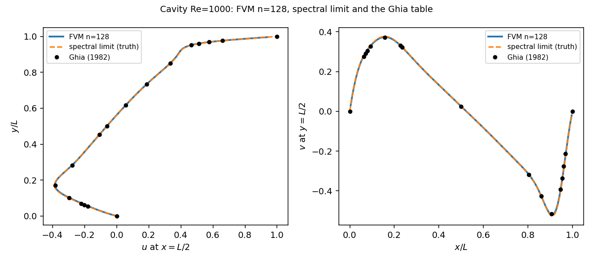
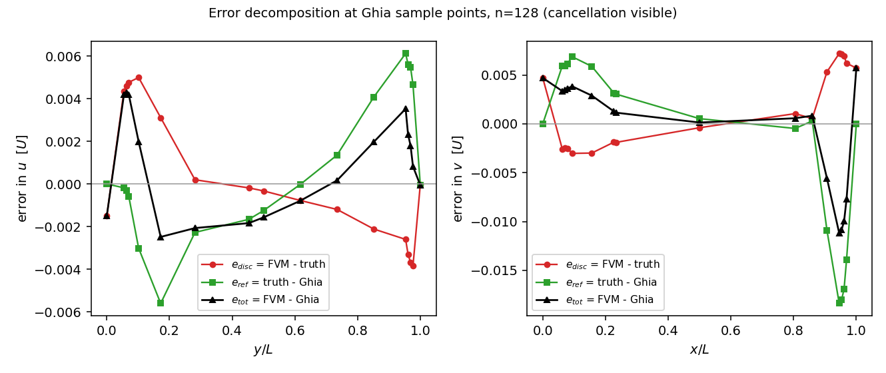
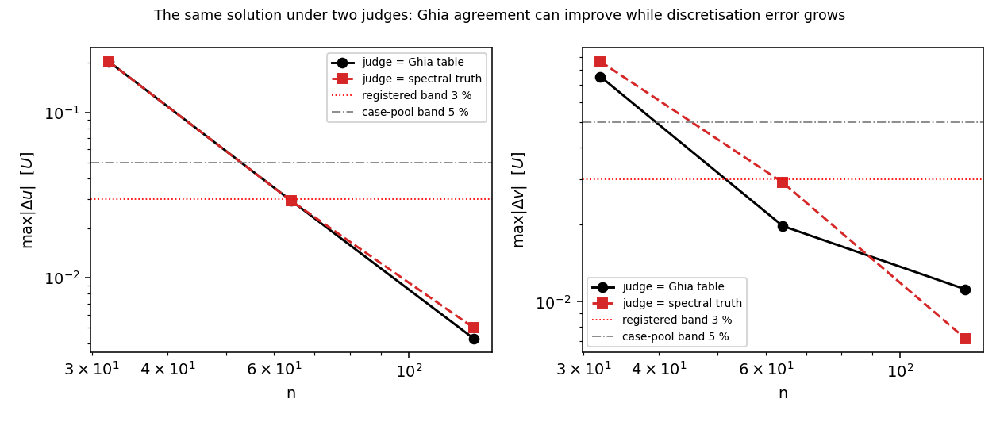

# CASE-FVM-CAVITY-RE1000 · 参考地板分解：把「与 Ghia 吻合」拆成离散误差 + 参考偏移

> 本文件全部数字由 `docs/CASE-FVM-CAVITY-RE1000/decompose_reference_floor.py` 从
> `runs/fields.npz`、`runs/spectral/*.json`（收敛谱极限）与 Ghia (1982) 表值注入，零手抄；
> 机检门 `tests/test_case_cavity_reference_floor.py`（11 项）从工件独立重算。

## ① 为什么做这件事（验证欠账）

锚点 `CASE-FVM-CAVITY-RE1000` 的验收量是**与 Ghia 表的吻合度**。`REPORT.md` 报
`max|Δv| = 0.0112 U`（n = 128），
而存档的**收敛**高阶解（Chebyshev 谱极限，`SPECTRAL.md`）与同一张表的偏移更大：
`0.0184 U`（v）。数值解不可能比真解更接近表值，
因此较小的那个数一定是两个**有符号误差相消**的结果：

```
e_total = f_FVM(n) − f_Ghia = (f_FVM(n) − f_truth) + (f_truth − f_Ghia)
                               \___ e_disc ___/    \___ e_ref ___/
```

本单把这条恒等式在两个中心线的每个 Ghia 采样点上逐点验证，并回答三个工程问题：
(a) 3 % 判据在「无参考」口径下是否仍成立？(b) 参考解自身吃掉了多少判据带宽？
(c) `REPORT.md` 里 n = 64 那一行 PASS 是否站得住？

## ② 怎么做的

* `f_FVM(n)`：`runs/fields.npz` 的收敛 MAC 场（n = 32/64/128），中心线 `x = L/2`、`y = L/2`；
* `f_truth`：谱解几何外推 `f_truth = f_64 + (f_64 − f_48)/(r − 1)`，
  `r = 3.923` 由谱解的 `wall_slip_defect` 实测比给出（不写死数字）；
  外推自身不确定度 `|f_64 − f_48|/(r − 1)`：`9.46e-04`（u）/ `2.85e-04`（v），即比它所测量的偏移小一个量级以上；
* 插值口径与验收门完全一致（`tensorfvm.lid_cavity.hermite_interpolate`），
  另以线性/夹紧规则做敏感性对照；
* 不重跑求解器：全部量从既有工件重算，因此本单只回答**度量**问题，不改任何解。

## ③ 结果

### 3.1 逐点分解（n = 128，Ghia 采样点，单位 U）

| 分量 | 判据带宽 | `max|e_tot|`（门报的数） | `max|e_disc|`（真离散误差） | `max|e_ref|`（参考自身偏移） | Ghia 口径是否低估真实误差 |
|---|---|---|---|---|---|
| u（x = L/2） | 0.03 | **0.00431** | **0.00500** | 0.00613 | 是（×1.16 低估） |
| v（y = L/2） | 0.03 | **0.01118** | **0.00720** | 0.01838 | 否（反而放大了 ×1.55） |

两个分量的符号相消方向相反：u 上 Ghia 口径**低估**真实离散误差（0.00431 vs 0.00500），v 上**放大**它（0.01118 vs 0.00720），因为 v 的参考偏移
（0.01838，位于 x ≈ 0.945 的强剪切处）与 v 的离散误差同号。

极值量（C3/C4 判据）的分解：

| 网格 n | u_min: 门口径 | u_min: 无参考口径 | v_max: 门口径 | v_max: 无参考口径 |
|---|---|---|---|---|
| 32 | 17.36 % | 18.55 % | 14.96 % | 16.29 % |
| 64 | 2.80 % | 4.20 % | 2.34 % | 3.86 % |
| 128 | 0.65 % | 0.80 % | 0.78 % | 0.79 % |

### 3.2 参考解吃掉了多少判据带宽

| 分量 | 参考偏移 / 3 % 登记带 | 参考偏移 / 5 % 算例池带 | 留给求解器的带宽（3 % 带） |
|---|---|---|---|
| u | 20.42 % | 12.25 % | 0.02387 U |
| v | 61.28 % | 36.77 % | 0.01162 U |

即：即使求解器**完全精确**，C2（v 中心线）也只能做到 0.0184 U，是 3 % 带宽的 61.28 %；这一条判据的上半段带宽本质上是**测量参考解**，不是测量求解器。

### 3.3 无参考口径下的收敛与 n = 64 那一行

| 网格 n | 内部公共网格 max|Δu| | 内部公共网格 max|Δv| | 观测阶（u / v） |
|---|---|---|---|
| 32 | 0.15983 | 0.08718 | 2.84 / 1.59 |
| 64 | 0.02227 | 0.02897 | 2.13 / 2.00 |
| 128 | 0.00509 | 0.00724 | — |

`REPORT.md` 把 n = 64 标为 PASS（u_min 2.80 % / v_max 2.34 %）。无参考口径下同一网格是 4.20 % / 3.86 %——**已越过 3 % 带**；v 剖面的真实误差 0.02915 U 已达阈值 0.03 的 97 %。
登记裁判行只在 n ≥ 128 判级，因此**验收结论不受影响**；但那行 PASS 只能读作诊断，不能读作「n = 64 已达 3 % 精度」。

## ④ 图



*图 D-1* n = 128 的 FVM 中心线、谱极限（真解）与 Ghia 采样点。



*图 D-2* Ghia 采样点上的逐点分解：`e_disc` 与 `e_ref` 符号反相（u 的 17 个点里只有 24 % 同号），`e_tot` 因此被压小或放大。



*图 D-3* 同一批解在两个裁判下的误差：Ghia 口径（黑）与无参考口径（红）。
两条线的差就是参考偏移的贡献；n = 64 处红线已在 3 % 带之外。

## ⑤ 注意点

* **本单不改解**：所有量从既有工件重算；「无参考口径」的真解是谱外推值，其自身
  不确定度（u 9.5e-04 / v 2.8e-04）比被测偏移小 6–80 倍，
  故所有 δ 级结论都稳；但外推用了「误差按壁滑移缺陷比几何衰减」这一假设，
  三阶谱求解（N = 96/128）在本机不划算，未做。
* **端点口径敏感性**：Ghia 表含两端壁点（u = 0/1、v = 0）。验收门的 Hermite 规则
  会外推一格到壁面，n = 128 时与「夹紧到最近内部样本」差 0.0587 U（u）/ 0.0263 U（v）。
  夹紧规则会把壁点读成最近内部样本（u = 0.9413），从而报出 0.059 U 的「误差」——
  这正说明壁点的值是靠外推锚到边界条件上的，不是求解器预测的。两个分量的最大值都落在
  **内部**采样点（u 在 y = 0.0625，v 在 x = 0.9453），所以判词不依赖端点规则；但复算者必须用同一口径。
* **参考偏移不是「Ghia 错了」**：谱解在 Re = 100 与 Re = 1000 上同向同量级偏离表值
  （见 `SPECTRAL.md` §3.3），本单只主张这 1.5 %–5 % 的偏移在**参考一侧**，
  且它决定了可达到的最小吻合度。

## ⑥ 误差判定（显式回答「是否 < 3 %」）

| 关键量 | 判据 | 门口径（Ghia） | 无参考口径（谱极限） | < 3 %？ |
|---|---|---|---|---|
| C1 u 中心线 | max|Δu| | 0.00431 | 0.00500 | **是**（两个口径都过）|
| C2 v 中心线 | max|Δv| | 0.01118 | 0.00720 | **是** |
| C3 u_min | 相对误差 | 0.65 % | 0.80 % | **是** |
| C4 v_max | 相对误差 | 0.78 % | 0.79 % | **是** |
| C3/C4（n = 64，仅诊断） | 相对误差 | 2.80 % / 2.34 % | 4.20 % / 3.86 % | **否**（无参考口径越带）|

**是否 < 3 %？** 判级网格 n = 128 在**两个裁判下都通过**：无参考口径的最严项是 C2 的 24 % 带宽（0.00720 U / 0.03 U），C1 只用掉 17 %。
n = 64 那一行在无参考口径下越带，已在 §3.3 明确。**验收结论（PASS）不变，但「0.43 % 精度」的说法应改读为「0.43 % 吻合、0.50 % 离散误差」。**

## 复算

```bash
PYTHONPATH=src python docs/CASE-FVM-CAVITY-RE1000/decompose_reference_floor.py   # ~5 s，写工件+图+本文
PYTHONPATH=src python -m pytest tests/test_case_cavity_reference_floor.py -q        # 11 passed
```
