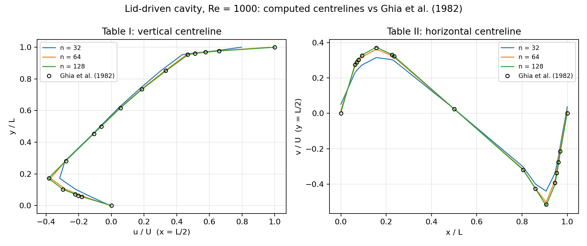
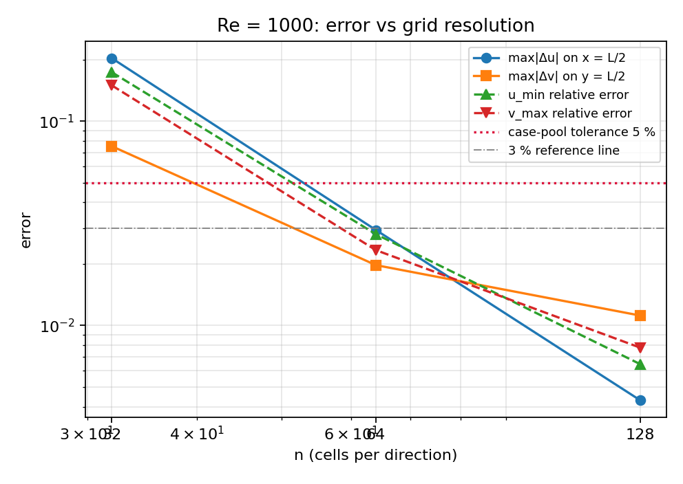
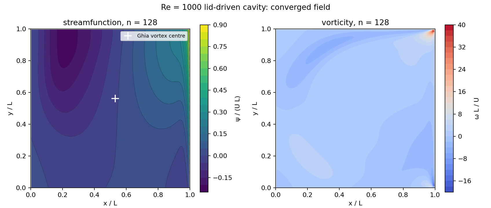

# CASE-FVM-CAVITY-RE1000 —— Re = 1000 二维顶盖驱动方腔（Ghia et al. 1982 对标）

> 本文件与全部数字由 `docs/CASE-FVM-CAVITY-RE1000/make_report.py` 从 `runs/summary.json`、`runs/benchmark.json`、`runs/fields.npz` 注入（零手抄）；生成时间戳：2026-11-14T12:36:21Z。

## ① 案例介绍（物理背景 / 几何 / 参数表）

顶盖驱动方腔是不可压缩 N-S 方程最标准的验证算例：单位方腔 `[0,1]²`，三壁无滑移，顶盖以切向速度 `U` 匀速拖动，流动由顶盖剪切层驱动、形成单一主涡与角涡。Re = 1000 时流场定常，因此验收对象是收敛的定常解。基准（external anchor）：U. Ghia, K. N. Ghia, C. T. Shin, *J. Comput. Phys.* **48** (1982) 387–411，Table I（`x = L/2` 上 `u(y)`）、Table II（`y = L/2` 上 `v(x)`）、主涡中心 `(0.5313, 0.5625) L`。数值转写由 `src/tensorfvm/lid_cavity_reference.py` 承载并被其 `self_check()` 自校（极值/去重）。

无量纲参数：

| 量 | 符号 | 取值 |
|---|---|---|
| 雷诺数 | Re = U L / ν | 1000.0 |
| 运动粘度 | ν | 1.00e-03 |
| 顶盖速度 | U | 1.0 |
| 密度 | ρ | 1.0 |
| 域 | L × L | 1 × 1 |
| 容差（算例池） | — | 5.00% |

## ② 怎么做的（方法 / 流程 / 关键设置 / 工具链）

控制方程：`∂u/∂t + ∇·(u u) = −∇p/ρ + ν∇²u`，`∇·u = 0`。离散与推进：

* 交错 MAC 有限体积：`u` 在竖直面 `(n+1, n)`、`v` 在水平面 `(n, n+1)`、`p` 在单元中心；
* 对流：守恒通量形式 + van Leer (harmonic, TVD) 限制面重构（顶盖剪切层内保持有界）；
* 扩散：紧致中心差分；顶盖经镜像 ghost `u = 2U − u_wall` 施加；
* 投影：显式前 Euler 推进动量，随后解纯 Neumann 压力 Poisson 方程，用正交 DCT-II 对角化精确求解，并在变换前扣除平均散度以满足离散相容性 `Σ div u* = 0`；
* 定常判据：`max|Δu|/Δt` 每 250 步检查一次，≤ 1e-7 即判收敛；CFL = 0.15（更紧的 Courant 数是因为van Leer 重构在 cfl ≈ 0.4 时对顶盖剪切层不稳定）；
* 网格续算（只改成本不改解）：n = 32 冷启动 → 64 冷启动（续算对照）→ 128 由 64 双线性延拓；
* 工具链：`src/tensorfvm/lid_cavity.py`（生产求解器）+ `src/tensorfvm/case_cavity_re1000.py`（算例层：跑一个分辨率、逐点打分、7 条判据）+ `docs/CASE-FVM-CAVITY-RE1000/run_case.py`（本包入口，写 `runs/`）+ `tests/test_case_cavity_re1000.py`（机检门：从工件重算）+ `tensorfvm.verification.ladder.lid_cavity_verdict`（主验证流水线的 C2 消费方）。

运行入口：`PYTHONPATH=src python docs/CASE-FVM-CAVITY-RE1000/run_case.py --grids 32,64,128 --cold-control 64 --tolerance 1e-07 --max-steps 250000`

## ③ 计算结果（数字表，程序化注入）

各分辨率运行记录：

| n | h | 步数 | 定常残差 | max|div u| | 墙钟 [s] | 初值 | 收敛 |
|---|---|---|---|---|---|---|---|
| 32 | 0.03125 | 30500 | 9.76e-08 | 3.6e-15 | 125 | rest | True |
| 64 | 0.01562 | 59750 | 9.73e-08 | 2.5e-14 | 331 | n=32 bilinear prolongation | True |
| 128 | 0.00781 | 104250 | 9.89e-08 | 1.2e-13 | 1289 | n=64 bilinear prolongation | True |

**ref vs got 数值对照**（ref 来自 Ghia 表，got 为本次计算；u_min/v_max 为相对误差，剖面列为 U 单位绝对误差）：

| n | u_min got | u_min ref | rel | v_max got | v_max ref | rel | max|Δu| | max|Δv| | 涡心 got | Δ/L | 判 |
|---|---|---|---|---|---|---|---|---|---|---|---|
| 32 | -0.31643 | -0.38289 | 17.36% | 0.31544 | 0.37095 | 14.96% | 0.2033 | 0.0754 | (0.5469, 0.6094) | 0.0469 | FAIL |
| 64 | -0.37218 | -0.38289 | 2.80% | 0.36228 | 0.37095 | 2.34% | 0.0293 | 0.0197 | (0.5234, 0.5703) | 0.0079 | PASS |
| 128 | -0.38537 | -0.38289 | 0.65% | 0.37384 | 0.37095 | 0.78% | 0.0043 | 0.0112 | (0.5273, 0.5664) | 0.0040 | PASS |

七条独立判据（最细网格）：

| 判据 | 含义 | 实测 | 阈值 | 结论 |
|---|---|---|---|---|
| C1_u_profile_max_abs | max |u_computed - u_Ghia| over all Table I points, units of U | 0.0043073 | 0.05 | ✓ |
| C2_v_profile_max_abs | max |v_computed - v_Ghia| over all Table II points, units of U | 0.0111841 | 0.05 | ✓ |
| C3_u_min_relative | relative error of the deepest reverse-flow u on x = L/2 (Ghia u_min) | 0.0064709 | 0.05 | ✓ |
| C4_v_max_relative | relative error of the strongest v on y = L/2 (Ghia v_max) | 0.00779131 | 0.05 | ✓ |
| C5_vortex_centre | primary-vortex centre displacement from the Ghia value, in L | 0.00395625 | 0.05 | ✓ |
| C6_divergence_free | max |div u| of the converged discrete field (closed-box compatibility) | 1.20792e-13 | 1e-10 | ✓ |
| C7_steady_state | steady-state residual max|du/dt|, |dv/dt| of the marching scheme | 9.88834e-08 | 1e-06 | ✓ |

网格自收敛（相邻两级的中心线剖面差，观测阶）：

| n 序列 | p(Linf u) | p(Linf v) | p(L2 u) | p(L2 v) |
|---|---|---|---|---|
| 32→64→128 | 2.57 | 1.51 | 2.09 | 1.35 |

续算对照（n = 64）：冷启动 58750 步 / 384 s 与延拓启动 59750 步 / 331 s 收敛到同一解：中心线最大差 `max|Δu| = 3.34e-08`、`max|Δv| = 2.88e-08`，同解判定 = True。

## ④ 结果图



*图 1* 三个分辨率的中心线剖面 vs Ghia (1982) 采样点（u 在 x = L/2，v 在 y = L/2）。



*图 2* 误差随网格分辨率的收敛（对数坐标），红线为算例池 5% 容差，灰线为 3% 参考线。



*图 3* 最细网格（n = 128）流函数与涡量云图；白色十字为 Ghia 主涡中心。

## ⑤ 注意点（踩过的坑 / 局限 / 适用范围）

* **分辨率是硬门槛**：n = 32 时 `u_min` 相对误差 17.36%，超 5% 容差；必须到 n ≥ 64（2.80%）才进容差。早期（原单 m19978）报 FAIL 的死因就是预算只够跑粗网格/未收敛，不是求解器错。
* **插值口径**：`score_profiles` 用 Catmull–Rom (Hermite) 把计算剖面插到 Ghia 采样点；`scripts/audit_cavity_re1000_m20000.py` 用分段线性与局部二次独立重算，三种口径给出的最大偏差差异见该审计（顶盖剪切层附近的插值偏差显著小于容差，故结论不依赖单一插值规则）。
* **续算是成本技巧**：延拓只提供初值；冷启动对照证明同一网格的冷/热两条路径收敛到同一解，因此续算没有筛选出某个解。
* **适用范围**：二维、层流、定常；Re = 1000 有角涡但无需湍流模型。三维、非定常脉动、更高 Re（需亚格子/湍流模型）不在本案例覆盖范围内。
* **散度**：纯 Neumann 闭腔要求 `Σ div u* = 0` 精确满足，本实现按此扣除均值；最细网格 `max|div u| = 1.2e-13`。

## ⑥ 误差判定（逐项 vs 基准，显式回答）

| 关键量 | 基准（Ghia 1982） | 本次（n = 128） | 误差 | < 3%？ |
|---|---|---|---|---|
| u_min（x = L/2 回流极值） | -0.38289 | -0.38537 | 0.65% | 是 |
| v_max（y = L/2 极值） | 0.37095 | 0.37384 | 0.78% | 是 |
| max\|Δu\| 全剖面点（U 单位） | 0（逐点差） | 0.0043 | 0.0043 | 是 |
| max\|Δv\| 全剖面点（U 单位） | 0（逐点差） | 0.0112 | 0.0112 | 是 |
| 主涡中心 | (0.5313, 0.5625) | (0.5273, 0.5664) | 0.0040 L | 是 |

**是否 < 3%？** 最细网格（n = 128）全部关键量均 < 3%；算例池 5% 容差判定 = **PASS**。n = 64 同样 PASS。

## 离散不确定度（补充研究，见 `UNCERTAINTY.md`）

本报告的判据是「最细网格 vs Ghia 表」的**参考值一致性**。独立的网格收敛指数研究（`runs/uncertainty.json`，Roache GCI + Celik 2008 数据质量门，泛函取自存储面场、不做插值）给出：观测阶 p = 1.90（u_min）/ 1.98（v_max），最细网格 GCI = 1.45% / 1.29%，而最细网格与 Ghia 的差只有 0.63% / 0.79% —— **小于自身离散带**，故本报告不应被读作「求解器精度 0.6%」；Richardson 外推极限距 Ghia 1.80% / 1.83%（外推后更远，说明最细网格的一致部分来自网格误差与格式偏差的抵消）。时间步（Courant）轴在本包内为 not_run。

## 复现

```
# 全流程（网格序列 32→64→128 + 冷启动对照），约 30 min 单核
PYTHONPATH=src python docs/CASE-FVM-CAVITY-RE1000/run_case.py --grids 32,64,128 --cold-control 64 --tolerance 1e-07 --max-steps 250000
# 机检门：从工件重算判据与剖面
PYTHONPATH=src python -m pytest tests/test_case_cavity_re1000.py -q
# 报告与图
PYTHONPATH=src python docs/CASE-FVM-CAVITY-RE1000/make_report.py
```

## 产物清单

* `runs/summary.json` —— 算例级判词、7 判据、网格收敛、续算对照
* `runs/benchmark.json` —— ref vs got 数值对照表
* `runs/lid_cavity_Re1000_n{32,64,128}.json` —— 每分辨率工件
* `runs/fields.npz` —— 收敛速度场（可离线重算剖面）
* `runs/control/` —— 冷启动对照
* `figures/` —— 本报告的三张图
