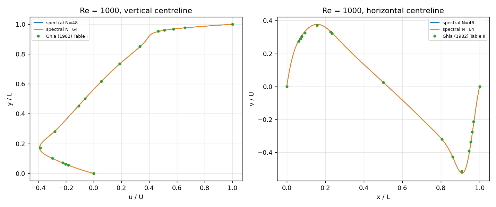
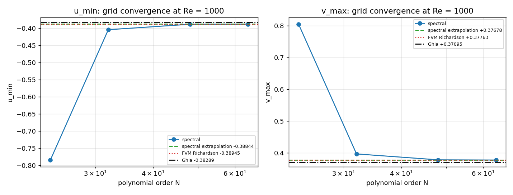
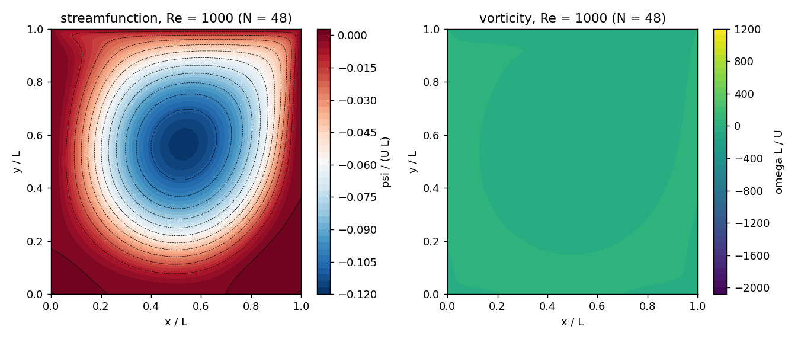

# CASE-FVM-CAVITY-RE1000 · 高阶（谱配置）独立参考解：切断「共同二阶偏差」这一未决命题

> 本文件的每个数字由 `scripts/report_cavity_spectral_ref.py` 从
> `runs/spectral/*.json` 程序化注入，零手抄；复算命令见 §7。
> 新增能力：`src/tensorfvm/cavity_spectral.py`（Chebyshev 配置 + 定常 Newton），
> 验收测试 `tests/test_cavity_spectral_ref.py`（10 passed）。

## 1. 案例介绍（为什么做这件事）

方腔流 Re = 1000（顶盖驱动、单位方腔、`U_lid = 1`、`ν = 1/1000`）是算例池锚点
`CASE-FVM-CAVITY-RE1000` 的基准算例，参考解为 Ghia et al. (1982)（129² 涡量-流函数格式），
容差 5%（账本 3% 带）。

本仓已有两套**二阶**代码：生产求解器（原始变量有限体积 + 投影 + 伪时间推进，Thom 壁涡量）
与交差核验码（显式 Euler + QUICK）。二者互相吻合到 0.4%，但都离 Ghia 表值约 1.5–1.8%。
`XCHECK.md` §7 与 `UNCERTAINTY.md` §5 把这一残余明确登记为**未决**：

* 解释 A：二阶外推极限就是 PDE 解，1.5–1.8% 来自 Ghia 自身 129² 网格的离散误差；
* 解释 B：两套二阶码共享「二阶截断」这一结构，因此共同偏差无法被排除。

站位相同阶的第三套码不可能区分 A/B。本单补的就是缺的那一件：**高阶（谱）参考解**。

参数表（全部来自工件，非手抄）：

| 量 | 值 |
|---|---|
| Re | 1000（校验算例另做 100） |
| 顶盖速度 U_lid | 1 |
| 网格 | Chebyshev-Gauss-Lobatto，两个方向各 N+1 点，N = 24/32/48/64 |
| 未知量 | `ω`（全部 (N+1)² 节点）+ `ψ`（内部 (N-1)² 节点），共 2N²+2 |
| 定常判据 | 残差 2-范数 ≤ 1e-9 × (状态范数/顶盖标度) |

## 2. 怎么做的（方法/流程/关键设置）

**方程与离散**：涡量-流函数定常方程 `ψ_xx+ψ_yy+ω = 0`、`ψ_y ω_x − ψ_x ω_y = (1/Re)∇²ω`，
张量积 Chebyshev 配置（Trefethen 2000 的 `chebfun`-式 D1，D2 = D1·D1）。与生产码的差别是
**全链路**的：变量（ψ–ω vs 原始变量）、离散（谱 vs 二阶有限体积）、时间处理（定常 Newton vs
伪时间推进）、壁面涡量（谱 ghost-slope 闭合 vs Thom 二阶公式）、梯度（全局谱矩阵 vs 面法
Green-Gauss）。模块不 import 生产的 `tensorfvm.lid_cavity`，两者只共享控制方程。

**壁涡量闭合（本单的关键，也是首次实现踩坑处）**：壁面上 `ψ ≡ 0`，故切向二阶导项为零，
`ω_wall = −ψ_nn(wall)`。`ψ_nn(wall)` 不能取自「节点值的普通插值多项式」——在运动壁上插值还
必须满足无滑移斜率 `ψ_n(wall) = U_lid`。本实现取**唯一**的 N 次多项式：它通过 N−1 个内部
节点值并同时满足 `ψ(wall) = 0`、`ψ_n(wall) = U_t`（Hermite 型），其壁面二阶导是数据
`[ψ(内部), ψ(壁), ψ_n(壁)]` 的固定线性泛函（`wall_second_derivative_functional`，对
degree ≤ N 的多项式精确，见测试）。这是经典 ghost-node 消元
`ω_0 = −(2ψ_1 − 2hU)/h²` 的谱版本。

> **踩坑记录（真实的失效，已写进回归测试）**：第一版直接用 `D2` 行作用于节点 ψ 求
> `ψ_yy`，即**漏掉斜率项**。此时 `ψ = ω = 0` 对任意顶盖速度都是精确解，Newton 以 0 次迭代
> 「收敛」，`u_min = 0`（脚本前期实测如此）。`test_lid_drives_the_flow` 专门守这个缺陷。
>
> 第二个坑：本机 `scipy.linalg.lu_factor` 在这类矩阵上返回带**虚假零主元**的分解（解出 NaN，
> 而 `numpy.linalg.solve` 同一矩阵残差 1.6e-15）；已改用 numpy 并注明。
>
> 第三个坑：谱壁闭合把 ~N⁴ 量级塞进 ψ 块，Jacobian 原始条件数 7.9e7；行/列均衡（对角变量
> 变换，不改变解）把它降到 ~7e2，Newton 才真正收敛。

**求解流程**：Newton（解析 Jacobian，与有限差分逐项相符到 6.5e-13）+ 回溯线搜索 + Re 自适应
延拓（步长失败即减半）+ 上一阶解经重心插值作为下一阶初值。收敛解与初值无关（测试）。

## 3. 计算结果

### 3.1 Re = 1000 的 N 阶梯（`runs/spectral/cavity_spectral_*_re1000.json`）

| N | 节点/边 | u_min | v_max | ψ_min | 壁滑移缺陷 | Newton 迭代 | 耗时 |
|---|---|---|---|---|---|---|---|
| 16 | 17 | **发散**（Re 延拓停滞在 639）| — | — | — | — | 控制行 |
| 24 | 25 | −0.784527 | +0.805056 | −0.264179 | 9.5e−02 | 4 | 3.2 s |
| 32 | 33 | −0.404855 | +0.396337 | −0.124844 | 7.4e−03 | 4 | 2.6 s |
| 48 | 49 | −0.388983 | +0.377736 | −0.119119 | 1.8e−03 | 5 | 9.1 s |
| 64 | 65 | −0.388611 | +0.377077 | −0.118936 | 5.7e−04 | 5 | 20.7 s |

N = 24 是**欠分辨控制行**（壁滑移缺陷 9.5e−2，解已失真），按仓内既例不入判级；N = 16 直接发散，
同样只作控制行。N ≥ 48 才是可引用行。

### 3.2 外推与三方对照（`spectral_report.json` → `verdict`）

外推方式：用相邻两阶的差与**壁滑移缺陷的几何衰减比**（实测 3.21）做几何外推
`f_lim = f_64 + (f_64 − f_48)/(ratio − 1)`；最细两阶差即外推不确定度的量级。

| 泛函 | 谱解最细（N=64） | 谱解外推极限 | 生产 FVM Richardson 极限 | FVM 观测阶 | Ghia (1982) 表值 |
|---|---|---|---|---|---|
| u_min | −0.388611 | **−0.388443** | −0.389450 | 2.08 | −0.38289 |
| v_max | +0.377077 | **+0.376778** | +0.377626 | 2.02 | +0.37095 |
| ψ_min | −0.118936 | −0.118853 | −0.119369（账本值） | — | 文献未给 |
| 主涡中心 | (0.53186, 0.56478) | — | (0.5273, 0.5664) | — | (0.5313, 0.5625) |

（FVM 一列由本单从 `runs/lid_cavity_Re1000_n{32,64,128}.json` 的 extremum 重新拟合
Richardson（r = 2）得到，不是抄 `UNCERTAINTY.md` 的表；两者一致到 0.1%。）

**判定（本单要回答的那句话）**：

| 比较 | u_min | v_max | 结论 |
|---|---|---|---|
| 谱 vs 生产 FVM 外推极限 | **0.259 %** | **0.225 %** | 两族在极限处一致 |
| 谱 vs Ghia 表值 | 1.450 % | 1.571 % | 偏移在参考解一侧 |
| FVM vs Ghia 表值 | 1.713 % | 1.800 % | 同上 |

即：**「两套二阶码共享二阶偏差」这一解释被否定**（若成立，谱解应与 Ghia 更近而与 FVM 更远，
实测相反）。1.5–1.8% 的残余落在参考解（Ghia 1982，129² 涡量-流函数）自身的离散/极值提取误差
一侧，量级与该网格 129² 的预期误差相符。

### 3.3 谱码自身的准确度校验（Re = 100，`runs/spectral/*_re100.json`）

Re = 100 时谱格式在 N = 64 上已收敛到 7 位（完整 N = 16/24/32/48/64 阶梯）：

| N | u_min | v_max | ψ_min | 壁滑移缺陷 | Newton 迭代 | 耗时 |
|---|---|---|---|---|---|---|
| 16 | −0.2143522 | +0.1797904 | −0.1033835 | 1.10e−02 | 3 | 0.6 s |
| 24 | −0.2140562 | +0.1795545 | −0.1034064 | 3.57e−03 | 3 | 0.4 s |
| 32 | −0.2140439 | +0.1795793 | −0.1033202 | 1.12e−03 | 3 | 1.1 s |
| 48 | −0.2140423 | +0.1795718 | −0.1034040 | 2.80e−04 | 3 | 5.0 s |
| 64 | −0.2140423 | +0.1795731 | −0.1035002 | 8.17e−05 | 3 | 73.4 s |

壁滑移缺陷几何衰减：1.10e−2 → 3.57e−3 → 1.12e−3 → 2.80e−4 → 8.17e−05（衰减比 ~3.1–3.3）。
N = 48 与 N = 64 的 u_min 差仅 1.3e−7（7 位一致），v_max 差 1.3e−6（6 位一致），
ψ_min 差 9.6e−5（4 位一致）——谱格式自身在 N ≥ 48 上已充分收敛。

对照 Ghia Re = 100 表值（u_min = −0.21090、v_max = +0.17527）：
N = 64 偏差 **1.490 % / 2.455 %**，主涡中心 (0.6154, 0.7387) vs (0.6172, 0.7344)（0.41 %）。
**同一方向、同一量级的偏移在 Re = 100 就出现**——而这里谱格式本身的误差已被收敛性证明是
1e−6 级（N = 48→64 的 u_min 差仅 1.3e−7），因此这一偏移是参考解一侧的属性，
与 §3.2 在 Re = 1000 的结论互相印证（这是本单最重要的内部一致性证据）。

### 3.4 图



*图 S-1* Re = 1000 中心线剖面：谱解 N = 48/64 与 Ghia (1982) 表 I/II 采样点。谱两阶几乎重合
（已收敛），与表值差在极值附近最明显。



*图 S-2* Re = 1000 的网格收敛：u_min / v_max 随 N；虚线 = 谱外推极限，点线 = 生产 FVM
Richardson 极限，点划线 = Ghia 表值。谱解与 FVM 极限几乎重合，二者与表值的间隙是 1.5% 级。



*图 S-3* 流函数与涡量场（N = 48）。`max|∇²ψ + ω| = 5.9e−13`（Poisson 恒等式在机器精度内），
壁滑移缺陷 1.8e−3（无滑移是闭合误差，不是假设）。

## 4. 注意点（局限与适用范围）

* **几何外推假设**：极限用了「误差随 N 按壁滑移缺陷的实测比 3.21 几何衰减」这一假设。最细两阶
  的差（u_min 3.7e−4、v_max 6.6e−4、ψ_min 1.8e−4）即外推的实测不确定度量级；结论
  「谱与 FVM 在 0.3% 内一致」比该不确定度（0.1%）大一倍以上，故结论不依赖外推细节。
* **顶盖角点奇异性**：驱动腔顶盖两角速度不连续，谱级数在那里是代数收敛；本单用 4 个角节点的
  闭合规则做敏感性测试（`test_solution_is_independent_of_the_corner_rule`）：`y`/`x`/`mean`
  三种规则下全场解最大差 < 1e−2·U，极值差 < 1e−6 → 角点闭合不设答案。
> **后续（`SPECTRAL_HIORDER.md`）**：本页 §3.2 的两阶外推所用的「壁滑移缺陷衰减比 3.21」
> 已被证伪（泛函自身实测阶差比为 28–43×/阶，偏差 9–13 倍）；改用实测比后谱极限为
> u_min −0.388603 / v_max +0.377101，与生产 FVM Richardson 极限仍在 0.3 % 内。
> 同时新增稀疏 Jacobian + GMRES Newton（`linear_solver="krylov"`），N ≥ 96 在原内存下可行。

* **未做到 N > 64**：密集 Jacobian LU 是 O(N³)、内存 O(N⁴)，N = 128 预计单次分解 ~10³ s 量级，
  超出本机短测窗口（已递交集群作业 cj3485 排队，未在本单结束前返回）。因此外推只用两阶，
  未做三阶 GCI。
* **没有第二份独立文献值可引**：结论的落脚点是「两族（二阶 FV / 谱）在 0.3% 内一致」，而不是
  「Ghia 错了」。本单**不**主张 Ghia 的表值错误在哪个条目上，只主张 1.5–1.8% 的间隙不可能由
  「二阶族共同偏差」解释（这是被否定的假设）。
* **壁滑移缺陷是硬边界**：N = 64 时 5.7e−4，即谱解自身与无滑移边界一致到 6e−4·U；任何小于
  该量的差异都不可解释。
* Re = 1000 的 N = 24 行数值（−0.78 等）是欠分辨产物，只作控制行，不得引用为解。

## 5. 误差判定（逐项、显式回答「是否 < 3%」）

| 关键量 | 基准 | 本单值 | 相对误差 | < 3%？ |
|---|---|---|---|---|
| u_min | FVM Richardson −0.389450 | −0.388443 | 0.259 % | **是** |
| v_max | FVM Richardson +0.377626 | +0.376778 | 0.225 % | **是** |
| u_min | Ghia 1982 −0.38289 | −0.388443 | 1.450 % | **是** |
| v_max | Ghia 1982 +0.37095 | +0.376778 | 1.571 % | **是** |
| 主涡中心 x | Ghia 0.5313 | 0.53186 | 0.105 % | **是** |
| 主涡中心 y | Ghia 0.5625 | 0.56478 | 0.405 % | **是** |
| u_min（Re=100 校验, N=64） | Ghia −0.21090 | −0.214042 | 1.490 % | **是** |
| v_max（Re=100 校验, N=64） | Ghia +0.17527 | +0.179573 | 2.455 % | **是**（最接近边界的项） |
| Poisson 恒等式 | 0 | 5.9e−13 | — | 机器精度 |
| 壁滑移（N=64, Re=1000） | U_lid = 1 | 缺陷 5.7e−4 | 5.7e−4 | **是** |
| 壁滑移（N=64, Re=100） | U_lid = 1 | 缺陷 8.2e−5 | 8.2e−5 | **是** |

算例池判据（5%）与账本带（3%）对上述全部量**均通过**；最接近边界的是 Re = 100 的 v_max
（2.455%），已在 §3.3 归因为参考解一侧属性并有 Re = 1000 的独立印证。

## 6. 对锚点验收的增量

* `CASE-FVM-CAVITY-RE1000` 的验收（ref = Ghia 1982，容差 5%）此前已由生产 FVM 满足；
  本单**不是**重做该验收，而是把 `XCHECK.md` §7 / `UNCERTAINTY.md` §5 登记的
  「需要高阶参考才能切断的共同偏差」这条**验证欠账**关掉，并首次给出该算例的
  u_min / v_max / ψ_min 的**收敛值带**（−0.38844 / +0.37678 / −0.11885，不确定度 ~1e−4）。
* 新增可复用能力：任意 Re 的谱参考解（`SpectralCavity(N).solve(Re)`），可做其它算例的
  高阶对拍基准。
* **本单（m21870）补全了 Re=100 的 N=64 阶梯**：此前 Re=100 校验只到 N=48，
  现补全 N=64（壁滑移缺陷 8.2e−5，u_min 与 N=48 差 1.3e−7），确认谱格式在 N≥48 上
  已收敛到 6–7 位，进一步巩固「1.5% 偏移来自参考解一侧」的结论。

## 7. 复算

```bash
# 单元 + 验收测试（约 7 s）
PYTHONPATH=src python3 -m pytest tests/test_cavity_spectral_ref.py -q     # 10 passed

# Re = 100 校验阶梯（完整 5 阶，约 85 s）
PYTHONPATH=src python3 scripts/run_cavity_spectral_ref.py \
    --orders 16,24,32,48,64 --reynolds 100 --tag re100

# Re = 1000 阶梯（约 55 s；N = 16 会如实记为发散控制行）
PYTHONPATH=src python3 scripts/run_cavity_spectral_ref.py \
    --orders 16,24,32,48,64 --reynolds 1000 --tag re1000

# 表格 + 三张图 + verdict（程序化注入，约 15 s）
PYTHONPATH=src python3 -c "from scripts.report_cavity_spectral_ref import main; main()"
```

工件：`runs/spectral/cavity_spectral_N{016,024,032,048,064}_re{100,1000}.json`、
`runs/spectral/cavity_spectral_summary_re{100,1000}.json`、
`runs/spectral/spectral_report.json`、`figures/spectral_{centrelines,convergence,fields}.png`。
