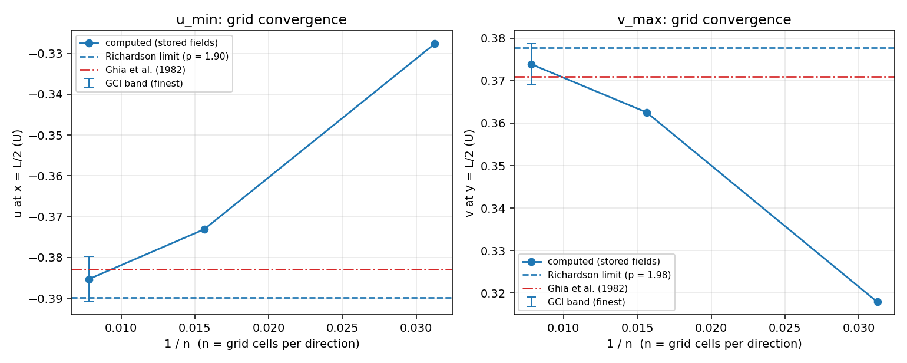

# CASE-FVM-CAVITY-RE1000 · discretisation-uncertainty study

> 本文件由 `uncertainty.py` 从 `runs/` 工件程序化生成（数字零手抄）；复算入口见文末。

## 1. 为什么要做这件事

算例门（`case_cavity_re1000.py` 的 C1–C7）判的是「最细网格与 Ghia 表的差」——这是**参考值一致性**。它不能回答「最细网格的解离 PDE 精确解有多远」，因为（i）网格误差与「格式-参考值」偏差可能相互抵消，使最细网格看起来比它自己的离散误差还准；（ii）参考值（Ghia 1982, 129²）本身有不确定度。本节用求解器**自己的网格序列**给出第二个答案（Roache GCI，Celik 2008 数据质量检查），并沿时间步轴做同样口径的检查。

## 2. 方法与设置

* 泛函（grid-independent，全部**从存储的面场直接算出**，`functionals_from_fields`）：`u_min`（x=L/2 面上最负流向速度）、`v_max`（y=L/2 面上最大横向速度）、`psi_min`（流函数极小，主涡强度）、`kinetic`（动能）；偶数 n 时基准截线恰好落在面上，**不做任何插值**——这与算例门的逐点判据（Hermite 插值到 Ghia 采样点）是互补口径。
* 网格序列：n = 32, 64, 128（32/64/128 来自算例包，n = 192 由 `refine_from_stored.py` 从存储 n=128 场双线性延拓后续算，仅提供初值）。
* 估计量：非均匀加密比下的 Celik et al. (2008) 观测阶迭代式；Richardson 外推 `f_ext = f_3 + (f_3-f_2)/(r^p-1)`；安全因子 Fs = 1.25；GCI_fine = Fs·|(f_3-f_2)/f_3|/(r^p-1)。
* 数据质量门：序列非单调或观测阶越界（<0.5 或 >4）时**拒绝给 GCI**，不做算术平均粉饰。

## 3. 结果：空间离散不确定度

| 泛函 | 观测阶 p | 序列数值 | 外推极限 | GCI(最细) | 最细 vs Ghia | 外推 vs Ghia | 参考偏差在 GCI 带内？ |
|---|---|---|---|---|---|---|---|
| u_min | 1.90 | -0.327616, -0.373096, -0.385304 | -0.389784 | +1.453% | -0.630% | -1.800% | 是 |
| v_max | 1.98 | 0.317901, 0.362526, 0.373867 | 0.37773 | +1.292% | +0.786% | +1.828% | 是 |
| psi_min | 2.33 | -0.11086, -0.117958, -0.119369 | -0.119719 | +0.367% | 无参考值 | 无参考值 | 无参考值 |
| kinetic | 1.71 | 0.0344643, 0.0416097, 0.043799 | 0.044766 | +2.760% | 无参考值 | 无参考值 | 无参考值 |



*图 UQ-1* 泛函随 1/n 的收敛（圆点=存储场实算，蓝虚线=Richardson 极限，误差棒=最细网格 GCI，红线=Ghia 1982 表值）。

### 3.1 这张表怎么读（显式结论）

* 观测阶 p = 1.90（u_min）/ 1.98（v_max），与二阶格式一致 → 序列确实处在渐近区，GCI 可用。
* 最细网格（n = 128）与 Ghia 的差为 -0.630% / +0.786%，**小于**该网格自身的离散带 +1.453% / +1.292%。因此「0.6% 精度」这种说法不成立；可支持的表述是「最细网格的参考偏差落在自身离散不确定度带内」。
* Richardson 外推极限 u_min = -0.38978、v_max = 0.37773，距 Ghia 表值 -1.800% / +1.828%。**外推极限比最细网格离参考值更远**——说明 n=128 上那 0.6% 的一致性部分来自网格误差与格式偏差的抵消，不是格式精度更高。
* 外推极限仍在算例池 5% 与账本 3% 带内，故算例门的 PASS 判定不受影响；受影响的只是「精度」的叙述口径。

## 4. 结果：时间步（Courant 数）敏感度

**未执行（not_run，不记 pass）**：not_run: no same-grid/different-Courant artefacts under runs/dt at generation time。时间步无关性在本包内没有证据，不作任何结论。

## 5. 注意点与局限

* **只有 3–4 个网格、至多 2 个加密区间**：GCI 的数据质量门只能检查单调性与观测阶是否落在可信区间，无法证明「已进入渐近区」。观测阶在 u_min/v_max 上稳定在 ~1.9–2.0，但在逐点剖面差范数上给出 2.57/1.51（`summary.json` 的 convergence 段）——不同泛函收敛速率不同，这一点如实保留。
* **外推极限不是真值**：它只是该格式族在 h→0 的极限；与 Ghia 的差可以是格式差异，也可以是 Ghia 129² 网格自身的不确定度。要判定需要第二个独立高精度参考（如谱方法文献），本仓库内**没有**已核对的第二来源，故不下结论（记入待办）。
* **逐点判据的插值敏感性**（审计 m20230 F5）：粗网格上 max|Δu| 随插值方案变化可达 ×2.5；本节用面值泛函回避了这个问题，两者不能混引。
* **时间步（Courant 数）轴**：只有存在同网格、不同 CFL 的工件时才给结论；缺失时记为 not_run，不记 pass。
## 6. 复算

```
# 网格序列（已有工件，无需重跑求解器）
PYTHONPATH=src python docs/CASE-FVM-CAVITY-RE1000/uncertainty.py
# n=192 加密（从存储 n=128 场延拓，可选）
PYTHONPATH=src python docs/CASE-FVM-CAVITY-RE1000/refine_from_stored.py --from-n 128 --n 192
# CFL 敏感度（同网格、不同 dt）
PYTHONPATH=src python scripts/case_cavity_re1000.py --n 128 --cfl 0.075 --out-dir docs/CASE-FVM-CAVITY-RE1000/runs/dt/cfl0075
PYTHONPATH=src python scripts/case_cavity_re1000.py --n 128 --cfl 0.300 --out-dir docs/CASE-FVM-CAVITY-RE1000/runs/dt/cfl0300
# 机检门
PYTHONPATH=src python -m pytest tests/test_case_cavity_uncertainty.py -q
```
