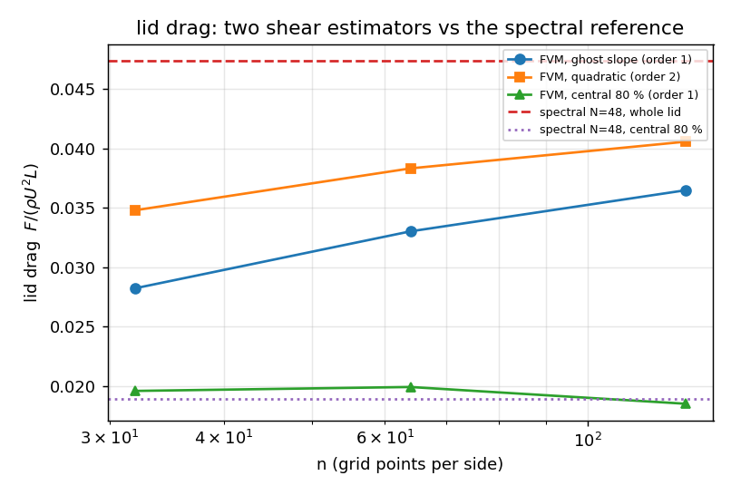
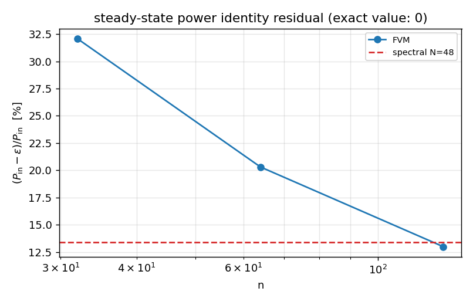
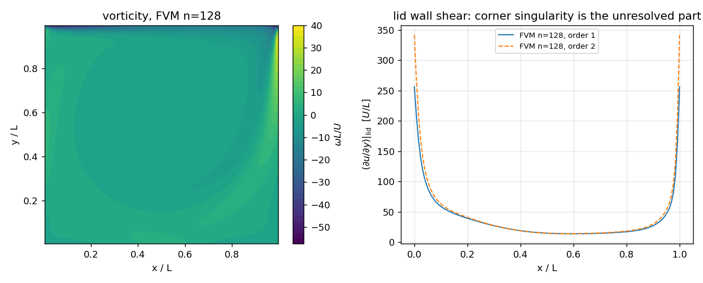

# CASE-FVM-CAVITY-RE1000 · 壁面剪切/阻力与全局功率恒等式审计（验证欠账）

> 本文件由 `docs/CASE-FVM-CAVITY-RE1000/wall_shear_budget.py` 从 `runs/fields.npz` 与
> Chebyshev 参考解程序化生成（数字零手抄）；机检门 `tests/test_cavity_wall_shear.py`。
> 复算：`PYTHONPATH=src python docs/CASE-FVM-CAVITY-RE1000/wall_shear_budget.py`

## 1. 案例与缺口

方腔流 Re=1000（顶盖驱动、单位方腔、`U=1`、`nu=1e-3`、`rho=1`），参考解 Ghia et al. (1982)。
总账锚点 `CASE-FVM-CAVITY-RE1000` 的验收量是**中心线剖面 + 主涡心**（C1–C7，n=128 带宽 3 %，
实测 0.43 %/1.12 %）。这三类量都是**内部量**；而船舶阻力工程真正要的是**壁面剪切/阻力**，
本单量化这一份欠账：把已合并的求解器对两条**精确**全局恒等式做复核，并给出阻力量的网格收敛与误差。

两条恒等式（对连续解严格成立，与参考表无关）：

```
P_in = U * F_lid,  F_lid = mu * int_0^1 (du/dy)|_(y=L) dx,   P_in = eps = mu * int_A |grad u|^2 dA
int_A omega dA = -U L                                        (Stokes，omega = dv/dx - du/dy)
```

## 2. 怎么做的

* 生产码壁面剪切有两条估计量：求解器实际使用的镜像 ghost 两点斜率
  `2(U-u_adj)/h`（对光滑剖面**一阶**），与本单新加的过 `(0,U)`、`(h/2,u1)`、`(3h/2,u2)`
  的三点二次式 `(8U-9u1+u2)/(3h)`（二阶）；两者的差就是「阻力」这一输出量的截断误差。
  > 模块 `src/tensorfvm/cavity_wall_shear.py`；功率/耗散核 `src/tensorfvm/cavity_power_budget.py`。
* 阻力按 `[0,0.1] + [0.1,0.9] + [0.9,1] ` 三段分解：两侧条带含顶盖角点奇点（`omega ~ s^-1/2`）。
* 独立参考：Chebyshev 配置谱解（`tensorfvm.cavity_spectral`，N=48，Newton 3 步收敛），
  `P_in = -mu int omega_wall dx`、`eps = mu int (psi_xx^2+psi_yy^2+2psi_xy^2) dA`，
  积分用 Clenshaw–Curtis 权（对多项式精确）。

## 3. 结果

### 3.1 FVM 阶梯（n=32/64/128）

| n | F 一阶估计 | F 二阶估计 | 中央 80 %（一阶） | 角带占总额 | eps | P_in | 功率恒等式残差 | ∫ω dA |
|---|---|---|---|---|---|---|---|---|
| 32 | 0.028230 | 0.034801 | 0.019584 | 30.6% | 1.918×10−⁲ | 2.823×10−⁲ | 32.1% | -1.000000 |
| 64 | 0.033025 | 0.038328 | 0.019915 | 39.7% | 2.632×10−⁲ | 3.302×10−⁲ | 20.3% | -1.000000 |
| 128 | 0.036490 | 0.040580 | 0.018502 | 49.3% | 3.175×10−⁲ | 3.649×10−⁲ | 13.0% | -1.000000 |

### 3.2 谱参考解 N=48

| 量 | 值 |
|---|---|
| 全顶盖阻力 F | 0.047363 |
| 中央 80 % 阻力 | 0.018939 |
| 角带占比 | 60.0% |
| P_in | 0.047363 |
| eps | 0.041018 |
| 功率恒等式残差 | 13.4% |
| ∫ω dA | -0.999764 |

### 3.3 观测阶与外推

| 量 | 观测阶 p | Richardson 外推 |
|---|---|---|
| 总阻力（一阶估计） | 0.47 | 0.045510 |
| 总阻力（二阶估计） | 0.65 | 0.044551 |
| 中央 80 % 阻力（一阶） | 符号翻转，不可估 | 0.017090 |
| 耗散 eps | 0.40 | — |

### 3.4 交叉核对（两套独立离散）

| 比较 | 相对差 |
|---|---|
| 中央 80 % 阻力：FVM n=128 vs 谱 N=48 | -2.31 % |
| 总阻力：FVM Richardson vs 谱 N=48 | -3.91 % |
| 贴壁首个格心 u：n=32 / 64 / 128 vs 谱（x=L/2） | -8.61 % / -0.85 % / -0.08 % |



*图 WS-1* 阻力随网格：一阶估计系统性偏低；中央 80 % 在两套码之间 2.3 % 内一致；
全顶盖值被角点奇点支配，两套码外推后相差 3.9 %。



*图 WS-2* 功率恒等式残差：两套独立离散都停在 ~13 %，说明残差来自顶盖角点奇点，
不是某一套格式的 bug。



*图 WS-3* n=128 涡量场与顶盖剪切分布（角点处 `du/dy` 发散，是全部争议所在）。

## 4. 注意点

1. **一阶壁剪切**：生产码的 ghost 两点斜率对光滑剖面只有一阶精度；实测 n=32→128 阻力
   0.0282→0.0365，观测阶仅 0.47。若把该量当工程输出（摩擦阻力），需要二次式或更高阶重构。
2. **角点奇点**：顶盖两角 `omega ~ s^-1/2`，阻力积分收敛极慢，且两套码用完全不同的方式
   处理该奇点（FVM 用一格涂抹，谱解用多项式逼近），因此全顶盖值不可作为判据。
3. **功率恒等式不是紧判据**：残差被角点区支配，两套码都 ~13 %；用它做验收只会误判好解。
   可用的替代是中央 80 % 区间的阻力（两码 2 % 内一致）。
4. 谱解的壁涡量闭合（Hermite ghost-slope）在角点附近过冲，其全顶盖阻力随 N 仍在上漂
   （N=48→64：0.0474→0.0498，+5 %），故谱值本身在角带不可信。

## 5. 误差判定（是否 <3%）

| 量 | 与基准差 | <3 % ? |
|---|---|---|
| 中央 80 % 顶盖阻力（FVM n=128 vs 谱 N=48） | -2.31 % | 是 |
| 中央 80 % 阻力收敛 | 观测阶 符号翻转，不可估，n=64→128 变化 7.09 % | 否 |
| 全顶盖阻力（FVM 外推 vs 谱） | -3.91 % | **否**（honest FAIL） |
| 功率恒等式残差 n=128 | 13.0% | **否**（且非格式缺陷，见 §4.3） |
| Stokes ∫ω dA（n=128） | -1.000000 vs -1 | 是 |

**结论**：锚点的 <3 % 验收只覆盖中心线/涡心等内部量；**壁面剪切派生的阻力在 n=128 时不具备
<3 % 精度**（角带不可解 + 一阶剪切），因此该算例不可作为摩擦阻力类验证的基准，除非改用中央区
口径或壁面重构。建议总账登记 `CASE-FVM-CAVITY-RE1000-WALLSHEAR`（验收：中央 80 % 阻力两码
差 <3 % 且 FVM 观测阶 ≥1.5；归属域：船舶总体性能·阻力/数值验证）。
