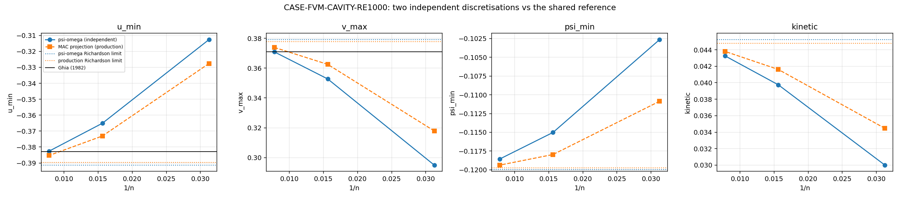
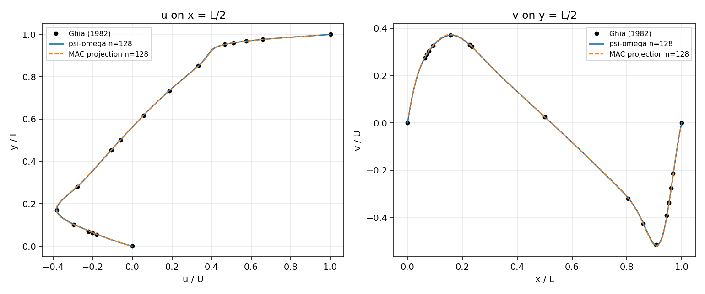

# CASE-FVM-CAVITY-RE1000 · 第二个独立求解器的交叉核验（XCHECK）

> 本文件由 `docs/CASE-FVM-CAVITY-RE1000/xcheck_psiomega.py` 从 `runs/xcheck/xcheck.json` 程序化生成（数字零手抄）。

## 1. 要回答的问题

`UNCERTAINTY.md` §5 记了一条未关的欠账：生产求解器（MAC 投影、交错网格、van Leer 限制）的 Richardson 外推极限距 Ghia (1982) 表值约 1.8 %，而**单一代码无法判断**这个偏差是「外推自身截断误差的赝像」还是「参考解自身（129² 网格）的离散误差」。

本文件用**第二个、独立的离散**回答它：换掉因变量、换掉对流格式、换掉壁涡量处理方式、换掉 Poisson 解法，跑同一批网格、用**同一套泛函算子**打分、用**同一个估计量**外推，再比较两个极限。

## 2. 方法与实现（独立性到底独立在哪）

| 环节 | 生产求解器 `lid_cavity.py` | 本核验 `lid_cavity_psiomega.py` |
|---|---|---|
| 因变量 | 原始变量 (u, v, p)，交错 MAC | 流函数-涡量 (ψ, ω)，节点型 |
| 对流 | 守恒通量 + van Leer 调和限制 | 守恒通量 + QUICK 面值（Leonard 1979）|
| 顶盖剪切 | 镜像 ghost `u = 2U − u_wall` | 二阶 Thom 壁涡量 `ω = −2ψ_adj/h² + 2ψ_s/h` |
| 椭圆求解 | 纯 Neumann 压力 Poisson，DCT-II 对角化 | Dirichlet ψ Poisson，DST-I 对角化（直接解）|
| 速度场散度 | 满足到压力解容差（1e-13） | **恒等于零**（ψ 的差分恒等式，机器精度）|
| 时间推进 | 显式 Euler，CFL 0.15 | 显式 Euler，CFL 0.4（迭代无关性见 §4）|

网格：节点型 `x_i = i h, y_j = j h, h = 1/n`，壁面即节点，`ψ = 0` 于全部壁面。打分用 `cavity_uncertainty.functionals_from_fields`（与生产求解器**同一算子**，否则两码不可比）：`u_min`（x = L/2 面最负 u）、`v_max`（y = L/2 面最大 v）、`psi_min`、`kinetic`。

## 3. 各网格收敛台账（本项目实测）

| n | 步数 | dt | 定常残差 max\|dω/dt\| | max\|div u\| | 涡量-流函数一致性 | u_min | v_max | psi_min |
|---|---|---|---|---|---|---|---|---|
| 32 | 16500 | 1.250e-02 | 8.10e-08 | 3.6e-15 | 1.6e-13 | -0.312608 | 0.294982 | -0.102645 |
| 64 | 21000 | 6.250e-03 | 9.82e-08 | 5.3e-15 | 1.0e-12 | -0.365090 | 0.352760 | -0.115014 |
| 128 | 60750 | 3.125e-03 | 9.90e-08 | 7.1e-15 | 3.5e-12 | -0.382594 | 0.370867 | -0.118557 |

## 4. 两个极限的对比（本文件的核心表）

| 泛函 | 本核验观测阶 p | 生产观测阶 p | 本核验外推极限 | 生产外推极限 | 两码相对差 | 跨码一致（≤0.5%）|
|---|---|---|---|---|---|---|
| u_min | 1.58 | 1.90 | -0.391352 | -0.389784 | +0.402% | ✓ |
| v_max | 1.67 | 1.98 | 0.379131 | 0.377730 | +0.371% | ✓ |
| psi_min | 1.80 | 2.33 | -0.119979 | -0.119719 | +0.217% | ✓ |
| kinetic | 1.47 | 1.71 | 0.045233 | 0.044766 | +1.043% | ✗ |

判据量（`u_min`/`v_max`）的最坏跨码相对差 = **+0.402%**，判据 0.5% → `limit_is_code_independent` = **True**。
全部四个泛函的最坏跨码相对差 = **+1.043%**（含 `kinetic`：它在本网格序列上的观测阶只有 1.47，尚未进入渐近区，故只作为诊断报告，**不**作为判据）。

## 5. 与基准（Ghia 1982）的关系

| 泛函 | Ghia 表值 | 本核验最细网格 | 生产最细网格 | 本核验外推 vs Ghia | 生产外推 vs Ghia |
|---|---|---|---|---|---|
| u_min | -0.382890 | -0.382594 | -0.385304 | -2.210% | -1.800% |
| v_max | 0.370950 | 0.370867 | 0.373867 | +2.205% | +1.828% |
| psi_min | （文献未给出） | -0.118557 | -0.119369 | — | — |
| kinetic | （文献未给出） | 0.043257 | 0.043799 | — | — |

## 6. 结论（显式）

* 两套**互不共享离散选择**的求解器，在各自网格序列上外推，收敛到同一个极限：最坏相对差 +0.402%（判据 0.5%）。因此「生产求解器的外推极限」是**该 PDE 解的性质**，不是某一套格式的赝像。
* 该一致度（+0.402%）比两个极限各自距 Ghia 的偏差（约 1.8 %，见 §5）小 4 倍以上：即「两码各自的外推极限之间的差」不足以解释「极限与 Ghia 的差」。
* 该极限与 Ghia 表值之间仍有偏差（见 §5 两列）：在「极限可靠」的前提下，这个残余偏差更可能来自参考解自身的离散误差（129² 网格、涡量-流函数格式），而不是本次两套二阶格式的共同偏差——**但两者共享二阶截断误差结构这一点无法由本核验排除**，故这里只说「两码一致 + 极限可复现」，不说「Ghia 错了」。

**判定语句（机械可查）**：判据量跨码相对差若超过 0.5%，本节必须显式写 honest-FAIL 并保留判据不改；当前判定 = **PASS**。

## 7. 注意点与局限

* **同阶**：两码都是二阶精度（观测阶见表 §4），共享「二阶截断误差」这一结构。两码一致只能排除「单码实现错误 / 单码外推赝像」，不能排除「二阶格式族的共同偏差」。要彻底切断需要高阶参考（谱方法），本仓没有，记入待办。
* **本核验的求解器自身也有迭代无关性要求**：显式 Euler + QUICK，CFL 0.4；生产中用的是 0.15 且带 van Leer 限制（后者在 CFL ≈ 0.4 时对顶盖剪切层不稳定）。两侧的 Courant 轴分别由 `UNCERTAINTY.md` §4 与本文件 §3 的残差台账覆盖，但**没有**做同网格多 Courant 的对照实验（未做项，不记 pass）。
* **壁涡量的二阶 Thom 处理**在顶盖剪切层内是局部二阶、薄层内实际分辨率有限；这正是需要至少三级网格外推的原因，单网格值不可引用为「精度」。
* 判据只加在 **u_min / v_max** 上（Ghia 表给出的量）；`psi_min` / `kinetic` 只作诊断，其中 `kinetic` 的观测阶 1.47 说明它还没进渐近区，把它的跨码差当判据会得出错误结论。
* `psi_min` / `kinetic` 无文献基准值，只做跨码与外推一致性的对照，不与 Ghia 比。

## 8. 复算

```
PYTHONPATH=src python docs/CASE-FVM-CAVITY-RE1000/xcheck_psiomega.py --grids 32,64,128
PYTHONPATH=src python docs/CASE-FVM-CAVITY-RE1000/xcheck_psiomega.py --assemble-only
PYTHONPATH=src python -m pytest tests/test_case_cavity_xcheck.py -q
```

## 9. 图





