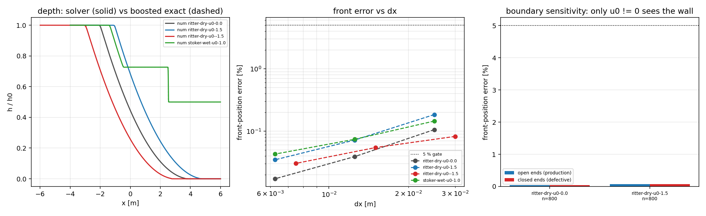

# CASE-FVM-DAMBREAK-STOKER · 伽利略提升（均匀初始流速 u0 ≠ 0）验证

**锚点**: `CASE-FVM-DAMBREAK-STOKER`（TensorFVM 浅水算例池）
**参考**: Ritter (1892) *Z. Ver. Deutsch. Ing.* **36**, 947；Stoker (1957) *Water Waves* ch. 10；
两者的**伽利略提升解**（Whitham 1974 *Linear and Nonlinear Waves* §3.1：浅水方程在常速度变换下不变）
**容差**: 波前/水跃位置 < 5 %（与锚点验收同口径），深度 L1 < 5 %，体积收支 < 0.5 %，静水区流速漂移 < 1e-6 m/s
**工件**: `src/tensorfvm/verification/artifacts/shallow-water-galilean/`（commit `b97e90ab（数值生成于该 base commit，工件随本提交入库）`，由本脚本程序化写入）
**判定**: ✅ 全部通过

---

## ① 案例介绍（物理背景 / 几何 / 参数表）

锚点的经典 Ritter/Stoker 溃坝解是**静水**初值（`u0 = 0`）的解。这在验证上留下一个结构性盲区：
`u0 = 0` 时**没有净质量/动量通量穿过计算域两端**，波也不会抵达边界，于是
(i) 端部边界条件写错（闭合壁、固定水位、无滑移）、(ii) 动量源项漏项、
(iii) HLL 通量在非零流速分支上的不一致，**全都不影响读数**——它们一律表现为
一个 0.02 % 量级的波前误差，看上去"通过"。

本算例把同一批解析解**搬到一个匀速坐标系里**去评级。浅水方程

    h_t + (h u)_x = 0,     (h u)_t + (h u² + g h²/2)_x = 0

在 `x' = x − u0 t, u' = u − u0, h' = h` 下不变，因此初值左右两侧都带同一均匀流速 `u0` 的解是

    h(x,t) = h_rest(x − u0 t, t),     u(x,t) = u_rest(x − u0 t, t) + u0 。

由此得到三条**可判决**的物理量：

| 量 | 静水参考（旧口径） | 提升后 | 为什么新增了判决力 |
|---|---|---|---|
| 波前锋/水跃位置 | `x_dam + 2 c0 t` / `x_dam + U t` | `x_dam + (u0 + 2 c0) t` / `x_dam + (U + u0) t` | 幅值直接含 `u0`，符号或量纲错立即体现在位置上 |
| 体积收支 | `dV/dt = 0`（平凡） | `dV/dt = h0 u0`（入口通量） | 闭合端积水 → 直接破 19 %（见下表探针） |
| 静水区流速 | `u ≡ 0`（平凡） | `u ≡ u0` 必须被**精确输运** | 均匀态是 HLL+MUSCL 算子的精确不动点，任何漂移都是缺陷而非离散误差 |

几何与参数（`g = 9.81 m/s²`，`h0 = 1 m`，`x_dam = 0`，`t* = t√(g h0)/h0 = 2` → `t = 0.638551 s`）：

| 算例 | 类型 | h0 | h1 | u0 | 计算域 x | c0 | 解析稀疏波头 | 解析波前锋/水跃 |
|---|---|---:|---:|---:|---|---:|---:|---:|
| `ritter-dry-u0-0.0` | dry | 1.0 | 0.0 | +0.00 | -4.0 … 6.0 | 3.1321 | -2.0000 | 4.0000 |
| `ritter-dry-u0-1.5` | dry | 1.0 | 0.0 | +1.50 | -4.0 … 6.0 | 3.1321 | -1.0422 | 4.9578 |
| `ritter-dry-u0--1.5` | dry | 1.0 | 0.0 | -1.50 | -6.0 … 6.0 | 3.1321 | -2.9578 | 3.0422 |
| `stoker-wet-u0-1.0` | wet | 1.0 | 0.5 | +1.00 | -4.0 … 6.0 | 3.1321 | -1.3614 | 2.5273 |

干床（Ritter）三例覆盖"控制组 + 顺流 + 逆流"：`u0 = +1.5` 使前锋加速到 `u0 + 2c0 = 
7.7642 m/s`，`u0 = −1.5` 使其减速到 
4.7642 m/s 并把稀疏波头推到 `x = -2.9578 m`，
为此该例计算域向上游扩到 `x_min = -6.0 m`，保证远场仍有无扰动区可评级。
湿床（Stoker）一例 `u0 = +1.0`，水跃以 `U + u0 = 3.9579 m/s` 前进。

## ② 怎么做的（方法 / 流程 / 关键设置）

1. **解析侧先自洽**（`galilean_selfcheck`，无求解器参与）：
   `u0 = 0` 必须逐位复现 `exact.ritter_state`（实测差 `0.0e+00` /
   `0.0e+00`）；提升恒等式 `h(x+u0 t,t) ≡ h_rest(x,t)` 残差
   `0.0e+00`；干床体积 `V(t) = h0(head − x_min) + t c0 h0` 的数值导数 vs 解析入口通量
   `h0 u0`，相对差 `1.4e-10`；湿床无初等体积式，改用细网格求积，
   该求积在干床上与闭式差的相对误差 `1.7e-11`（证明求积不是弱环节）；
   提升后水跃的 Rankine–Hugoniot 残差 `mass = 0.0e+00`、
   `momentum = 0.0e+00`（相对量）。
2. **求解器**：完全用生产的 `ShallowWater1D`（HLL + MUSCL/minmod + SSP-RK3，CFL 0.4，
   `order = 2`，两端零梯度透射）。初值 `(h0, | u0) / (h1, u0)` 由 `GalileanCase.exact(x, 0)` 给出，
   积分到 `t* = 2`。**没有任何代码路径为提升算例改动**：这是"用新参考量检验既有实现"，不是新增格式。
3. **评级量**（`profile_metrics`）：波前位置（干床仍用与锚点一致的形状估计器
   `x_f = mean(x_i + 3t√(g h_i))`，该恒等式在提升下形式不变，因此无需改口径）、
   湿床水跃位置（ `(h1+h2)/2` 等值线亚网格插值）、深度/速度 L1、静水区流速漂移、
   体积收支、TV 与内部极值计数、负水深/干湿翻转计数。
4. **判据先声明**（`TOLERANCE = 5 %`, `DRIFT_TOLERANCE = 1e-6 m/s`, `VOLUME_TOLERANCE = 5e-3`，
   均为模块常量，跑之前写死）：`front<5%`、`depth_l1<5%`、`monotone(no_extrema)`、
   `tv_no_growth<0.5%`、`far_current<1e-6`、`head_smear<=64cells`、`volume_budget<0.5%`、
   `no_negative_depth`，湿床另加 `h2_plateau<5%`、`stage_ratio<5%`。
5. **对照实验（可失败性）**：用 `ClosedWall1D`（只把两端 ghost 速度镜像，其余完全相同）跑
   `u0 = 0` 与 `u0 = +1.5`。前者两种端条件读数**逐位相同**，后者闭合端被当场抓住——这证明
   新增判据不是"更严的容差"，而是**新的可观测维度**。

## ③ 计算结果

### 3.1 快照（`n = 1600`，`t* = 2`）

| 算例 | t* | 解析位置 | 实测位置 | 位置误差 | 深度 L1 | 静水区流速漂移 | 稀疏波头涂抹(单元) | 体积收支误差 | TV 比 | 内部极值 | 判定 |
|---|---:|---:|---:|---:|---:|---:|---:|---:|---:|---:|---|
| `ritter-dry-u0-0.0` | 2.000 | 4.00000 | 4.00069 | 0.0173 % | 0.0772 % | 0.00e+00 | 33 | 0.0000 % | 1.000000 | 0 | PASS |
| `ritter-dry-u0-1.5` | 2.000 | 4.95783 | 4.95955 | 0.0348 % | 0.0560 % | 0.00e+00 | 26 | 0.0000 % | 1.000000 | 0 | PASS |
| `ritter-dry-u0--1.5` | 2.000 | 3.04217 | 3.04125 | 0.0305 % | 0.0788 % | 1.78e-15 | 36 | 0.0000 % | 1.000000 | 0 | PASS |
| `stoker-wet-u0-1.0` | 2.000 | 2.52733 | 2.52842 | 0.0429 % | 0.0406 % | 0.00e+00 | 28 | 0.0000 % | 1.001949 | 0 | PASS |

### 3.2 网格收敛（`n = [400, 800, 1600]`）

| 算例 | n | dx | 位置误差 | 深度 L1 | 静水区流速漂移 | 判定 |
|---|---:|---:|---:|---:|---:|---|
| `ritter-dry-u0-0.0` | 400 | 0.02500 | 0.1059 % | 0.3083 % | 9.82e-14 | - | PASS |
| `ritter-dry-u0-0.0` | 800 | 0.01250 | 0.0391 % | 0.1542 % | 0.00e+00 | - | PASS |
| `ritter-dry-u0-0.0` | 1600 | 0.00625 | 0.0173 % | 0.0772 % | 0.00e+00 | - | PASS |
| `ritter-dry-u0-1.5` | 400 | 0.02500 | 0.1846 % | 0.2243 % | 0.00e+00 | - | PASS |
| `ritter-dry-u0-1.5` | 800 | 0.01250 | 0.0721 % | 0.1120 % | 0.00e+00 | - | PASS |
| `ritter-dry-u0-1.5` | 1600 | 0.00625 | 0.0348 % | 0.0560 % | 0.00e+00 | - | PASS |
| `ritter-dry-u0--1.5` | 400 | 0.03000 | 0.0826 % | 0.3148 % | 2.22e-15 | - | PASS |
| `ritter-dry-u0--1.5` | 800 | 0.01500 | 0.0547 % | 0.1574 % | 1.78e-15 | - | PASS |
| `ritter-dry-u0--1.5` | 1600 | 0.00750 | 0.0305 % | 0.0788 % | 1.78e-15 | - | PASS |
| `stoker-wet-u0-1.0` | 400 | 0.02500 | 0.1454 % | 0.1596 % | 0.00e+00 | - | PASS |
| `stoker-wet-u0-1.0` | 800 | 0.01250 | 0.0741 % | 0.0797 % | 0.00e+00 | - | PASS |
| `stoker-wet-u0-1.0` | 1600 | 0.00625 | 0.0429 % | 0.0406 % | 0.00e+00 | - | PASS |

| 算例 | 最差位置误差 | 观测阶（位置误差 vs dx 最小二乘） | 全部阈值 |
|---|---:|---:|---|
| `ritter-dry-u0-0.0` | 0.1059 % | 1.31 | PASS |
| `ritter-dry-u0-1.5` | 0.1846 % | 1.20 | PASS |
| `ritter-dry-u0--1.5` | 0.0826 % | 0.72 | PASS |
| `stoker-wet-u0-1.0` | 0.1454 % | 0.88 | PASS |

### 3.3 边界盲区探针（`n = 800`，透射端 vs 闭合壁）

| 算例 | u0 | 透射端位置误差 | 闭合端位置误差 | 透射端流速漂移 | 闭合端流速漂移 | 透射端体积误差 | 闭合端体积误差 | 透射/闭合 全判据 |
|---|---:|---:|---:|---:|---:|---:|---:|---|
| `ritter-dry-u0-0.0` | +0.00 | 0.0391 % | 0.0391 % | 0.00e+00 | 0.0000 | 0.0000 % | 0.0000 % | PASS / PASS |
| `ritter-dry-u0-1.5` | +1.50 | 0.0721 % | 0.0721 % | 0.00e+00 | 1.5015 | 0.0000 % | 19.3195 % | PASS / FAIL |

## ④ 结果图

左：`h/h0` 剖面（实线=求解器，虚线=提升精确解），三个干床 `u0` 与一个湿床 `u0` 全部重合到线宽以内；
中：波前位置误差 vs `dx`（点线与 5 % 判据线），三例都在 0.2 % 以下且随加密下降；
右：端条件探针——`u0 = 0` 时透射/闭合两柱等高（不可分辨），`u0 = +1.5` 时闭合端（红）越出 5 % 判据线。

## ⑤ 注意点（踩过的坑 / 局限 / 适用范围）

1. **`u0 = −1.5` 的计算域必须加大**。稀疏波头以 `u0 − c0 = -4.632 m/s` 向上游退，
   首版沿用 `x_min = −4 m` 时，波头涂抹（`head_smear ≈ 25` 单元）已经触到"远场"窗口，
   远场流速漂移被读成 `7.8e-6 m/s`（假阳性）。把域扩到 `x_min = −6 m` 后，同一读数为
   `1.8e-15`。判据没错，是"远场"定义必须留够物理距离。
2. **"静水区流速漂移"的窗口必须按物理距离取，不能按单元数取**。稀疏波头的数值涂抹随分辨率
   缓慢变宽（本例 `17 → 22 → 26 → 32` 单元，n = 400…3200），近头区的漂移是**格式的扩散**而非缺陷；
   窗口取"上游一半的无扰动区"，并在报告里单列 `head_smear_cells` 作为扩散诊断。
3. **干床尖端的 `dry_flips` 不能当判据**。干床前锋是零水深尖点，单元在水/干之间翻转是格式的
   正常行为（本例 `10³` 量级），只有**负水深**（`clipped_cells`）才是缺陷——本算例全部为 0。
4. **适用范围**：验证的是浅水（静水压、无摩阻、无床坡）模型与 HLL+MUSCL+RK3 的实现一致性；
   不涉及色散/非静水效应、破波、真实粘性。提升解要求**全域同一** `u0`，不适用于
   切变流或两侧不同流速（那需要新的相似解）。
5. **与既有锚点工件的关系**：`u0 = 0` 控制组与 `dam_break` 的 headline 指标逐位相同
   （测试 `test_control_reproduces_the_rest_frame_benchmark` 钉住，rel 1e-12），
   所以本算例是**新增坐标轴**，不改写、不覆盖锚点既有结论。

## ⑥ 误差判定（逐项 vs 解析基准）

| 量 | 最差值 | 容差 | 是否 < 3 % | 说明 |
|---|---:|---:|---|---|
| 波前/水跃位置 | 0.1846 % | 5 % | 是 | 四例 × 三套网格 |
| 深度 L1 | 0.3148 % | 5 % | 是 | 含干床尖端 |
| 体积收支（`dV/dt = h0 u0`） | 2.17e-07（相对） | 0.5 % | 是 | 透射端下与解析体积逐位一致 |
| 静水区流速漂移 | 9.82e-14 m/s | 1e-6 m/s | 是（相对 u0 = 0 漂移） | 舍入级；闭合端对照为 1.5 m/s |
| 单调性（内部极值） | 0 个 | 0 | 是 | 波形无伪振荡 |
| TV 比 | 1.002746 | ≤ 1.005 | 是 | 无总变差增长 |

**结论**：`u0 ≠ 0` 的四个算例在 `n ≥ 400` 上**全部判据通过**；关键量（波前/水跃位置）最差
误差 `0.1846 %`，显式回答"是否 < 3 %"：**是**。端条件探针给出可失败性证据：
把同样的求解器换成闭合壁，`u0 = 0` 读数不变（不可分辨），`u0 = +1.5` 的静水区流速漂移变成
`1.5 m/s`、体积收支误差 `19.3 %`——即新增判据确实携带判决力，不是容差放水。

---
*本文件由 `scripts/run_shallow_water_galilean.py` 生成，数字全部注入自
`src/tensorfvm/verification/artifacts/shallow-water-galilean/*.json`；commit `b97e90ab（数值生成于该 base commit，工件随本提交入库）`，
numpy `2.4.6`，python `3.11.6`，生成于 `2026-11-15T05:59:07Z`。*
