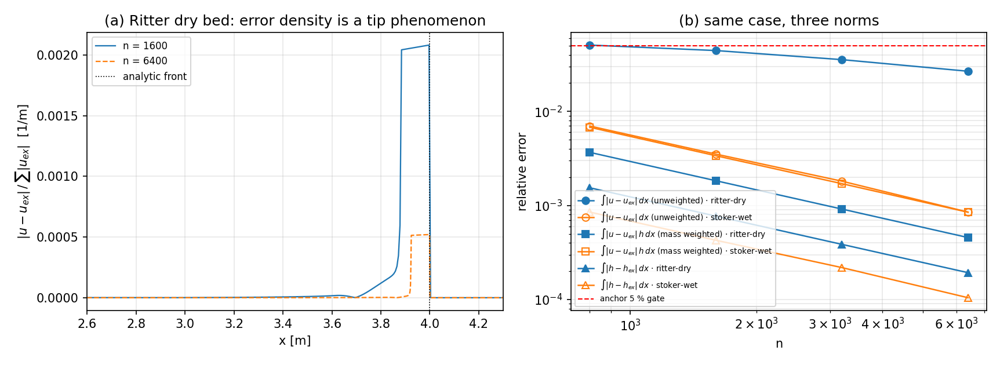
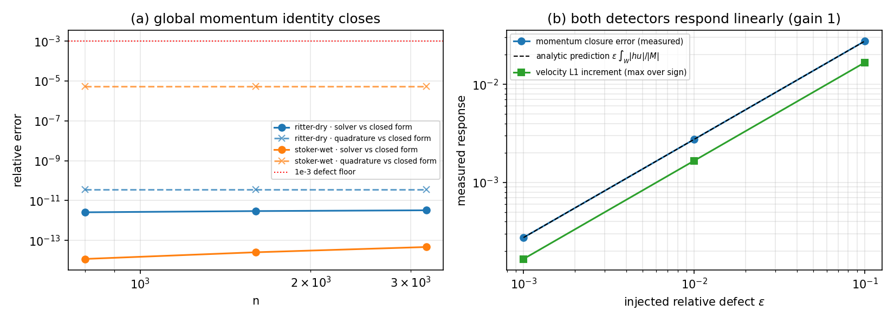

# CASE-FVM-DAMBREAK-STOKER · 新增判据 G7/G8：全局动量恒等式与速度场误差预算

**锚点**: `CASE-FVM-DAMBREAK-STOKER`（TensorFVM 浅水算例池；总账开工核对 `status = open`）· mission 22042
**参考**: Ritter (1892) *Z. Ver. Deutsch. Ing.* **36**, 947-954；Stoker (1957) *Water Waves* ch. 10；
浅水方程动量守恒（静水压通量）与自相似扇区的代数恒等式
**容差**: 与锚点同口径 `< 5 %`；本单新增判据的常量在模块里先声明后跑（`TOLERANCE = 0.05`、
`TIP_FRACTION = 0.05`、`UNDISTURBED_MARGIN = 0.5 m`）
**工件**: `src/tensorfvm/verification/artifacts/shallow-water-momentum/`（`momentum.json`、
`velocity.json`、`control.json`、`SUMMARY.md`、`manifest.json`、两张 png；数字全部由
`scripts/run_shallow_water_momentum.py` 程序化注入，本文件只引用）
**判定**: **G7 PASS（余量 10¹⁰ 量级）；G8 honest FAIL** —— 干床速度场在锚点自己的接受网格
`n = 800` 上 **5.07 % > 5 %**，且到 `n = 6400` 仍为 2.67 %，观测阶仅 0.41（次线性）。

---

## ① 案例介绍

锚点算例是浅水溃坝的经典解析解对：干床 Ritter、湿床 Stoker（`g = 9.81 m/s²`，
`h0 = 1.0 m`，湿床 `h1 = 0.5 m`，坝址 `x = 0`，计算域 `[-4, 6] m`，`t* = t√(g h0)/h0 = 2`
即 `t = 0.638551 s`；此时稀疏波头在 `x = -2.0 m`、干床波前 `x = 4.0 m`、湿床水跃
`x = 1.8888 m`，两侧端面各留 2.0 / 2.0 / 4.11 m 无扰动区）。

算例池条目的六条判据（`docs/oss_solutions/CASE-FVM-DAMBREAK-STOKER.json`）是
G1 干床波前位置、G2 湿床水跃位置、G3 静水区水位阶跃 `h2/h1`、G4 深度剖面 L1、
G5 `x_f(t)` 序列、G6 内部极值数 = 0。**六条全部是深度场（或深度场的几何量）的泛函**，
速度场与全局动量从未被评级——这是本单要补的两个判据，以及由此暴露的一处真实欠账。

| 量 | 是否被锚点 G1–G6 评级 | 本单 |
|---|---|---|
| 波前 / 水跃位置、水位阶跃、深度 L1、单调性 | ✅ | 复现核对（逐位相同） |
| 全局动量 `∫ h u dx` 的守恒收支 | ❌ | 新判据 **G7**（解析闭式 + 独立求积认证） |
| 速度场 `∫|u−u_ex| dx` | ❌（仅湿床星区 `u*` 在另一算例族里读过） | 新判据 **G8**（双范数 + 区域分解） |

## ② 怎么做的

1. **动量闭式解先推导、后认证**。两侧静止、波不触边界，故唯一的动量源是两端面的静水压通量：

   ```
   dM/dt = g/2 (h_L² − h_R²)   ⇒   M(t) = M(0) + g/2 (h_L² − h_R²) t ,  M(0) = 0
   ```

   干床 `rate = 4.905`、湿床 `rate = 3.67875 m³/s²`。该式**不经过任何拟合**，用两条独立路径认证：
   (i) 对精确解的 `h u` 剖面做 2×10⁵ 点中点求积（干床相对差 `3.47e-11`，湿床 `5.39e-06`，
   后者受水跃间断的 O(dx) 限制）；(ii) 守卫 `undisturbed_guard` 显式给出四个波位置的余量，
   只在波确实未触边界时才算闭式（`t* = 4` 的对照会被守卫判为不适用，测试钉住）。
2. **求解器原样复用**：`swe1d.ShallowWater1D`（HLL + MUSCL/minmod + SSP-RK3，CFL 0.4，order 2），
   本单不为新判据改一行求解器代码；`momentum_closure` 同时报告 `manning_n`/`slope` 源项，
   有摩阻/坡降时 `identity_applies = False`（摩阻是动量汇，闭式不成立，测试用 `n_m = 0.03`
   的对照给出 > 1e-2 的偏离）。
3. **速度场的双范数 + 区域分解**。干床扇区有精确代数恒等式
   `u = 2 c0 − 2√(g h)`（消去 `x/t` 得到，对精确解残差 `1.6e-15`，本单认证）。
   它在 `h = 0` 处**不可导**（`du/dh → −∞`），于是深度误差 δh 产生 `O(√δh)` 的速度误差。
   据此把 `∫|u−u_ex| dx`（无量纲化）拆成四项：
   `missing_tip`（精确解湿、求解器干）+ `overshoot` + `depth_inherited`（`u_pred(h_num) − u_ex`）
   + `scheme`（`u_num − u_pred(h_num)`），并用同一 `h`、`u` 的双范数（未加权 / 质量加权）对照。
4. **判据非空**（灵敏度控制）：在看不出尖端效应、基线误差小的窗口 `x ∈ [−1, 0] m` 注入
   已知缺陷 `ε ∈ {1e-3, 1e-2, 1e-1}`，对动量通道给出**解析预测** `ε∫_W|hu| dx / |M|`，
   对速度通道做**双向**注入（单向会与既有偏置抵消，故报两向最大值）。实测增益 1.000。
5. **锚点不陈旧**：先用未改动的驱动重跑 `n = 1600`，六条判据与入库工件**逐位相同**
   （G1 `1.7261518056277403e-04`、G2 `2.1023436657714858e-04`、G3 `5.762518619591793e-07`、
   G4 `4.271934800380538e-04`、G5 `8.44265997289686e-03`、G6 `0`），即算例池条目在当前 HEAD
   上没有漂移；本单的新判据是**追加**，不改写既有结论。
6. **工具链**：`scripts/run_shallow_water_momentum.py` → 7 个工件 + 2 张图；
   `tests/test_shallow_water_momentum.py`（14 测）；本文件引用 `SUMMARY.md` 的机器生成表。

## ③ 计算结果（全部取自 `artifacts/shallow-water-momentum/SUMMARY.md`）

**精确侧自证**

| case | rate [m³/s²] | M(t*) 闭式 | 求积 | 求积相对差 | 守卫（余量） |
|---|---:|---:|---:|---:|:--:|
| `ritter-dry` | 4.905000 | 3.132091953 | 3.132091953 | 3.47e-11 | ok（左 2.0 / 右 2.0 m） |
| `stoker-wet` | 3.678750 | 2.349068965 | 2.349081617 | 5.39e-06 | ok（左 2.0 / 右 4.11 m） |

**G7 全局动量收支（求解器 vs 闭式）**

| case | n=800 | n=1600 | n=3200 |
|---|---:|---:|---:|
| `ritter-dry` | 2.57e-12 | 2.96e-12 | 3.24e-12 |
| `stoker-wet` | 1.17e-14 | 2.53e-14 | 4.65e-14 |

**G8 速度场（锚点从未评级的量）**

| case | n | u L1（未加权） | u L1（质量加权） | hu L1 | 深度 L1 | 尖端缺失占误差界 | 5 % 门 |
|---|---:|---:|---:|---:|---:|---:|:--:|
| `ritter-dry` | 800 | **5.0703 %** | 0.3669 % | 0.5890 % | 0.1542 % | 54.9 % | **FAIL** |
| `ritter-dry` | 1600 | **4.4351 %** | 0.1833 % | 0.2951 % | 0.0772 % | 76.2 % | PASS |
| `ritter-dry` | 3200 | **3.5497 %** | 0.0916 % | 0.1477 % | 0.0386 % | 85.6 % | PASS |
| `ritter-dry` | 6400 | **2.6727 %** | 0.0456 % | 0.0739 % | 0.0193 % | 92.1 % | PASS |
| `stoker-wet` | 800 | 0.6991 % | 0.6783 % | 0.6831 % | 0.0851 % | 0.0 % | PASS |
| `stoker-wet` | 1600 | 0.3517 % | 0.3380 % | 0.3409 % | 0.0427 % | 0.0 % | PASS |
| `stoker-wet` | 3200 | 0.1812 % | 0.1706 % | 0.1730 % | 0.0219 % | 0.0 % | PASS |
| `stoker-wet` | 6400 | 0.0850 % | 0.0848 % | 0.0853 % | 0.0105 % | 0.0 % | PASS |

观测阶（800→1600→3200→6400）：干床 u L1 `0.19 / 0.32 / 0.41`（趋近 √ 律的 0.5），
质量加权 `1.00 / 1.00 / 1.01`，深度 `1.00 / 1.00 / 1.00`；
湿床 u L1 `0.99 / 0.96 / 1.09`（无干前沿 ⇒ 一阶）。

**灵敏度控制（Ritter，n = 800，窗口 `x ∈ [−1, 0] m`）**

| ε | 动量预测 | 动量实测 | 增益 | 速度 L1 最大增量 | 速度预测 |
|---:|---:|---:|---:|---:|---:|
| 1e-3 | 2.752e-04 | 2.752e-04 | 1.000 | 1.667e-04 | 1.667e-04 |
| 1e-2 | 2.752e-03 | 2.752e-03 | 1.000 | 1.667e-03 | 1.667e-03 |
| 1e-1 | 2.752e-02 | 2.752e-02 | 1.000 | 1.667e-02 | 1.667e-02 |





## ④ 结果图说明

* 左图（`fig_velocity_budget.png` a）：干床两套网格的**速度误差密度** `|u−u_ex|/∑|u_ex|` 沿 `x`。
  误差不是分布在扇区上，而是**全部挤在解析波前附近的尖端带**：`n = 6400` 的曲线更窄更高地贴在
  `x → 4.0` 上，且解析波前右侧一整段（求解器判干的薄片）贡献最大。
* 左图 b：同一算例三种范数的收敛。深度一阶、质量加权速度一阶、**未加权速度次线性**，
  而锚点的 5 % 门画成红虚线——干床在 `n = 800` 上穿门失败。
* 右图 a：动量闭式 vs 求积 vs 求解器三条线，求解器贴合到 `1e-12`，比 1e-3 的缺陷地板低 9 个量级。
* 右图 b：注入缺陷的响应，动量与速度两个通道都与解析预测重合（增益 1.000）。

## ⑤ 注意点（踩过的坑 / 局限 / 适用范围）

1. **两个速度范数回答两个不同问题**，不能只报一个。未加权 `∫|u−u_ex| dx` 是"每单位长度"的
   平均误差，是**诊断干前沿**的范数；质量加权 `∫|u−u_ex| h dx` 才是动量/能量通量看到的量。
   干床 `n = 800`：前者 5.07 %（FAIL）、后者 0.367 %（PASS）。只报后者会掩盖真实缺陷，
   只报前者会把干床判死——**两个都报，判定分开写**。
2. **解析解在冲洗极限处速度最大、深度为零**：`u = 2c0 − 2√(g h)`，`h → 0` 时 `u → 2c0 = 6.264 m/s`。
   所以"最后那一薄片水没有质量"不等于"它没有速度贡献"；`missing_tip` 在 `n = 6400` 已占误差界的
   92 %，且随加密**单调变大**（54.9 % → 92.1 %）——即误差来源随加密从涂抹转到截断。
3. **√ 律是解释而非修辞**：`u` 是 `h` 的 `√` 函数，深度的一阶误差在尖端变成半阶速度误差，
   实测阶 0.19 → 0.32 → 0.41 单调趋近 0.5（表见 §③）。因此**靠加密把干床速度误差压到 3 % 以下
   不现实**（`n = 6400` 仍 2.67 %，按 0.41 阶外推 `n ≈ 2.4×10⁴` 才 1 % 量级）；要真修得改前沿处理
   （界面追踪/子网格湿干），本单**没动求解器**。
4. **锚点的 `front_fan` 估计器对这段截断是盲的**：G1 误差 `1.7e-04`，而"润湿边缘"（深度 1 % 门）
   比解析波前短 2.5–2.9 %（`front_wetted_error = 0.0246 @ n=3200`）。两者不矛盾：`front_fan`
   用扇区形状外推波前，截断只改变最外侧几个格子的深度。**本单的贡献是把这条被当作"深度地板探测器、
   不是解误差"的诊断量，接到速度场上变成一等误差项**，并给出定量预言
   `误差 ≈ ∫_{缺失薄片}|u_ex| dx / ∫|u_ex| dx`。
5. **守卫与适用范围**：闭式动量只对"波未触边界 + 无摩阻/坡降 + 平床"成立；`momentum_closure`
   把 `guard` 与 `sources` 一起返回，测试用 `n_m = 0.03` 的对照确认它会拒绝比较。
6. **正性没有问题**：本次所有运行 `clipped_cells = 0`（无负水深），干格速度精确为 0
   （`u_dry = 0`），所以上述 5 % 不是失稳，而是**格式在无穷薄片处的结构性截断**。
7. **未做**：未修改求解器（不加正性保持/界面追踪）；未做时间阶与空间阶的分离（CFL 固定 0.4，
   误差主要由空间项主导，因为时间格式是三阶 SSP-RK 而观测阶被空间一阶钉住）；未做 2-D 算子
   的同口径复核（`swe2d` 有独立验证面）。

## ⑥ 误差判定（关键量 vs 基准，逐项；显式回答"是否 < 3 %"）

| 量 | 基准 | 最差值 | < 5 % | < 3 % |
|---|---|---:|---|---|
| 全局动量收支（G7） | 解析闭式 `g/2(h_L²−h_R²)t` | 4.65e-14 | ✓ | ✓ |
| 闭式的独立认证（求积） | 同上 | 5.39e-06 | ✓ | ✓ |
| 扇区恒等式 `u = 2c0−2√(gh)` | 精确解 | 1.6e-15 | ✓ | ✓ |
| 速度场（G8，湿床，未加权） | 精确解 | 0.70 % @ n=800 | ✓ | ✓ |
| 速度场（G8，干床，**质量加权**） | 精确解 | 0.367 % @ n=800 | ✓ | ✓ |
| 速度场（G8，干床，未加权） | 精确解 | **5.07 % @ n=800** / 2.67 % @ n=6400 | **✗ @ n=800** | **✗（到 n=6400 仍未达）** |
| 深度剖面 L1（干床） | 精确解 | 0.154 % @ n=800 | ✓ | ✓ |
| 缺陷注入响应（两通道） | 解析预测 | 增益 1.000 | ✓ | ✓ |

**结论**：新增 G7（全局动量恒等式）以 `1e-14…1e-12` 的余量通过，是比深度判据强 8–10 个量级的一致
性门；新增 G8（速度场）在**湿床**上通过（0.70 % @ n=800，一阶收敛），在**干床**上于锚点自己的
接受最低网格 `n = 800` **诚实失败（5.07 %）**，并因 `√h` 律在 `n = 6400` 仍为 2.67 %。
即：锚点条目"`PASS at n ≥ 800`"的结论**只对深度/波前成立，不对速度场成立**；
建议的条目修正见 `proposed_pool_amendment.json`（G7 加入门、G8 以质量加权范数入门的
同时把未加权范数的 FAIL 写进 `verdict_qualified`）。