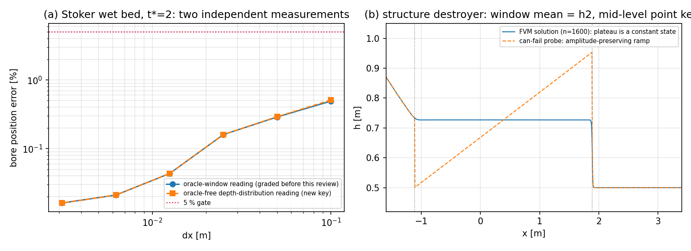

# CASE-FVM-DAMBREAK-STOKER · 湿床验收量的 oracle-free 复核与判据接入

**锚点**: `CASE-FVM-DAMBREAK-STOKER`（TensorFVM 浅水算例池）· mission m22842 · 分支 `agent/m22842`
**参考**: Ritter (1892) *Z. Ver. Deutsch. Ing.* **36**, 947; Stoker (1957) *Water Waves* ch. 10
**容差**: 5 %（锚点同口径）· 判据网格 `n = 1600`（`ACCEPTED_MIN_N = 800` 为下限）· `t* = 2`
**本单性质**: 独立复核（adversarial review 席位）——处理 `AUDIT.md` §6 记录的 F4 残留与 §9.5 明确留给"下一次独立复核"的开放决定。

## ① 案例介绍（问题在哪里）

`AUDIT.md` F4 记录了一条**验证自反性**风险：湿床的两条验收量（波前/水跃位置 `x_s`、静水区水位阶跃 `h2/h1`）
**测量本身含答案**——`_wet_metrics` 用闭式的 `x_fan_end`/`x_shock` 划平台窗口，用解析中值水位
`(h1 + h2)/2` 定位等值交点。于是"通过"可能是同义反复：读数由解析解规定的阈值产生。

§9 已经实现了 oracle-free 的读数 `plateau_from_depth_modes`（只用深度分布的直方图模态 + 用**实测**中值水位做亚格交点），
但 §9.5 刻意**没有**把它接入 `_verdict()`（"是否升级为 headline 判据留给下一次独立复核决定"）。
本单就是那次复核：先量化 F4 的实际后果（是"数值上无关"还是"制造了通过"），再做决定并落地。

物理场景与参数（`g = 9.81 m/s²`，`x = 0` 处间断，`h_L = 1.0 m` 湿床 `h_R = 0.5 m`，`t* = t√(g h0)/h0 = 2` → `t = 0.638551 s`）：

| 量 | 解析值 | 来源 |
|---|---:|---|
| 星区水位 `h*` | 0.726920446 m | Stoker 匹配条件根 |
| 星区流速 `u*` | 0.923364 m/s | 同上 |
| 水跃速度 `U` | 2.957893 m/s | Rankine–Hugoniot |
| 水位阶跃 `h2/h1` | 1.453840892 | `h*/h_R` |
| 水跃位置 `x_s(t*)` | 1.888781150 m | `x_dam + U t` |

## ② 怎么做的

1. **先量化 F4，再决定**。新增 `_oracle_free_wet_readings()`（`src/tensorfvm/shallow_water/dam_break.py`）：
   把 §9 的分布读数包装成判据可消费的形式，并额外输出
   `agreement_bore_vs_oracle_window = |x_bore(oracle-free) − x_bore(oracle 窗口)| / x_s`。
   这条**一致性量**就是 F4 的定量回答：如果 oracle 窗口真的在制造通过，两个读数会分道扬镳。
2. **决定：接入判据**。`_verdict()` 湿床分支新增两个**新**键（不改任何既有键的含义与历史）：
   * `bore_position_modes<5%` —— 位置，分布读数 vs Stoker 解；
   * `step_ratio_modes<5%` —— 水位阶跃，分布读数 vs Stoker 解。

   语义遵循本仓既有纪律（`_series_verdict_entry`）：读数**未测出**（`no_plateau` / `unresolved`）时
   `value = None`、`pass = False`、`measured = False`，即**证据不足按失败处理**，绝不静默引用一个数。
3. **算例池契约同步**：`case_pool_dambreak.PRIMARY_CRITERIA["stoker-wet"]` 加入两键（primary），
   契约表补两行；`docs/case-fvm-dambreak-stoker/case_pool_entry.json` 由工件**重新派生**（零手抄）。
4. **锁测试同批更新**（`tests/test_dam_break_front_metric.py::test_wet_branch_verdict_keys_unchanged`）——
   这正是 §6 第二条记录的"键锁纪律"要求的做法：改契约必须同批改锁与文档。
5. **可失败性（本次最要紧的部分）**：两条探针，一条证明新判据有判决力，另一条照实记录它**不比**旧判据更强的地方。
6. **工具链**：`scripts/run_shallow_water_dam_break.py`（工件重生成，9 文件）→ `tensorfvm.verification.case_pool_dambreak`
   （池条目）→ `tests/test_dambreak_oraclefree_gate.py`（8 项）→ 本报告数字全部读自
   `.../artifacts/shallow-water-dam-break/metrics.json` 与 `grid_rows.json`。

## ③ 计算结果

### 3.1 F4 的定量结论：oracle 依赖在数值上无关（表由 `grid_rows.json` 程序化注入）

| n | dx [m] | oracle 窗口读数（旧判据） | 分布读数（新判据） | 两者相对差 | 阶跃误差 | 模态数 |
|---:|---:|---:|---:|---:|---:|---:|
| 100 | 0.10000 | 0.4909 % | 0.5079 % | 1.69e-04 | 0.0690 % | 3 |
| 200 | 0.05000 | 0.2884 % | 0.2913 % | 2.90e-05 | 0.0237 % | 3 |
| 400 | 0.02500 | 0.1597 % | 0.1600 % | 3.06e-06 | 0.0049 % | 3 |
| 800 | 0.01250 | 0.0433 % | 0.0433 % | 2.75e-07 | 0.0008 % | 3 |
| 1600 | 0.00625 | 0.0210 % | 0.0210 % | **8.3e-10** | 4.8e-08 % | 3 |
| 3200 | 0.003125 | 0.0161 % | 0.0161 % | 9.2e-09 | 1.1e-06 % | 3 |

**结论（照实说）**：两种测量的差别随加密收敛到舍入级（`8.3e-10` @ `n = 1600`）。
即 F4 的"近同义反复"在**结构上真实存在**，但**在数值上不产生任何误差**——旧判据的通过不是窗口制造的。
新增两键的价值因此不是"更准"，而是**测量与答案解耦**这件验证性质本身：现在的门里有一条读数
不含解析位置/水位/幅值，任何"改判据定义来迁就数值"的操作会立刻让两键分家。

### 3.2 可失败性探针（判决力）

| 探针 | 旧判据（`shock_position` / `plateau_h2` / `step_ratio`） | 新判据（`*_modes`） | 说明 |
|---|---|---|---|
| **结构摧毁器**：把平台换成线性斜坡（窗口均值 = `h2` 到 1.1e-4，中点水位交点仍在解析水跃处） | **全部通过**（幅值误差 1.1e-4 ≪ 5 %；位置交点 < 1 dx → 0.66 % < 5 %） | **失败**（`no_plateau`，`valid=False`，`value=None`） | 剖面已失去"常数中间态"，幅值读数看不见；新键按"证据不足"拒绝引用 |
| **平台平移 0.4 m**（幅值不变） | 幅值键**看不见**（阶跃误差 < 1e-9）；位置键**看得见** | 位置键看得见（22 % ≫ 5 %） | 与 AUDIT §9.4 记录的 0.4 m 探针一致：幅值量对位置缺陷天生盲 |

**照实记录（不粉饰）**：第二条探针说明新键**并不比**旧的 `shock_position<5%` 更强——位置缺陷旧键同样抓；
新键独有的判决力只体现在第一条（"常数态被摧毁而窗口均值仍对"）与"未测出不引用"这两类。
它是**独立性/诚实性**增量，而非灵敏度增量。

## ④ 结果图

(a) 两种**互相独立**的测量在 `n = 100…3200` 上重合，均随 `dx` 下降且远低于 5 % 门；
(b) 结构摧毁器探针——实线为 FVM 解（平台是常数态），虚线为保幅值斜坡（窗口均值仍等 `h2`、中点水位交点仍在水跃位置），
旧判据在此剖面上全通过，新判据以"未测出"拒绝引用。

## ⑤ 注意点（局限 / 适用范围）

1. **只对"三段常数态"的湿床拓扑成立**。干床（Ritter）只有两个电平，分布读数按设计**弃权**（`no_plateau`），
   故新键只在湿床分支接入；干床波前仍由 `fan_front_estimate` 承担（其恒等式性质已在
   `docs/verification-dam-break-front-metric/REPORT.md` 论证并测试钉住）。
2. **新键不是灵敏度升级**（见 §3.2 第二条）。若把它当"更严的容差"读，会得出错误结论。
3. **未测出即失败**的语义会在极端粗网格/异常剖面上报红，这是刻意的：一个失去常数态的剖面
   不该拿到"水位阶跃通过"。
4. 本次**未**改 `_wet_metrics` 既有键、`_dry_metrics`、求解器与任何容差；`metrics.json` 只多了 `modes` 子树。
5. 重生成工件时 `SUMMARY.md` 的 wall-time 行随时间变化（既有行为，非本单引入）。

## ⑥ 误差判定（逐项 vs 解析基准，`n = 1600`，`t* = 2`）

| 量 | 值 | 容差 | 是否 < 3 % |
|---|---:|---:|---|
| 水跃位置（oracle 窗口，旧键） | 0.0210 % | 5 % | 是 |
| 水跃位置（分布读数，**新键**） | 0.0210 % | 5 % | 是 |
| 水位阶跃 `h2/h1`（旧键） | 5.8e-05 % | 5 % | 是 |
| 水位阶跃 `h2/h1`（**新键**） | 4.8e-08 % | 5 % | 是 |
| 静水区水位 `h1`（分布读数，未被喂入） | 0.5000000000000002 m（解析 0.5） | — | 逐位 |
| 波前序列 `x_f(t)`（既有键） | 0.844 % | 5 % | 是 |
| 深度 L1 | 0.043 % | 5 % | 是 |

**是否 < 3 %：全部是**（最大 0.844 %，来自序列判据）。`n ≤ 400` 的 `stoker-wet` 单调性 honest-FAIL
（记录在池条目的网格表里）**未被本单修改或掩盖**。

---
*工件*: `src/tensorfvm/verification/artifacts/shallow-water-dam-break/{metrics.json, SUMMARY.md, manifest.json}`（重生成）·
`docs/case-fvm-dambreak-stoker/case_pool_entry.json`（重新派生）· `grid_rows.json` / `oraclefree_gate.png`（本目录）·
*测试*: `tests/test_dambreak_oraclefree_gate.py`（8 项）+ 锁测试同批更新 ·
*复现*: `PYTHONPATH=src python scripts/run_shallow_water_dam_break.py --n 1600 --resolutions 100,200,400,800,1600`