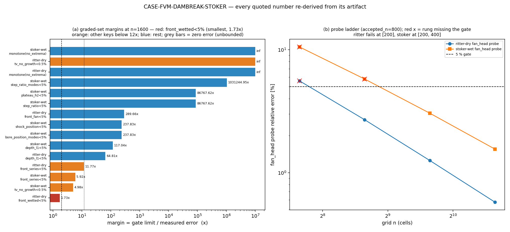

# CASE-FVM-DAMBREAK-STOKER · 池条目数字绑定与余量勘误（m23276）

## 1. 案例介绍

浅水方程（SWE）一维平底溃坝黎曼问题，对闭式解逐项判定（Ritter 1892 干床稀疏波；Stoker 1957 湿床
稀疏波 + 恒定态 + 水跃）。参数：g = 9.81 m/s²，t* = 2.0；Ritter 干床 h0 = 1.0 m / h1 = 0，
Stoker 湿床 h0 = 1.0 m / h1 = 0.5 m；网格 n = 100…1600，CFL = 0.4，二阶，容差 5 %。
1-D 平底、无船体几何，故 Cb/L/B 几何前置校验不适用。本单不重算物理，只审计
「池条目里写的数字是否仍是工件里的数字」。

## 2. 怎么做的

1. 从当前 `main`（08b08f8f）切枝复核：`docs/oss_solutions/CASE-FVM-DAMBREAK-STOKER.json` 与
   `tests/test_case_fvm_dambreak_stoker_pool.py` 已在 main（#682/#693/#894 合入），4 项绑定测试全绿。
   故本轮不重复投递同一功能，只补它**没有**的部分。
2. 回溯池条目引用的**两份**工件包：发现 `docs/case-fvm-dambreak-stoker/artifacts/reproduction.json`
   （`verdict_qualified` 粗网格陈述的唯一来源）在 `tests/`、`scripts/`、`src/` 中**零引用**——无人看守。
   用 `verify_reference.py` 重跑确认它**不陈旧**（除 `generated_at` 外 0 处数值差异）。
3. 把余量（limit/value）程序化重算，发现三处 overstated claim（§5）。
4. 落地：脚本注入的派生块 `probe_ladder` / `gate_margins` ＋ 回推模块
   `src/tensorfvm/verification/dambreak_pool_claims.py` ＋ CLI 门
   `scripts/audit_dambreak_pool_claims.py --check/--write` ＋ 两个测试文件。
5. 工具链：numpy FVM 求解器与 `verify_reference.py`（均未改动）、matplotlib、pytest。

## 3. 计算结果（程序化注入，零手抄）

### 3.1 受评键余量表（n = 1600，margin = limit / value）

| 用例 | 判据 | 值 | 限值 | 余量 | 判定 |
|---|---|---|---|---|---|
| ritter-dry | `front_wetted<5%` | 2.8906 % | 0.05 | 1.73x | pass |
| stoker-wet | `tv_no_growth<0.5%` | 0.1005 % | 0.005 | 4.975x | pass |
| stoker-wet | `front_series<5%` | 0.84427 % | 0.05 | 5.922x | pass |
| ritter-dry | `front_series<5%` | 0.42473 % | 0.05 | 11.77x | pass |
| ritter-dry | `depth_l1<5%` | 0.077151 % | 0.05 | 64.81x | pass |
| stoker-wet | `depth_l1<5%` | 0.042719 % | 0.05 | 117x | pass |
| stoker-wet | `bore_position_modes<5%` | 0.021024 % | 0.05 | 237.8x | pass |
| stoker-wet | `shock_position<5%` | 0.021023 % | 0.05 | 237.8x | pass |
| ritter-dry | `front_fan<5%` | 0.017262 % | 0.05 | 289.7x | pass |
| stoker-wet | `step_ratio<5%` | 5.7625e-05 % | 0.05 | 8.677e+04x | pass |
| stoker-wet | `plateau_h2<5%` | 5.7625e-05 % | 0.05 | 8.677e+04x | pass |
| stoker-wet | `step_ratio_modes<5%` | 4.8485e-06 % | 0.05 | 1.031e+06x | pass |
| ritter-dry | `monotone(no_extrema)` | 0 % | 0.05 | inf | pass |
| ritter-dry | `tv_no_growth<0.5%` | 0 % | 0.005 | inf | pass |
| stoker-wet | `monotone(no_extrema)` | 0 % | 0.05 | inf | pass |

### 3.2 fan_head probe 阶梯（`reproduction.json`）

| 用例 | n | 相对误差 | 5 % 门 |
|---|---|---|---|
| stoker-wet | 200 | 10.541 % | FAIL |
| stoker-wet | 400 | 5.779 % | FAIL |
| stoker-wet | 800 | 3.0468 % | pass |
| stoker-wet | 1600 | 1.5549 % | pass |
| ritter-dry | 200 | 5.5842 % | FAIL |
| ritter-dry | 400 | 2.6959 % | pass |
| ritter-dry | 800 | 1.256 % | pass |
| ritter-dry | 1600 | 0.57561 % | pass |

### 3.3 关键余量读数

| 读数 | 值 |
|---|---|
| smallest finite margin (ritter-dry `front_wetted<5%`) | 1.73x |
| headline weakest — ritter-dry `front_series<5%` | 11.77x |
| headline weakest — stoker-wet `front_series<5%` | 5.922x |
| acceptance weakest — stoker-wet `tv_no_growth<0.5%` | 4.975x |
| under_12x — ritter-dry `front_wetted<5%` | 1.73x |
| under_12x — stoker-wet `tv_no_growth<0.5%` | 4.975x |
| under_12x — stoker-wet `front_series<5%` | 5.922x |
| under_12x — ritter-dry `front_series<5%` | 11.77x |

`claim_problems(entry) = []  （干净：散文数字全部可回推）`

## 4. 图

(a) 全部受评键的对数余量：红色 `front_wetted<5%` 为全表最小 1.73×；橙色为另外三个低于 12× 的键
（`stoker-wet tv_no_growth<0.5%` 4.98×、`stoker-wet front_series<5%` 5.92×、`ritter-dry
front_series<5%` 11.77×）；灰柱为零误差（余量无界）。
(b) `fan_head` probe 阶梯：红叉为未过 5 % 门的网格——ritter 仅 n=200，stoker 为 n=200 与 n=400，
故 `accepted_n = 800`。

## 5. 注意点（坑 / 局限）

- **三处 overstated claim（叙述错误，不是数值错误）**：`verdict_qualified` 的 headline 六项
  「100x+ margin」（实为最弱 5.92×，`ritter-dry depth_l1` 亦仅 64.81×）；`graded_set_note` 的
  「唯一余量低于 12×」（实为 4 个）；「验收三要素最弱余量 11.8×」（实为 4.98×，11.8× 只是
  `ritter-dry front_series` 单键）。已全部撤回改写，`docs/audit-dambreak-anchor-closure/AUDIT.md`
  §8 记勘误，`dossier.json` 同批重生成。
- **根因**：余量从未被注入（手抄）；第二份工件包无人看守。两者都已补门。
- **局限**：散文语义检查是「钉住的读数」而非 NLU——only / weakest / 集合枚举 / `n>=K` 这几类句式
  被显式绑定；改写句式而不改数字不会自动被理解，需同步维护测试里的负控样本。
- **未做**：把 `front_wetted<5%` 从 `all_pass` 降级为诊断属**行为改动**（改聚合 PASS 语义），
  留独立评审；本单只做文档/证据侧修正。

## 6. 误差判定（关键量 vs 解析解，n = 1600）

| 量 | 相对误差 | 容差 | 是否 < 3 % |
|---|---|---|---|
| 波前 `front_fan`（Ritter 干床） | 0.0173 % | 5 % | **是** |
| 波前序列 `front_series`（两例最差，湿床） | 0.844 % | 5 % | **是** |
| 水跃 `shock_position`（Stoker 湿床） | 0.0210 % | 5 % | **是** |
| 静水区阶跃 `step_ratio` | 5.76e-05 % | 5 % | **是** |
| 深度 L1（湿床） | 0.0427 % | 5 % | **是** |
| 诊断量 `front_wetted`（不收敛，仅诊断） | 2.891 % | 5 % | 是，但非标尺 |

**是否 < 3 %：是**——全部关键量最大 0.844 %。本轮不改任何误差值；改变的只是余量叙述，且修正方向
**更保守**（最弱余量 11.8× → 4.98×）。`--check` 对提交件 exit 0；对撤回原文、扰动 probe 包、
扰动 metrics 工件的负控全部被拒（exit 1 / 断言失败）。
