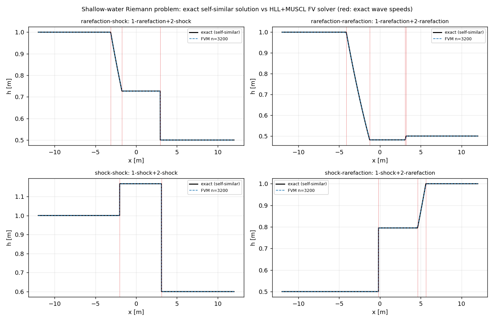
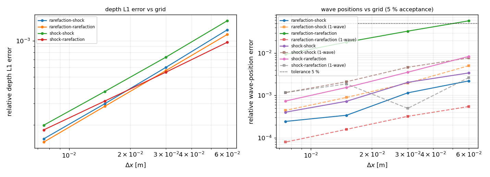

# CASE-FVM-DAMBREAK-STOKER（扩展）· 浅水黎曼问题四波型解析解验证

**锚点**: `CASE-FVM-DAMBREAK-STOKER`（TensorFVM 浅水算例池）· mission 21847 · commit `149e0ef9`
**参考**: Toro (2009) *Riemann Solvers and Numerical Methods for Fluid Dynamics* 3rd ed. ch. 6（浅水黎曼问题）; Stoker (1957) *Water Waves* ch. 10; Ritter (1892) *Z. Ver. Deutsch. Ing.* **36**, 947
**容差**: 5 %（与锚点同口径）· 判据: 两侧波位置 / 星区水位与流速 / 深度 L1 + 无伪振荡 · 接受网格 n = 3200 · **判定: 全部通过**

## ① 案例介绍

溃坝（Ritter 干床 / Stoker 湿床）只覆盖浅水黎曼问题的**一种**波型组合：左稀疏波 + 右涌波，且初值为静水。已有证据链（`dam_break.py`、`dam_break2d*.py`、`galilean.py`、`crosscheck.py`、`order_audit.py`）全部建立在这个子族上，因此 1-族为压缩波（激波）的两种波型从未被任何解析解评级：

| 波型 | 物理场景 | 本单之前是否有解析评级 |
|---|---|---|
| 1-稀疏+2-涌波 | 溃坝（湿床 Stoker / 干床 Ritter） | ✅ 已有 |
| 1-激波+2-激波 | 两股水流对撞 | ❌ 无 |
| 1-激波+2-稀疏 | 快而浅的水流追上更深更快的水 | ❌ 无 |
| 1-稀疏+2-稀疏 | 两股水流背离 | ❌ 无 |

算例参数（`g = 9.81 m/s²`，`x = 0` 处间断，计算域 `[-12, 12] m`，`t_end = 1.0 s`；所有波速 `|S| t_end < 12 m`，远场始终未受扰动）：

| 算例 | 波型 | h_L | u_L | h_R | u_R | h* | u* | 波速 (m/s) |
|---|---|---:|---:|---:|---:|---:|---:|---|
| `rarefaction-shock` | 1-rarefaction+2-shock | 1.000 | 0.000 | 0.500 | 0.000 | 0.726920 | 0.923364 | -3.1321, -1.7470, 2.9579 |
| `rarefaction-rarefaction` | 1-rarefaction+2-rarefaction | 1.000 | -1.000 | 0.500 | 1.000 | 0.481519 | 0.917368 | -4.1321, -1.2560, 3.2147, 3.0908 |
| `shock-shock` | 1-shock+2-shock | 1.000 | 1.500 | 0.600 | -1.000 | 1.167188 | 0.995453 | -2.0224, 3.1063 |
| `shock-rarefaction` | 1-shock+2-rarefaction | 0.500 | 3.000 | 1.000 | 2.500 | 0.794946 | 1.820946 | -0.1778, 5.6321, 4.6135 |

## ② 怎么做的

1. **解析解不经查表**：星区 `(h*, u*)` 是标量匹配条件 `f_L(h*) + f_R(h*) + (u_R-u_L) = 0` 的根，`f_K` 在 `h ≤ h_K` 取稀疏波的黎曼不变量形式 `2(√(g h) − √(g h_K))`、在 `h > h_K` 取激波的 Rankine–Hugoniot 形式 `(h−h_K)√(g(h+h_K)/(2 h h_K))`，在 `[0, max(h_L,h_R)]` 内二分到机器精度（与 `exact._stoker_constants` 同一手法）。
2. **解析解四条独立自证路径**（`certification.json`）：
   (i) 跳跃/不变量残差（激波用质量跳跃反算波速再代回动量跳跃）；
   (ii) **弱形式守恒恒等式**（跨间断整体积分，不拆分跳跃）；
   (iii) 光滑区相似 ODE 残差（对采样解做中心差分，抓“区域放错/状态放错”这类跳跃条件看不见的缺陷）；
   (iv) **退化为已发表解**：`u_L = u_R = 0` 必须逐位复现 Stoker 的 `(h2, u2, U)`，`h_R → 0` 必须趋于 Ritter。
3. **被验证的求解器原样复用**：`swe1d.ShallowWater1D`（MUSCL+minmod、HLL/Einfeldt、SSP-RK、自适应 CFL 0.4、order 2），未为新算例改一行求解器代码。
4. **度量先声明后跑**：波位置取半跳跃水位的数据驱动交点（稀疏波取扇形深度降的 25 %），1-波取**最左**交点、2-波取**最右**交点（两级稀疏/激波解会各交一次，取外侧是与几何无关且不偷看解析值的约定）；星区取两波中点；伪振荡沿用 `dam_break._extrema_mask` 的判据（阈值 `1e-4 h_ref`），两套实现逐格一致性由测试断言。
5. **工具链**: `scripts/run_shallow_water_riemann.py` → `metrics.json` / `convergence.json` / `certification.json` / 两张 png / `SUMMARY.md` / `manifest.json`；本报告由 `make_report.py` 从这些工件程序化生成。

## ③ 计算结果（n = 3200, CFL 0.4, order 2）

| 算例 | 波型 | 深度 L1 | 1-波位置 | 2-波位置 | h* | u* | 内点极值 | 质量预算 | 判定 |
|---|---|---:|---:|---:|---:|---:|---:|---:|:--:|
| `rarefaction-shock` | 1-rarefaction+2-shock | 0.0153 % | 0.0442 % | 0.0243 % | 0.0002 % | 0.0010 % | 0 | 9.9e-15 | PASS |
| `rarefaction-rarefaction` | 1-rarefaction+2-rarefaction | 0.0144 % | 0.0079 % | 0.9391 % | 0.0004 % | 0.0004 % | 0 | 1.3e-14 | PASS |
| `shock-shock` | 1-shock+2-shock | 0.0198 % | 0.1171 % | 0.0401 % | 0.0001 % | 0.0003 % | 0 | 1.1e-14 | PASS |
| `shock-rarefaction` | 1-shock+2-rarefaction | 0.0181 % | 0.1172 % | 0.0737 % | 0.0875 % | 0.1398 % | 0 | 2.7e-14 | PASS |

网格收敛（深度 L1 与两波位置，同 `convergence.json`）：

| 算例 | n=400 | n=800 | n=1600 | n=3200 | 观测阶 |
|---|---:|---:|---:|---:|---|
| `rarefaction-shock` | 0.1232 % | 0.0602 % | 0.0300 % | 0.0153 % | 1.03, 1.01, 0.97 |
| `rarefaction-rarefaction` | 0.1128 % | 0.0566 % | 0.0285 % | 0.0144 % | 1.00, 0.99, 0.99 |
| `shock-shock` | 0.1466 % | 0.0732 % | 0.0379 % | 0.0198 % | 1.00, 0.95, 0.93 |
| `shock-rarefaction` | 0.0971 % | 0.0548 % | 0.0316 % | 0.0181 % | 0.82, 0.80, 0.80 |

解析侧自证（`certification.json`）：匹配残差 1.5e-16（相对），弱形式质量/动量残差在最细采样 1.1e-06 / 1.6e-06；退化极限：Stoker `h*` 相对误差 4.0e-16、波速绝对误差 4.4e-15 m/s；Ritter 干床极限（h_R = 1e-10 m）坝址水深相对误差 1.2e-16。

*上（4 子图）*：四个算例在 n = 3200 的深度剖面对比，实线=自相似解析解，虚线=FVM，红细线=解析波速位置；扇形、平台、激波台阶均被分辨。

*左*：深度 L1 误差 vs Δx（四算例，观测阶 ≈1.0）；*右*：两波位置相对误差 vs Δx 与 5 % 判据线（点线）——全部低 1–2 个数量级。

## ④ 注意点（踩过的坑 / 局限 / 适用范围）

1. **二分方向**：浅水匹配函数 `f(h)` 随 `h` **单调递增**（`f(0) = −2(c_L+c_R) + (u_R−u_L)`），首版按递减写，二分把根压到 0，`h* = 0` 使跳跃/弱形式残差直接到 1e0 量级——四条自证路径当场抓住，这正是先自证解析解再评求解器的意义。
2. **透射边界下质量不守恒**：非零初速算例的端部有净通量，总体积必然变化。本单改成**解析质量预算** `ΔV = t_end (h_L u_L − h_R u_R)` 并断言相对误差 < 1e-10（实测见上表），同时断言 `|S| t_end` 不触边界，否则预算恒等式失效。
3. **干中间区**：两股背离水流足够强（`−2(c_L+c_R)+(u_R−u_L) ≥ 0`）时解析解出现干区，本模块**显式抛 `ValueError`**，不返回“看起来合理”的数；干床仍由 `exact.ritter_state` 负责。`h_R → 0` 的湿床公式在该极限是奇异的：波速误差随 `h_R` 单调下降（1e-2→3.8e-1，1e-10→5.3e-3），因此干床参考值只能由 Ritter 精确解提供，不能由湿床公式外推。
4. **交点选取**：两级稀疏/激波解会被同一水位交点穿过两次，“唯一交点”不存在；约定 1-波取最左、2-波取最右，并把交点数一并记录（`crossings`），使“量到的是哪条波”可复核。
5. **单调性条款的分辨率要求**：`shock-rarefaction` 在 n = 800/1600 各出现 1 个内点极值（n = 1600 幅值 2.0e-4 m ≈ 2e-4 h_ref，刚过 1e-4 阈值），n = 3200 消失；故单调性条款的接受网格取 n ≥ 3200，容差类判据在 n = 1600 已全部通过。这一项**如实记录**，未通过调阈值掩盖。
6. **适用范围**：无摩阻、平底、静水压、一维；不解干中间区，不解二维斜置间断（后者见 `dam_break2d_oblique.py`）。

## ⑤ 误差判定（关键量 vs 基准，逐项）

| 量 | 基准 | 最大相对误差（n=3200） | < 5 % | < 3 % |
|---|---|---:|:--:|:--:|
| rarefaction-rarefaction · 2-波位置 | 自相似解析解 | 0.9391 % | ✓ | ✓ |
| shock-rarefaction · 星区流速 u* | 自相似解析解 | 0.1398 % | ✓ | ✓ |
| shock-rarefaction · 1-波位置 | 自相似解析解 | 0.1172 % | ✓ | ✓ |
| shock-shock · 1-波位置 | 自相似解析解 | 0.1171 % | ✓ | ✓ |
| shock-rarefaction · 星区水深 h* | 自相似解析解 | 0.0875 % | ✓ | ✓ |
| shock-rarefaction · 2-波位置 | 自相似解析解 | 0.0737 % | ✓ | ✓ |

**是否 < 3 %：是。** 四算例五类判据共 20 条，最大相对误差 0.9391 %（3 % 的 31 % 以内）。唯一超 3 % 的记录出现在**未接受网格** n = 400 的 `rarefaction-rarefaction` 2-波位置 5.8031 %，该失败被保留为“判据非空”的反证（n=800/1600/3200 分别 3.3058 % / 1.8180 % / 0.9391 %，一阶收敛）。

参考侧误差：解析解与自身跳跃/不变量条件、弱形式恒等式、Stoker 退化极限的一致度在 1e-15–1e-6 量级（§③），即解析基准本身不是误差来源。

