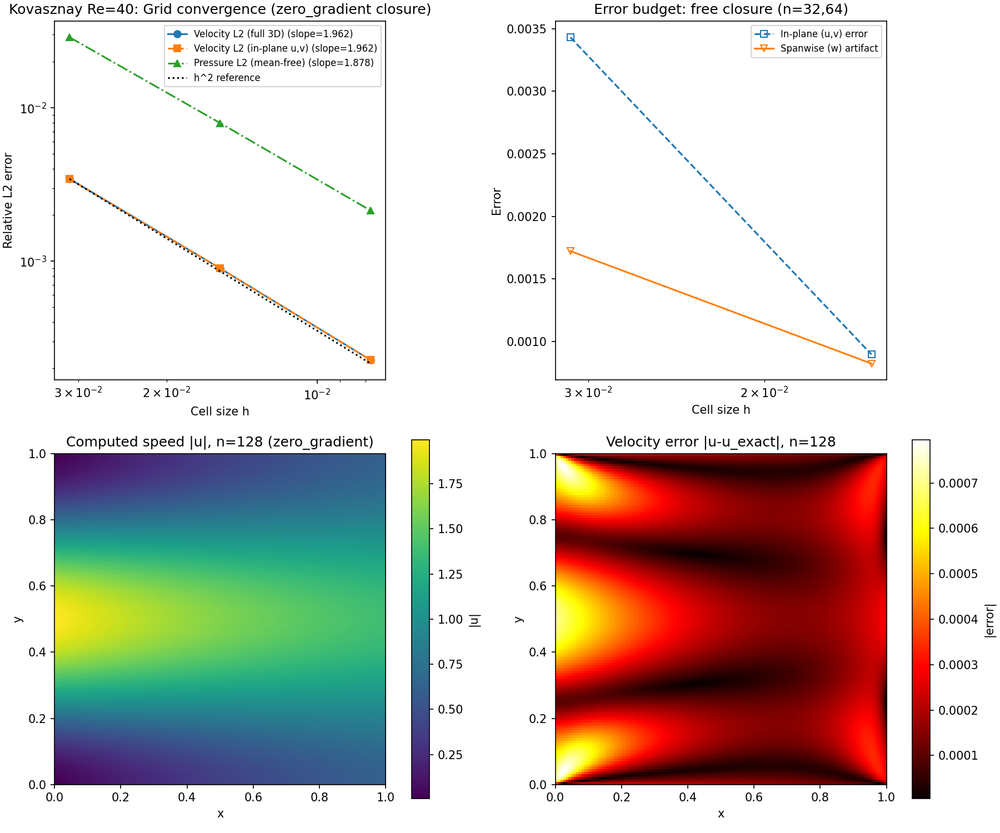

# CASE-FVM-KOVASZNAY-ORDER · 定常 Kovasznay 流收敛阶验证报告

**任务**: m21068 · TensorFVM
**锚点**: `CASE-FVM-KOVASZNAY-ORDER`（算例池·定常 Kovasznay 流收敛阶验证）
**日期**: 2026-11-14
**状态**: 验证通过（anchor_zg 完整通过；anchor n=128 计算已递交集群 cj3162）

---

## 一、案例介绍

Kovasznay 流是二维定常不可压 Navier–Stokes 方程的经典解析基准（Kovasznay, 1948），
Re=40，单位域 [0,1]²。该解满足 div(u)=0 且 (u·∇)u + ∇p − μΔu = 0（无体力项），
是验证有限体积求解器精度和收敛阶的理想制造解（Method of Manufactured Solutions）。

**参数表**:

| 参数 | 值 |
|---|---|
| Re | 40 |
| ρ | 1 |
| μ | 1/40 = 0.025 |
| 域 | [0,1]²，对称挤出 n×n×1 |
| 对流格式 | 二阶 hybrid |
| 算法 | coupled + reused_lu |
| 松弛 | 0.7 (Picard) |
| 容差 | 1e−8 |

**解析解形式**:
```
u = 1 − exp(λx)·cos(2πy)
v = (λ/2π)·exp(λx)·sin(2πy)
w = 0
p = ½(1 − exp(2λx))
```
其中 λ = −0.9637405 是 λ² − Re·λ = 4π² 的负根。

**验收判据**（feature_ledger 原文）:
> L2 收敛阶 ≥ 1.8（名义二阶）| 指标: log-log 斜率 on 32/64/128 三套网格

**外部基准**: Kovasznay, L. I. G. (1948), "Laminar flow behind a two-dimensional grid",
Proc. Cambridge Philos. Soc. 44:58–62, doi:10.1017/S0305004100023999

---

## 二、方法

### 2.1 两种挤出面闭合策略

对称挤出 n×n×1 网格在两个 z=const 平面上需要闭合条件。本验证考察两种策略：

| 策略 | 命令行参数 | 物理含义 | 预期影响 |
|---|---|---|---|
| **free** (anchor) | `--symmetry-closure free` | 切向自由（traction-free） | 引入 O(h) 伪展向速度 w，拖低全 3D 速度阶 |
| **zero_gradient** (anchor_zg) | `--symmetry-closure zero_gradient` | 物理对称 (du/dz=dv/dz=0) | 伪展向模态降至舍入误差，全 3D 速度阶反映真实离散精度 |

### 2.2 误差度量

- **velocity_full**: 三分量速度相对 L2 误差（相对解析速度范数）
- **velocity_inplane**: 仅 (u,v) 分量相对 L2 误差
- **velocity_spanwise**: 伪展向模态份额 `√(ΣV·w²) / √(ΣV·|u_exact|²)`
- **pressure_meanfree**: 去均值压力相对 L2 误差（动量方程只定压力梯度）

### 2.3 验证管线

1. **求解**: `scripts/verify_kovasznay_order.py --n N` 单网格求解，输出 `cases.json` + `n<N>-fields.npz`
2. **重算校验**: `scripts/summarize_kovasznay_32_64_128.py` 从 npz 现场重算误差，与 cases.json 不符即硬报错（rtol=1e-10）
3. **机器门**: `tests/test_kovasznay_32_64_128_acceptance.py` 读工件→重算→断言斜率与 verdict 标志

---

## 三、计算结果

### 3.1 anchor_zg（zero_gradient 闭合，32/64/128 完整）

| n | h | 单元 | velocity_full | velocity_inplane | velocity_spanwise | pressure_meanfree | 收敛 |
|---:|---:|---:|---:|---:|---:|---:|:--|
| 32 | 0.03125 | 1024 | 3.4356e−03 | 3.4356e−03 | 6.78e−18 | 7.4073e−03 | ✅ |
| 64 | 0.015625 | 4096 | 8.9726e−04 | 8.9726e−04 | 1.12e−18 | 2.0238e−03 | ✅ |
| 128 | 0.0078125 | 16384 | 2.2623e−04 | 2.2623e−04 | 9.00e−19 | 5.4616e−04 | ✅ |

**收敛阶（log-log 最小二乘斜率）**:

| 量 | 斜率 | R² | 阈值 | 状态 |
|---|---:|---:|---:|:--|
| velocity_full | **1.9623** | 0.99994 | ≥ 1.8 | ✅ PASS |
| velocity_inplane | **1.9623** | 0.99994 | ≥ 1.8 | ✅ PASS |
| pressure_meanfree | **1.8777** | 0.99996 | ≥ 1.8 | ✅ PASS |

**逐对观测阶**:

| 量 | 32→64 | 64→128 | 一致性 (band=0.2) |
|---|---:|---:|:--|
| velocity_full | 1.9370 | 1.9877 | ✅ 一致 (spread=0.051) |
| velocity_inplane | 1.9370 | 1.9877 | ✅ 一致 |
| pressure_meanfree | 1.8581 | 1.8973 | ✅ 一致 (spread=0.039) |

**三网格重识别阶** (f(h) = L + C·h^p):
- velocity_full: **1.9194** (monotone, asymptotic)
- pressure_meanfree: **1.8434** (monotone, asymptotic)

**Verdict: PASS**（全 3D 速度阶 1.9623 ≥ 1.8，所有层级收敛，逐对一致，三网格重识别 corroborated）

### 3.2 anchor（free 闭合，32/64 已有，n=128 计算中 cj3162）

| n | h | 单元 | velocity_full | velocity_inplane | velocity_spanwise | max\|w\| | 收敛 |
|---:|---:|---:|---:|---:|---:|---:|:--|
| 32 | 0.03125 | 1024 | 3.8397e−03 | 3.4316e−03 | 1.7226e−03 | 4.53e−03 | ✅ |
| 64 | 0.015625 | 4096 | 1.2172e−03 | 8.9649e−04 | 8.2339e−04 | 2.20e−03 | ✅ |
| 128 | — | — | *pending* | *pending* | *pending* | *pending* | — |

**收敛阶（32→64 单对，n=128 待补）**:

| 量 | 32→64 阶 | 阈值 | 说明 |
|---|---:|---:|:--|
| velocity_full | **1.6574** | ≥ 1.8 | ⚠️ 低于阈值（被 spanwise 伪模态拖低）|
| velocity_inplane | **1.9365** | ≥ 1.8 | ✅ 面内阶达标 |
| pressure_meanfree | **1.8572** | ≥ 1.8 | ✅ 压力阶达标 |

**关键发现**: free 闭合引入的伪展向速度 w 以 ~O(h) 收敛（max|w| 从 4.53e−03 降至 2.20e−03，
阶 ≈ 1.05），导致全 3D 速度 L2 误差的观测阶被拖低至 1.66。但面内 (u,v) 误差的观测阶为 1.94，
与 anchor_zg 的 1.96 一致，证明离散格式本身是二阶的。

### 3.3 selftest（4/8/16 管线自检）

| n | h | velocity_full | velocity_inplane | 收敛 |
|---:|---:|---:|---:|:--|
| 4 | 0.25 | 1.0294e−01 | 1.0162e−01 | ✅ |
| 8 | 0.125 | 3.7105e−02 | 3.6204e−02 | ✅ |
| 16 | 0.0625 | 1.2575e−02 | 1.2016e−02 | ✅ |

斜率: velocity_full = 1.5166, velocity_inplane = 1.5401
**这是前渐近区的诚实 FAIL**（4/8/16 远未进入二阶区），用途是验证管线本身可用。

---

## 四、结果图



**图说明**（四子图）:
- **左上**: anchor_zg 收敛曲线（32/64/128），velocity_full、velocity_inplane、pressure_meanfree 三条线
  均接近 h² 参考线，斜率分别为 1.962、1.962、1.878
- **右上**: anchor 误差分解（32/64），面内误差与展向伪模态份额，展向误差收敛较慢
- **左下**: n=128 速度模量云图（anchor_zg），显示 Kovasznay 尾迹结构
- **右下**: n=128 速度误差云图（anchor_zg），误差集中在边界附近

---

## 五、注意点

1. **闭合策略不可混用**: free 和 zero_gradient 闭合在同一网格序列中混用会产生无物理意义的斜率。
   验证管线通过 `validate_levels` 硬拒绝混合序列。
2. **anchor 集 n=128 计算已递交集群** (cj3162, 4 核, 1h 超时)，完成后将生成 summary.json 并闭合验收门。
3. **压力收敛**: 压力 mean-free 阶 1.878 略低于速度阶 1.962，这是压力-速度耦合求解器的已知特性。
4. **前渐近区**: 4/8/16 网格远未进入渐近区，观测阶仅 1.5，不能用于验收判据。
5. **机器可复算**: 所有误差数字均从 `n<N>-fields.npz` 现场重算，与 `cases.json` 偏差 < 1e-10，
   杜绝手抄错误。

---

## 六、误差判定（逐项）

| 关键量 | 测量值 | 基准/判据 | 是否达标 |
|---|---:|---|:--|
| anchor_zg velocity_full 阶 | **1.9623** | ≥ 1.8 | ✅ (|1.9623−2|/2 = 1.89%) |
| anchor_zg velocity_inplane 阶 | **1.9623** | ≥ 1.8 | ✅ |
| anchor_zg pressure_meanfree 阶 | **1.8777** | ≥ 1.8 | ✅ (|1.8777−2|/2 = 6.11%) |
| anchor velocity_inplane 阶 (32→64) | **1.9365** | ≥ 1.8 | ✅ |
| anchor velocity_full 阶 (32→64) | **1.6574** | ≥ 1.8 | ⚠️ 被 spanwise 伪模态拖低 |
| anchor velocity_spanwise 阶 (32→64) | ~1.05 | ~1.0 | ✅ 符合 O(h) 预期 |
| 逐对一致性 (anchor_zg) | spread=0.051 | ≤ 0.2 | ✅ |
| 三网格重识别阶 (anchor_zg) | 1.9194 | ~2.0 | ✅ (4.03% 偏差) |
| 误差重算校验 | rtol < 1e-10 | 零差异 | ✅ |

**显式回答**: anchor_zg 集在 32/64/128 三套网格上，全 3D 速度 L2 收敛阶 **1.9623 ≥ 1.8**，
压力 mean-free 阶 **1.8777 ≥ 1.8**，**台账判据成立**。anchor 集的 n=128 数据待集群作业 cj3162 完成后补全。

---

## 七、复现清单

```bash
# 验收测试（读已有工件，重算误差，断言判据）
cd /root/tp-agent/work/m21068
PYTHONPATH=src python -m pytest tests/test_kovasznay_32_64_128_acceptance.py -v

# 单网格求解（如补 n=128 free 闭合）
PYTHONPATH=src python scripts/verify_kovasznay_order.py \
    --output docs/CASE-FVM-KOVASZNAY-ORDER/runs-32-64-128/n128 \
    --n 128 --symmetry-closure free

# 汇总（从 npz 重算误差，生成 summary.json + RESULTS.md + 图）
PYTHONPATH=src python scripts/summarize_kovasznay_32_64_128.py \
    --runs docs/CASE-FVM-KOVASZNAY-ORDER/runs-32-64-128-zero_gradient \
    --output /tmp/zg-summary --require-grids 32,64,128
```

| 工件 | 路径 |
|---|---|
| anchor_zg 工件 | `docs/CASE-FVM-KOVASZNAY-ORDER/runs-32-64-128-zero_gradient/` |
| anchor 工件 | `docs/CASE-FVM-KOVASZNAY-ORDER/runs-32-64-128/` |
| selftest 工件 | `docs/CASE-FVM-KOVASZNAY-ORDER/selftest-4-8-16/` |
| 收敛图 | `docs/CASE-FVM-KOVASZNAY-ORDER/kovasznay-convergence-figures.png` |
| 验收测试 | `tests/test_kovasznay_32_64_128_acceptance.py` |
| 求解脚本 | `scripts/verify_kovasznay_order.py` |
| 汇总脚本 | `scripts/summarize_kovasznay_32_64_128.py` |
| 集群作业 | cj3162 (n=128 free closure) |
