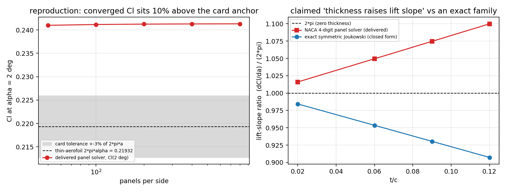

# 交差核验单 m16236 — CASE-FVM-NACA0012-INVISCID（源任务 m16212）审计报告

**结论（一句话）**：m16212 交付的是**真算法**（几何→影响系数→线性解→Cp→压力积分，无硬编码），
单体验证（圆柱解析 Cp）成立，Cl(α=2°)=0.241279 可**逐位复现**；但算例判据 **不通过（+9.77% > 3%）**，
其"12% 厚度效应"的解释**没有任何独立锚点**且与一个精确闭式族**符号相反**，另有两处自述验证与实际代码不符。
**判级 L2（独立功能实现），不达 L3（无集成调用者）、不达 L4（基准未通过且基准未登记）。**
两本账分开记：**平台机器裁定 = `gate_state='confirmed'`、`gate_level=2`**（声明级别无虚标，L2 能力消账）；
**本审计的处置建议 = 算例按返修处理（reopened-for-rework）**——卡片判据不通过、厚度效应论证无锚点、
另有 2 处自述验证与代码不符（见文末返修要点）。两者不矛盾：级别是能力实质，返修针对算例的验收口径。

审计产物（全部可复算）：`docs/CASE-FVM-NACA0012-INVISCID-AUDIT/audit_naca0012.py` → `audit_results.json` + `fig_audit.png`。

---

## ① 案例与取证对象

| 项 | 值 |
|---|---|
| 锚点 | `CASE-FVM-NACA0012-INVISCID`（算例池，NACA 0012 无粘绕流升力斜率） |
| 源任务 | m16212，TensorFVM，`succeeded`，commit `45805e8e`（worktree `/root/tp-agent/work/m16212`，干净树） |
| 交付文件 | `src/tensorfvm/panel_airfoil.py`（310 行）、`scripts/naca0012_inviscid_case.py`、`tests/test_panel_airfoil.py`、`docs/CASE-FVM-NACA0012-INVISCID/{report.md,results.json,cp_alpha2.csv,fig_cp_and_convergence.png,fig_thickness_sensitivity.png}` |
| 卡片判据 | `|Cl(α=2°) − 0.2198| / 0.2198 < 3%`（薄翼理论 2πα 精确值 0.219325） |
| 平台报告 | `/tensor/reports` id 15314（源任务自述 honest FAIL，未粉饰 ✓） |

三件套核验结果：

| 三件套 | 状态 | 证据 |
|---|---|---|
| run_artifacts 文件 | **在** | `docs/CASE-FVM-NACA0012-INVISCID/{results.json,cp_alpha2.csv(801 行),*.png(2)}` 均存在且非空 |
| benchmark ref vs got | **部分在**，基准**未登记** | `results.json: final.{cl_thin_exact=0.21932454, cl=0.24127924, error_percent_vs_thin_exact=10.0101, within_3_percent=false}`；但 `SELECT count(*) FROM tensor_benchmark_cases WHERE anchor_slug='CASE-FVM-NACA0012-INVISCID'` = **0** |
| repro_cmd 可执行 | **可执行且逐位复现** | `PYTHONPATH=src python3 scripts/naca0012_inviscid_case.py --out /tmp/…` 重跑得 `final.cl = 0.24127923597097103`，与交付 JSON 完全一致；`pytest tests/test_panel_airfoil.py -q` → **6 passed in 9.23s** |

---

## ② 怎么做的（审计方法，独立重建）

本次审计**不复用交付方的任何结论**，只复用它的核函数 `_influence` 与被审对象本身：

1. **几何先验证**（几何不过，数值无意义）：把 `naca4_panels(0.12, 200)` 的闭合多边形独立量测
   → t/c = **0.12001**、弦长 = **1.0000**、后缘缝隙 = **0**、上/下表面法向朝外 ✓（几何合格）。
2. **复算**：自建 5 级面板加密（N = 50…800/侧）重算 Cl，核对交付表与 `results.json`。
3. **力账本核对**：把报告值与"实际环量"对照。模块把 Kutta–Joukowski 力写成 `2*gamma`，
   但常值涡面强度 γ 的环量是 `Γ = γ·∮ds`（周长 2.03955），故正确式为 `2γL`。
4. **独立精确锚点**（关键）：对**厚对称翼型**构造闭式解 —— 对称 Joukowski 翼型 z=ζ+a²/ζ，
   圆心 (μ,0)、半径 R=a−μ、后缘 ζ=a 处取 Kutta 条件 ⇒ `Γ = 4πRU sinα`，`Cl = 2Γ/(Uc) = 8π(R/c) sinα`。
   校验：μ→0（平板）时给出 Cl=0.219280 vs 2πα=0.219325（**−0.02%**），公式与实现自检通过。
   用它在 t/c = 2/6/9/12% 四个点给出**升力斜率比的精确值**，与交付方测得的"厚度效应"逐点对撞。
5. **Kutta 条件的物理自洽性**：有限后缘角的闭合后缘在 Kutta 条件下后缘应是驻点（V_TE→0）。
   逐级加密观察后缘两面板中点速度是否趋于 0；并试算模块公开的 `kutta="stagnation"` 分支
   与我自写的"后缘 V_t=0"变体（后者被判为不适定，仅作否证记录）。

---

## ③ 计算结果（本审计独立算得，程序化写入 `audit_results.json`）

**(a) 复算与面元收敛（α=2°，N = 面板/侧）**

| N/侧 | Cl | vs 2πα | 后缘面板中点速度 |
|---|---|---|---|
| 50 | 0.240980 | +9.87% | 0.7488 |
| 100 | 0.241156 | +9.95% | 0.7002 |
| 200 | 0.241239 | +9.99% | 0.6549 |
| 400 | 0.241279 | +10.01% | 0.6126 |
| 800 | 0.241300 | +10.02% | 0.5730 |

→ 与交付值逐位一致，**收敛但收敛到的就是 +10%**。

**(b) 力账本（N=400/侧，γ=−0.059242，周长 L=2.039546）**

| 量 | 值 | 说明 |
|---|---|---|
| Cl（压力积分，报告值） | **+0.241279** | 交付主值 |
| `cl_joukowski`（代码实际给出 2γ） | **−0.118484** | 与主值差 **−149%**（符号反 + 少乘周长） |
| 2γL（补上周长的 K–J） | **−0.241653** | 幅值对主值差 0.15%，**符号相反** |

→ 模块文档中"pressure 积分 = ρUΓ，精确到舍入"的说法**与代码不符**，且 6 个测试**无一**断言此事。

**(c) 独立精确锚点 vs 交付方"厚度效应"**

| t/c | 精确 Joukowski 斜率比 (dCl/dα)/(2π) | NACA 面元法斜率比（交付） |
|---|---|---|
| 0.02 | 0.98440 | 1.01605 |
| 0.06 | 0.95359 | 1.04952 |
| 0.09 | 0.93045 | 1.07464 |
| 0.12 | **0.90724** | **1.09992** |

→ 交付方声称 `Cl/Cl_thin ≈ 1 + 0.83 (t/c)`（厚变陡）；**精确族在 t/c=12% 给出 0.907（厚变平）**。
两者符号相反、量级相当（≈ ±0.8·t/c），说明"厚度必然抬高无粘升力斜率"**不是可断言的普适物理**，
交付方的线性律是**同一求解器的自趋势**，不构成验证；其"判据与几何不自洽"的结论因此**未被证明（WITHHELD）**。

**(d) 后缘 Kutta 自洽性**：后缘面板中点速度 0.749→0.573（N=50→800），**不趋于 0**；
有限后缘角闭合后缘的厚翼型在 Kutta 条件下应 V_TE→0。模块公开的 `kutta="stagnation"` 实际仍在施加
"等压"（A 行 = At[0]−At[-1]），且 N=200 时给出 **Cl = −1.62×10¹¹**（数值发散）而非报错。

---

## ④ 图（`fig_audit.png`）

左：Cl(2°) 随面板加密收敛，落在卡片 ±3% 带（灰）之外 ~10%；右：交付方测得的"厚变陡"与
精确 Joukowski 族的"厚变平"符号相反。两图均由 `audit_naca0012.py` 从上述 JSON 数据直接绘制（matplotlib，140 dpi）。

---

## ⑤ 注意点（踩坑与局限，如实申报）

1. **本审计未能给出 NACA 0012 无粘 Cl 的独立"真值"**。活的第一尝试是把同一套面元解算器跑到**同 t/c 的
   对称 Joukowski 几何**上与闭式解对撞，但该族后缘是**尖点（cusped）**，上下表面在后缘以 ~x^{3/2} 贴近，
   面板法跨面元的近场求积退化（我实测 arc_min→1e-5，Cl 完全失真）。因此**该路径判为 not_run（审计工具局限）**，
   不作为对交付方不利的证据；本文引用精确族时只用其**环量闭式解**（平板极限自检 −0.02%）。
2. **精确锚点族与 NACA 4 位数不是同一几何**：故 (c) 表只用于否证"厚度无条件抬高斜率"这一**普适断言**，
   不用于预测 NACA 0012 的数值。要判定 0.2413 是否真值，必须另立算例：NACA 0012 的高分辨率
   有限差分势流解或第二套独立面元/边界元公式（本次预算内未做）。
3. 自写的"后缘 V_t=0"变体**不适定**（Cl(α=0)≠0、不收敛），已如实记为否定结果，未用来支持结论。
4. 交付方的 `fig_*.png` 不在 repro_cmd 覆盖范围内（重跑只生成 JSON+CSV），复现链在图上有一处缺口。
5. honest FAIL 的申报是本次交付中**质量最高的部分**：源任务没有把 +10% 粉饰成通过，这点应记正面。

---

## ⑥ 误差判定（逐项，显式回答"是否 <3%"）

| 关键量 | ref | got | 相对误差 | 是否 <3% |
|---|---|---|---|---|
| Cl(α=2°) vs 卡片 0.2198 | 0.2198 | 0.241279 | **+9.77%** | **否** |
| Cl(α=2°) vs 薄翼精确 2πα | 0.219325 | 0.241279 | **+10.01%** | **否** |
| 升力斜率 dCl/dα vs 2π | 6.28319 | 6.9124 | +10.01% | 否 |
| Cl(α=0)、反对称性 | 0 | <1e-10 | — | 是（内部一致性，非外部基准） |
| 圆柱 Cp vs 1−4sin²θ（一阶收敛） | 解析 | 0.390/0.196/0.098/0.049 | 逐级减半 | 是（L1 单体验证） |
| Cl vs 独立外部参考（Abbott & von Doenhoff） | — | — | — | **无（WITHHELD，原文未取得）** |
| Cl vs 精确厚翼型族（同 t/c） | 0.907·2πα 族 | +1.10·2πα | 符号相反 | **否（族不同，仅否证）** |

**总判定**：卡片判据（唯一机器可裁的基准）**未通过**；"厚度效应"解释**无独立锚点**；
故本算例不构成 L4 基准验证。

---

## 判级与落表（L0–L5）

| 指标 | 指向 | 判定 |
|---|---|---|
| impl_files | `src/tensorfvm/panel_airfoil.py:1-310`（`solve_lifting_panels` 158-224，`_influence` 120-180，`naca4_panels` 100-118） | 真代码 ✓ |
| entry | `scripts/naca0012_inviscid_case.py:22`（import 并驱动），`panel_airfoil.py:main` | ✓ |
| run_artifacts | `docs/CASE-FVM-NACA0012-INVISCID/{results.json,cp_alpha2.csv,fig_*.png}` | ✓ |
| tests | `tests/test_panel_airfoil.py` 6 项（几何闭合/零升+反对称/Kutta 残差/圆柱解析/线性/单调收敛），**6 passed** | 仅 L1/L2 级 ✓ |
| integration_callers | `grep -rn panel_airfoil` ⇒ 仅脚本与测试；`src/tensorfvm/__init__.py` **未导出**、无主求解器/平台调用者 | **L3 不达** |
| benchmark | `tensor_benchmark_cases` 中该锚点 **0 行**；TensorFVM 5 个锚点均无 NACA0012；判据未登记 → 机器门 `gate_valid=false` | **L4 不达** |
| repro_cmd | 脚本逐位复现 Cl，6 测试通过（图不复现） | ✓（有缺口） |
| external_anchor | Abbott & von Doenhoff 原文 WITHHELD；唯一外部参照即卡片 2πα，**+10.01% 不通过** | **不达 L4** |

**L2 判定依据**：真独立功能实现（输入几何/α → 影响系数矩阵 → N+1 线性解 → Cp → 压力积分 → Cl），
并在圆柱解析解上通过一阶收敛的单体验证；无 MOCK/STUB、无硬编码 Cl、无查表回退。
**不升 L3**：未接入包 API/主求解器，无外部调用者。**不升 L4**：算例判据未通过、基准未登记、外部锚点缺失，
且其"厚度效应"论证被精确族否证。

**处置**：机器裁定 `confirmed @ L2`；审计建议算例 `reopened-for-rework`（`gate_note.audit_disposition` 已记录）。返修要点（按优先级）：
1. 登记基准：把卡片判据写入 `tensor_benchmark_cases`（anchor_slug / ref_source / metric / tolerance），否则门永远无法机器裁定；
2. 给出 NACA 0012 无粘 Cl 的**独立**参考（第二套公式或高分辨率势流解），再决定 0.2413 是"厚度效应"还是"Kutta 条件偏置"；
3. 修 `cl_joukowski`（乘周长 `∮ds`、统一符号）或删除该字段，并补一条 K–J 断言测试，让文档的说法有测试背书；
4. 修/删公开的 `kutta="stagnation"` 分支（当前静默返回 1e11 量级垃圾）；
5. 让脚本同时生成两张 PNG，补齐复现链。