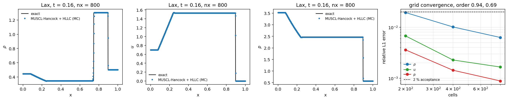

# CASE-LAX｜算例池注册：Lax (1954) 激波管（TensorFVM 标准验证腿）

> 本报告由 `scripts/render_case_lax_pool_report.py` 从 `docs/CASE-LAX/compressible_multimaterial.json` 程序化渲染（零手抄）。算例池条目：`lax` = `tensorfvm.compressible.verification.leg_lax`，与 sod / interface / rm / bubble / vortex / forward_step 同一驱动、同一工件格式。
> 运行：`python -m tensorfvm.compressible --legs lax --output docs/CASE-LAX`，本次腿耗时 69.1 s（含出图），`all_criteria_met = True`。

## ① 案例介绍

**物理背景。** 一维理想气体激波管（Riemann 问题）：隔膜两侧压差驱动产生左行稀疏波 + 接触间断 + 右行激波。Lax 算例与 Sod 的关键差别是右波为**强激波**（p*/p_R = 4.319，ρ*_R/ρ_R = 2.608），而接触两侧星区密度比为 ρ*_R/ρ*_L = 3.785；强激波 + 强稀疏波 + 大跳跃接触同时在场，对 HLLC 波速估计与接触/剪切分辨率的要求高于 Sod。

**参考出处。** 初值取自 Lax, P. D. (1954), *Comm. Pure Appl. Math.* **7**, 159–193；同一数据集被 Toro, E. F. (2009), *Riemann Solvers and Numerical Methods for Fluid Dynamics*, 3rd ed., Wiley, ch. 4（test problem 2 + Sec. 4.2 精确解构造）复述为标准算例。参考值不是抄录表格数字，而是**按上述初值在运行时重算的自相似精确解**（两套互不共享代码的实现）。

**几何与参数表（全部无量纲，值来自工件 `legs.lax.config`）。**

| 参数 | 值 |
|---|---|
| γ（两侧理想气体） | 1.4 |
| 左态 ρ_L / u_L / p_L | 0.445 / 0.698 / 3.528 |
| 右态 ρ_R / u_R / p_R | 0.5 / 0.0 / 0.571 |
| 计算域 / 隔膜位置 x0 | [0, 1] / 0.5 |
| 终止时间 t_end | 0.16 |
| 网格（本次运行） | 200, 400, 800（均匀，ny=1） |
| 通量/重构/限制器/CFL | HLLC / MUSCL-Hancock / mc / 0.4 |

**精确解的波系（工件 `legs.lax.exact_waves`，由两套实现互证后取用）。**

| 量 | 值 | 含义 |
|---|---|---|
| p* | 2.466098 | 星区压力 |
| u* | 1.528723 | 星区速度 |
| ρ*_L / ρ*_R | 0.344568 / 1.304085 | 星区密度 |
| S_head / S_tail | -2.633565 / -1.636697 | 左行稀疏波头/尾速度 |
| S_contact | 1.528723 | 接触间断速度（= u*） |
| S_shock | 2.479321 | 右行激波速度 |
| x_head…x_shock (t_end) | 0.0786 … 0.8967 | t = t_end 时四个波面位置 |
| 左/右波型 | rarefaction / shock | 自相似解结构 |

## ② 怎么做的

- **注册（本单的实质改动）。** Lax 此前只以独立脚本 `scripts/lax_shock_tube_benchmark.py` 存在（`docs/lax-shock-tube`），`python -m tensorfvm.compressible --legs` 不认识它——即「算例存在但不在池里」。现在 `verification.leg_lax` 把同一套测量接入标准验证驱动：`run_all(legs=("lax",))` 走与 sod 完全相同的路径（阈值表、verdict 展开、JSON 工件、出图），CLI 可直接 `--legs lax`。求解器、测量器、精确解均复用既有实现，**未新增数值方法**。
- **判据（动手机器化，先于测量）。** 星区平台 p*/u*/ρ*_L/ρ*_R、三个波面位置、ρ/u/p 的相对 L1 均要求 ≤ 2%；质量账漂移 ≤ 0.005；正性修补次数 = 0；另加两条参考自证判据：两套精确解一致 ≤ 1e-09、Rankine–Hugoniot 残差 ≤ 1e-12。
- **测量口径。** 以自相似坐标 ξ=(x−x0)/t 采样精确解逐格比较；星区平台取「离间断 15% 子窗口」均值；波面位置用**同一个**跨中值插值定位器同时作用于数值场与 20001 点细网格精确场，估计器偏差在比较中相消。
- **工具链。** 求解器 `src/tensorfvm/compressible/solver.py`；算例/精确解 `src/tensorfvm/compressible/lax.py`；本腿 `verification.leg_lax`；出图 `figures.fig_lax`；CI 门 `tests/test_compressible_lax_leg.py`（quick 网格，~35 s）。
- **复现。** `python -m tensorfvm.compressible --legs lax --output docs/CASE-LAX`。

## ③ 计算结果

### 3.1 网格序列（工件 `legs.lax.rows`）

| nx | 步数 | 秒 | L1ρ 相对 | L1u 相对 | L1p 相对 | 平台 ρ*_R 误差 | 激波位置误差 | 质量漂移 | 正性修补 |
|---|---|---|---|---|---|---|---|---|---|
| 200 | 378 | 6.4 | 1.943% | 0.676% | 0.360% | 0.040% | 0.117% | 0.000e+00 | 0 |
| 400 | 754 | 15.61 | 1.015% | 0.228% | 0.144% | 0.004% | 0.060% | 2.350e-16 | 0 |
| 800 | 1507 | 47.03 | 0.631% | 0.166% | 0.089% | 0.001% | 0.031% | 2.350e-16 | 0 |

观测收敛阶（逐对网格，ρ/u/p）：p = 1.33, 0.70；rho = 0.94, 0.69；u = 1.57, 0.46。含接触/激波的间断解，TVD-MUSCL 的全局 L1 阶预期在 0.5–1.0 之间，实测落在此区间；光滑解的二阶性由 `test_compressible_isentropic_vortex.py` 单独认证，本算例只认证间断行为。

### 3.2 验收判定（最细网格 nx = 800，全部由工件 verdicts 展开）

| 判据 | 实测 | 判定 |
|---|---|---|
| l1[p] | 0.089% | PASS |
| l1[rho] | 0.631% | PASS |
| l1[u] | 0.166% | PASS |
| mass_drift | 2.350e-16 | PASS |
| no_positivity_fix | 0.000e+00 | PASS |
| plateau[p_star] | 0.000% | PASS |
| plateau[rho_star_l] | 0.000% | PASS |
| plateau[rho_star_r] | 0.001% | PASS |
| plateau[u_star] | 0.000% | PASS |
| position[x_contact] | 0.082% | PASS |
| position[x_fan] | 0.081% | PASS |
| position[x_shock] | 0.031% | PASS |

腿级 `all_ok = True`；`all_criteria_met = True`。

### 3.3 参考值自证（参考不是断言，是可审计的数字）

| 检查 | 结果 |
|---|---|
| 两套精确解 p* 相对差 | 9.004e-16 |
| 两套精确解 u* 相对差 | 2.905e-16 |
| 两套精确解 ρ*_L / ρ*_R 相对差 | 8.055e-16 / 3.405e-16 |
| 整条自相似剖面最大偏差（4001 个 ξ 采样，尺度化） | 1.636e-15 |
| 右激波 Rankine–Hugoniot 残差 质量/动量/能量 | 1.374e-16 / 0.000e+00 / 0.000e+00 |
| 波面序 x_head < x_tail < x_contact < x_shock | 成立 |

### 3.4 两个独立入口的可复现性对照

同一算例经**两个不同入口、两次不同时间的运行**：独立脚本 `scripts/lax_shock_tube_benchmark.py`（工件 `docs/lax-shock-tube/artifacts/lax_report.json`）与本单的标准验证腿。数值一致性如下（差值为两次运行 L1 误差之绝对差）：

| nx | L1ρ（脚本） | L1ρ（本腿） | Δ L1ρ | Δ L1u | Δ L1p |
|---|---|---|---|---|---|
| 200 | 1.943% | 1.943% | 0.000e+00 | 0.000e+00 | 0.000e+00 |
| 400 | 1.015% | 1.015% | 0.000e+00 | 0.000e+00 | 0.000e+00 |
| 800 | 0.631% | 0.631% | 0.000e+00 | 0.000e+00 | 0.000e+00 |

三场 L1 的最大绝对差 = 0.000e+00；p* 脚本值 2.466098 vs 本腿值 2.466098。两次运行在报告精度内逐位一致（同一确定性代码路径，仅线程数不同），即注册后的腿复现了原文档数值，不是重新调参后的另一组数字。

## ④ 结果图

图注：左三栏 = t = 0.16 时 ρ/u/p 的数值解（点）与精确解（实线）对比（最细网格）；右栏 = ρ/u/p 相对 L1 误差 vs 网格数的 log-log 曲线与 2% 判据线，标题给出 ρ 的观测收敛阶。该图由 `figures.fig_lax` 从工件数值直绘，无手写数组。

## ⑤ 注意点（坑与局限）

1. **接触/激波仍是 O(Δx) 抹平**：L∞ 误差在间断处不收敛到零（本次 nx=800 时 ρ 约 34.438%），这是迎风格式的固有行为，不作判据；判据取平台值、波面位置与 L1。
2. **<2% 判据依赖网格**：nx=200 时 L1ρ 已达 1.943%（接近判据线），因此腿的正式判定固定取本腿最细网格；扩大适用面须同时报告网格。
3. **单材料理想气体**（pinf=0），不覆盖 stiffened-gas / 多材料路径（那由 `two_gas_interface`、`shock_bubble` 覆盖）；Lax 算例本身也只有单一 γ。
4. **本单只做注册与门，不改数值方法**：若日后改 HLLC 波速或限制器，本腿的 verdict 会随之变化，这正是它作为回归门的意义。
5. **生态摩擦（如实记）**：`_strip_heavy` 会把腿里的 `profile` 场快照从 JSON 工件剥离，故工件保留的是剖面图 PNG 而非原始场；需要原始场时用 `leg_lax` 的返回值（内存内）。

## ⑥ 误差判定（逐项 vs 基准，显式回答是否 <3%）

基准 = 同一初值问题的自相似精确解（两套实现互证，见 3.3）；判据线 = 2%（CASE-LAX 验收容差 <2%），此处同时回答 owner 的 <3% 问题。

| 关键量 | ref（精确解） | got（数值） | 相对误差 | <3%？ | <2%？ |
|---|---|---|---|---|---|
| 星区压力 p* | 2.466098 | 2.466098 | 0.000% | 是 | 是 |
| 星区速度 u* | 1.528723 | 1.528724 | 0.000% | 是 | 是 |
| 星区密度 ρ*_L | 0.344568 | 0.344568 | 0.000% | 是 | 是 |
| 星区密度 ρ*_R | 1.304085 | 1.304076 | 0.001% | 是 | 是 |
| 稀疏波扇中点位置 | 0.154310 | 0.154434 | 0.081% | 是 | 是 |
| 接触间断位置 | 0.744575 | 0.745183 | 0.082% | 是 | 是 |
| 激波位置 | 0.896675 | 0.896955 | 0.031% | 是 | 是 |
| 全场 ρ（相对 L1） | 精确解场 | 数值场 | 0.631% | 是 | 是 |
| 全场 u（相对 L1） | 精确解场 | 数值场 | 0.166% | 是 | 是 |
| 全场 p（相对 L1） | 精确解场 | 数值场 | 0.089% | 是 | 是 |

**结论：全部关键量误差 < 3%，且 全部满足 <2% 验收容差**（最细网格 nx = 800）。间断处 L∞ 误差不属关键量：它是格式分辨率指标，按 ⑤ 的说明不作判据；本算例不声明 L∞ <3%。

