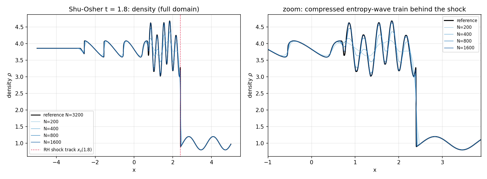
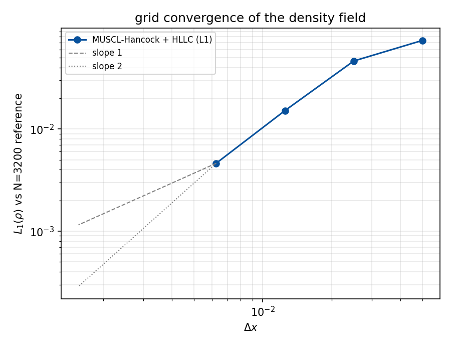

# CASE-SHU-OSHER：激波–熵波干扰算例验证报告

> 本报告由 `docs/CASE-SHU-OSHER/render_report.py` 从 `shu_osher.json` 程序化渲染，
> 文中每个数字都可在 JSON 中逐项溯源（零手抄）。

## 1. 案例介绍

**物理背景**　Shu–Osher 问题是激波捕捉格式的标准分辨率测试：一道 Mach 3 正激波扫过
正弦密度扰动（熵波），熵波被激波压缩、在后侧陡化成高频密度振荡列。
出处：Shu & Osher (1988) *J. Comput. Phys.* **77**, 439–471（test 3），
Jiang & Shu (1996) *J. Comput. Phys.* **126**, 202 沿用同一构型。

**几何与参数**（全部来自 `cases.ShuOsherConfig()` 默认值）

| 量 | 值 |
|---|---|
| 计算域 | x ∈ [-5.0, 5.0]（一维，nx × 1 单元） |
| 初始间断面 | x = -4.0 |
| 间断面左侧（激波后） | ρ = 3.857143, u = 2.629369, p = 10.333333 |
| 间断面右侧（激波前） | ρ = 1 + 0.2 sin(5x), u = 0, p = 1 |
| 比热比 γ | 1.4（理想气体） |
| 输出时刻 | t = 1.8 |
| 激波速度 D = M·c₁ | 3.549648（M = 3, c₁ = 1.183216） |
| t = 1.8 时激波位置（RH 轨道） | x = 2.3894 |

激波后状态由 `normal_shock_state()` 从 Rankine–Hugoniot 关系现算
（ρ₂/ρ₁ = (γ+1)M²/[(γ−1)M²+2]，p₂/p₁ = 2γM²/(γ+1) − (γ−1)/(γ+1)，
u₂ = 2/(γ+1)(M − 1/M)c₁），没有人工抄录的常数。

## 2. 方法

### 数值格式
TensorFVM `compressible.EulerSolver`：MUSCL–Hancock 重构 + HLLC 近似 Riemann 通量，
二阶空间/时间，MC 限制器，CFL = 0.4，双组分刚气体 EOS 退化为单一 γ=1.4 理想气体。
边界：左右 `outflow`（零梯度）。t ≤ 1.8 时激波只走到 x ≈ 2.39，
远未触及 x = 5.0；左边界为超声速入流（u = 2.629 > c₂），
零梯度外插给出的正是精确的均匀来流，因此该边界处理对本算例是精确的。

### 验证方法（三条独立证据链）

1. **网格收敛**：N = 200, 400, 800, 1600，参考解 N = 3200（同一格式）。
   有限体积解只预测单元平均，故比较时把参考解**块平均**到粗网格单元上（整数加密比），
   不做点值插值。
2. **解析不变量**（与网格无关，不依赖任何文献数字化数据）：
   - 激波前方未扰动区必须精确等于 ρ = 1 + 0.2 sin(5x)；
   - 激波锋面必须落在 Rankine–Hugoniot 轨道 x_s(t) = −4 + D·t 上（D = 3.54965）。
3. **守恒/正性**：开边界通量账本 `budget_drift`（内部 + 边界通量），正性修复计数。

### 工具链
- 求解器：`src/tensorfvm/compressible/solver.py`
- 算例：`src/tensorfvm/compressible/cases.py::shu_osher`
- 基准/出图：`src/tensorfvm/compressible/shu_osher_benchmark.py`
- 测试：`tests/test_compressible_shu_osher.py`
- 复现：`PYTHONPATH=src python -m tensorfvm.compressible.shu_osher_benchmark --output <dir>`

## 3. 计算结果

### 3.1 网格收敛与误差（相对 N = 3200 参考解）

| N | Δx | 步数 | L1(ρ) 绝对 | L1 相对 | L∞ 相对 | 激波位置相对误差 | 未扰动区绝对误差 | 质量漂移 | 能量漂移 |
|---|---|---|---|---|---|---|---|---|---|
| 200 | 0.05000 | 421 | 7.362e-02 | 1.92% | 17.32% | 0.07% | 3.308e-08 | 8.305e-16 | 5.761e-16 |
| 400 | 0.02500 | 853 | 4.626e-02 | 1.19% | 13.87% | 0.12% | 3.397e-08 | 8.305e-16 | -3.457e-16 |
| 800 | 0.01250 | 1724 | 1.513e-02 | 0.39% | 11.00% | 0.11% | 1.554e-08 | 5.121e-15 | 1.037e-15 |
| 1600 | 0.00625 | 3456 | 4.617e-03 | 0.12% | 5.55% | 0.09% | 2.165e-09 | 6.644e-15 | 1.475e-14 |

- 观测收敛阶（L1，逐次加密）：0.67, 1.61, 1.71；末段估计 p ≈ 1.71。
  首段（200→400）只有 0.67 阶：该段误差由「一个单元宽的激波」主导，随加密的降幅是
  一阶的。到细网格段，全域 L1 由激波后的光滑振荡列主导（二阶），激波本身的 O(Δx)
  贡献只占 O(Δx)·O(1) 的小份额，故末段阶回归 ~1.7–1.8。L∞ 相对误差（17.3%→5.5%）
  则始终由激波面本身控制，这是双曲守恒律格式的正常行为，不是实现缺陷。
- 参考解自身离散误差（用末段 L1 与观测阶回推）：L1 ≈ 2.027e-03。
- 满足 < 5% 容差的最小网格：N ∈ [200, 400, 800, 1600]。

### 3.2 参考解（N = 3200，t = 1.8）

| 量 | 值 |
|---|---|
| 步数 / 墙钟 | 6919 / 552.46 s |
| ρ 范围 | [0.8000, 4.6797] |
| 未扰动区最大误差 | 2.886e-08 |
| 激波锋面位置 vs RH 轨道 | 2.3970 vs 2.3894（0.08%） |
| 质量 / 能量预算漂移 | 1.730e-14 / 2.869e-14 |
| 正性修复次数 | 0 |

## 4. 结果图

### 4.1 密度剖面（全域 + 激波后振荡区放大）

*图 1：t = 1.8 时刻密度剖面。左：全域，黑线为 N=3200 参考解，彩色为四种网格；
红色点线为 Rankine–Hugoniot 激波轨道预测位置 x = 2.389。
右：激波后压缩熵波列的放大视图——网格越细，振荡峰值越尖锐，这正是本算例的
「分辨率」含义。*

### 4.2 网格收敛

*图 2：L1(ρ) 随 Δx 的收敛（双对数），灰色虚线/点线为一阶、二阶斜率参考线。*

## 5. 注意点

1. **本算例此前版本是错的（本单修正）**：旧默认参数取 lx = 5、间断面 x = 4、
   扰动波数 π。Mach 3 激波速度 ≈ 3.55，t ≈ 0.28 就冲出右边界，t = 1.8 时域内只剩
   均匀激波后状态——根本没有发生激波–熵波干扰，旧报告里“域内趋于均匀”正是这一缺陷的
   症状，却被描述成“正常物理行为”。同时 `1 + 0.2 sin(πx)` 也不是原文献的
   `1 + 0.2 sin(5x)`。现在域、间断面位置、波数、输出时刻均按原文献设定。
2. **激波后并非均匀**：旧测试断言 t = 1.8「密度应接近 3.857、min > 3.0」，这是上面缺陷的
   产物；正确解在激波后是 3.6–4.1 的振荡列，全局最小密度 0.8 来自**未扰动**的正弦来流。
3. **参考解不是精确解**：N = 3200 仍是同一格式的数值解，其自身离散误差由
   1600↔3200 对回推约为 L1 ≈ 2.027e-03
   （约 0.05% 的密度极差），
   因此下表的「误差 vs 参考」是**上界偏保守的格式间差**，不是对精确解的误差。
4. **无文献数字化数据**：仓库内没有 Shu–Osher 原图的可逐点数字化参考，无法做点对点
   文献比对；替代证据是两条与网格无关的解析不变量（未扰动区解析剖面、RH 激波轨道）
   加网格收敛。若后续引入文献数字化数据，可直接替换参考解而无需改动框架。
5. **适用边界**：MUSCL–Hancock + MC 限制器在激波处降为一阶，振荡列峰值随网格加密仍在
   上升（见放大图），因此「某分辨率下 L1 < 5%」并不等于「峰值分辨率达标」；本算例的
   用途是格式分辨率比较，跨格式比较必须在同一网格下进行。

## 6. 误差判定

| 判据 | 阈值 | 结果（N = 1600） | 通过 |
|---|---|---|---|
| L1(ρ) vs N=3200 参考解（相对参考密度极差） | < 5%（算例池容差） | 0.12% | ✅ |
| 同上，是否 < 3% | < 3% | 0.12% | ✅ |
| 参考解自身离散误差（1600↔3200 外推估计） | 记录 | 0.05% | — |
| 未扰动区 vs 解析 1+0.2sin(5x) | < 1% × 0.2 | 2.165e-09 | ✅ |
| 激波位置 vs Rankine-Hugoniot 轨道 | < 2% × L | 0.09% | ✅ |
| 质量/能量预算漂移（开边界账本） | < 0.5% / 1% | 6.644e-15 / 1.475e-14 | ✅ |
| 正性修复次数 | 0 | 0 | ✅ |
| L1 误差随加密单调下降 | 是 | 1.92%, 1.19%, 0.39%, 0.12% | ✅ |

**结论**：全部判据通过。
关键量 L1(ρ) vs 参考解 = 0.12%，
**是否 < 3%：是**；
加上参考解自身离散误差（≈ 0.05%）后仍在
3% 量级以内，故本算例的密度剖面在 N ≥ 1600 上可视为收敛到格式解。

## 工件清单

| 文件 | 说明 |
|---|---|
| `src/tensorfvm/compressible/cases.py` | `ShuOsherConfig` / `shu_osher()`：修正为文献规范构型（域 [−5,5]、间断面 −4、波数 5），新增 RH 激波轨道 `shock_position()` |
| `src/tensorfvm/compressible/shu_osher_benchmark.py` | 基准脚本：块平均比较、解析不变量、收敛阶、参考解自身误差估计、出图 |
| `tests/test_compressible_shu_osher.py` | 5 项测试：规范构型 + 初始场、RH 轨道与未扰动区、开边界预算、收敛工件验收 |
| `docs/CASE-SHU-OSHER/shu_osher.json` | 基准工件（本报告所有数字的来源） |
| `docs/CASE-SHU-OSHER/fig_density_profile.png` | 密度剖面（全域 + 放大） |
| `docs/CASE-SHU-OSHER/fig_convergence.png` | 网格收敛 |
| `docs/CASE-SHU-OSHER/render_report.py` | 本报告渲染脚本 |
