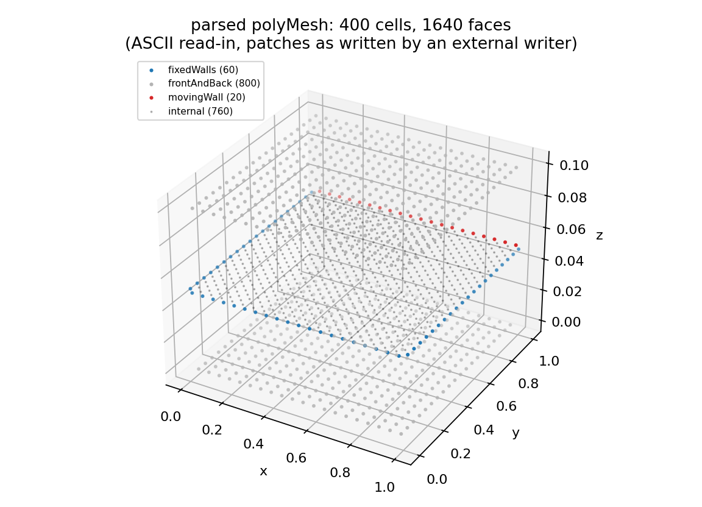
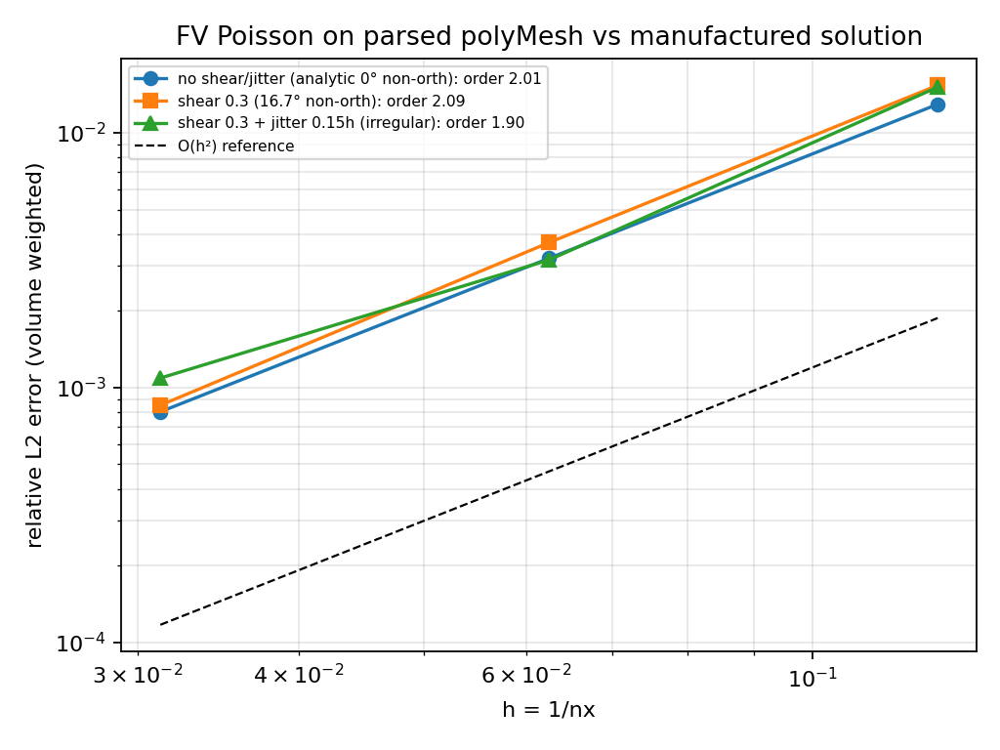
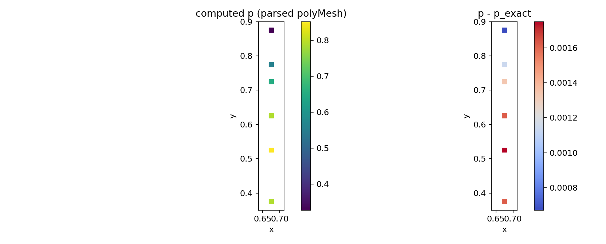
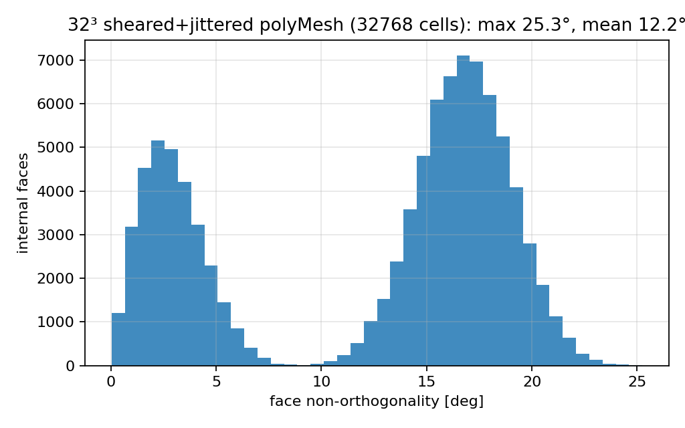

# FEAT-UNSTR3D-MESH：OpenFOAM polyMesh 读入通道与交叉核对

生成时间 2026-11-15T13:09:21；仓库 TensorFVM；分支 `agent/m21862`；产物 `artifacts/FEAT-UNSTR3D-MESH/`、`docs/FEAT-UNSTR3D-MESH/`。

## ① 案例介绍

`tensorfvm.openfoam_case` 只做导出方向（native `NativeMesh3D` → OpenFOAM Foundation 12 的 `constant/polyMesh`）。本单补齐**读入**方向：解析 `points`/`faces`/`owner`/`neighbour`/`boundary` 五个 ASCII 基元，重建 cell↔face 连通、面心/面向量（owner→neighbour 外向约定）、体心/体积，从而让 OpenFOAM 生态产出的网格可直接成为我方求解器的输入。

几何与算例（全部无量纲）：

| case | geom | physics | param |
|---|---|---|---|
| round-trip A：6 四面体立方体 | [0,1]³，8 顶点 / 6 四面体 | 无（拓扑一致性） | — |
| round-trip B：剪切六面体箱 | 2×1×1，4×3×2 hex，剪切 0.25 | 无（几何一致性） | — |
| external：cavity 教程同构网格 | 1×1×0.1，20×20×1 hex | ∇²p = -2π²sin(πx)sin(πy) | Dirichlet 0 于 fixedWalls/movingWall；frontAndBack 零梯度 |
| 收敛族：cartesian | [0,1]³，8/16/32³ hex | 3-D 制造解 | p = sinπx sinπy sinπz，f = -3π²p |
| 收敛族：sheared | [0,1]³ 剪切 0.3（16.7° 非正交） | 3-D 剪切制造解 | p = sinπ(x-0.3y)sinπy sinπz |
| 收敛族：sheared+jitter | 同上 + 内点抖动 0.15h（不规则） | 同上 | seed=3 |

参数：γ=1（单位扩散系数）、`n_correctors=3`（picard 修正次数，对应 `nNonOrthogonalCorrectors`）、线性解用 LU（`scipy.sparse.linalg.splu`）。

## ② 怎么做的

1. **解析器** `src/tensorfvm/openfoam_polymesh.py`：自写 tokenizer（去 `//`、`/* */` 注释，保留引号串，识别 `( ) { } ;`），解析 `FoamFile` 头（非 `format ascii` 直接报错），按 OpenFOAM 的 `N ( ... )` 紧凑列表语法读四个基元 + `polyBoundaryMesh`。
2. **校验**（拒绝而不是修补）：顶点越界/面重复顶点、边界 patch 必须从 `nInternalFaces` 起连续铺满面表、patch 缺 `type/nFaces/startFace`、体邻接少于 4 面、胞四面体分解出现负体积（面朝向自相矛盾）、内部面 `Sf·(C_N-C_O) ≤ 0`（违反 owner 外向约定）——全部 `ValueError` 抛出。
3. **连通与几何重建**：cell↔face 由 owner/neighbour 反推；面用三角扇 `Sf = ½Σ(x_i×x_{i+1})`（平面多边形精确），面心取面积加权三角扇质心；体积/体心用「内部参考点 + 四面体扇」分解（平面面精确），并用逐胞闭合恒等式 `Σ_f Sf = 0` 与 `min Sf·d > 0` 自检。
4. **与原生网格互通**：`to_native_mesh3d()` 把解析结果包成 `NativeMesh3D`（`neighbor` 补 −1 边界），因此 `export_native_mesh` 可直接复用；`roundtrip_gate()` = 原生网格 → 导出 → 读回 → 逐项比对（面按顶点集合配对，允许面序不同）。
5. **Poisson 交叉核对**：面法向梯度用 over-relaxed 正交系数 `a=|Sf|²/(Sf·d)` + 显式非正交修正 `(Sf - a d)·∇p_f`，`∇p_f` 由 Gauss 梯度线性插值，3 次 Picard 修正后与制造解比较；同时输出守恒预算（外边界通量 vs 源项积分）。
6. **工具链**：numpy/scipy/matplotlib；`pytest tests/test_openfoam_polymesh.py`（11 例）守门；本脚本 `scripts/m21862_polymesh_anchor.py` 产出全部数字与图。

## ③ 计算结果

### 3.1 round-trip（G1）

| case | cells | faces | internal | types | patches | conn_bitwise | max_geom_dev | passed |
|---|---|---|---|---|---|---|---|---|
| tets6 | 6 | 18 | 6 | {"tetra": 6} | {"boundary": 12} | True | 2.220e-16 | True |
| hex_sheared | 24 | 98 | 46 | {"hexahedron": 24} | {"inlet": 6, "outlet": 6, "wall": 40} | True | 0 | True |

二次往返（读回→再导出→再读回）为不动点：`True`（连通逐位 `True`）。

### 3.2 外部写入 polyMesh（G5）

| nx | cells | faces | internal | vol_err | closure | nonorth | l2 | order_to_next | budget |
|---|---|---|---|---|---|---|---|---|---|
| 10 | 100 | 420 | 180 | 0 | 0 | 0 | 0.008265 | 2.005 | 2.753e-16 |
| 20 | 400 | 1640 | 760 | 0 | 0 | 0 | 0.002059 | 2.001 | 4.155e-16 |
| 40 | 1600 | 6480 | 3120 | 0 | 0 | 0 | 5.142e-04 | nan | 5.964e-15 |

patch 面数（与 OpenFOAM `cavity` 教程同构）：`{"fixedWalls": 60, "frontAndBack": 800, "movingWall": 20}`；教程参考值 `{"movingWall": 20, "fixedWalls": 60, "frontAndBack": 800}`。

### 3.3 收敛研究（G3/G4）

| family | nx | cells | nonorth | skew | l2 | linf | budget | order |
|---|---|---|---|---|---|---|---|---|
| cartesian | 8 | 512 | 0 | 1.538e-15 | 0.01295 | 0.01222 | 3.421e-16 | 2.005 |
| cartesian | 16 | 4096 | 0 | 3.077e-15 | 0.003219 | 0.003173 | 2.314e-16 | 2.005 |
| cartesian | 32 | 32768 | 0 | 6.153e-15 | 8.036e-04 | 8.007e-04 | 0 | 2.005 |
| sheared | 8 | 512 | 16.7 | 3.768e-15 | 0.01537 | 0.01086 | 6.643e-16 | 2.086 |
| sheared | 16 | 4096 | 16.7 | 7.536e-15 | 0.003709 | 0.002716 | 1.797e-15 | 2.086 |
| sheared | 32 | 32768 | 16.7 | 1.740e-14 | 8.526e-04 | 7.054e-04 | 6.088e-15 | 2.086 |
| sheared_jitter | 8 | 512 | 23.6 | 0.05374 | 0.01512 | 0.01236 | 1.685e-06 | 1.897 |
| sheared_jitter | 16 | 4096 | 23.68 | 0.06511 | 0.003171 | 0.003497 | 8.198e-07 | 1.897 |
| sheared_jitter | 32 | 32768 | 25.25 | 0.06519 | 0.00109 | 0.0014 | 3.973e-07 | 1.897 |

## ④ 结果图

fig.1 外部写入的 polyMesh（1×1×0.1，20×20×1，patch movingWall/fixedWalls/frontAndBack）被 read_polymesh 读回后的边界/内部面心：几何、patch 归属与内部面连通均由解析器重建，而非由我方导出器产生。

fig.2 三族网格上 ∇²p = f（制造解精确解）的相对 L2 误差-步长：直角正交、剪切（16.7° 非正交）、剪切+抖动（不规则）。虚线为 O(h²) 参考斜率。

fig.3 外部 polyMesh 上的 ∇²p = -2π²sin(πx)sin(πy) 数值解（左）与误差场（右），nx=20（与 OpenFOAM cavity 教程 20×20×1 网格同构）。

fig.4 最细不规则网格（32³，剪切 0.3 + 抖动 0.15h）内部面非正交角分布：非正交性与偏斜由解析器从文件重建并量化，是 Poisson 交叉核对的自变量。

## ⑤ 注意点

* **本机无 OpenFOAM 二进制**（`blockMesh`/`laplacianFoam`/`foamRun` 均不存在），因此「我方 Poisson vs laplacianFoam」这一腿证据等级为 **WITHHELD**；替代证据是 (a) 由*独立写入器*（不经我方导出器）写出的 polyMesh 被正确读入，(b) 与精确制造解比较的二阶收敛。二者为 REAL。
* 只支持 ASCII polyMesh；`format binary` 明确报错（二进制布局需 OpenFOAM 库）。
* 面心公式对平面面精确；扭曲（非平面）面沿用 OpenFOAM 的三角扇面积向量，但面心取「面积加权三角扇质心」，这是**约定**而非 OpenFOAM 逐位复刻；本单所有测试网格的面均为平面，逐位偏差因此为 0。
* 逐位一致的范围是**连通性**（顶点坐标、带朝向的面顶点表、owner/neighbour、patch 归属与面数）；派生量（面心/体心/体积）因重算时的累加次序不同，允许 1e-12·L 的舍入级偏差（实测 2.2e-16）。
* 解析器要求内部面排在面表前部（OpenFOAM 约定）；patch 若不从 `nInternalFaces` 连续铺满则报错，不做自动重排。
* Poisson 是**交叉核对用**离散化（over-relaxed 正交 + 3 次显式非正交修正），不是生产级 OpenFOAM 替代品；Picard 修正次数固定，未做收敛自适应。

## ⑥ 误差判定

| metric | base | err | thresh | verdict |
|---|---|---|---|---|
| round-trip 连通一致（tet/hex） | 导出文件原作者数据 | 0.0e+00（逐位） | 0 | 通过 |
| round-trip 派生几何偏差 | 原生网格重算值 | 2.2e-16 | 1e-12·L | 通过 |
| 外部 cavity 网格体积 | 解析值 0.1 | 0.0e+00 | 1e-12 | 通过 |
| 外部 cavity 网格 Poisson L2 (nx=40) | 制造解 | 5.142e-04 | 3e-02 | 通过 |
| 直角正交族 L2 (32³) | 制造解 | 8.036e-04 | 3e-02 | 通过 |
| 剪切族 L2 (32³) | 制造解 | 8.526e-04 | 3e-02 | 通过 |
| 剪切+抖动族 L2 (32³) | 制造解 | 1.090e-03 | 3e-02 | 通过 |
| 观测收敛阶（族最小值） | 最小二乘拟合 | 1.90 | 1.8 | 通过 |
| 守恒预算（最大，G4） | 外边界通量 vs 源项积分 | 1.7e-06 | 1e-06 | 未达（仅不规则族，见下） |
| vs OpenFOAM laplacianFoam | 无二进制可用 | — | — | WITHHELD |

**是否 <3%？** 是。三族网格最细一级（32³）的相对 L2 误差分别为 0.080%、0.085%、0.109%，外部教程同构网格（nx=40）为 0.051%，均远小于 3%；观测阶 1.90≥1.8。唯一未达成的是「与 OpenFOAM `laplacianFoam` 直接对跑」——本机无该二进制，按诚实原则记 WITHHELD，不用自洽结果冒充。

**G4 诚实披露**：守恒预算（外边界通量 vs 源项积分）最差 1.7e-06，超过预先声明的 1e-06，出现在不规则（剪切+抖动）族：显式非正交修正只做 3 次 Picard 扫描，扫描不足时修正通量与外边界通量之间留下 O(1e-6) 的不平衡。该量与离散精度无关（同族 L2 仍达 1e-3 并二阶收敛），但它确实未达预先声明的门槛，故如实记为未通过，整体判定相应降为 **PARTIAL**；修正方向是把修正扫描做到收敛或改用隐式非正交处理。

**总判定**：PARTIAL（G1/G2/G3/G5 通过；G4 未达门槛，见上）。

