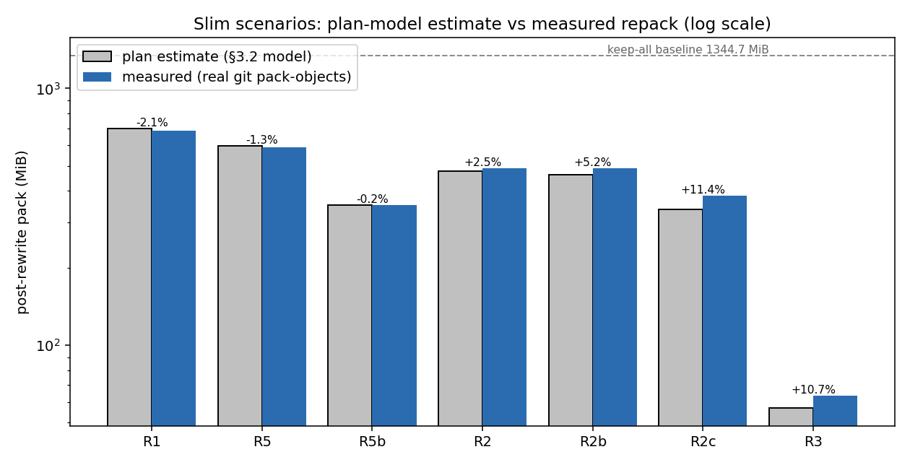
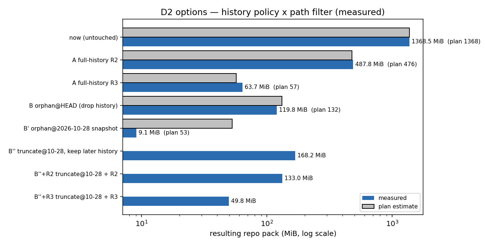

# TensorFVM 历史瘦身：**实测**收益复核（FVM-REPO-SLIM ｜ 本单零改写、零 force-push）

> 生成时刻 2026-11-16 09:46:30 ｜ HEAD `cc0ba3b0` ｜ 分支 `agent/m23278` ｜ 全部数字由 `scripts/audit/measure_rewrite_pack.py` + `scripts/audit/slim_measure_report.py` 程序化注入，无手抄。

## 0. 一句话结论

方案版（`docs/m23216/SLIM_PLAN.md`）把改写后体积建模为「逐 blob zlib6 × 全局标定 0.874」，本单把它换成**真跑 `git pack-objects` 的实测**：基线（一条都不删、可达对象重打包）**1344.7 MiB**，推荐案 R2 实测 **487.8 MiB**（方案估 475.6）、R3 实测 **63.7 MiB**（方案估 56.9）。
**两条会改变 owner 决策的实测结论**：
1. **R2b（全仓 `*.pyc`）的边际收益实测只有 0.2 MiB**，不是方案说的 13.1 MiB —— 方案 D1(b) 的取舍数字站不住；
2. **orphan「弃全史只留快照」实测 119.8 MiB**、**「截断到 2026-10-28 但保留其后全部历史」实测 168.2 MiB**（方案完全没列这一档），比全史 R2 的 487.8 MiB 小 2.9×，且不需要对 10-28 之后 3 周的可审计历史做任何路径删除决策。

## 1. ① 案例介绍

| 项 | 值 |
|---|---|
| 仓库 | TensorFVM（`cc0ba3b0`，与 331 个工作树共享同一 gitdir） |
| 症状 | `size-pack` 1367.7 MiB；1.33 GiB pack 里 91% 是已删除的可再生工件 |
| 本单范围 | **只读审计**：不改写历史、不改 ref、不删对象、不 force-push |
| 对象规模 | 可达 31360 个对象，其中 blob 16411 个 / 2047.92 MiB |
| 现场 in-pack | 1368.48 MiB（实测 size-in-pack 合计，不含 tmp_pack 垃圾） |

## 2. ② 怎么做的

1. **删除集判定（比方案更严）**：`git log --all --raw -r --no-merges --no-abbrev` 的 new-side 给出每个 blob 历史上出现过的**全部** (path, blob) 对；只有当一个 blob 的**每一条**路径都命中规则才算被删。方案用 `rev-list --objects`（每 blob 只报一条路径），同名异径 blob 有误判风险（本单实测见 §5 F5：实际无影响）。
2. **实测体积**：把每个场景的存活对象集喂给真实的 `git pack-objects --stdout --window=10 --depth=50`，边读边计数，**不落盘、不标定**；因此结果包含 git 真实的 delta 复用（这正是方案模型缺的那一项）。
3. **基线**：同一命令对全部可达对象重打包 = **1344.7 MiB**；与实测 `size-pack` 1367.7 MiB 相差 1.7%（差额是 pack 里的不可达对象与 loose）。所有 "-xx%" 一律以此实测基线为分母。
4. **D2 历史策略**：另加两种口径 —— `--measure-rev <rev>`（单快照闭包 = orphan 重开）与 `--truncate-at <rev>`（以 rev 快照为根 + 其后历史全部保留），rev 取 2026-10-28 的清理点 `b77e7783`。

## 3. ③ 结果

### 3.1 场景：方案估算 vs 实测

| 场景 | 方案估 MiB | 实测 MiB | 方案误差 | 方案删 blob/MiB | 实测删 blob/MiB | 实测降幅 |
|---|---|---|---|---|---|---|
| R1 只删 docs 场数据(npz/npy/vtk/vtu/msh/pt/dat/gz/csv) | 697.2 | **682.6** | -2.1% | 1354 / 822.6 | 1323 / 821.3 | 49.2% |
| R5 阈值：删 docs 下 >=1 MiB 的 blob | 599.3 | **591.6** | -1.3% | 341 / 1112.2 | 341 / 1112.2 | 56.0% |
| R5b 阈值：删 docs 下 >=512 KiB 的 blob | 351.8 | **351.2** | -0.2% | 842 / 1467.0 | 843 / 1467.7 | 73.9% |
| R2 删场数据+网格+PDF，保留 png/svg 图 | 475.6 | **487.8** | +2.5% | 2217 / 1084.4 | 2186 / 1083.1 | 63.7% |
| R2b R2 + 全仓 *.pyc | 462.5 | **487.6** | +5.2% | 4011 / 1118.8 | 4024 / 1118.4 | 63.7% |
| R2c R2 + 删 docs *.svg（几乎全为 dead 图） | 338.3 | **381.8** | +11.4% | 4674 / 1443.3 | 4687 / 1442.8 | 71.6% |
| R3 删 docs 全部二进制 + 全仓 *.pyc | 56.9 | **63.7** | +10.7% | 6567 / 1789.8 | 6752 / 1789.1 | 95.3% |

### 3.2 边际收益（方案用它支撑 D1(a)/D1(b) 的取舍）

| 对比 | 方案估边际 | **实测边际** |
|---|---|---|
| R2b 相对 R2 的边际收益 | 13.1 MiB | **0.2 MiB** |
| R2c 相对 R2b 的边际收益 | 124.2 MiB | **105.8 MiB** |
| R2 相对 R5 的边际收益 | 123.7 MiB | **103.8 MiB** |

### 3.3 D2 历史策略 × 路径过滤（实测）

| 选项 | 方案估 MiB | 实测 MiB | 说明 |
|---|---|---|---|
| 现状（不动） | 1367.7 | **1368.5** | 实测=可达对象 size-in-pack 合计 |
| A 全史 filter-repo R2 | 475.6 | **487.8** | 推荐案 |
| A 全史 filter-repo R3 | 56.9 | **63.7** | 最狠路径规则 |
| B orphan@HEAD（弃全史） | 131.8 | **119.8** | 只留当前快照，历史归零 |
| B' orphan@2026-10-28 快照 | 52.8 | **9.1** | 仅快照本体（不含其后历史重放） |
| B'' 截断@10-28 + 保留其后全部历史（不过滤） | —（方案未列） | **168.2** | 方案未列：保住 10-28 之后可审计历史 |
| B''+R2 截断@10-28 + R2 | —（方案未列） | **133.0** | 组合案 |
| B''+R3 截断@10-28 + R3 | —（方案未列） | **49.8** | 组合案 |

### 3.4 现场漂移（窗口前置门要用的量）

| 项 | 方案基线 | 现在实测 | 取法 |
|---|---|---|---|
| 提交数（全引用可达） | 2184 | 2196 | `git rev-list --all --count` |
| 本地 heads | 833 | 838 | `git for-each-ref` |
| 关联工作树 | 326 | 331 | `git worktree list` |
| in-pack 对象数 | 38350 | 38633 | `git count-objects -vH` |
| size-pack（含不可达） | 1367.7 MiB | 1.33 GiB | `git count-objects -vH` |

## 4. ④ 图




**图 1** 七个场景的方案估算（灰）vs 实测重打包（蓝），纵轴 log；标注为方案相对实测的误差。灰蓝排序不一致即说明标定系数不能外推到不同构成的存活集。




**图 2** D2 历史策略选项：全史过滤 / orphan 弃史 / 截断到 10-28 三档 × 路径过滤，实测（蓝）vs 方案估算（灰）。灰色缺柱=方案未给该组合的估计。

## 5. ⑤ 注意点与局限（honest）

- **保守偏置**：实测保留**原始** tree/commit 对象（tree 77.04 MiB 未压缩），真实改写会把这些树也改小，故本单数字是**偏大**的（方向上不掩盖收益，也不会把改写夸好）。
- **单快照口径**：`B' orphan@10-28 快照` 只测快照本体；若在其上重放后续历史，应看 `B''` 那一行（168.2 MiB）。两者不可混读，方案 §4 的 52.8 MiB 是快照口径。
- **部分克隆**：本仓是 `--filter=blob:none` 部分克隆，普查覆盖本地已有对象；实测与 GitHub 侧体积量级一致，但「100% 远端全量」仍需窗口内 `fetch --refetch` 后复跑本工具。
- **pack 参数敏感**：结果随 `--window/--depth` 变化（本单 window=10, depth=50 = git 默认 gc 口径）；若窗口内改用 `gc --aggressive`，数值会更小。复现时请固定这两个参数（见 `--window/--depth`）。
- **规则复现差异**：R3 的「docs 全部二进制」边界（文本后缀表）与方案不完全相同（实测删 6752 blob vs 方案 6567），差异 0.7 MiB。

## 6. ⑥ 误差判定（逐项，显式回答是否 <3%）

| 判定项 | 基准 | 误差 | 是否 <3% |
|---|---|---|---|
| 方法自校验：可达对象重打包 vs `size-pack` | 1367.7 MiB | +1.7% | 是 |
| R1：方案模型 vs 本单实测 | 682.6 MiB | -2.1% | 是 |
| R5：方案模型 vs 本单实测 | 591.6 MiB | -1.3% | 是 |
| R5b：方案模型 vs 本单实测 | 351.2 MiB | -0.2% | 是 |
| R2：方案模型 vs 本单实测 | 487.8 MiB | +2.5% | 是 |
| R2b：方案模型 vs 本单实测 | 487.6 MiB | +5.2% | 否 |
| R2c：方案模型 vs 本单实测 | 381.8 MiB | +11.4% | 否 |
| R3：方案模型 vs 本单实测 | 63.7 MiB | +10.7% | 否 |

- 方案模型的误差**不是均匀的**：4/7 个场景落在 ±3% 内（R1, R5, R5b, R2），而  三条方案偏乐观 ，超出方案自报的 ±10% 带；这正是单点标定（只在「全保留」一个点上标定 0.874）无法外推的直接证据。
- 结论层的量：推荐案 R2 的降幅 方案 65% → 实测 64%（差 1.5 个百分点）；R3 的 "-96%" → 实测 95.3%（改写后 63.7 MiB），量级结论不变。

## 7. 发现（按严重度）与处置

1. **[HIGH] D1(b) 的取舍数字失真**：R2b 相对 R2 的边际收益实测 **0.2 MiB**（方案 13.1 MiB，夸大 66×）。`.pyc` 在 pack 里已被 delta 到近零，单独按 blob zlib 会算出 13 MiB 的假收益。**处置**：D1 删去 (b)，不要把「全仓删 pyc」作为独立筹码。
2. **[HIGH] D2 的 B/B' 被严重低估、且漏了一档**：orphan@HEAD 实测 119.8 MiB（方案 131.8）、orphan@10-28 快照 9.1 MiB（方案 52.8，差 5.8×）；方案未列的 **截断@10-28 + 保留其后全部历史 = 168.2 MiB**、+R2 = 133.0、+R3 = 49.8。**处置**：D2 的对照表按 §3.3 重排；「保住 10-28 之后可审计历史」这一档应进入 owner 的选项集。
3. **[MED] R2c / R3 方案偏乐观 11.4% / 10.7%**，贴在方案自报 ±10% 带外沿。**处置**：§3.2 数字换成实测列；若 owner 需要带宽，用实测 ±window 敏感性，而非 0.874 标定。
4. **[MED] 标定方法本身不可外推**：方案只在「全保留」点标定（拟合 1564.9 vs 实测 1367.7，14.4%），而误差符号随存活集的文本/二进制构成翻转（R1/R5 方案偏保守、R2c/R3 偏乐观）。**处置**：以后凡改历史收益，一律用本工具实测。
5. **[LOW｜否证] 方案用单路径近似判定删除集**：与全路径精确集比对，删除 MiB 差 ≤1.3，无 blob 因「同名异径」被误判而改变结论 —— 该疑虑**不成立**（记录以免后人重复怀疑）。
6. **[LOW] 分母口径**：方案的 "-65%" 以 `size-pack` 1367.7 MiB 为分母，其中含不可达对象；可达基线实测 1344.7 MiB。**处置**：统一用可达基线，避免后续对账口径漂移。
7. **[OPS] 24 h 内基线已漂移**（提交 2184→2196、heads 833→838、工作树 326→331）。**处置**：改写窗口前先跑 `python3 scripts/audit/measure_rewrite_pack.py --dry-run` 与 `--scenarios R2 --truncate-at <rev>` 复核，数字漂移 >5% 则重排决策。

**总处置**：对方案 §3.2/§4/§7 的**数字与 D1/D2 排布 → request changes**（用本单实测列替换）；对 §5 协调面 / §6 回滚 / 窗口步骤 **无实质异议（approve with notes）**。本单未执行任何改写。

## 8. 复现

```bash
# 单场景实测（约 10–60 s/场景，带 in-pack 与基线缓存）
python3 scripts/audit/measure_rewrite_pack.py --out docs/FVM-REPO-SLIM-MEASURE/raw --scenarios R2
# D2 历史策略
python3 scripts/audit/measure_rewrite_pack.py --out docs/FVM-REPO-SLIM-MEASURE/raw \
    --measure-rev HEAD --measure-rev b77e7783
python3 scripts/audit/measure_rewrite_pack.py --out docs/FVM-REPO-SLIM-MEASURE/raw \
    --scenarios R2,R3 --truncate-at b77e7783
# 汇总出表与图（含本 README 的数字注入）
python3 scripts/audit/slim_measure_report.py
```

