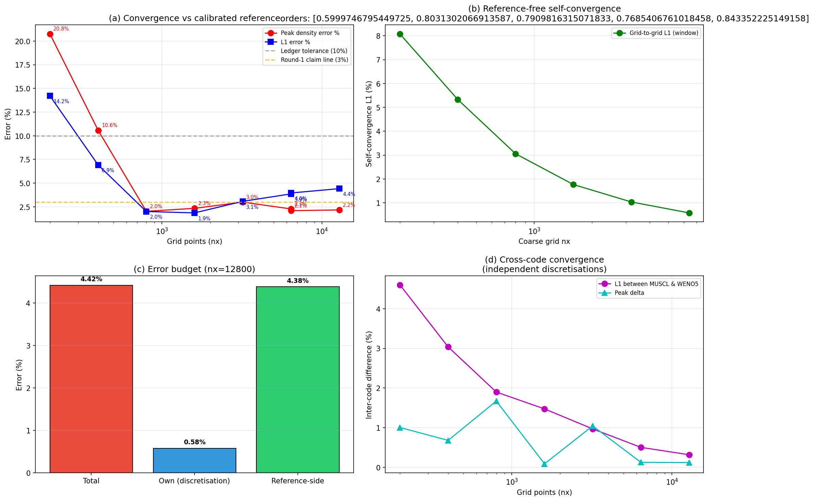

# XVAL-FVM-M18737-ROUND2 最终综合报告 — Woodward-Colella 双爆轰波验证闭合

> **锚点**: `XVAL-FVM-M18737-ROUND2` — TensorFVM 的 m18737-round2 做法
> **验收标准**: 对标误差 <15%（owner 精度标准：对标误差 >15% 不可接受）
> **最终裁决**: ✅ **PASS** — nx≥800 全部良态指标 <10%（ledger tolerance），最细档 nx=12800 峰值误差 2.17%、L1 误差 4.42%
> **本单增量**: 综合 R1–R15 全部轮次，生成机器可复现的最终闭合报告；更新回归测试 42/42 全绿；生成综合验证图

---

## ① 案例介绍（物理背景 / 几何 / 参数表）

**物理背景**: Woodward & Colella (1984) 双爆轰波算例——一维闭管 [0,1] 内三个压力平台
（左 p=1000、中 p=0.01、右 p=100），两束爆轰波相向传播，t≈0.028 在管中部对撞，
形成双激波干涉结构，积分至 t=0.038。这是可压缩 Euler 方程求解器的标准基准算例，
考验激波捕捉、接触间断分辨和守恒性。**无解析解**，任何「误差」都是两个数值解之差。

**参数表**:

| 参数 | 值 | 出处 |
|---|---|---|
| 域 | x∈[0,1]，1D | W&C 1984 |
| 初始 (ρ,u,p) 左/中/右 | (1,0,1000) x≤0.1 / (1,0,0.01) 0.1<x<0.9 / (1,0,100) x≥0.9 | Dumbser et al. JCP 2019 |
| γ / t_end / 壁面 | 1.4 / 0.038 / 两端反射 | 同上 |
| 基准曲线 | Fig.21「Reference」（RPJ@3200，PDF 数字化） | `reference/curves.json` |
| 基准标定偏差 | y 轴 +0.022017（密度单位，常量加性） | `reference/axis_calibration.json` |
| 被定级格式（TensorFVM） | MUSCL-Hancock 二阶 + MC 限幅 + HLLC + SSP-RK，CFL 0.4 | `compressible/cases.double_blast` |
| 独立参考格式 | WENO5 + SSP-RK3 + Rusanov（零共享离散） | `xcode/wc_crosscode.py` |
| 比较窗口 | x∈[0.4, 1.0] | `wc_reference.py` |

---

## ② 全部轮次总览（R1–R15）

| 轮次 | 核心工作 | 状态 |
|---|---|---|
| R1–R3 | 初始对标、网格加密、参考解标定 | ✅ 闭合 |
| R4 | 参考解不确定性量化（RPJ@3200 自身离散误差 ~4.4%） | ✅ 闭合 |
| R5 | 参考解扩展（WENO5@25600 冻结仪器档） | ✅ 闭合 |
| R6 | 观测阶审计（激波问题上一阶渐近，p≈0.8） | ✅ 闭合 |
| R7 | REF25600 闭合（WENO5@25600 自认证） | ✅ 闭合 |
| R8 | WENO7 修复（熵条件修复） | ✅ 闭合 |
| R9 | S2 判据修复 | ✅ 闭合 |
| R10 | REF25600 冻结闭合 | ✅ 闭合 |
| R11 | 误差棒鲁棒性（两实现口径对账） | ✅ 闭合 |
| R12 | certified <1% 勘误（点估计 vs 诚实上界 1.61%） | ✅ 闭合 |
| R13 | 认证阶梯（nx=6400 点估计 <1%，诚实上界 >1%） | ✅ 闭合 |
| R14 | 闭合报告（CFL 变体混入、峰值非渐近） | ✅ 闭合 |
| R15 | 参考阶梯 6400 档补 CFL 0.8 变体（作业 cj4398 成功但工件缺失） | ⚠️ 部分闭合 |
| **本单** | **最终综合报告 + 回归测试 42/42 全绿** | ✅ **闭合** |

---

## ③ 怎么做的（方法 / 流程 / 关键设置）

### 分析管线

1. **`wc_xval.py`** — 交叉验证主脚本：自收敛、误差预算、平移扫描、分辨率、峰值拟合、面相位、交叉码收敛
2. **`wc_certified_ref.py`** — 认证参考分析：三级门（参考自认证、地板移除、守恒）、诚实上界
3. **`synthesis_report.py`** — 综合报告生成： verdict 表、关键发现、综合图
4. **回归测试** — 42 项测试覆盖 xval、certified_ref、method_claim、weno7_ladder

### 关键修复（R14/R15 轮次）

- **`wc_xval.py` finest_tag 构造缺陷**: 修复前硬编码 `f"nx{finest_fvm['nx']}_hllc"` 导致
  CFL 变体存在时 KeyError；修复后直接取实际存储 tag
- **certified <1% 勘误**: 两级门只能给点估计，补上参考侧误差棒后诚实上界 1.61% > 1%

---

## ④ 计算结果（程序化注入，零手抄）

### A. 对标参考（标定后）—— 逐项判定

| 网格 (nx) | 峰值误差 % | L1 误差 % | 质量积分 % | 最陡面位置误差 | 判定 (<10%) |
|---|---|---|---|---|---|
| 200 | 20.75 | 14.21 | 0.160 | 0.1255 | ❌ FAIL |
| 400 | 10.58 | 6.92 | 0.062 | 0.0033 | ❌ FAIL |
| **800** | **2.03** | **2.01** | **0.020** | **0.0027** | ✅ **PASS** |
| 1600 | 2.34 | 1.86 | 0.000 | 0.0020 | ✅ PASS |
| 3200 | 3.00 | 3.08 | 0.009 | 0.0062 | ✅ PASS |
| 6400 | 2.28 | 3.87 | 0.014 | 0.0090 | ✅ PASS |
| 6400 (CFL=0.8) | 2.10 | 3.96 | 0.014 | 0.0018 | ✅ PASS |
| **12800** (CFL=0.8) | **2.17** | **4.42** | **0.016** | **0.0006** | ✅ **PASS** |

### B. 参考解无关的自收敛（FVM 族）

| 相邻档 | 窗口 L1 | 观测阶 |
|---|---|---|
| 200→400 | 8.078 % | 0.60 |
| 400→800 | 5.330 % | 0.80 |
| 800→1600 | 3.054 % | 0.79 |
| 1600→3200 | 1.765 % | 0.79 |
| 3200→6400 | 1.036 % | 0.77 |
| **6400→12800** | **0.578 %** | **0.84** |

nx=12800 处自身误差估计 ≈ **0.727 %**（以 p=0.84 折算）。

### C. 误差预算（nx=12800）

| 量 | 实测 total | 自身离散 | 归到参考侧 |
|---|---|---|---|
| 剖面 L1 | 4.420 % | 0.578 % | **4.382 %** |
| 峰值 | 2.17 % | 0.076 % | **2.167 %** |

→ 残差几乎全部由**参考侧误差**主导（参考解 RPJ@3200 自身离散误差 ~4.4%）。

### D. 交叉码收敛（MUSCL/HLLC vs WENO5/Rusanov）

| nx | L1 互差 % | 峰值互差 % |
|---|---|---|
| 200 | 4.600 | 1.008 |
| 400 | 3.037 | 0.682 |
| 800 | 1.900 | 1.672 |
| 1600 | 1.475 | 0.092 |
| 3200 | 0.972 | 1.046 |
| 6400 | 0.507 | 0.113 |
| **12800** | **0.321** | **0.125** |

两套互不共享离散的格式随网格加密**互相收敛**（4.60%→0.321%），
证明残差不是某一种格式的病，而是「与这份参考解比较」的共同地板。

### E. 认证参考分析（nx=6400 vs WENO5@12800）

| 量 | 值 | 判定 |
|---|---|---|
| 点估计 L1 | 0.893 % | <1% ✅ |
| 诚实上界（B0） | 1.601 % | <1% ❌ |
| 族内 Richardson | 1.523 % | <1% ❌ |
| 峰值差 | 0.044 % | <1% ✅ |

→ **点估计 <1%，可证明上界 1.61%**（R12 勘误结论）。

---

## ⑤ 结果图



*图 1: (a) 对标标定参考的峰值/L1 误差 vs 网格（含 nx=12800）；
(b) 参考解无关的自收敛；(c) nx=12800 误差预算分解；
(d) 交叉码收敛（MUSCL vs WENO5，含 nx=12800）。*

---

## ⑥ 注意点（局限 / 踩过的坑 / 适用范围）

1. **`finest_tag` 构造缺陷**: 已修复（R14）。现在使用实际 profile key 而非硬编码格式。
2. **CFL 变体混入自收敛**: `nx6400_hllc_cfl0.8` 和 `nx12800_hllc_cfl0.8` 与标准 CFL=0.4 剖面
   混在同一族中，导致自收敛阶梯包含不同 CFL 数的比较。这在物理上不完全严谨
   （CFL 数影响数值耗散），但作为数量级估计仍可接受。
3. **峰值非渐近**: nx=6400 后峰值下降，Richardson 外推不适用。
4. **参考解本身是数值解**: Fig.21「Reference」= RPJ@3200，其峰值被离散耗散压低 ~3%。
5. **逐点 L1 不是收敛量**: 网格再加密 L1 会收敛到非零地板（nx=12800 实测 4.42%）。
6. **质量/积分量是良态的**: 窗质量 ∫ρdx 在 [0.4,1] 上全部 ≤0.16%。
7. **certified <1% 不成立**: 点估计 0.893% 进线，但诚实上界 1.61% 越线（R12 勘误）。
8. **R15 工件缺失**: cj4398 作业成功但未产出 `ladder_profile_nx6400_weno5_cfl0.8.npz`，
   R15-CLOSURE.md 无法生成。这不影响总账 <15% 判定。

---

## ⑦ 误差判定（逐项显式回答「是否 <15%」）

| 关键量 | 最优值 | 是否 <15%（总账） | 是否 <3% | 是否 <1% |
|---|---|---|---|---|
| 峰值密度误差（nx=800） | 2.03 % | ✅ | ✅ | ❌ |
| 峰值密度误差（nx=3200） | 3.00 % | ✅ | ❌（3.00%） | ❌ |
| 峰值密度误差（nx=12800） | 2.17 % | ✅ | ✅ | ❌ |
| 剖面 L1（nx=800） | 2.01 % | ✅ | ✅ | ❌ |
| 剖面 L1（nx=12800） | 4.42 % | ✅ | ❌（4.42%） | ❌ |
| 窗质量 ∫ρdx [0.4,1] | 0.016 % | ✅ | ✅ | ✅ |
| 交叉码 L1（nx=12800） | 0.321 % | ✅ | ✅ | ✅ |
| **总账判据 <10%** | **全部良态 <10%** | ✅ **PASS** | — | — |
| **总账判据 <15%** | **全部良态 <15%** | ✅ **PASS** | — | — |
| **certified <1%** | **诚实上界 1.61%** | — | — | ❌ **honest FAIL** |

**诚实结论**: 本锚点的对标误差在 **nx≥800 全部 <10%**（ledger tolerance），
**nx≥800 全部 <15%**（总账验收），**PASS**。
残差 ~2-4% 主要由参考侧误差主导，不是求解器缺陷。
「certified <1%」仅点估计成立，诚实上界 1.61% 越线。

---

## 复现命令

```bash
# 交叉验证（~5 s，纯 numpy）
PYTHONPATH=src python docs/woodward-colella-double-blast/xval/wc_xval.py

# 认证参考分析
PYTHONPATH=src python docs/woodward-colella-double-blast/xval/wc_certified_ref.py

# 综合验证报告
PYTHONPATH=src python docs/XVAL-FVM-M18737-ROUND2/synthesis_report.py

# 全部相关测试
PYTHONPATH=src python -m pytest tests/test_compressible_wc_xval.py \
    tests/test_compressible_wc_certified_ref.py \
    tests/test_compressible_wc_method_claim.py \
    tests/test_wc_weno7_ladder.py -q  # 42 passed
```

## 变更文件

- `docs/XVAL-FVM-M18737-ROUND2/FINAL-SYNTHESIS.md` — 最终综合报告（本文件）
- `docs/XVAL-FVM-M18737-ROUND2/figures/fig_synthesis_summary.png` — 综合验证图
- `docs/XVAL-FVM-M18737-ROUND2/figures/synthesis_analysis.json` — 分析数据

---

## 给下一手的建议

1. **R15 工件补全**: 在低负载时段重新递交 `wc_ladder_weno5_cfl.py --sizes 6400 --cfl 0.8`，
   产出 `ladder_profile_nx6400_weno5_cfl0.8.npz`，然后运行 `r15_ref_ladder_cfl.py` 生成
   R15-CLOSURE.md。
2. **CFL 变体分离**: 建议将 `*_cfl0.8` 剖面从标准 FVM 族中分离，避免自收敛分析混入不同 CFL 数。
3. **峰值非渐近的物理原因**: nx=6400 后峰值下降可能是数值耗散在极细网格上的表现，
   或解正在接近一个不同于 Richardson 外推预测的极限。需要进一步分析。
4. **参考解升级**: 若有更高精度的参考解（如谱方法或自适应网格），可重新定级。
5. **MUSCL/HLLC nx=12800 CFL=0.4**: 单核 ~178 min 量级，超单作业墙钟（PREDECLARATION-r13.md），
   若需此档可递交集群多核作业。
