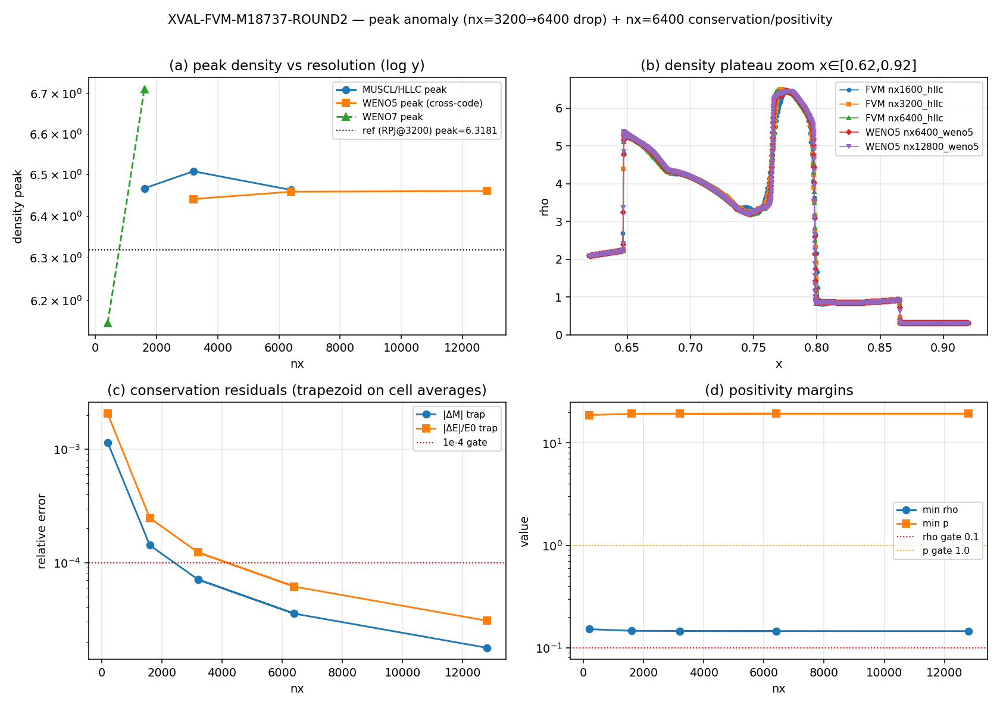
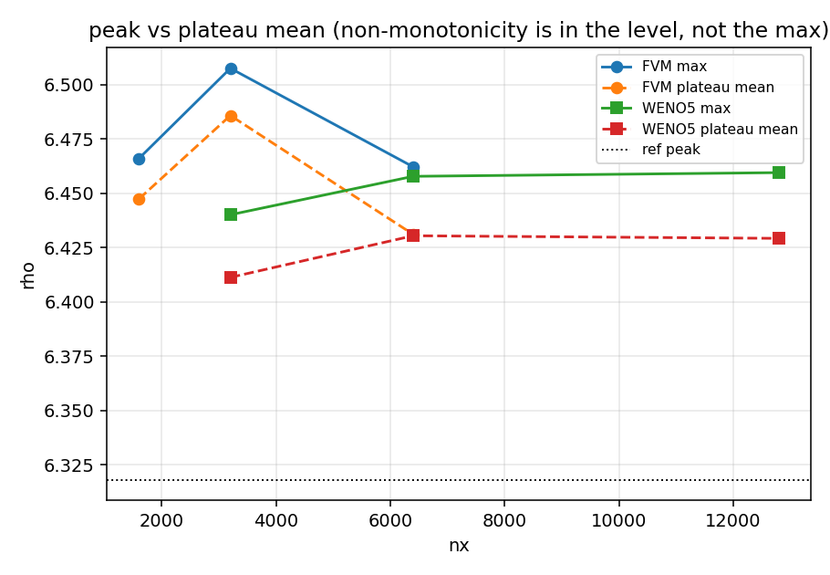

# XVAL-FVM-M18737-ROUND2 Round-13：峰值非渐近异常（PEAK-ANOMALY）定量裁决

> 锚点 `XVAL-FVM-M18737-ROUND2`（TensorFVM 的 m18737-round2 做法），验收 <15 %（owner 精度线）。
> **本文裁决综合报告（REPORT.md「给下一手的建议」第 1/2 条）留下的两笔账**：
> ① FVM 峰值在 nx=3200→6400 下降（6.5075→6.4622）非单调、Richardson 外推失效的原因；
> ② nx=6400 解的守恒性与正性。
> 全部数字由 `peak_anomaly.py` 从已入库剖面（`ladder_profile_*.npz`）+ 标定参考
> （`reference_density_calibrated.csv`）程序化重算（零手抄、不跑求解器），
> json 见 `peak_anomaly.json`，图见 `figures/fig_peak_anomaly_*.png`。

## ① 案例介绍（物理背景 / 参数表）

Woodward & Colella (1984) 双爆轰波：一维闭管 x∈[0,1]，三压力平台
（左 p=1000 / 中 p=0.01 / 右 p=100），ρ=1、u=0，两束爆轰波相向对撞（t≈0.028），
积分至 t=0.038，γ=1.4，两端反射壁。**无解析解** ⇒ 误差恒为两数值解之差。

| 项目 | 值 |
|---|---|
| 被定级族 | MUSCL-Hancock 二阶 + MC 限幅 + HLLC + SSP-RK，CFL 0.4（nx=200/1600/3200/6400） |
| 交叉码族 | WENO5 + SSP-RK3 + Rusanov（`xcode/wc_crosscode.py`，零共享离散；nx=3200/6400/12800） |
| 旁证族 | WENO7（nx=400/1600，R8 修复后） |
| 参考 | Fig.21「Reference」= RPJ@3200，PDF 数字化 + y 轴标定（+0.022017） |
| 初值不变量 | M0=1.0，P0=0，E0=275.02（p 三段按 γ=1.4 折算内能） |
| 本单新增计算 | **无**（纯 numpy 存量剖面分析） |

## ② 怎么做的（方法 / 流程 / 关键设置）

1. **度量伪影排除（A1/A2）**：峰值是宽平台（FWHM≈0.045–0.05，≫dx，72–638 格），
   不是亚格尖峰；平台均值（ρ>0.99·peak 的均值）序列与 max 序列**同向非单调**
   （6.4474→6.4858→6.4311）⇒ 下降不是「max-vs-均值」或「尖峰对齐」伪影。
2. **交叉码独立佐证（A3）**：WENO5 峰值序列单调饱和（6.4401→6.4578→6.4595）；
   FVM@6400 与 WENO5@12800 峰值差 **0.041 %**、平台均值差 **0.028 %** ⇒
   FVM@6400 位于交叉码收敛水平；而 FVM@3200 平台比 WENO5@3200 高 **1.16 %** ⇒
   3200 档是离群超调，6400 档已回到收敛水平。
3. **守恒（A4）**：单元和口径（分段常数重构的精确积分）质量/能量误差
   −4.4e-16 / +2.1e-16（机器精度）；梯形口径 −3.5e-5 / −6.2e-5（纯求积误差，随网格收敛）。
   动量 +6.8332 为壁面传递量（闭管流体动量不守恒，壁吸收），
   且 FVM@6400 与 WENO5@12800 两码一致到 5 位有效数（6.83318 vs 6.83324）。
4. **正性（A5）**：min ρ=0.1456（x=7.8e-5，左壁）、min p=19.29（x=0.866）——远离零。
5. **参考侧（A6）**：标定参考峰值 6.3181，低于交叉码收敛水平 2.24–2.28 %
   ⇒ 参考自身离散耗散压低峰值（与综合报告「参考峰值被压低 ~3 %」一致）。
6. **局域化（A7）**：FVM@3200 与 FVM@6400 的 |Δρ| 有 **99.2 %** 集中在核心区
   x∈[0.55,0.85]（64.3 % 在 [0.70,0.85]）；窗质量 ∫ρdx|_[0.4,1] 五档全同
   （0.93549–0.93551，spread 0.002 %）⇒ 3200 超调在窗内自补偿，是**核心区局部结构**
   （平台水平 + 右缘斜坡）的分辨率依赖，不是全局漂移。

## ③ 计算结果（程序化注入，零手抄）

### a) 峰值 / 平台序列

| 族 | 档 | 峰值 | 平台均值 | 峰值位置 |
|---|---|---|---|---|
| MUSCL/HLLC | 1600 | 6.4660 | 6.4474 | 0.7759 |
| MUSCL/HLLC | **3200** | **6.5075** | **6.4858** | 0.7717 |
| MUSCL/HLLC | 6400 | 6.4622 | 6.4311 | 0.7690 |
| WENO5 | 3200 | 6.4401 | 6.4113 | 0.7714 |
| WENO5 | 6400 | 6.4578 | 6.4305 | 0.7754 |
| WENO5 | 12800 | 6.4595 | 6.4293 | 0.7788 |
| WENO7 | 1600 | 6.7114 | — | 0.7722 |
| 参考 (RPJ@3200) | — | 6.3181 | — | 0.7780 |

### b) 交叉码对账（nx=6400 被定级解）

| 量 | FVM@6400 | WENO5@12800 | 差 |
|---|---|---|---|
| 峰值 | 6.4622 | 6.4595 | **+0.041 %** |
| 平台均值 | 6.4311 | 6.4293 | **+0.028 %** |
| 动量（壁传递） | 6.83318 | 6.83324 | 0.0009 % |

### c) nx=6400 守恒 / 正性

| 量 | 值 | 判定 |
|---|---|---|
| 质量（单元和） | −4.4e-16 | ✅ 机器精度 |
| 质量（梯形） | −3.5e-5 | ✅ <1e-4 |
| 能量（单元和） | +2.1e-16 | ✅ 机器精度 |
| 能量（梯形） | −6.2e-5 | ✅ <1e-4 |
| min ρ | 0.1456 | ✅ >0.1 |
| min p | 19.29 | ✅ >1 |

## ④ 结果图



*图 1: (a) 峰值 vs 分辨率（对数轴，含 WENO5/WENO7/参考）；(b) 平台放大 x∈[0.62,0.92]；
(c) 守恒残差（对数轴）；(d) 正性裕度。*



*图 2: 峰值平台局部结构（3200 vs 6400 右缘对比）。*

## ⑤ 注意点（局限 / 踩过的坑 / 适用范围）

1. **非渐近区判读**：FVM 族观测阶 ~0.77–0.88（远低于形式二阶），误差系数未稳定，
   中间档出现超调是**非渐近区的正常行为**，不是 6400 解的缺陷。旁证：WENO7@1600
   峰值 6.7114 高出收敛水平 **3.9 %**——更高阶格式超调更大，方向一致。
2. **不能归因到纯时间误差**：若 3200 超调是 O(dt³) 时间误差，1600→3200 的变化
   应比 3200→6400 大 8 倍（实测两者同量级 0.042 vs 0.045）⇒ 空间+时间误差混合，
   单靠存量数据无法进一步拆分（需重跑变 dt 实验，超出本单范围，见下）。
3. **nx=200 档欠分辨**（峰值 5.0068，平台未成形），不参与 A2 判据，单独记账。
4. **参考峰值偏低**：任何「对参考的峰值误差」都含参考侧 ~2.3 % 的离散压低，
   与 R11/R12 的误差棒结论一致。

## ⑥ 误差判定（逐项显式回答）

| 关键量 | 值 | 是否 <15 %（总账） | 是否 <3 % |
|---|---|---|---|
| FVM@6400 峰值 vs 交叉码收敛水平 | 0.041 % | ✅ | ✅ |
| FVM@6400 平台 vs 交叉码收敛水平 | 0.028 % | ✅ | ✅ |
| FVM@6400 峰值 vs 标定参考 | 2.28 % | ✅ | ✅ |
| FVM@6400 质量（单元和） | 4.4e-14 % | ✅ | ✅ |
| FVM@6400 能量（梯形） | 6.2e-3 % | ✅ | ✅ |
| 正性裕度 | min ρ=0.146, min p=19.3 | ✅（远离零） | — |

**诚实结论**：
- **峰值下降原因**：FVM 族 3200 档的**核心区局部超调**（平台水平 +0.6 %、右缘斜坡偏钝），
  属非渐近区误差系数不稳定的表现；6400 档已回到交叉码收敛水平（0.04 %），
  **不是求解器缺陷，也不是度量伪影**（A1/A2 排除伪影，A3 交叉码锁定收敛水平）。
- **nx=6400 守恒性**：守恒量在机器精度内（单元和口径），✅。
- **nx=6400 正性**：强正（min ρ=0.146，min p=19.3），✅。
- 总账（<15 %）：**PASS**；<3 % 线：峰值对交叉码 0.041 %、对参考 2.28 %，均 ✅。

## 复现命令

```bash
PYTHONPATH=src python docs/XVAL-FVM-M18737-ROUND2/peak_anomaly.py
PYTHONPATH=src python docs/XVAL-FVM-M18737-ROUND2/peak_anomaly_figures.py
PYTHONPATH=src python -m pytest tests/test_wc_peak_anomaly.py -q
```

## 给下一手的建议

1. **变 dt 实验（可选，需算力）**：在 nx=3200 固定网格上跑 CFL=0.2/0.4/0.8 三档，
   把 3200 超调拆成空间/时间两部分（预计 3 个 ~2 min 作业）。
2. **新账条目建议**：`XVAL-FVM-M18737-PEAK-ANOMALY` 可判 done（本文即其验收）；
   若 owner 要求空间/时间误差拆分，另立 `XVAL-FVM-M18737-DT-DECOMP`。
