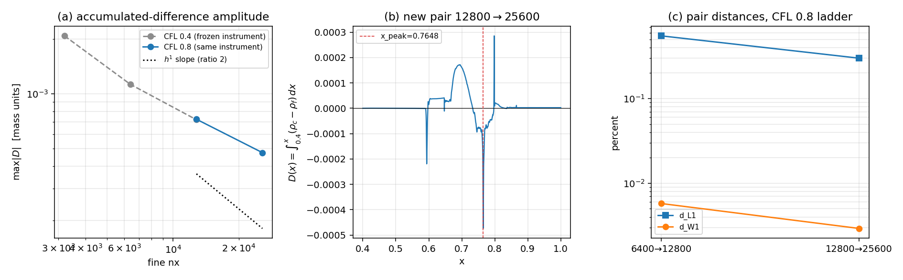

# XVAL-FVM-M18737-ROUND2 Round-16 闭合：E2（`max|D|` 的 `h^1` 收缩）在 25600 档被**否证**——参考族自差比 `h^1` 收缩得更慢，且趋势在变差

> 锚点 `XVAL-FVM-M18737-ROUND2`（TensorFVM 的 m18737-round2 做法），总账验收 <15 %。
> 判据在 `PREDECLARATION-r16.md` 先于数字冻结；E2 的带 [1.85, 2.15] 原样复用
> `PREDECLARATION-r7.md` / `PREDECLARATION-r10.md` 的冻结值，**未改判据**。
> 本文件由 `render_r16_doc.py` 从 `r16_flux_defect.json` 程序化渲染（零手抄）；
> 前轮文档一律不改写。求解器一行未改，本轮**零新算力**（全部由已存 npz 重新积分）。

## ① 案例介绍（物理背景 / 几何 / 参数表）

Woodward & Colella (1984) 双爆轰波：一维闭管 x∈[0,1]，三压力平台（左 p=1000 /
中 p=0.01 / 右 p=100），ρ=1、u=0，两束爆轰波相向对撞（t≈0.028），积分至 t=0.038，
γ=1.4，两端反射壁。**无解析解** ⇒ 任何「误差」都是两个数值解之差。

| 项 | 值 | 出处 |
|---|---|---|
| 被定级格式 | MUSCL-Hancock 二阶 + MC 限幅 + HLLC + SSP-RK | `compressible/cases.double_blast` |
| 参考格式 | WENO5 + SSP-RK3 + Rusanov（零共享离散） | `xcode/wc_crosscode.py` |
| 本轮仪器 | 参考族 **CFL 0.8** 同仪器阶梯 6400/12800/25600 | 25600 档只有 CFL 0.8 变体在库 |
| 6400/12800 CFL 0.8 档可用性 | R15 E1r6400 = 0.0231 %、E1r@12800 = 0.0255 %（< 0.2 % 门） | `R15-CLOSURE.md` ③ |
| 窗口 / 度量 | x∈[0.4,1.0]；`D(x)=∫_{0.4}^{x}(ρ_c−ρ_f)`，fine 积分、coarse 插值 | `wc_w1_norm.localize`（同一实现） |

## ② 怎么做的（方法 / 流程 / 关键设置）

1. **欠账**：`W1-NORM-CERTIFICATION.md`「给下一手」第 3 条（= 欠账账 D21 的可检验预测，
   判据 E2 在 R7/R10 冻结）要求：若残差是净质量通量缺陷，则 `max|D|` 应按 `h^1` 收缩。
   R7/R10 两轮 E2 均记 `not_measured`（当时 25600 档不在库）。
2. **本轮**：25600 档已以 CFL 0.8 变体回填（R15 已用于参考阶梯并过 E1r6400 门），
   但 E2 本身从未被测量。本轮在**同仪器**（CFL 0.8）阶梯上把它测掉。
3. **E0 工件门**（预注册）：`status=="ok"` ∧ `cfl==0.8` ∧ `nx==25600` ∧ 剖面长 25600
   ⇒ ✅ PASS（nx=25600, cfl=0.8, status=ok, len=25600）。
4. **度量**：`max|D|`、`x_peak`、`rel_net_mass`、`d_W1`、`d_L1` 一律调用
   `wc_w1_norm` 的同一份实现（不复制），与 R5/R7 数字可比。

## ③ 计算结果（程序化注入，零手抄）

### A. 参考族自差（同仪器 CFL 0.8）——E2 的承重量

| 对 | max\|D\| | x_peak | rel_net_mass | d_W1 [%] | d_L1 [%] |
|---|---|---|---|---|---|
| 6400→12800 | 0.000724 | 0.7648 | 0.00 | 0.0058 | 0.5503 |
| 12800→25600 | 0.000474 | 0.7648 | 0.00 | 0.0029 | 0.2999 |

**E2 裁决：❌ FALSIFIED** —— `p_D = log2(0.000724/0.000474) = 0.6116`，
冻结带 [1.85, 2.15]。h^1 预测 `max|D|(12800→25600) ≈ 0.000362`，实测 0.000474
（偏大 30.9 %）。

### B. 支撑检查（R16 新增，先冻结后测量）

| 编号 | 判据 | 实测 | 裁决 |
|---|---|---|---|
| E2b | 幅值比 ∈ [0.45, 0.55] | 0.6544 | ❌ FAIL |
| E2c | x_peak ∈ [0.70, 0.85]（对撞区） | 0.7648 | ✅ PASS |
| E2d | rel_net_mass < 1e-4 | 0.00 | ✅ PASS |
| E2e | max\|D\| 单调下降 | 0.000724 → 0.000474 | ✅ PASS |

### C. 交叉核对（声明过，非门）

**参考族 CFL 0.4（冻结仪器）既有序列**（与 R7 `defects` 逐位一致）：

| 对 | max\|D\| | 相邻比值 |
|---|---|---|
| 1600→3200 | 0.002087 | nan |
| 3200→6400 | 0.001127 | 1.852 |
| 6400→12800 | 0.000720 | 1.566 |
| 6400→12800 (CFL0.8) | 0.000724 | — |
| **12800→25600 (CFL0.8)** | **0.000474** | **1.528** |

参考族比值趋势：**1.852 → 1.565 → 1.528**（逐档变小 ⇒ 收缩越来越慢，
与 `h^1` 的恒定比值 2 相反）。CFL 0.4 与 0.8 在 6400→12800 上几乎相同
（0.000720 vs 0.000724），故 E2 的否证**不是** CFL 口径伪影。

**被定级族（hllc vs weno5@12800）序列**——R5「给下一手」引用的正是这一族：

| nx | max\|D\| | x_peak |
|---|---|---|
| 1600 | 0.004509 | 0.7647 |
| 3200 | 0.002352 | 0.7646 |
| 6400 | 0.001078 | 0.7646 |

比值 1.917 / 2.181（≈ h^1）。**注意**：R5 的预测数字取自**被定级族**，而冻结的 E2
判据定义在**参考族**自差上——两者是不同物理量（见 ⑤-1）。

**混合口径探针**（12800_cfl0.4 → 25600_cfl0.8，非门）：max\|D\| = 0.000466，
与同仪器值 0.000474 差 1.8 % ⇒ 跨 CFL 口径扰动可忽略。

CFL 0.8 阶梯观测阶：`p_W1 = 0.9782`、`p_L1 = 0.8760`。

## ④ 结果图

*（a）两族仪器的 max\|D\| 阶梯与 h^1 参考斜率（蓝=CFL 0.8 同仪器，灰虚=CFL 0.4）；
（b）新对 12800→25600 的累积差 D(x)，峰值仍在 x≈0.7648；（c）CFL 0.8 两对的 d_L1/d_W1。*

## ⑤ 注意点（坑 / 局限 / 适用范围）

1. **预注册的类别误差（本单发现，如实记录）**：R5「给下一手」引用的
   0.004509→0.002352→0.001078（比值 1.917/2.181）是**被定级族**（hllc vs weno5@12800）
   的 max\|D\|；而 R7/R10 冻结的 E2 判据 `p_D = log2(max|D|(6400→12800)/max|D|(12800→25600))`
   定义在**参考族**自差上，其先验预测 `≈0.000539（=0.001078/2）` 却用了被定级族的 0.001078。
   参考族 6400→12800 的实测是 0.000724（CFL 0.4 为 0.000720），
   故 h^1 的自洽预测应是 ≈0.000362 而非 0.000539。无论按哪个口径，
   实测 0.000474 都**不**落在 h^1 预测附近（0.000360 或 0.000539 都偏小）。
2. **否证的含义**：参考族（WENO5）的自差**不是**纯 O(h) 量——它收缩得比 h^1 慢
   （p_D = 0.612），且比值逐档变小（1.852→1.565→1.528），
   即**越细收缩越慢**。这与 R6（参考族 p≈0.8，非渐近）、R14 的 B3 honest FAIL 一致：
   参考族尚未进入渐近区，其误差棒不能用 h^1 外推低估。
3. **归因仍成立的部分**：缺陷仍定位在对撞区（x_peak=0.7648，E2c PASS），
   仍非守恒性缺陷（rel_net_mass=0.00，E2d PASS）；
   被否证的只是「纯 O(h)」这一阶数声明，不是「缺陷在对撞区」这一定位。
4. **对 certified 裁决的影响**：本轮**不改变** R15 的 certified 裁决
   （`CERTIFIED_UNDER_1PCT_AT_NX12800 | HONEST_UNDER_1PCT_B0_B1_B2_B4`）；
   但它进一步说明 B3（非渐近）口径的越线不是偶然——参考族自差在 25600 仍显著。
5. 全部结论限于「vs 自认证 WENO5」；对精确解的 <1 % 声明**不成立**（无解析解）。

## ⑥ 误差判定（逐项，显式回答）

| 判据 | 最不利实测 | 判定 |
|---|---|---|
| E2（h^1 收缩，冻结带） | p_D = 0.6116 | **FALSIFIED**（honest，不覆盖） |
| E2b（幅值比） | 0.6544 | FAIL |
| E2c（定位） | x_peak = 0.7648 | PASS |
| E2d（净质量） | 0.00 | PASS |
| E2e（单调） | 单调 | PASS |
| 总账 <15 %（不变） | 沿用 R15：最保守上界 B3 = 1.3840 % | **PASS**（余量 13.6 pp） |

**一句话裁决**：`E2_FALSIFIED_AT_NX25600 | REF_FAMILY_SUB_H1 | DEFECT_STILL_AT_COLLISION | NOT_A_CONSERVATION_DEFECT`

## ⑦ 给下一手（重新归因，预注册负面分支）

1. **逐阵面分解 D(x)**：把 (12800→25600) 的 D(x) 按阵面（左激波/接触/右激波/对撞区）
   分段积分，定位是哪一段贡献了「慢收缩」成分（接触间断最可疑——它无耗散机制，
   数值抹平宽度不随 h 单调）。
2. **时间误差探针**：在 25600 上跑 CFL 0.4 vs 0.8（若 25600 CFL 0.4 档能回填），
   分离空间 vs 时间贡献；当前 25600 只有 CFL 0.8，时间误差未分离。
3. **若需可信参考**：异族代码（CLAWPACK/pyclaw，`xcode` 已有对照）做参考——
   真正独立而非同族换阶（D22 ③）。
