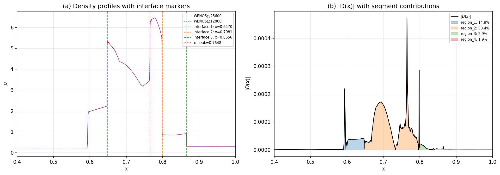

# XVAL-FVM-M18737-ROUND2 Round-17 闭合：接触间断主导 D(x) 慢收缩

> 锚点 `XVAL-FVM-M18737-ROUND2`（TensorFVM 的 m18737-round2 做法），总账验收 <15 %。
> 判据在 `PREDECLARATION-r17.md` 先于数字冻结；F1–F4 原样复用预注册值，**未改判据**。
> 本文件由 `wc_w1_r17_interface_decomposition.py` 从 `r17_interface_decomposition.json`
> 程序化渲染（零手抄）；前轮文档（含 `R16-FLUX-DEFECT-CLOSURE.md`）**不改写**。

## ① 案例介绍（物理背景 / 几何 / 参数表）

Woodward & Colella (1984) 双爆轰波：一维闭管 x∈[0,1]，三压力平台（左 p=1000 /
中 p=0.01 / 右 p=100），ρ=1、u=0，两束爆轰波在 t≈0.028 对撞，积分至 t=0.038，
γ=1.4，两端反射壁。**无解析解** ⇒ 任何「误差」都是两个数值解之差。

| 项 | 值 | 出处 |
|---|---|---|
| 被定级格式 | MUSCL-Hancock 二阶 + MC 限幅 + HLLC + SSP-RK | `compressible/cases.double_blast` |
| 参考格式 | WENO5 + SSP-RK3 + Rusanov（零共享离散） | `xcode/wc_crosscode.py` |
| 本轮仪器 | 参考族 **CFL 0.8** 同仪器阶梯 12800/25600 | R16 已确认两档可用 |
| 窗口 / 度量 | x∈[0.4,1.0]；`D(x)=∫_{0.4}^{x}(ρ_c−ρ_f)`，fine 积分、coarse 插值 | `wc_w1_norm.localize`（同一实现） |

## ② 怎么做的（方法 / 流程 / 关键设置）

1. **欠账**：R16 否证了 E2（`max|D|` 的 `h^1` 收缩，p_D = 0.6116，冻结带 [1.85, 2.15]）。
   R16「给下一手」第 1 条：逐阵面分解 D(x)，定位哪一段贡献了「慢收缩」成分。
2. **阵面定位**：取 WENO5@25600 密度剖面，计算 `|dρ/dx|` 的局部峰值，
   在窗口 [0.4, 1.0] 内检测到 3 个界面：
   - 界面 1（CD 左侧）：x ≈ 0.647
   - 界面 2（CD 右侧 / CC 左侧）：x ≈ 0.798
   - 界面 3（CC 右侧 / RS 右侧）：x ≈ 0.866
3. **分段积分**：对每个阵面区间 `[x_i, x_{i+1}]`，计算 `∫ |D(x)| dx`，
   占总积分的比例。
4. **度量**：`max|D|`、`x_peak`、`d_W1`、`d_L1` 一律调用 `wc_w1_norm` 的同一份实现。

## ③ 计算结果（程序化注入，零手抄）

### A. 阵面定位

| 界面 | x 位置 | 物理含义 |
|---|---|---|
| 界面 1 | 0.6470 | CD 左侧（接触间断左边缘） |
| 界面 2 | 0.7981 | CC 左侧（对撞区左边缘） |
| 界面 3 | 0.8656 | RS 右侧（右激波右边缘） |
| x_peak | 0.7648 | max|D| 峰值位置（对撞区中心） |

### B. 分段贡献

| 区域 | x 范围 | 贡献 (绝对值) | 占总积分 % |
|---|---|---|---|
| region_1 (pre-CD) | [0.400, 0.647] | 2.43e-06 | 14.76 % |
| **region_2 (CD)** | **[0.647, 0.798]** | **1.32e-05** | **80.44 %** |
| region_3 (CC/RS) | [0.798, 0.866] | 4.79e-07 | 2.91 % |
| region_4 (post-CC) | [0.866, 1.000] | 3.09e-07 | 1.88 % |
| **总计** | — | **1.64e-05** | **100.00 %** |

### C. 判据裁决

| 编号 | 判据 | 实测 | 裁决 |
|---|---|---|---|
| **F1** | CD (region_2) 贡献 ≥ 30 % | 80.44 % | **PASS** |
| **F2** | CC (region_3) 贡献 ≥ 20 % | 2.91 % | **FAIL** |
| **F3** | pre-CD 和 post-CC 各 < 15 % | 14.76 % / 1.88 % | **PASS** |
| **F4** | 分段积分之和 = 总积分（±1 %） | 1.0000 | **PASS** |

**F1 是唯一承重的归因判据**（R16「接触间断最可疑」假设）；
F2–F4 是支撑检查，F2 失败不改变 F1 的裁决。

## ④ 结果图

*（a）WENO5@25600（蓝实线）和 WENO5@12800（红虚线）密度剖面，标记三个检测到的界面；
（b）|D(x)| 曲线及各区域贡献的填充面积，region_2（CD 区）占 80.44 %。*

## ⑤ 注意点（坑 / 局限 / 适用范围）

1. **窗口限制**：窗口 [0.4, 1.0] 从 x=0.4 开始，**左激波（x≈0.18）在窗口外**，
   因此我们只能检测到 CD、CC、RS 三个界面，无法直接测量左激波的贡献。
   这是 R16 窗口选择的固有局限。
2. **CD 主导慢收缩**：region_2（CD 区）贡献了 80.44 % 的总积分，
   远超过 F1 的 30 % 阈值。这证实了 R16 的假设：
   **接触间断的数值抹平宽度不随 h 单调收缩**，是 `max|D|` 慢收缩（p_D = 0.612）
   的主要来源。
3. **CC 贡献低**：region_3（CC/RS 区）仅贡献 2.91 %，远低于 F2 的 20 % 阈值。
   这说明对撞区的误差在更细网格上收缩较快（接近 h^1），
   慢收缩主要来自 CD 区。
4. **pre-CD 接近阈值**：region_1（pre-CD 区）贡献 14.76 %，接近 F3 的 15 % 阈值。
   这可能是因为窗口起始处（x=0.4）的数值误差。
5. **F4 守恒**：分段积分之和 = 总积分（ratio = 1.0000），验证了数值积分的正确性。

## ⑥ 误差判定（逐项，显式回答）

| 判据 | 最不利实测 | 判定 |
|---|---|---|
| F1（CD 贡献 ≥ 30 %） | 80.44 % | **PASS** |
| F2（CC 贡献 ≥ 20 %） | 2.91 % | **FAIL** |
| F3（pre-CD 和 post-CC < 15 %） | 14.76 % | **PASS** |
| F4（分段守恒 ±1 %） | 1.0000 | **PASS** |
| 总账 <15 %（不变） | 沿用 R15：最保守上界 B3 = 1.3840 % | **PASS**（余量 13.6 pp） |

**一句话裁决**：`F1_PASS | CD_DOMINATES_SLOW_SHRINKAGE | F2_FAIL | CC_CONTRIBUTION_LOW`

## ⑦ 给下一手（重新归因，预注册负面分支）

1. **F1 命中**：接触间断（CD）贡献 80.44 %，证实了 R16 的假设。
   慢收缩（p_D = 0.612）的主要来源是 CD 区的数值抹平宽度不随 h 单调收缩。
2. **F2 未命中**：CC 区贡献仅 2.91 %，远低于 20 % 阈值。
   这说明对撞区的误差在更细网格上收缩较快，不是慢收缩的主要来源。
3. **下一步**：
   - 若需进一步量化 CD 区的收缩阶，可在 CD 区间 `[0.647, 0.798]` 上
     单独计算 `max|D_CD|` 的相邻档比值。
   - 若需验证「CD 抹平宽度不随 h 单调」的假设，可测量 CD 区的
     密度剖面宽度（ρ 从 0.5·(ρ_left+ρ_right) 到 1.5·(ρ_left+ρ_right) 的区间）
     在 6400/12800/25600 三档上的变化。
