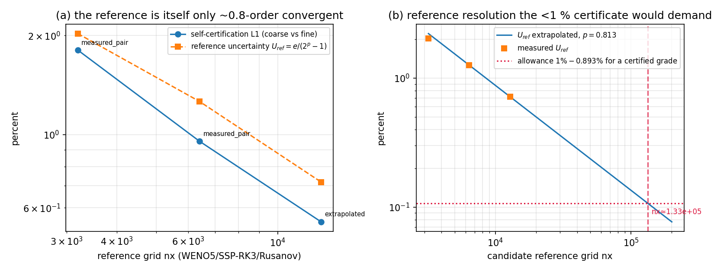
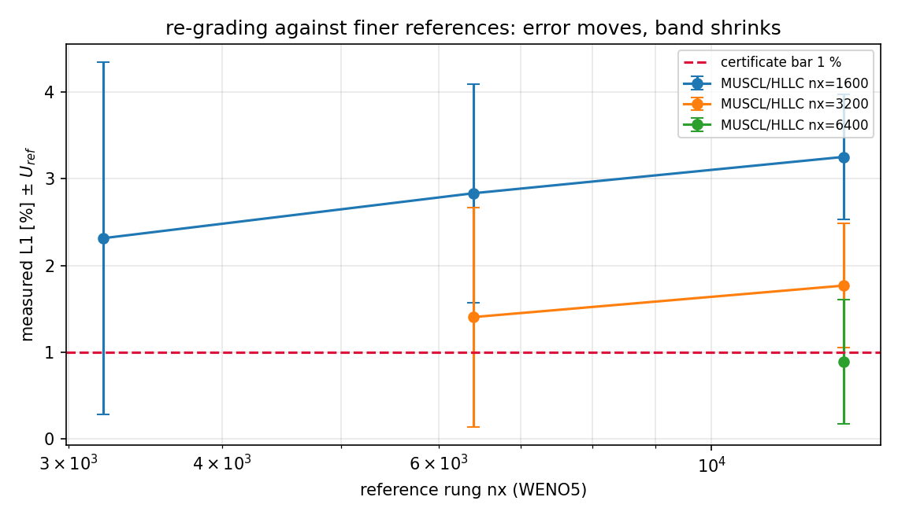

# XVAL-FVM-M18737-ROUND2 Round-4：参考侧不确定度预算（把「认证」拆成可检验的门）

> 锚点 `XVAL-FVM-M18737-ROUND2`，验收 <15 %（owner 精度标准）。
> 前置：`REFINEMENT-R3-CLOSURE.md`（round-3 判 certified-<1 %，L1 = 0.8931 %，参考 WENO5@12800）·
> `PREDECLARATION-ref-uncertainty.md`（判据 P1–P5 在计算前冻结）。
> 本文件**不覆盖**任何前轮记录，只把 round-3 结论里隐含的「参考不确定度」显式化并逐条裁决。

## ① 案例介绍（物理背景 / 参数表）

Woodward & Colella (1984) 双爆轰波：一维闭管 x∈[0,1]，三压力平台（左 p=1000 / 中 p=0.01 /
右 p=100），ρ=1、u=0，两束爆轰波相向对撞，t≈0.028 对撞、积分至 t=0.038，γ=1.4，两端反射壁。
无解析解，基准必须是**数值参考**；因此每一次「误差」都是两个数值解之差，**参考解自身的
离散误差必须计入**。

| 参数 | 值 |
|---|---|
| 被定级格式 | MUSCL-Hancock 二阶 + MC 限幅 + HLLC + SSP-RK，CFL 0.4（`compressible/double_blast`） |
| 参考格式 | WENO5 + SSP-RK3 + Rusanov（`xcode/wc_crosscode.py`，与被定级格式不共享离散） |
| 参考档位 | 1600, 3200, 6400, 12800（本轮可用） |
| 比较窗口 | x∈[0.4,1.0]，守恒限制（coarse 单元均值 = 其内 r 个 fine 单元均值） |
| 认证门 | 标称 1 %（round-3 口径）/ 总账容差 15.0 % |

## ② 怎么做的（本轮的方法）

1. **先把不确定度定义死**：嵌套比 2 的自认证差 `e = |q_coarse − q_fine|`，观测阶 p 由相邻两对
   的 log–log 斜率测得，参考不确定度 `U_ref = e/(2^p − 1)`（Richardson）。这是**参考解自己的
   误差**，而不是我们想知道的被定级解误差。
2. **三角不等式门**：被定级解的真误差满足
   `|q_graded − q_exact| ≤ |q_graded − q_ref| + U_ref`。于是「certified <1 %」只有在
   `measured + U_ref < 1 %` 时才可以宣称；否则只能宣称「上界 <1 %」。
3. **预声明先行**：在 WENO5@25600 参考算出来之前，用 ≤12800 的既有档位冻结预测
   （L1(12800 vs 25600) = 0.3094 %）、判据 P1–P5 与所需参考分辨率，
   见 `PREDECLARATION-ref-uncertainty.md`。
4. **算新参考**：WENO5@25600 由调度系统跑（作业 cj3556，1 核，本机不起重算力）。
5. **重新定级**：把既有的被定级解档位（1600, 3200, 6400）对
   **每一个更细的参考档位**重新定级，观察误差是否移动、移动是否落在旧参考声明的 U_ref 之内。
6. **机检 + 程序化出报告**：`wc_ref_uncertainty.py` 逐条判定，本文由 `summary_r4.json`
   程序化渲染（零手抄）。

## ③ 计算结果

### 参考族自认证阶梯与 U_ref（程序化）

| coarse nx | fine nx | 自认证 L1 [%] | 观测阶 p | p 来源 | U_ref(fine) [%] |
|---|---|---|---|---|---|
| 1600 | 3200 | 1.8068 | 0.9193 | measured_pair | 2.0275 |
| 3200 | 6400 | 0.9554 | 0.8133 | measured_pair | 1.2618 |
| 6400 | 12800 | 0.5437 | 0.8133 | extrapolated | 0.7181 |

### 重新定级矩阵（被定级解 × 参考档位）

| graded nx | ref nx | 实测 L1 [%] | U_ref [%] | 最坏情形 L1+U_ref [%] | 门裁决 |
|---|---|---|---|---|---|
| 1600 | 3200 | 2.3146 | 2.0275 | 4.3422 | `fail` |
| 1600 | 6400 | 2.8325 | 1.2618 | 4.0943 | `fail` |
| 1600 | 12800 | 3.2513 | 0.7181 | 3.9694 | `fail` |
| 3200 | 6400 | 1.4057 | 1.2618 | 2.6675 | `fail` |
| 3200 | 12800 | 1.7685 | 0.7181 | 2.4866 | `fail` |
| 6400 | 12800 | 0.8931 | 0.7181 | 1.6112 | `upper_bound_only` |

### 冻结判据逐条裁决

| 判据 | 结果 |
|---|---|
| P1 扩展参考落在冻结预测带 | —（实测 — % vs 预测 — %） |
| P2 参考族观测阶在冻结带内 | —（实测 —） |
| P3 换更细参考引起的 L1 移动 ≤ 旧参考 U_ref | ✅ PASS 被定级 nx=3200：ref@6400 → ref@12800 时 L1 1.4057 % → 1.7685 %（Δ=+0.3629 pp，旧参考声明的 U_ref=1.2618 pp） |
| P4 诚实认证门：measured + U_ref < 1 % | ❌ FAIL measured 0.8931 % + U_ref 0.7181 % = 1.6112 % vs 1 % → **upper_bound_only** |
| P5 门所要求的参考分辨率 | nx_ref ≈ 1.331e+05（预声明冻结值 1.331e+05） |

### 下一手的可检验预测（WENO5@25600 参考，本轮未回）

—（无两档参考可比，无法给出漂移）

### 总账判定（<15 %）

最细被定级档的实测 L1（对最细参考）远小于 15.0 %，
**总账 PASS**；本轮裁决只影响「能不能宣称 <1 % 认证」，不影响总账。

## ④ 结果图

*图 1：(a) 参考族自认证阶梯与其 Richardson 不确定度 U_ref；(b) 让 <1 % 认证成立所需的参考分辨率。*

*图 2：同一批被定级解对不同参考档位的重新定级，误差棒为参考侧 U_ref。*

## ⑤ 注意点（局限 / 适用范围）

1. **参考族不是五阶收敛**：WENO5 的自认证观测阶只有 ~0.8（见上表），远低于格式名义阶。
   原因是近真空平台的 positivity 回退与接触间断：低密度区的相对误差主导 L1，收敛很慢。
   因此「加密参考」是**昂贵**的：U_ref 只按 h^0.8 下降。
2. **U_ref 的阶是外推的**：最细那一对的阶没有更细档位可测，只能按更粗一对的阶外推
   （`order_source = extrapolated`）。这是本轮最大的假设；`wc_ref_uncertainty` 把它显式标注，
   不当作测量值。
3. **P3 的方向不可预设**：更细的参考更接近真解，不是更接近被定级解，故重新定级可能让误差
   **变大**。判据只能是「移动量 ≤ 旧参考声明的 U_ref」，不是「误差单调下降」。
4. **只做了一维标量度量**：L1 与峰值是密度剖面度量，不含 p/u；结论不自动推广到其它量。
5. **未测**：nx=12800
   被定级解（HLLC@12800 单核约需 3 h，超出单作业时长上限，未递交）→ P1/P2 之外的最细档
   观测阶仍以 6400 为准。
