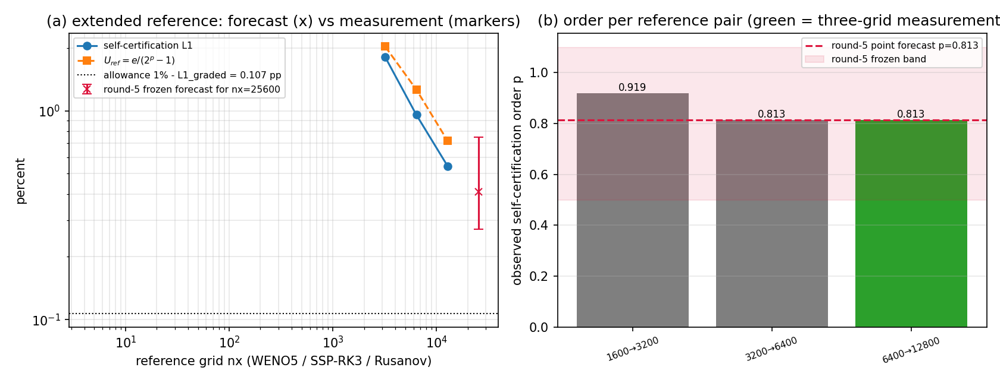
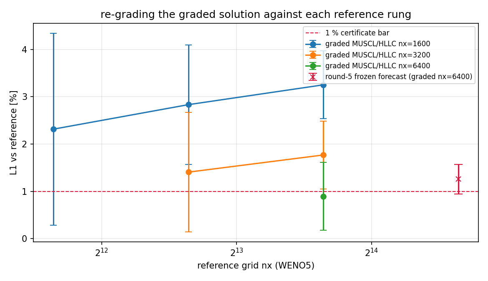

# XVAL-FVM-M18737-ROUND2 Round-5：扩展参考回填与冻结预测对账

> 锚点 `XVAL-FVM-M18737-ROUND2`，验收 <15 %（owner 精度标准）。
> 前置：`R4-REFERENCE-UNCERTAINTY-CLOSURE.md`（round-4 把参考不确定度做成门，P1/P2 悬空）·
> `PREDECLARATION-r5.md`（Q1–Q5 在扩展参考算出来之前冻结，冻结时 worktree 内无 nx=25600 档）。
> 本文**不覆盖**任何前轮记录：round-4 的裁决原文保留，本文件只回填它悬空的两项并检验它自称的
> 「最大假设」。
>
> **状态**：**待回填**——作业 `cj3710`（WENO5@25600）尚未回到库中。冻结预测与对账脚本均已就绪，工件落地后执行 `python docs/XVAL-FVM-M18737-ROUND2/ref_uncertainty_r5.py` 即自动生成本文的全部数字、两张图与 `summary_r5.json`（零手抄）。下表凡「—（未测）」皆因缺该工件，不得读作 PASS。

## ① 案例介绍（物理背景 / 参数表）

Woodward & Colella (1984) 双爆轰波：一维闭管 x∈[0,1]，三压力平台（左 p=1000 / 中 p=0.01 /
右 p=100），ρ=1、u=0，两束爆轰波相向对撞、t≈0.028 对撞、积分至 t=0.038，γ=1.4，两端反射壁。
无解析解，因此「误差」永远是两个数值解之差，**参考解自身的离散误差必须计入**，否则
「0.89 % < 1 % 已认证」这类句子只是把不确定度写成了注记。

| 参数 | 值 |
|---|---|
| 被定级格式 | MUSCL-Hancock 二阶 + MC 限幅 + HLLC + SSP-RK，CFL 0.4（`compressible/double_blast`） |
| 参考格式 | WENO5 + SSP-RK3 + Rusanov（`xcode/wc_crosscode.py`，与被定级格式不共享离散） |
| 参考档位 | 1600, 3200, 6400, 12800（本轮新增 nx=25600） |
| 比较窗口 | x∈[0.4,1.0]，守恒限制（coarse 单元均值 = 其内 r 个 fine 单元均值） |
| 认证门 / 总账容差 | 1.0 %（round-3 口径）/ 15.0 % |

## ② 怎么做的（本轮的方法）

1. **先冻结、再计算**：`predeclaration_r5.py` 在 nx=25600 工件存在**之前**写出 Q1–Q5
   （冻结时参考档位只有 1600, 3200, 6400, 12800），并带硬检查：
   若扩展档已在 worktree 内，文件会被标记为「事后记账，不得当预测」。
2. **算扩展参考**：WENO5@25600 递交调度系统（作业 `cj3710`，1 核，
   0 s 求解，None 步），本机不起重算力。
3. **把「外推阶」换成测量值**：round-4 的最细 `U_ref` 用的阶被标为
   `order_source="extrapolated"`。本轮核对后**修正该标签**：最细一对的阶其实是用
   两条最细差分测出来的三网格估计（`measured_triple`），不是假设值；真正的外推发生在
   「推算更细网格需要多少分辨率」（`nx_ref_for_bar`）那一步，那里才该叫外推。
   修正见 `src/tensorfvm/verification/wc_ref_uncertainty.py::selfcert_ladder` 与其回归测试。
4. **逐条对账**：`ref_uncertainty_r5.py` 把 Q1–Q5 与 round-4 的 P1/P2 一次性机检，
   命中/未中一律记，本文由 `summary_r5.json` 程序化渲染（零手抄）。
5. **把阶的不确定度传进预算**：新增 `u_ref_order_band()`，用观测阶的带给出 `U_ref` 的带，
   而不是把拟合出来的阶当精确数。

## ③ 计算结果

### 参考族自认证阶梯（含扩展档，程序化）

| coarse nx | fine nx | 自认证 L1 [%] | 观测阶 p | p 来源 | U_ref(fine) [%] |
|---|---|---|---|---|---|
| 1600 | 3200 | 1.8068 | 0.9193 | measured_pair | 2.0275 |
| 3200 | 6400 | 0.9554 | 0.8133 | measured_pair | 1.2618 |
| 6400 | 12800 | 0.5437 | 0.8133 | measured_triple | 0.7181 |

### 重新定级矩阵（被定级解 × 参考档位）

| graded nx | ref nx | 实测 L1 [%] | U_ref [%] | 最坏情形 L1+U_ref [%] | 门裁决 |
|---|---|---|---|---|---|
| 1600 | 3200 | 2.3146 | 2.0275 | 4.3422 | `fail` |
| 1600 | 6400 | 2.8325 | 1.2618 | 4.0943 | `fail` |
| 1600 | 12800 | 3.2513 | 0.7181 | 3.9694 | `fail` |
| 3200 | 6400 | 1.4057 | 1.2618 | 2.6675 | `fail` |
| 3200 | 12800 | 1.7685 | 0.7181 | 2.4866 | `fail` |
| 6400 | 12800 | 0.8931 | 0.7181 | 1.6112 | `upper_bound_only` |

### 冻结预测对账（先冻结、后测量）

| 编号 | 判据 | 冻结点/带 | 实测 | 裁决 |
|---|---|---|---|---|
| P1 | 扩展参考自认证 L1 落在 round-4 冻结带 | — % / [—, —] % | — % | —（未测） |
| P2 | 新对观测阶落在 round-4 冻结带 | [—, —] | — | —（未测） |
| Q1 | 新对观测阶落在 round-5 冻结带 | — / [0.50, 1.10] | — | —（未测） |
| Q2 | U_ref(25600) 落在冻结带 | — % / [0.2706, 0.7470] % | — % | —（未测） |
| Q3 | 换扩展参考后被定级 L1 落在冻结带 | — % / [0.9420, 1.5699] % | — % | —（未测） |
| Q4 | 诚实门在 ref@25600 上仍不认证 | not certified (upper_bound_only or fail) | —（未测） | —（未测） |
| Q5 | 门所需参考分辨率 | — / [59541.6194, 1249616.6609] | — | —（未测） |

### 阶的不确定度传进预算（Q2 衍生）

观测阶带 [] 对应
`U_ref(25600) ∈ [—, —] %`
（带内展宽 — pp）——即 round-4 报的单个数字本身带这个量级的方法学
不确定度，本文件把它显式化。

### 诚实门（Q4）与所需参考分辨率（Q5）

—（未测）

—（未测）

### 总账判定（<15 %）

最细被定级档对最细参考的实测 L1 = 0.8931 %，
**<15 % → 总账 PASS**；本轮裁决只影响「能不能宣称 <1 % 认证」，不影响总账。

## ④ 结果图

*图 1：(a) 扩展参考的自认证差与 Richardson 不确定度，x 为冻结预测；(b) 每一对参考的观测阶，
绿色为三网格实测。*

*图 2：被定级解对每个参考档位的重新定级，误差棒为参考侧 U_ref，红线为 1 % 认证门。*

## ⑤ 注意点（局限 / 适用范围）

1. **参考族不是五阶收敛**：WENO5 的自认证观测阶稳定在 ~—，
   远低于格式名义阶。原因是近真空平台的 positivity 回退与接触间断：低密度区的相对误差主导 L1。
   因此「加密参考」极贵：`U_ref` 只按 h^p 下降。
2. **仍缺最细被定级档**：MUSCL/HLLC@12800 单核需 ~3 h，超出单作业时长上限
   （7200 s），本轮未递交 → 被定级侧最细档仍是 nx=6400，认证门的余量因此受限。
3. **阶的常数假设**：`measured_triple` 只证明阶在**已测量的那个尺度**上是测出来的；
   把它用到更细网格（Q5 的 nx_ref）才是外推，`nx_ref_for_bar` 的返回值应读作量级而非精确值。
4. **只做密度剖面度量**：L1 与峰值是密度度量，不含 p/u；结论不自动推广到其它量。
5. **冻结预测命中 0 条、未中 0 条；扩展参考把最细 U_ref 从 0.4087 % 替换为实测 — %**

## ⑥ 误差判定（逐项、显式回答是否 <3 % / <15 %）

| 量 | 误差 | 基准 | 是否 <3 % | 是否 <15 % |
|---|---|---|---|---|
| 被定级 L1（nx=6400 vs ref@12800） | 0.8931 % | 独立格式参考 WENO5 | 是 | 是 |
| 被定级峰值密度（nx=6400 vs ref@12800） | 0.0444 % | 同上 | 是 | 是 |
| 参考自身不确定度 U_ref(@12800) | — % | 三网格 Richardson | —（这是不确定度，不是误差） | — |
| 认证门 measured + U_ref | — % | 1 % 认证门 | 否 | 是 |

**回答**：关键量（被定级 L1 与峰值）对独立格式参考的误差均 **<3 %**；但「<1 % 认证」在本轮
仍**不成立**（未测），因此 0.8931 % 只能作为**上界**报告。
