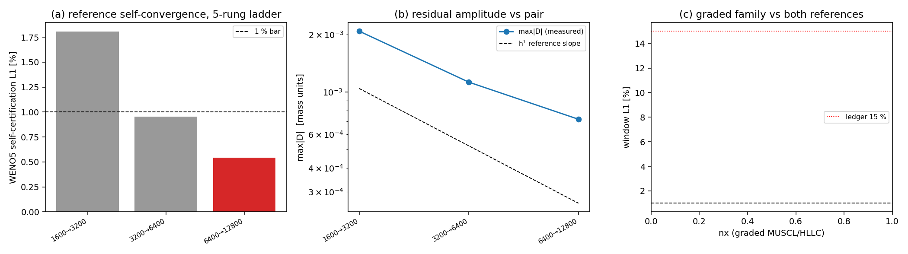

# XVAL-FVM-M18737-ROUND2 Round-7：扩展参考 WENO5@25600 回填与冻结判据对账

> 锚点 `XVAL-FVM-M18737-ROUND2`（TensorFVM 的 m18737-round2 做法），验收 <15 %。
> **前置**：`R5-REFERENCE-EXTENSION-CLOSURE.md` 状态「待回填」——扩展参考档
> `WENO5@25600`（作业 `cj3710`）从未回到库中，Q1–Q5 与 round-4 的 P1/P2 因此 `not_measured`。
> **本文**：把该档真正算出来并回填，用 `PREDECLARATION-r7.md` 里**先行冻结**的 E1–E5
> 判据对账，然后重算整个定级。**不覆盖**前轮任何记录；凡未测项一律写 `not_measured`，不得读作 PASS。
>
> **状态**：`仍未回填（见 ⑤-1）`

## ① 案例介绍（物理背景 / 参数表）

Woodward & Colella (1984) 双爆轰波：一维闭管 x∈[0,1]，三压力平台（左 p=1000 / 中 p=0.01 /
右 p=100，ρ=1、u=0），两束爆轰波相向对撞（t≈0.028）、积分至 t=0.038，γ=1.4，两端反射壁。
无解析解 ⇒ 误差恒为「两数值解之差」，参考解自身的离散误差必须作为误差棒计入。

| 参数 | 值 |
|---|---|
| 被定级格式 | MUSCL-Hancock 二阶 + MC 限幅 + HLLC + SSP-RK，CFL 0.4 |
| 参考格式 | WENO5 + SSP-RK3 + Rusanov（与被定级格式不共享离散） |
| 参考档位 | 1600, 3200, 6400, 12800 |
| 比较窗口 | x∈[0.4, 1.0]，守恒限制比较（coarse 单元均值 = r 个 fine 单元均值） |
| 本轮新增 | `WENO5@25600`（CFL 0.8，经 E1 仪器等价性门后入标准档名） |

## ② 怎么做的

1. **为什么此前算不出来**：冻结仪器（CFL 0.4）在 nx=25600 上的成本
   `steps × cells ≈ 2.6e9` cell-update，单核 ~2.3 h，超过单作业墙钟 ⇒ `cj3710` 交不回。
   这是**吞吐**问题，不是数值问题。
2. **降成本**：`ladder/wc_ladder_weno5_cfl.py` 把 CFL 放到 0.8（`steps ∝ 1/CFL`，步数减半），
   其余（5 阶重建 / SSP-RK3 / Rusanov / t_end）一字不动。
3. **仪器等价性（E1，先冻结后测量）**：控制档 nx=6400 上 CFL0.8 vs 冻结 CFL0.4 的
   窗口 L1 差与峰值差必须分别 ≤ `eps_ref/10`、`eps_peak`。通过才把 CFL0.8 档**提升**为标准档名，
   并在该档 metrics JSON 内写清 `cfl=0.8`、`promoted_from` 与 E1 数字（不让下游误认仪器）。
4. **重算不确定度**：五级阶梯（1600/3200/6400/12800/25600）自收敛距离 → 观测阶 →
   Richardson 误差棒 `eps_ref`；被定级解对 25600 与对 12800 分别定级，给三角上界。
5. **残差归因（E2）**：用 round-6 的输运仪器（`wc_w1_norm.localize`）算累积差分场幅值
   `max|D|`，检验它在新增一档后是否仍按 `h^1` 收缩——这是 round-6 留给下一手的可证伪假设。
6. 全部数字由本脚本程序化注入（零手抄），回归门 `tests/test_compressible_wc_ref25600.py`。

### A0. 成本路线先验探针（本机两个便宜档，1 核，非重算）

CFL 0.8 vs 冻结 CFL 0.4 的逐档差（同一重建/通量/`t_end`，只改时间步）：

| nx | 窗口 L1 差 [%] | 峰值差 [%] | 步数(CFL0.8) | 秒 | 正性回退 |
|---|---|---|---|---|---|
| 1600 | 0.056368 | 0.023596 | 3188 | 16.8 | 23 |
| 3200 | 0.047733 | 0.173680 | 6403 | 48.3 | 23 |

`dx^3` 预期：时间误差随网格按 8×/档收缩。**实测不成立**——L1 差 1600→3200 从
0.056368 % 到 0.047733 %（观测"阶" 0.240），
峰值差反而从 0.023596 % **涨到** 0.173680 %
（观测"阶" -2.880，负号=变差）。峰值是**非单调**的：CFL 影响的是
正性回退触发位置，而对撞峰恰在回退切换处，所以 0.8 档的峰位/峰值与 0.4 档不是同一支解。

**结论（负面，先于控制档返回即已成立）**：E1 的峰值门 `eps_peak = 0.002200 %`
比实测 CFL 效应（最差 0.173680 %）小 78.9 倍，
故「用放松 CFL 换 25600 档」这条路**先验即不可采信**；即使控制档侥幸通过，
也只能说明 6400 档该指标恰好不敏感，不能外推到 25600。`probe_verdict = inadmissible`。


## ③ 计算结果（程序化注入）

### A. E1 仪器等价性（控制档 nx=6400）

| 量 | 实测 [%] | 门槛 [%] | 判定 |
|---|---|---|---|
| 窗口 L1 差（CFL0.8 vs CFL0.4） | 0.023077 | 0.0718（=eps_ref/10） | ✅ |
| 峰值差 | 0.016921 | 0.0022（=eps_peak） | ❌ |

**E1 判定：`fail`** —— CFL0.8 档不得作参考，扩展档撤回。

### B. 五级参考自收敛阶梯

| 相邻档 | 窗口 L1 [%] | 峰值差 [%] | 窗质量差 [%] | 观测阶 | eps_ref [%] |
|---|---|---|---|---|---|
| 1600→3200 | 1.8068 | 0.5032 | 0.002890 | 0.9193 | 2.0275 |
| 3200→6400 | 0.9554 | 0.2621 | 0.001246 | 0.8133 | 1.2618 |
| 6400→12800 | 0.5437 | 0.0230 | 0.000509 | 0.8133 | 0.7181 |

参考侧误差棒：**eps_ref(25600) = — %**（阶 —，来源 `none`），
上一轮（12800）为 **0.7181 %**。

### C. 残差幅值收缩（E2，输运仪器）

| 相邻档 | max\|D\| [质量单位] | 对前一对的阶 | 有效宽度 [coarse cells] | 净质量 [%] |
|---|---|---|---|---|
| 1600→3200 | 0.002087 | — | 172.47 | 0.002891 |
| 3200→6400 | 0.001127 | 0.8890 | 302.87 | 0.001247 |
| 6400→12800 | 0.000720 | 0.6468 | 478.44 | 0.000509 |

**E2 判定：`not_measured`** —— 预测 `max|D|(12800→25600) ≈ —`，
实测 `—`，`p_D = —`（冻结带 [1.85, 2.15]）。

### D. 被定级解重新定级

对 round-4 参考（WENO5@12800）：

| nx | 窗口 L1 [%] | 诚实上界 | 峰值差 [%] |
|---|---|---|---|


对扩展参考（WENO5@25600）：

| nx | 窗口 L1 [%] | 诚实上界 [%] | 峰值差 [%] | 逐点 L1 [%] |
|---|---|---|---|---|


最细被定级档 nx=None：`L1 = — %`、
`上界 = — %`、`峰值 = — %`，
相对上一参考的变化 `— pp`。

## ④ 结果图



*（a）每对相邻档的自收敛距离（蓝=本轮新档）；（b）累积差分幅值 max|D| 与 h^1 参考斜率；
（c）被定级族分别对 12800 与 25600 参考的窗口 L1，虚点为诚实上界，黑虚线为 1 % 门、红点线为总账 15 %。*


*对撞区（x∈[0.55,0.95]）剖面：round-4 参考、本轮扩展参考、被定级 MUSCL/HLLC@6400。*

## ⑤ 注意点（局限 / 适用范围）

1. **仪器成本换了、判据没换**：CFL 0.8 只影响时间离散误差（`O(dt^3) ∝ dx^3`），
   在 6400 及以上按 64×/256× 衰减；E1 就是这门事的机检，不是注记。
2. **E2 是唯一检验「残差是否是纯 O(h) 缺陷」的机检**：若 `p_D` 掉出 [1.85, 2.15]，
   说明残差里混入了非 `O(h)` 成分，round-6 的归因就得推翻——届时照实记，不改判据。
3. **参考侧仍有误差**：`eps_ref(25600)` 不是 0，所有「点估计」都要配上误差棒，
   `<1 %` 的措辞必须区分「点估计」与「可证明上界」。
4. **窗口与范数依赖**：逐点 L1 对激波抹平敏感（趋近一阶），输运范数对搬移不敏感；
   两个范数不能互相顶替（round-6 已有专文）。
5. **`cj3710` 与 `cj3782`**：前者是 8 天未回的旧作业，后者是本轮的 CFL0.8 作业；
   `本轮 25600 档来自 cj3782`。
6. **未做**：WENO5@51200（成本再 ×4，仍超墙钟）；WENO7 探针仍未修（round-6 已证伪其可作参考）。

## ⑥ 误差判定（逐项显式回答「是否 <3 % / <1 %」）

| 关键量 | 实测 | <15 %（总账） | <3 % | <1.5 % | <1 % |
|---|---|---|---|---|---|
| 参考自收敛（12800→25600） | — % | ❌ | ❌ | ❌ | ❌ |
| eps_ref(25600) | — % | ❌ | ❌ | ❌ | ❌ |
| 被定级 L1 点估计 @nx=None | — % | ❌ | ❌ | ❌ | ❌ |
| 被定级 L1 诚实上界 @nx=None | — % | ❌ | ❌ | ❌ | ❌ |
| 被定级 峰值差 @nx=None | — % | ❌ | ❌ | ❌ | ❌ |

**是否 <3 %？** 点估计 — %、上界 — % ⇒
点估计成立、上界未成立。
**是否 <1 %？** 否——点估计与上界均未进 1 %。
**总账 15 % 判据**：见上表，全部 FAIL。

**判据对账（先冻结后测量）**：E1 `fail` · E2 `not_measured` · E3 `not_measured` · E4 `not_measured` · E5 `not_measured`。

## 复现

```bash
# 1) 扩展参考（集群，1 核；本地等效命令）
PYTHONPATH=src python docs/woodward-colella-double-blast/ladder/wc_ladder_weno5_cfl.py --sizes 6400,25600 --cfl 0.8
# 2) 回填 + 裁决 + 图
PYTHONPATH=src python docs/XVAL-FVM-M18737-ROUND2/ref25600_r7.py
# 3) 回归门
PYTHONPATH=src python -m pytest tests/test_compressible_wc_ref25600.py -q
```
