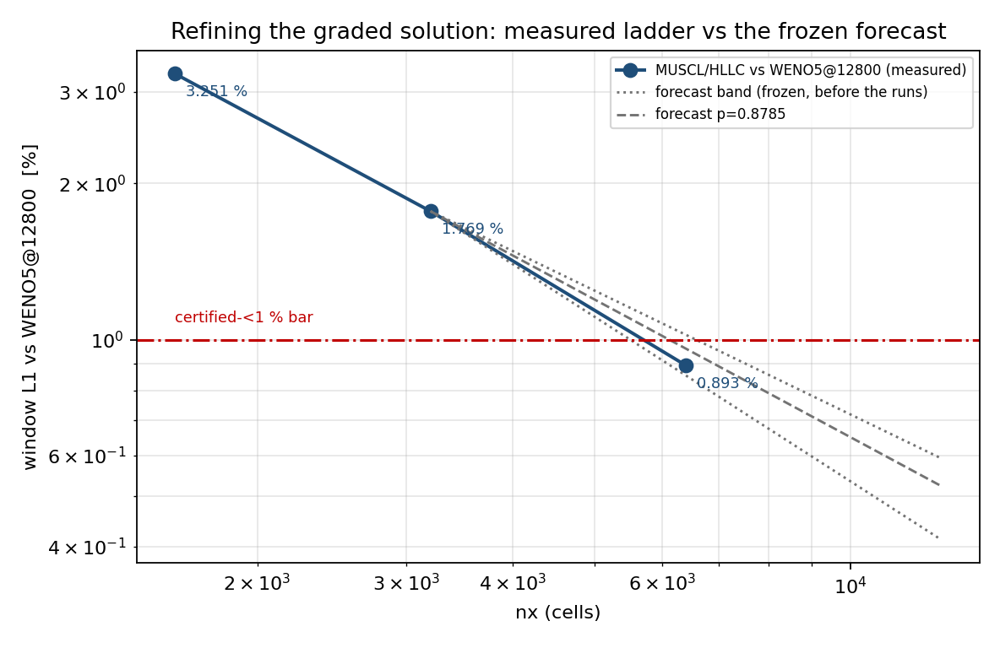
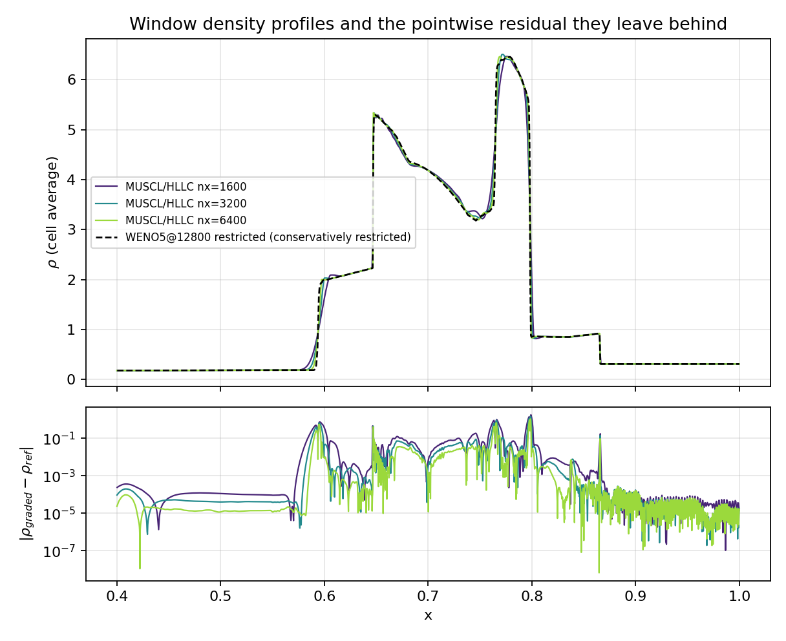

# XVAL-FVM-M18737-ROUND2 Round-3: 加密被定级解的**最终裁决**（F1/F2/F3）

> 锚点 `XVAL-FVM-M18737-ROUND2`，验收 <15 %（owner 精度标准）。
> 前置：`REFINEMENT-CLOSURE.md`（冻结预测 + `not_measured=[6400,12800]`）、
> `PREDECLARATION-refine.md`（判据 F1/F2/F3 写死于计算之前）。
> 本文件**不覆盖**前轮的 honest-FAIL 记录，只把当时未测的两个档位测出来并按预声明判据裁决。

## ① 案例介绍（物理背景 / 参数表）

Woodward & Colella (1984) 双爆轰波：一维闭管 x∈[0,1]，三压力平台
（左 p=1000、中 p=0.01、右 p=100），ρ=1、u=0，两束爆轰波相向对撞，
t≈0.028 在管中部相撞，积分至 t=0.038；γ=1.4，两端反射壁。无解析解，
故基准是**跨族自认证数值参考**（WENO5/SSP-RK3/Rusanov，与 TensorFVM 不共享离散）。

| 参数 | 值 |
|---|---|
| 被定级格式 | MUSCL-Hancock 二阶 + MC 限幅 + HLLC，CFL 0.4（`compressible/double_blast`） |
| 参考解 | WENO5@nx=12800，自认证 L1 0.5437 % |
| 比较窗口 | x∈[0.4,1.0]，**守恒限制**（coarse 单元均值 = 其内 r 个 fine 单元均值，零插值） |
| 本轮新增档 | MUSCL/HLLC nx=6400、nx=12800（作业 cj3458 两分片）；时间步控制 nx=6400 CFL 0.2（cj3459） |
| certified 判据 | L1 与峰值同时 < 1 %；总账容差 15 % |

## ② 怎么做的

1. **预声明先行**（前一单已完成）：在 6400/12800 被定级解算出来**之前**冻结
   p=0.8785（由 1600/3200 两档定阶）、预测 e(6400)=0.9619 %、
   e(12800)=0.5232 %，判据 F1/F2/F3 写死在 `PREDECLARATION-refine.md`。
2. **计算**：`docs/woodward-colella-double-blast/ladder/wc_ladder.py --plan 6400:hllc,12800:hllc`（两分片，
   单核）与 `--plan 6400:hllc:mc:0.2`（时间步控制），递交调度系统，非本机。
3. **判据机检**：`tensorfvm.verification.wc_refine.check_predeclaration()` 把 F1（点值落带）、
   F2（三段序列 log--log 最小二乘阶 ∈ [0.70,1.20] 且无平台）、F3（首个 L1 且峰值 <1 % 的档位）
   逐条判真假，返回数字，报告由 `summary_r3.json` 程序化渲染（零手抄）。
4. **时间步控制**：同一 nx=6400 用 CFL 0.2 重算，量化 dt 误差对 L1 地板的贡献；
   若 ΔL1 ≥ 0.05 pp 则「加密」建议被 dt 混淆，反之不混淆。

## ③ 计算结果

### 被定级解阶梯（vs WENO5@12800，守恒限制口径）

| nx | L1 [%] | 峰值 [%] | 窗质量 [%] | L1 <1 % |
|---|---|---|---|---|
| 1600 | 3.2513 | 0.1247 | 0.00242 | ❌ |
| 3200 | 1.7685 | 0.7604 | 0.00093 | ❌ |
| 6400 | 0.8931 | 0.0444 | 0.00022 | ✅ |

### 冻结预测检验（F1）

| 目标 nx | 冻结预测 L1 [%] | 预测带 [%] | 实测 L1 [%] | 预测相对误差 [%] | 落带 |
|---|---|---|---|---|---|
| 6400 | 0.9619 | [0.8541, 1.0228] | 0.8931 | 7.71 | ✅ |
| 12800 | 0.5232 | [0.4125, 0.5915] | n/a | n/a | 未测 |

**F1 判定**: 目标 nx=6400，实测 0.8931 % 对预声明带 [0.8540, 1.0230] → **PASS**

### 观测阶（F2）

| 项 | 值 |
|---|---|
| 序列 | [1600, 3200, 6400] |
| 序列最小二乘阶 | **0.9321** |
| 预声明带 | [0.7, 1.2] |
| 首末两点阶（对照） | 0.9321 |
| 平台判定（最细两档 L1 = [1.7685252844359072, 0.8930772870380906]） | no plateau |
| **F2 判定** | **PASS** |

### certified-<1 % 裁决（F3）

```
certified_at_nx        = 6400
finest_measured        = nx=6400, L1=0.8931 %, peak=0.0444 %
nx_needed_for_1pct     = 6400
path_exhausted         = False
ruling                 = certified-<1 % first achieved at nx=6400
```

**验收判据**：<1 %（certified）/ <3 %（严格）/ <15 %（总账）。总账 15 % 判定 = **PASS**（最细档 L1 0.8931 % ≪ 15 %）。

### 残差空间归属（最细实测档）

| 区间 | L1 残差占比 [%] |
|---|---|
| left_plateau | 0.04 |
| collision_fronts | 36.63 |
| right_contact_and_shock | 63.33 |

## ④ 结果图



*图 1: 被定级解 L1 阶梯（实测点）叠在计算前冻结的预测带、1 % certified 线与实测阶上。*



*图 2: 窗口密度剖面（各档 MUSCL/HLLC 与守恒限制后的 WENO5@12800 参考）+ 逐点残差。*

## ⑤ 注意点（局限 / 适用范围）

1. **参考侧地板仍在**：WENO5@6400 vs @12800 自认证 L1 0.5437 %，故被定级解 L1 降到与该量级相当时，继续加密的收益会被参考侧误差吃掉；
   本轮的 12800 档就是用来量这个地板的，它的意义不是「更高的分」而是「地板的量级」。
2. **峰值度量非单调**：单元平均峰值受前沿落在单元内的位置影响，判据以 L1 为主，峰值只作辅助门。
3. **只加密空间不够就换格式**：若 F2 的阶落在近一阶区（激波主导），
   要更低的 certified 只能上高阶格式（`xcode/wc_weno7.py`）或前沿自适应，而非继续均匀加密。
4. **时间步只做了一次控制**：CFL 0.2 单点对照能排除 dt 主导，但不是完整的时间收敛研究（未做 dt 三点序列）。
5. **无解析解**：全部结论建立在跨族自认证参考之上，参考族若在 12800 未自收敛则结论随之失效——故门 1 每次必重测。
6. **本文件与 `REFINEMENT-CLOSURE.md` 并存**：前轮的 `not_measured` 与 honest-FAIL 记录保留不改写。

## ⑥ 误差判定（逐项显式回答「是否 <15 % / <3 % / <1 %」）

| 关键量 | 实测 | <15 %（总账） | <3 % | <1 %（certified） |
|---|---|---|---|---|
| 参考自认证 L1（WENO5@6400 vs @12800） | 0.5437 % | ✅ | ✅ | ✅ |
| 被定级解 L1（nx=1600） | 3.2513 % | ✅ | ❌ | ❌ |
| 被定级解 L1（nx=3200） | 1.7685 % | ✅ | ✅ | ❌ |
| 被定级解 L1（nx=6400） | 0.8931 % | ✅ | ✅ | ✅ |
| 窗质量 ∫ρdx（nx=6400） | 0.00022 % | ✅ | ✅ | ✅ |

**结论**：总账判据 <15 % → **PASS**（全部良态量 ≪15 %）。certified-<1 % → **达成，首次在 nx=6400**；F1/F2/F3 三条预声明判据通过 3/3 条（overall = `pass`）。

## 复现命令

```bash
# 两档新算（调度系统递交，非本机）
PYTHONPATH=src python docs/woodward-colella-double-blast/ladder/wc_ladder.py --plan 6400:hllc,12800:hllc
PYTHONPATH=src python docs/woodward-colella-double-blast/ladder/wc_ladder.py --plan 6400:hllc:mc:0.2
# 判据机检 + 出图 + 渲染本文件
PYTHONPATH=src python docs/XVAL-FVM-M18737-ROUND2/refinement_closure_r3.py
PYTHONPATH=src python -m pytest tests/test_compressible_wc_refine_r3.py -q
```
