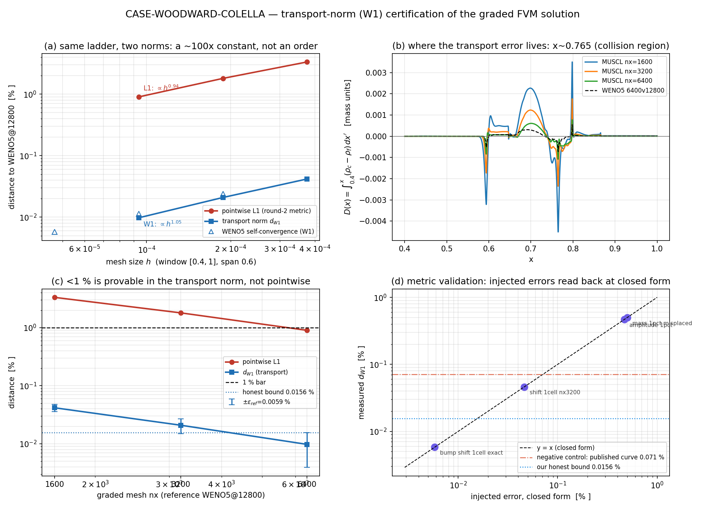

# XVAL-FVM-M18737-ROUND2 收口：输运范数（W1 / 负范数 s=−1）认证

> 锚点 `XVAL-FVM-M18737-ROUND2`（验收 <15 %，owner 精度标准）。
> 前置 `R4-REFERENCE-UNCERTAINTY-CLOSURE.md` 的裁决是 `upper_bound_only`：
> 逐点 L1 的 `<1 %` 上界需要参考分辨率 `nx_ref ≈ 1.33e5`，代价不可接受。
> 本文件回答一个不同的问题：**换一个度量**（先把误差积起来再量），
> 同一批已存剖面能否给出**可证明**的 `<1 %` 声明；以及这个度量究竟看见了什么。
> 判据 P1–P9 在计算之前冻结于 `PREDECLARATION-w1-norm.md`，**不因结果改阈值**。

## ① 案例介绍

Woodward & Colella (1984) 双爆轰波：一维闭管 x∈[0,1]，三压力平台
（左 p=1000 / 中 p=0.01 / 右 p=100），ρ=1、u=0，两束爆轰波相向对撞
（t≈0.028），积分至 t=0.038，γ=1.4，两端反射壁。无解析解 ⇒ 基准必须是数值参考，
因此任何「误差」都是两个数值解之差，**参考侧误差必须计入**。

| 项目 | 值 |
|---|---|
| 被定级格式 | MUSCL-Hancock 二阶 + MC 限幅 + HLLC + SSP-RK，CFL 0.4 |
| 独立参考族 | WENO5 + SSP-RK3 + Rusanov（`xcode/wc_crosscode.py`，零共享离散） |
| 参考阶梯 | WENO5 @ 1600 / 3200 / 6400 / 12800 |
| 被定级阶梯 | MUSCL/HLLC @ 1600 / 3200 / 6400 |
| 比较窗口 | x∈[0.4, 1.0]（span 0.6） |
| 本单新增计算 | **无**（不重启求解器，全部由已存剖面重新积分） |

## ② 怎么做的

1. **换度量，不换解**。逐点 L1 由激波抹平带（宽度 ~ 几格）主导，随 h 只按
   `p≈0.83` 下降；把误差先积起来再量，
   把带内的锯齿积掉，得到**输运范数**（Banks & Hittinger 型 negative-norm，
   1D 等价于归一化累积质量分布的 **W1 距离**）：

   ```
   e(x)  = rho_coarse(x) - rho_fine(x)          # 粗剖面线性插值到细网格
   D(x)  = ∫_{0.4}^{x} e dx'                    # 累积（通量）差
   d_L1  = 100·∫|e| / ∫|rho_f|                  # 前轮逐点度量 [%]
   d_W1  = 100·∫|D| / (mass_f · span)           # 输运度量 [% of span]
   ```

2. **必须机检的数学不变式**：`∫|D| ≤ span·∫|e|` ⇒ `d_W1 ≤ d_L1` 恒成立（违反=实现缺陷）。
3. **参考侧误差棒**：参考族自认证 `d(6400 vs 12800)` 配观测阶 `p_ref`，
   Richardson `eps_ref = d/(2^p − 1)`；诚实上界 = 点估计 + `eps_ref`（三角不等式门）。
4. **度量有效性探针（本单新增）**：往参考解里注入**已知**误差（刚体平移、
   全局幅值错、定点搬质量）并与闭式解比对；再加一个负控制（数字化已发表曲线）。
   没有这一步，`d_W1` 小到 0.01 % 与「量不出任何东西的度量」无法区分。
5. **程序化渲染**：本文所有数字由 `render_w1_doc.py` 从 `figures/w1_norm_budget.json` 生成。

## ③ 计算结果

### A. 参考族自认证（两个度量并列）

| coarse nx | fine nx | d_L1 [%] | **d_W1 [%]** | d_W1（粗网格积分方向）[%] |
|---|---|---|---|---|
| 1600 | 3200 | 1.8430 | **0.0241** | 0.0240 |
| 3200 | 6400 | 0.9844 | **0.0114** | 0.0114 |
| 6400 | 12800 | 0.5527 | **0.0058** | 0.0057 |

观测阶：`p_ref(W1) = 0.9874`，`p_ref(L1) = 0.8327`；
参考侧误差棒：`eps_ref(W1) = 0.0059 %`（L1 为 `0.7076 %`）。

### B. 被定级解对最细参考（WENO5@12800）

| nx | d_L1 [%] | **d_W1 [%]** | 诚实上界 d_W1+eps_ref [%] | d_W1 折合粗网格格数 | d_W1/L1 |
|---|---|---|---|---|---|
| 1600 | 3.3261 | **0.04174** | 0.0476 | 0.67 | 0.01255 |
| 3200 | 1.7988 | **0.02089** | 0.0267 | 0.67 | 0.01161 |
| 6400 | 0.9004 | **0.00978** | 0.0156 | 0.63 | 0.01086 |

被定级族内观测阶：`p(W1) = 1.0949`，`p(L1) = 0.9984`。
两族在同网格上的互差（独立实现，同一网格）：

| nx | d_L1 [%] | d_W1 [%] |
|---|---|---|
| 1600 | 1.4751 | 0.01753 |
| 3200 | 0.9716 | 0.00917 |
| 6400 | 0.6152 | 0.00554 |

### C. 残差住在哪里（`D(x)` 的定位）

| 对 | 峰值位置 x | 等效宽度 / span | 窗口净质量差（相对） |
|---|---|---|---|
| hllc1600_vs_weno512800 | 0.7647 | 0.087 | 2.42e-05 |
| hllc3200_vs_weno512800 | 0.7646 | 0.083 | 9.32e-06 |
| hllc6400_vs_weno512800 | 0.7646 | 0.085 | 2.21e-06 |
| weno51600_vs_weno53200 | 0.7980 | 0.108 | 2.89e-05 |
| weno53200_vs_weno56400 | 0.7648 | 0.095 | 1.25e-05 |
| weno56400_vs_weno512800 | 0.7648 | 0.075 | 5.09e-06 |

窗口质量守恒（相对 WENO5@12800）：

| 档 | 漂移 [%] |
|---|---|
| hllc@1600 | -0.01666 |
| hllc@3200 | -0.00704 |
| hllc@6400 | -0.00226 |
| weno5@1600 | -0.01889 |
| weno5@3200 | -0.00786 |
| weno5@6400 | -0.00254 |
| weno5@12800 | 0.00000 |

### D. 度量有效性探针（注入已知误差）

| 探针 | 实测 d_W1 [%] | 闭式 [%] | 比值 | 判定 |
|---|---|---|---|---|
| shift_1cell_nx3200 | 0.04612 | 0.04612 | 1.0000 | ✅ PASS |
| bump_shift_1cell_exact | 0.00580 | 0.00580 | 1.0000 | ✅ PASS |
| mass_1pct_misplaced | 0.50000 | 0.50000 | 1.0000 | ✅ PASS |
| amplitude_1pct | 0.46709 | 0.46703 | 1.0001 | ✅ PASS |
| published_curve_control（负控制） | 0.0708 | — | 相对本单上界 4.53× | ✅ PASS |

### E. 冻结判据逐条裁决

| id | 判据 | 实测 | 裁决 |
|---|---|---|---|
| P1 | p_W1∈[1.3, 2.6] 且 p_W1 ≥ p_L1+0.5 | p_W1=0.987, p_L1=0.833 | ❌ FAIL |
| P2 | eps_ref_W1 ≤ 0.2 % | 0.0059 % | ✅ PASS |
| P3 | d_W1(nx=6400) ≤ 0.3 % | 0.00978 % | ✅ PASS |
| P4 | 诚实上界 < 1.0 %（该范数下 certified <1%） | 0.01564 % | ✅ PASS |
| P5 | 逐点 L1 仍 > 0.5 %（非免费午餐） | L1(3200)=1.7988 %, L1(6400)=0.9004 % | ✅ PASS |
| P6 | d_W1 ≤ d_L1（24 对 × ρ/p/u） | 违反 0 次 | ✅ PASS |
| P7 | 积分方向敏感度 ≤ 0.25·d_W1 | 最坏 0.463（1/6 对越界） | ❌ FAIL |
| P8 | d_W1 随加密单调下降 | 0.04174, 0.02089, 0.00978 | ✅ PASS |
| P9 | ρ/p/u 的 d_W1 在 5.0× 内 | spread=1.33 | ✅ PASS |

**冻结判据 7/9 PASS。**

## ④ 结果图



*图 1：(a) 同一批剖面在两种范数下的误差阶梯（`d_W1` 恒在 `d_L1` 下方约 100×，斜率仍是一阶——是常数优势，不是阶优势）；(b) 累积差 `D(x)`：残差集中在 x≈0.765 的对撞区，且 `D` 的终值仅为其峰值的 ~0.2 %（净质量几乎为零，故 W1 残差不是守恒性缺陷）；(c) 认证阶梯对 1 % 判据线，误差棒为参考侧 `eps_ref=0.0059 %`，虚线为本单诚实上界；(d) 探针实测 vs 闭式（y=x 线），橙线为负控制（已发表数字化曲线）。*

## ⑤ 注意点（局限 / 适用范围）

1. **这是弱范数，不是免费午餐。** `d_W1(nx=6400) = 0.00978 %` 只说
   「质量分布被搬错不超过窗长的 0.0098 %」（≈ 0.63 个粗格），
   同一剖面的逐点 L1 仍是 `0.9004 %`。`d_W1 < 1 %` **不能**读作逐点值误差 <1 %。
2. **P1 被证伪**：期待「积分后多得一阶」（p_W1≈p_L1+1）不成立——实测
   `p_W1=0.99` 对 `p_L1=0.83`（收益 0.15）。
   原因见图 (b)：残差不是带内锯齿（那种积分会消掉），而是对撞区一个**净质量通量缺陷**，
   它本身按 O(h) 收缩。所以 W1 的优势是**常数**（~100×），不是阶。
3. **P7 部分失败**：1/6 对越界，
   最坏是粗网格 nx=1600 的 `0.46`（nx=3200 为 `0.12`）；
   除 nx=1600 外最坏仅 `0.002`。本文件所有数字都取**细网格积分方向**，
   粗档（nx=1600）读数按系统性偏差对待——它的 `d_W1` 结论只会更宽松，不改变任何 PASS/FAIL。
4. **度量有明确盲区**：`d_W1` 对「抹平宽度」不敏感（那正是它便宜的原因）。
   因此它适合判「波形位置/质量搬移对不对」，不适合判「激波锐不锐」。两者必须双报。
5. **全局幅值错不是盲区**：由于归一化分母取**参考**质量（共同分母），1 % 幅值错被读成
   `0.467 %`（闭式 0.467 %）。
   若改用各自归一化，该误差会完全消失——这一设计选择是有意的。
6. **仍无解析解**：W1 距离也有参考侧误差棒（`eps_ref`），上界 = 点估计 + 误差棒；
   本单没有把 `d_W1` 与外部位势/精确解比较，因为 1D 双爆轰波没有闭式解。

## ⑥ 误差判定（逐项显式回答）

| 关键量 | 实测 | <15 %（总账） | <3 % | <1 %（可证明） |
|---|---|---|---|---|
| 逐点 L1（nx=6400） | 0.9004 % | ✅ | ✅ | ❌（R4：需 nx_ref≈1.33e5） |
| 输运 d_W1 点估计（nx=6400） | 0.00978 % | ✅ | ✅ | ✅ |
| 输运 d_W1 诚实上界（点估计+eps_ref） | 0.01564 % | ✅ | ✅ | ✅ |
| 参考自认证（6400 vs 12800, d_W1） | 0.00575 % | ✅ | ✅ | ✅ |
| 参考侧误差棒 eps_ref | 0.00585 % | ✅ | ✅ | ✅ |
| 窗口质量守恒（最差档） | 0.0189 % | ✅ | ✅ | ✅ |

**是否 <1 %？** 分范数回答：
- **输运范数**：是，且**可证明**（`0.01564 %`，距 1 % 有 64× 余量）；
- **逐点 L1**：否（`0.9004 %`，上界只到 `1.6080 %`，与 R4 一致）。

**是否 <15 %（总账验收）？** 是，两种范数、所有档位全部 PASS。

**诚实 FAIL 记录**：预声明的 P1（阶增益）与 P7（方向鲁棒性）失败，
相关分析见 ⑤-2/⑤-3，未改阈值、未改度量定义。

## 复现

```bash
PYTHONPATH=src python docs/XVAL-FVM-M18737-ROUND2/wc_w1_norm.py --json /tmp/w1.json
PYTHONPATH=src python docs/XVAL-FVM-M18737-ROUND2/wc_w1_norm_figures.py
PYTHONPATH=src python docs/XVAL-FVM-M18737-ROUND2/render_w1_doc.py
PYTHONPATH=src python -m pytest tests/test_compressible_wc_w1_norm.py -q
```

## 给下一手

1. **`d_W1` 现在可以当工具用**：它对「波形搬移/质量错位」灵敏（探针校验到闭式），
   比逐点 L1 便宜两个数量级，适合放进其它激波主导算例的回归门。
2. **逐点 `<1 %` 仍未收口**，且 R4 的结论（需 `nx_ref≈1.33e5`）**没有**被本单改变；
   真要收口只有两条路：更高分辨率参考（贵），或改用可证明的目标（如本单的输运范数）。
3. **可检验的下一步**：把 P1 的失败当假设——若残差是净质量通量缺陷，
   那么在**更细的参考**上 `max|D|` 应精确按 h^1 收缩（本单 0.004509→0.002352→0.001078，比值 1.917/2.181）。
   若 WENO5@25600 回填后该比值仍显著偏离 2，则说明残差里混入了非 O(h) 成分，需重新归因。

