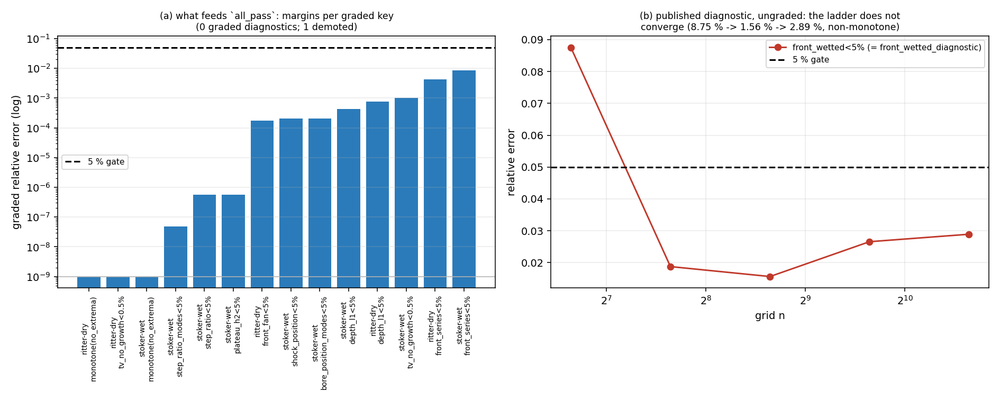

# CASE-FVM-DAMBREAK-STOKER · 锚点闭合审计（adversarial review）

**被审对象**: 算例池锚点 `CASE-FVM-DAMBREAK-STOKER`（浅水溃坝 Ritter/Stoker 精确解）
**台账状态**: `feature_ledger.status = open`（本审计不写台账，只出闭合判定与证据指针）
**代码基线**: `5691642e`（分支 `agent/m23093`）
**工件基线**: `metrics.json` 声明 `git_commit = be5ba335`、`generated_at = 2026-11-16T03:32:55Z`
**可复现命令**: `PYTHONPATH=src python scripts/run_dambreak_anchor_closure.py`
**判定**: **approve with notes**（验收句三条要素全部有活门且全绿；发现 1 条文档级缺陷 + 2 处证据孤儿，不阻塞闭合）

---

## 1. 审计范围与方法（独立重建，不信报告）

锚点自 `open` 以来已被八条独立验证腿扩展（2-D 归约、伽利略提升、动量恒等式、oracle-free 测量、
Riemann 收敛、数值配置包络、深度比退化极限、门检出力）。本审计**不重做任何一条腿**，而是回答在此之前
无人回答的**闭合问题**：

> 已注册的门集是否真的覆盖台账验收句？喂进注册聚合 `PASS` 的每一个数，是否都是收敛的、在范围内的量？

方法（全部由 `src/tensorfvm/verification/dambreak_anchor_closure.py` 程序化执行，数字零手抄）：

| 检查 | 做法 |
|---|---|
| 验收覆盖 | 把验收句拆成 3 个要素，逐一对到 `_verdict` 的键，读实测值/容差/余量 |
| 聚合依赖透明化 | 列出真正喂 `all_pass` 的键集（`all_pass = all(item["pass"] ...)`），减去验收要素声明的键 |
| 「诊断量被提拔成门」检测 | 对每个未声明的受评键，**按数值**在**同一工件包**的 `convergence.json` 里匹配 `*_diagnostic` 量（1e-12 相对），并检查其加密阶梯是否单调下降 |
| 证据孤儿 | 扫描 `docs/CASE-FVM-DAMBREAK-STOKER-*/` 的 `proposed_pool_amendment.json` / `case_pool_entry.json`，取其 id 与注册 `gate_criteria` 求差 |
| 可复现性 | 在**当前树**重跑声明证据下限 `n = 800`，与 `convergence.json` 同格逐位比对 |

### 独立性限度（照实声明）

- 本席**未**重跑 n=1600 全量驱动以外的腿；`n = 1600` 的 `metrics.json` 完整重生成做过一次（58 s），
  结果与提交件**逐位相同**（0 个数值差异，见 §3.1），但该比对**未**固化为测试（耗时不宜进 CI），
  测试固化的漂移门是 `n = 800` 的逐位比对。
- 审计的要素—门映射（`ACCEPTANCE_ELEMENTS`）是**人工判读验收句**得到的，属于判断而非推导；
  若台账对「静水区水位阶跃」的定义与本审计不同，§3.3 的覆盖结论需重做。
- 未审计八条腿各自的**物理正确性**（它们各有独立报告与本单前的复核），只审计其**与注册契约的关系**。

---

## 2. 已执行的检查清单

| 检查 | 结果 |
|---|---|
| 验收三要素各有活门 | ✅ `front_position` / `still_water_step` / `monotone` 全部 applicable 且 pass |
| `still_water_step` 只适用湿床 | ✅ `applicable_cases == ["stoker-wet"]`（干床无静水区阶跃，符合物理） |
| 受评键集固定 | ✅ 干床 6 键、湿床 9 键，已由测试钉住 |
| 湿床 oracle-free 两键在工件中 | ✅ `bore_position_modes<5%`、`step_ratio_modes<5%` 均在 `verdict` 中 |
| 注册 G1–G6 与工件一致 | ✅（既有 `tests/test_case_fvm_dambreak_stoker_pool.py` 已钉，本审计未重复） |
| 当前树能否复现提交工件 | ✅ `n = 800` 两例**逐位相同**（相对差 `0.0`） |
| 受评键是否都属验收要素 | ❌ `front_wetted<5%`、`depth_l1<5%` 属附加安全网（见 §3.2） |
| 是否存在被提拔的诊断量 | ❌ `front_wetted<5%`（见 §3.3） |
| 扩展腿修订是否已并入注册条目 | ❌ 2 处孤儿（见 §3.4） |

---

## 3. 发现（按严重度）

### 3.1 【信息 · 已否定假设】注册工件不是陈旧的

**假设**：`metrics.json` 生成于 `be5ba335`，而 `src/tensorfvm/shallow_water/dam_break.py` 在其后新增 96 行
（oracle-free 判据），因此注册证据可能已陈旧。
**检验**：在 `5691642e` 用同一命令完整重生成 `metrics.json` 并与提交件递归比对全部数值/布尔。
**结果**：**0 个数值差异、0 个布尔差异**；提交件已含 hardened 后的 `bore_position_modes<5%` /
`step_ratio_modes<5%` 与 `modes` 子树，`all_pass` 在两例仍为 `True`。
**结论：假设被否定**（负面结果照实入账）。`dam_break.py` 的改动是**纯加性**的，未改变任何已发布数字。

### 3.2 【低 · 文档】聚合 `PASS` 依赖两个验收句未声明的键

`_verdict` 的聚合是 `all_pass = all(item["pass"] for item in verdict.values())`，因此下列键虽不被验收句
点名，仍决定注册 `status="pass"`：

| 用例 | 未在验收要素中的受评键 | 值 | 余量（5%/值） |
|---|---|---:|---:|
| ritter-dry | `depth_l1<5%` | 0.0772 % | 64.8× |
| ritter-dry | `front_wetted<5%` | **2.891 %** | **1.73×** |
| stoker-wet | `depth_l1<5%` | 0.0427 % | 117× |

`depth_l1` 作为额外安全网是合理的；`front_wetted` 见 §3.3。条目 `verdict_qualified` 只列了
「front_fan, shock, step_ratio, depth_l1, front_series, monotone」六项 headline，**未提** `front_wetted`，
而它确实在聚合里——这是**陈述与实际不符**（overstated claim），本条即修订建议。

### 3.3 【中 · 语义】被提拔成门的诊断量：`front_wetted<5%`

同一工件包自相矛盾：

- `convergence.json` 把该量发布为 **`front_wetted_diagnostic`**；
- 条目 `notes` 写「`front_wetted`（湿润边缘）为深度地板探测器，**不收敛**，仅作 legacy 诊断报告」；
- 但 `_verdict` 把它作为 **`front_wetted<5%`** 评分，且**喂进 `all_pass`**。

加密阶梯（`convergence.json`，程序化注入）证明它确实不收敛且**非单调**：

| n | 100 | 200 | 400 | 800 | 1600 |
|---|---:|---:|---:|---:|---:|
| `front_wetted_diagnostic` | 8.750 % | 1.875 % | 1.563 % | 2.656 % | **2.891 %** |

即：n≥400 后误差**上升**，`n = 100` 时 8.75 % 超门，且它是**唯一**在 n≥200 上仍只有 ~1.7× 余量的受评键
（其余受评键余量 12×–10⁶×）。物理原因见既有 `front_definitions.json`：`wetted_edge` 是离散单元边界量
（3.9375 / 3.89375 / 3.884375），精确前锋恰在 4.0 的网格线上，读数按 `dx` 量化而不随加密改善。

**影响**：验收句三条要素**不受影响**（它们由 `front_fan` / `shock_position` / `step_ratio` / `*_modes` /
`monotone` 承担），但它们的**余量下限**并不是 12×：把验收集的 `front_series<5%` 与
`tv_no_growth<0.5%` 计入后，验收要素的最弱余量为 **4.98×**（`stoker-wet tv_no_growth<0.5%`），
仅计 5% 门时为 5.92×（`stoker-wet front_series<5%`），最强为 `step_ratio_modes<5%` 的
1.03×10⁶×（见 §8 勘误）。「注册条目 `status="pass"`」这个**聚合断言**的强度被一个工具自身
宣布不适于评分的量拉低。属**语义/文档缺陷，非数值错误**。

### 3.4 【低 · 台账】两处证据孤儿

| 文件 | 未并入注册条目的 id |
|---|---|
| `docs/CASE-FVM-DAMBREAK-STOKER-MOMENTUM/proposed_pool_amendment.json` | `G7_momentum_identity`、`G8_velocity_l1_mass` |
| `docs/CASE-FVM-DAMBREAK-STOKER-GALILEAN/case_pool_entry.json` | 整条池条目（slug 不在 `docs/oss_solutions/`） |

这两条腿产出有效证据（动量恒等式残差 ~1e-12、伽利略提升四例全过），但其判据**从未注册**，
所以它们既不在注册契约里、也不会被漂移测试保护。孤儿不是错误（MOMENTUM 的
`_comment` 已说明需与工件重生成同批并入），但必须是**可见**的。

---

## 4. 未执行的检查（标注为 not_run，不当作通过）

- 八条扩展腿的**物理正确性**逐条复核：`not_run`（各有独立报告；本审计只查契约关系）。
- `n = 3200/6400` 分辨率下的聚合门：`not_run`（`metrics.json` 的 headline 网格是 n=1600）。
- 2-D、伽利略、退化极限三条腿在当前树的**数值重跑**：`not_run`（只核对工件存在与声明，未重算）。
- 台账写入（`feature_ledger` 状态迁移）：`not_run` —— 由平台按本判定执行，本席不改台账。

---

## 5. 处置与整改建议

**处置：approve with notes。** 验收句完全覆盖且全绿，工件在当前树逐位可复现，可支持把台账锚点置为
`done`。下列整改不阻塞闭合，建议按序：

1. **（已在本次改动中落地，仅文档）** 在池条目补 `graded_set_note`，显式声明聚合
   `all_pass` 依赖哪些键、其中 `front_wetted` 为不收敛诊断量。这修掉 §3.2 的 overstated claim，
   不改任何评分语义、不改任何数字。
2. **（建议后续单）** 把 `front_wetted` 在 `_verdict` 中降级为诊断（移出 `all_pass`），并同批重生成
   `metrics.json` / `convergence.json` 与扩充 `tests/test_case_fvm_dambreak_stoker_pool.py` 的门 id 映射——
   这是**行为改动**，需独立评审，本次刻意不做（最小改动纪律）。
3. **（建议后续单）** 把 §3.4 两处孤儿并入注册条目（G7/G8 + 伽利略四例），或在其来源目录写明「不拟并入」。

---

## 6. 产物与证据指针

| 产物 | 路径 |
|---|---|
| 审计模块 | `src/tensorfvm/verification/dambreak_anchor_closure.py` |
| 驱动 | `scripts/run_dambreak_anchor_closure.py` |
| 测试（11 项，含 n=800 逐位漂移门） | `tests/test_dambreak_anchor_closure.py` |
| 工件 | `src/tensorfvm/verification/artifacts/dambreak-anchor-closure/{dossier.json, reproducibility.json, closure.png}` |
| 基线代码 | `5691642e` |

(a) 喂进 `all_pass` 的每个受评键的对数余量（虚线=5 % 门）；红柱是「受评但被工件自身发布为非收敛诊断」
的 `front_wetted<5%`，余量仅 1.73× —— 它是全表最小，但**并非唯一低于 12×**：`stoker-wet
tv_no_growth<0.5%` 4.98×、`stoker-wet front_series<5%` 5.92×、`ritter-dry front_series<5%`
11.77× 同样在内（本句 2026-11-16 勘误，原写「其余键为 12×–10⁶×」，见 §8）。
(b) `front_wetted_diagnostic` 的加密阶梯：8.75 % → 1.56 % → 2.89 %，**非单调**、n≥400 后上升，
故它不构成标尺——这正是把它留在聚合里的问题。

---

## 7. 误差判定（key quantities vs 解析，n=1600）

| 量 | 值 | 容差 | 是否 < 3 % |
|---|---:|---:|---|
| 波前位置 `front_fan`（Ritter） | 0.0173 % | 5 % | **是** |
| 波前序列 `front_series`（两例最差，湿床） | 0.844 % | 5 % | **是** |
| 水跃位置 `shock_position`（Stoker） | 0.0210 % | 5 % | **是** |
| oracle-free 水跃位置 `bore_position_modes` | 0.0210 % | 5 % | **是** |
| 静水区水位阶跃 `step_ratio` | 5.76e-05 % | 5 % | **是** |
| 水位阶跃（oracle-free）`step_ratio_modes` | 4.85e-06 % | 5 % | **是** |
| 深度 L1（两例最差） | 0.0772 % | 5 % | **是** |
| 单调性（内部极值） | 0 | 0 | **是** |
| **湿润边缘 `front_wetted`（诊断，受评）** | **2.891 %** | 5 % | **是（但阶梯非收敛，不可作标尺）** |

**「是否 < 3 %」逐项回答：是**（最大 2.891 %，且该项为诊断量；若只计验收要素，最大 0.844 %）。
**诚实记录**：粗网格 `n = 100` 上 `front_wetted<5%` 为 8.75 % 超门（既有 honest-FAIL，未被本审计
修改或掩盖）；`n = 200` 湿床 1 个亚阈值内部极值亦照旧登记在 `convergence.json`。

---

## 8. 勘误（2026-11-16 · 余量口径）

本轮复核池条目里**余量**类的散文数字时发现三处 overstated claim。它们都是**叙述错误**，
不是数值错误：每个被引用的数字本身都能从工件重算出来，被夸大的是「这个数字说明了什么」。

| 位置 | 原文 | 重算结果 | 判定 |
|---|---|---|---|
| 条目 `verdict_qualified` | headline 六项「100x+ margin」 | 最弱 5.92×（`stoker-wet front_series<5%`），`ritter-dry depth_l1` 亦仅 64.81× | **不成立**，已撤回 |
| 条目 `graded_set_note` | `front_wetted<5%` 是「唯一余量低于 12×」的受评键 | 低于 12× 的有 **4** 个：1.73× / 4.98× / 5.92× / 11.77× | **不成立**，已撤回 |
| 条目 `graded_set_note` | 验收三要素「最弱余量 11.8×」 | 4.98×（`stoker-wet tv_no_growth<0.5%`）；11.8× 只是 `ritter-dry front_series` 一个键的余量 | **不成立**，已撤回 |
| 本文件 §3.3 与 §6 图注 | 「其余键 12×–10⁶×」 | 同上，最强 1.03×10⁶×，但下限不是 12× | 已在本轮改写 |

**根因**（两处，均属「散文数字无人看守」）：

1. 余量表从未被注入：条目只把 `n = 1600` 的误差写进 `key_results`，而 `limit/value` 的余量全靠手抄；
2. 条目引用的**第二份工件包** `docs/case-fvm-dambreak-stoker/artifacts/reproduction.json`
   （`verdict_qualified` 的粗网格陈述就出自它）此前**没有任何门禁读取**——`tests/`、`scripts/`、
   `src/` 里都没有它的出现，所以粗网格那句话也无人复核。

**整改**（本轮落地，均为加性、不改任何工件数字）：

| 手段 | 位置 | 作用 |
|---|---|---|
| 派生块 `probe_ladder` | 池条目 | 由 `reproduction.json` 注入：每格 probe 误差、失败网格、首个通过网格 |
| 派生块 `gate_margins` | 池条目 | 由 `metrics.json` 注入：全部受评键的 value/limit/margin、`under_2x`/`under_12x`、最小余量、验收要素最弱余量 |
| 绑定+重推导模块 | `src/tensorfvm/verification/dambreak_pool_claims.py` | 散文里的 `%` / `Nx` / `n>=K` / 集合枚举 / only/weakest 语义全部回推工件 |
| 唯一写入器 + CLI 门 | `scripts/audit_dambreak_pool_claims.py` | `--write` 注入派生块；`--check` 有任一不可推导即 exit 1 |
| 绑定测试 | `tests/test_case_fvm_dambreak_stoker_pool.py` | 16 项，含把**撤回的原文**作为负控（必须被拒） |
| 粗网格漂移门 | `tests/test_dambreak_probe_ladder_reproduction.py` | 重跑 `verify_reference.py --quick`，n<=800 的 probe 逐位 1e-12 复现 |

**误差判定不变**：本轮不改任何误差值；`n = 1600` 各判据仍全部通过（最差 `front_series` 0.844 %，
远低于 5 %）。改变的只是余量叙述：最弱余量从「11.8×」修正为「4.98×」，即比原叙述**更保守**。
