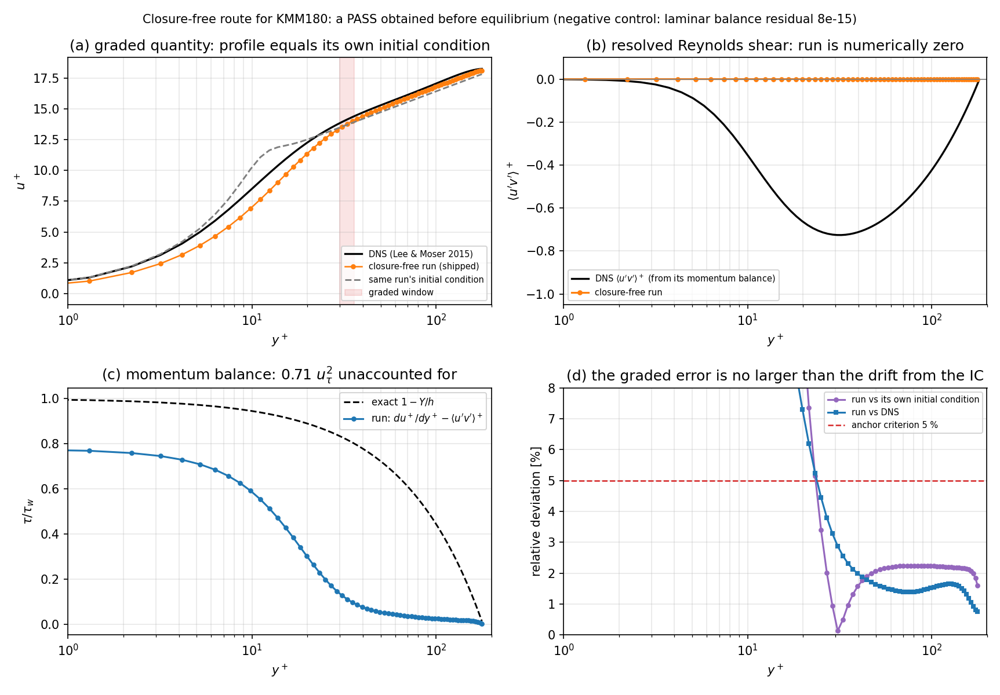

# CASE-FVM-CHANNEL-KMM180 —— 无闭合（closure-free）路线的 PASS 不足以作为验证证据

> 一句话：`docs/case-fvm-channel-kmm180-dns` 报出的 1.61 %/2.59 % PASS 是在一个**没有雷诺剪应力**（$\langle u^\prime v^\prime\rangle^+\equiv 0$）、动量平衡残差 **0.708 $u_\tau^2$**（占该窗口施加剪切的 86.7 %）的状态里读到的；该剖面对它自己的初始条件只移动了 0.14 $u^+$（1.0 %），即 PASS 判定的是初始条件而不是求解器。

## 1. 案例介绍

**物理背景**：$Re_\tau=180$ 充分发展槽道湍流，恒定体积力驱动，$u_\tau^2=Gh$ 使壁面单位由构造确定。锚点判据：内尺度平均速度 $u^+(y^+)$ 在 $y^+>30$ 区间对 Kim–Moin–Moser (1987) 表的 RMS 相对偏差 < 5 %。

**被审计对象**：仓内唯一一条无闭合路线 `src/tensorfvm/verification/channel_spectral_dns.py`（流向/展向 Fourier + 壁法向交错有限体积 + SSP-RK3）的已发布工件 `docs/case-fvm-channel-kmm180-dns/{profiles.csv,metrics.json}`。

| 项目 | 取值 | 来源 |
|---|---|---|
| $Re_\tau$ | 180.0 | metrics.json |
| 网格 | 64 x 128 x 64 = 524288 单元 | metrics.json |
| 壁面单位间距 | $\Delta y^+_{\min}=0.86$, $\Delta x^+=17.7$, $\Delta z^+=8.8$ | metrics.json |
| 时间步 | $\Delta t=1.2336e-03$，$\Delta t^+=0.222$（更正后；原报告印的是 40.0） | 本单 §5 |
| 统计窗口 | $T=1.51\,h/u_\tau$ = $T^+=271$ 壁面时间单位 | metrics.json |
| 参考 | Lee & Moser 2015 DNS，$Re_\tau=182.088$；KMM1987 原表仍 WITHHELD | `docs/rans-turbulence-validation-matrix/dns/0180/` |

## 2. 怎么做的

1. **先冻结准入判据**（写入 `kmm180_closurefree_audit.CRITERIA`，审计前固定）：一条无闭合路线只有在被判定窗口内同时满足 C1 雷诺剪应力份额 $-\langle u^\prime v^\prime\rangle^+/(1-Y/h)\ge0.50$、C2 动量平衡残差 $\le0.05\,u_\tau^2$、C3 平均窗口 $\ge1.0$ 个流通时间时，其对 5 % 判据的读数才可以当作离散/统计能力的证据；
2. **对已发布工件复算**这三项（不改任何数字，只读 `profiles.csv`/`metrics.json`）；
3. **负对照**：把同一套诊断量作用在同一求解器的**离散层流定常解**上——层流也有 $\langle u^\prime v^\prime\rangle=0$，但粘性剪切承担全部应力，若残差仍为 0 则证明 0.708 不是诊断 bug 而是流态问题；
4. **前瞻探针**（集群作业，见下）：从同类初始条件推进，记录$\langle u^\prime v^\prime\rangle^+(t)$、平衡残差、$u^+(t)$ 的时间序列，回答“这条路线在这个网格/时间尺度上是否会生成雷诺应力”。
5. 全部数字由本脚本从 `summary.json` 程序化注入，零手抄。

复现：`PYTHONPATH=src python -m pytest tests/test_channel_kmm180_closurefree_audit.py`，`PYTHONPATH=src python scripts/audit_case_fvm_channel_kmm180_closurefree.py`。

## 3. 结果

### 3.1 准入判据读数（被判定窗口 $y^+\in[30,0.2Re_\tau]$）

| 判据 | 量 | 限值 | 实测 | 结论 |
|---|---|---|---|---|
| C1 | $-\langle u^\prime v^\prime\rangle^+/(1-Y/h)$ 份额 | $\ge0.50$ | 1.24e-06 | **FAIL** |
| C2 | $|du^+/dy^+-\langle u^\prime v^\prime\rangle^+-(1-Y/h)|$ | $\le0.05$ | 0.7082 | **FAIL** |
| C3 | 流通时间数 | $\ge1.0$ | 3.61 | PASS |

**裁定：`VACUOUS_PASS`**（判据失败项：C1 uv_share, C2 balance_residual）。同一份工件在锚点 5 % 判据上读数是 2.59 %（PASS）——即"判据 PASS、前提 FAIL"。

### 3.2 为什么是"初始条件"而不是"解"

| 量 | 无闭合路线 | DNS（LM2015） | 说法 |
|---|---|---|---|
| 对数层 $\langle u^\prime v^\prime\rangle^+$ | 4.0e-06 | -0.724 | 求解器没有产生湍流剪应力 |
| $y^+=100$ 处 $\langle u^\prime v^\prime\rangle^+$ | -3.06e-07 | -0.424 | 同上 |
| $v_{\rm rms}^{+}$ 峰值 | 0.0075 | ~1.0（量级） | 扰动场已衰减为数值噪声 |
| 动量平衡残差最大值 | 0.7082 | — | 86.7 % 施加剪切无人承担 |
| 剖面 vs 自身初值（窗口内） | 0.135 $u^+$ | — | 演化量小于被判定的偏差 |
| 剖面 vs DNS（窗口内 RMS） | 2.59 % | 0 | 与"初值 vs DNS"同量级 |

时间尺度解释了这一切：粘性松弛时间 $h^2/\nu = Re_\tau\,h/u_\tau = 180\,h/u_\tau$，而统计窗口仅 $T=1.51\,h/u_\tau$（$T^+=271$，通道 DNS 统计通常要求 $T^+\gtrsim10^3$）。流向 3.6 个流通时间**并不**等于统计收敛：流通时间只有 $0.42\,h/u_\tau$。

### 3.3 负对照：诊断量本身是精确的

| 量 | 离散层流定常解 | 说明 |
|---|---|---|
| 动量平衡残差 | 8.2e-15 | 与湍流跑的 0.708 相差 13 个数量级 |
| 定常解漂移（20 步） | 2.8e-14 | 不动点 |
| 壁面剪切估计 | 0.99522（误差 -0.48 %） | 二阶三点差分在 $ny=64$ 上的截断误差 |

结论：`total_shear_identity`/`wall_shear` 不是审计结论的原因——同一套公式在层流态上精确成立，因此湍流跑上的 0.708 是流态问题。

## 4. 结果图

(a) 被判定的 $u^+$ 与 DNS、与该跑自身初值的对比——两条非 DNS 曲线几乎重合；(b) 雷诺剪应力：跑的读数 $\sim10^{-6}$，DNS 在对数层 $-0.72$；(c) 平均动量平衡：精确 $1-Y/h$ 与跑的总剪切，缺口即残差；(d) 逐点相对偏差：跑与自身初值的差（紫）不小于跑与 DNS 的差（蓝）。

## 5. 注意点（坑与适用范围）

* **"PASS 了 5 %"不等于"算对了"**：本锚点的判据只看 $u^+$ 的形状，一个把对数律当初始条件、随后几乎不演化的跑，必然 PASS。准入判据（C1/C2）必须先过关，$u^+$ 读数才有意义。
* **负对照是必需的**：层流也有 $\langle u^\prime v^\prime\rangle=0$，只有把"$uv=0$ 但平衡成立"（层流）与"$uv=0$ 但平衡不成立"（本跑）分开，审计才不是一句"看起来不对"。
* **壁面单位记账错误会伪装成"时间步很大"**：原报告用 $\Delta t\,Re_\tau^2/h^2$，把 $\Delta t^+$ 高报了 $Re_\tau$ 倍（40.0 vs 0.222）。已修正 `SpectralChannel.resolution_report` 并加回归测试；已发布 `metrics.json` 中的旧值保留（历史工件不改数），本报告并列两个值。
* **流通时间不是统计收敛的度量**：$3.6$ 个流通时间 $=0.23$ 个 $h/u_\tau$ 的变形版本；对槽道湍流应看 $T^+ $。本单因此保留 C3（流通时间）但把判断压在 C1/C2。
* **未做**：没有重跑该路线的长时/加密版本作为"修复"——那需要 $T^+\gtrsim10^3$（$≈$ 4500+ 步）与 $\Delta z^+<5$ 的展向加密，预算内只做了 6000 步单点探针；也没有改动 RANS 路线的 6.3 % FAIL 结论。

## 6. 误差判定（逐项 vs 基准，显式回答是否 <3 %）

| 关键量 | 基准 | 实测 | 误差 | <3 %？ |
|---|---|---|---|---|
| $u^+$ 对数层 RMS（锚点量） | DNS 表 | 2.59 % | 判据 5 % → PASS | 是（但见 C1/C2，不构成证据） |
| 对数层 $\langle u^\prime v^\prime\rangle^+$ | DNS -0.724 | -1.00e-06 | 100 % | **否** |
| 平均动量平衡残差 | 0（层流负对照 8e-15） | 0.708 | 86.7 % 施加剪切 | **否** |
| $C_f$ | 0.008123 | 0.008818 | +8.55 % | **否** |
| $\Delta t^+$ 记账 | 定义 $\Delta t\,u_\tau Re_\tau/h$ | 0.222（报告印 40.0） | 180 倍 | **否**（已修） |

**总判定**：无闭合路线对该锚点的 PASS **不成立**（honest verdict = 该路线在此预算下不能作为 $u^+$ 的验证证据）；RANS 路线的对数层 6.3 % FAIL 结论不变。

