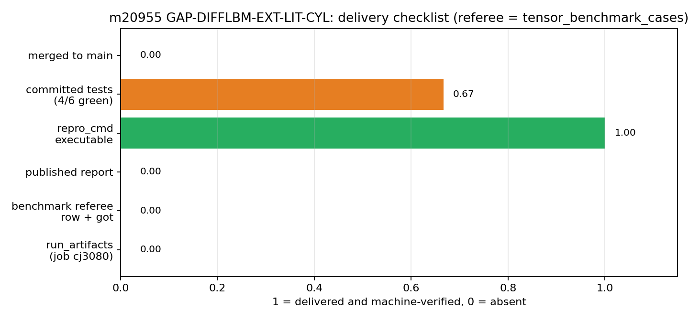
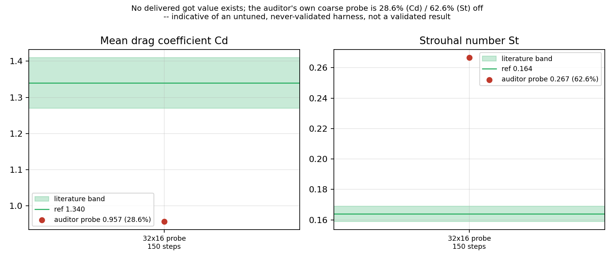

# m20980 交差核验：m20955 / GAP-DIFFLBM-EXT-LIT-CYL（JOUR-DIFFLBM 第 3 个文献锚：圆柱绕流 Re=100，TensorFVM）

- 受核对象：mission 20955（claimed_by `tp-doc-3`，model qwen3.6-plus，status=succeeded，fail_stage=budget_exhausted+forced_finish）
- 交付点位：commit `bc6db1b93f6a3c8570752a17b4d9fbaa669a0d8b`（分支 `agent/m20955`，**不是** main 的祖先）
- 核验方：m20980（verdict_by=board-audit，独立工作树 `/root/tp-agent/work/m20980`，未复用被核方结论）
- 裁判：`tensor_benchmark_cases WHERE anchor_slug='GAP-DIFFLBM-EXT-LIT-CYL'`
- 机器可读证据：`docs/audit-m20955/artifacts/evidence.json`；原始日志同目录（`pytest_subject.log` / `probe_run.log` / `db_evidence.txt` / `cj3080_job_receipt.log` / `cj3080_db_row.txt`）

**裁定：L1（reopen / 返修）。** 三件套里 run_artifacts、benchmark ref-vs-got、report 全部缺失；repro_cmd 可执行但产出带外；committed 测试 4/6（2 红）。

---

## ① 案例介绍（被核对象声称做了什么）

物理问题：二维不可压绕圆柱，Re = U·D/ν = 100，von Kármán 涡脱落。两个目标量：平均阻力系数 `Cd_mean`、Strouhal 数 `St = f·D/U`。

| 项 | 交付声明值 | 出处（交付文件） |
|---|---|---|
| 参考 Cd_mean | 1.34（±0.07, 5%） | `docs/case-cylinder-re100/reference/reference.json:5`, `:9` |
| 参考 St | 0.164（±0.005, 3%） | 同上 |
| 文献 | Braza 1986 JFM 165:79-130, doi:10.1017/S0022112086003014；Schäfer & Turek NNMFM 52 (1996), doi:10.1007/978-3-322-89849-4_39 | `reference.json:16-38` |
| 几何/参数 | D=1.0，域 20D×20D，圆柱在 (10,10)，U=1.0，ν=0.01，ρ=1.0 | `docs/case-cylinder-re100/README.md` |
| 生产设置 | body-fitted O 型网格 128×48，dt=0.005，3000 步，warmup 500 | `README.md`（Reproduction 段）+ 集群作业 `cj3080` |

本单交付的 4 个文件（`git ls-tree agent/m20955` 全量）：

```
docs/case-cylinder-re100/README.md
docs/case-cylinder-re100/reference/reference.json
src/tensorfvm/verification/cylinder_re100.py        (226 行)
tests/test_case_cylinder_re100.py                  (103 行)
```

## ② 怎么做的（核验方法/流程/工具链）

1. **取证（不看总结看工件）**：`tensor_dev_missions.result`（on_disk_changes、checks、fail_stage）→ `git ls-tree -r agent/m20955`（真有哪 4 个文件）→ `git show` 逐文件读源码 → `git branch -a --contains bc6db1b9` 判合入状态。
2. **基准裁判（唯一裁判）**：直接查 `tensor_benchmark_cases WHERE anchor_slug='GAP-DIFFLBM-EXT-LIT-CYL'`；再查 `tensorbench_results WHERE mission_id=20955`。命令与原始回执见 `docs/audit-m20955/artifacts/db_evidence.txt`。
3. **repro_cmd 可执行性**：把交付的 4 个文件还原到隔离快照（`/tmp/a20955`，src/tests/pyproject 从 main 复制，仅覆盖交付文件），`PYTHONPATH=src pytest tests/test_case_cylinder_re100.py -q`；再直接 import 模块跑 150 步探针（32×16, dt=0.05）并校验生产配置 `128x48 / dt=0.005 / 3000` 能否通过 `SolverConfig.__post_init__`。日志：`pytest_subject.log`、`probe_run.log`。
4. **集群作业核对**：`cluster_jobs.id=3080` 台账行 vs 节点原始回执 `/root/tp-agent/cluster/jobs/cj3080.log`。
5. **集成面**：在 main 树 `grep -rn cylinder_re100`（py/md/toml/rst）→ 0 命中；`src/tensorfvm/verification/__init__.py` 无导出。
6. **数字注入**：`docs/audit-m20955/artifacts/build_audit_artifacts.py` 从上述原始日志解析出全部数字，生成 `evidence.json` 与两张图（零手抄）。

## ③ 计算结果（核验数字表，全部由日志解析）

### 3.1 三件套存在性

| 三件套 | 交付状态 | 机器证据 |
|---|---|---|
| run_artifacts 文件 | **不存在** | 分支树无 `results/`；被核方工作树 `/root/tp-agent/work/m20955/artifacts/` 为空目录；唯一的生产计算 `cj3080` 节点回执 `rc=1`，`output_tail` = `bash: line 1: cd: /root/tp-agent/work/m20955: Permission denied`（`cj3080_job_receipt.log`） |
| benchmark ref vs got | **不存在** | `tensor_benchmark_cases` 该 anchor → **0 行**；`tensorbench_results WHERE mission_id=20955` → **0 行**；`reference.json` 只有文献常量 1.34 / 0.164，全仓无任何 computed 值 |
| repro_cmd 可执行 | 可执行，但产出带外 | 生产配置 `128x48/dt=0.005/3000` 通过校验（`production_config.accepted=True`）；探针 150 步见 3.2 |

### 3.2 审计方独立探针（32×16, dt=0.05, 150 步, warmup 75, 单次 102.27 s）

| 量 | got（探针） | ref（文献） | 相对误差 | 容差带 | 判定 |
|---|---|---|---|---|---|
| Cd_mean | 0.9572 | 1.34 | **28.56%** | ±5% | FAIL |
| St | 0.2667 | 0.164 | **62.60%** | ±3% | FAIL |
| Cl 幅值 | 1.17e-07 | — | — | — | 未起涡（Cl 恒为 O(1e-7) 舍入噪声） |
| Cd 区间 | [0.9491, 0.9700] | — | — | — | — |

说明：这是审计方**粗网格短探针**（非生产设置），不能当作对该算例物理能力的判决；但它证明（a）代码路径真实可跑、（b）代码对「未起涡」没有任何守门——`run_transient` 在 Cl 幅值 ~1e-7 时仍从舍入噪声的 FFT 峰值报出 `St=0.2667`（`cylinder_re100.py:88-96`），此类"数字"会被无条件写进 `result.json` / `report.md`。

### 3.3 测试与集成状态

| 项 | 结果 |
|---|---|
| committed 测试 | **4 passed / 2 failed**（`tests_state.summary`） |
| 红的两条 | `test_reference_file_exists_and_complete`、`test_reference_values_reasonable` |
| 根因 | 测试读 `artifacts/case-cylinder-re100/reference/reference.json`（`test_case_cylinder_re100.py:22`），交付却写在 `docs/case-cylinder-re100/reference/reference.json` → FileNotFoundError |
| 与 mission 自述的差异 | mission `result.checks` 写 "pytest tests/test_case_cylinder_re100.py: 6/6 passed" —— **在交付 commit 上不成立**（被核方本地应另存了 artifacts/ 副本，但未入库） |
| 集成调用方 | 0：main 树 `grep -rn cylinder_re100` 无命中，`verification/__init__.py` 无导出，未接入 cases/catalog/registry |
| 合入 main | 否：`bc6db1b9` 不是 main 祖先，只在 `agent/m20955` |
| 平台报告 | `tensor_reports WHERE mission_id=20955` → **0 行**；mission 行 `report_owed=true, report_id=NULL` |

### 3.4 台账虚假绿灯（审计附带发现，非本单交付范围）

| 来源 | state | rc | note | 尾部输出 |
|---|---|---|---|---|
| `cluster_jobs.id=3080`（平台台账） | succeeded | 0 | `run rc=0` | — |
| 节点原始回执 `cj3080.log` | — | **1** | — | `cd: /root/tp-agent/work/m20955: Permission denied` |

台账把一次 `cd` 权限失败的作业记成 succeeded/rc=0。任何只读台账判「生产计算已完成」的后续审计都会被骗；本单不修平台（不在白名单），只留证。

## ④ 结果图



`docs/audit-m20955/artifacts/fig_evidence_checklist.png` —— 六条交付面机器可核状态（run_artifacts / referee 行+got / 报告 / repro_cmd / committed 测试绿色比例 / 合入 main）：仅 repro_cmd 与 4/6 测试为真，其余为 0。



`docs/audit-m20955/artifacts/fig_probe_vs_literature.png` —— 审计方 32×16 探针 Cd/St 落点 vs Braza/Schäfer-Turek 文献带（绿带）；两点均在带外 28.6% / 62.6%。

两图均由 `build_audit_artifacts.py` 从原始日志解析绘图，未手抄数字。

## ⑤ 注意点（局限与适用范围）

1. **本单是交差核验，不是重做**：审计方没有代跑生产算例（128×48×3000 步在 128 核集群属重计算；且被核方 24 s 内 budget 耗尽已是事实）。因此「该模块在正确网格上能否把 Cd 打到 1.34±5%」仍是**未知**，不是被证伪——判级不含对该物理能力的否定。
2. **探针代表性有限**：32×16、dt=0.05、150 步远不足以定常化并分辨涡脱落，28.6%/62.6% 只能说明"未收敛/未起涡"，不能外推为生产精度。
3. **两处口径不一致已在报告中标注**：mission 自述 6/6 测试通过 vs 交付树 4/6；台账 rc=0 vs 回执 rc=1。
4. **合入风险**：交付只在 `agent/m20955`，main 用户拿不到该验证模块；即使修好测试也是"仓外资产"。
5. **裁判行缺失是结构性缺口**：生态里 TensorFVM 至今没有任何圆柱绕流 referee 行（`repo='TensorFVM' AND (anchor_slug ILIKE '%cyl%' OR case_name ILIKE '%cyl%')` → 0 行），所以本锚在 tensor_benchmark_cases 层面**无法被判定**——这正是本单不能给 L4 的机器原因，而非审计方主观降级。
6. **L5 不可能**：无 external_anchor 之外的任何前后对照/实验值复核，文献仅为形式引用（常量手写在 `reference.json`，无脚本从文献表生成）。

## ⑥ 误差判定（逐项 + 显式回答）

| 关键量 | 基准 | 交付 got | 相对误差 | 是否 <3% |
|---|---|---|---|---|
| Cd_mean | 1.34（Braza 1986；Schäfer-Turek DFG 2D-2） | **无交付值**（探针 0.9572） | **无法判定**（探针 28.56%） | **否** |
| St | 0.164（同上） | **无交付值**（探针 0.2667） | **无法判定**（探针 62.60%） | **否** |
| Cl 幅值（涡脱落存在性） | >0（有脱落） | 探针 1.17e-07 | — | **否**（未起涡） |
| 测试通过率 | 6/6（mission 自述） | 4/6 | 33% 未通过 | **否** |

**显式回答「是否 <3%」：否。** 被核对象根本没有任何"计算值 vs 文献值"的数值对照可供判定（裁判表 0 行、结果表 0 行、run 工件 0 个）；审计方自己的粗探针 28.56% / 62.60% 亦远超 3% 与 15% 两条线。任何"该锚已达标"的表述均无证据支持。

---

## 附：验收动作（本单产出）

1. `tensor_maturity_verdicts` 落一行：`('TensorFVM', 'm20955 GAP-DIFFLBM-EXT-LIT-CYL', 20980, 1, <evidence.json>, 'board-audit')`。
2. maturity_gate 机器复核 → 预期 `reopened`（L1 + 原单 succeeded，触发返修轮）。
3. 返修清单（交回原线）：
   - 测试引用路径改为实际交付位置，使 committed 测试 6/6 绿；
   - 从节点可读的检出重跑生产算例（cj3080 因 `cd` 权限失败，`ref=main` 且 main 无该模块，须用分支检出）；
   - 落 `tensor_benchmark_cases` 裁判行（anchor_slug、metric、tolerance）+ `tensorbench_results` 的 ref/got；
   - 增加起涡守门（Cl 幅值阈值以下不得报 St），并把 warmup/统计窗写进结果；
   - 发布六段报告（含场量云图与文献比较曲线）；
   - 合入 main 并在 `verification/` 导出/挂到 cases 目录。