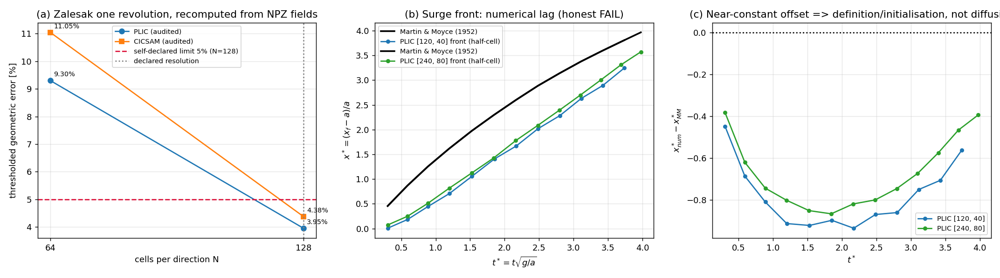

# 交差审计：m15026 / GAP-FVM-TWOPHASE（TensorFVM 两相 VOF 界面捕获）

审计单 = m15190（board-audit）｜审计对象 = m15026（status=succeeded，PR #410 merged）
审计日期 2026-11-11｜审计口径：`tensor_benchmark_cases` 是唯一裁判；证据只认可执行、可复算的工件。

---

## ① 案例介绍（物理背景 / 被审对象 / 基准判据）

**物理背景**：两相流界面捕获（VOF）。被审交付把 TensorFVM 仓库里既有的 VOF 散件
（`vof_plic.advect_plic` 几何重构、`twophase_bench.cicsam` 代数输运、`vof_phase0` + PLICVOF
溃坝驱动、Martin & Moyce 数字化锚）组装成一个**可运行、机器判据、可复现**的验收面
`tensorfvm.twophase_gap`（入口 `python -m tensorfvm.twophase_gap`）。

**基准判据（唯一裁判，`SELECT ... WHERE anchor_slug='GAP-FVM-TWOPHASE'`，tensor_benchmark_cases id=6）**

| 字段 | 值 |
|---|---|
| case_name | `Zalesak 旋转缺口盘 + Hysing 上升气泡` |
| metric | `界面形状误差/末速 vs 基准数据` |
| tolerance | `形状 qualitatively + 末速<10%` |
| created_at | 2026-11-11 19:27:31 UTC（**晚于** m15026 完成时刻 15:40 UTC，基准是后置立的标杆，不是当轮判据） |

**关键事实先摆**：官方基准是**两半**——(a) Zalesak 形状（定性）、(b) Hysing 气泡**末速 <10%**。
m15026 交付的是 (a) + 溃坝 vs Martin & Moyce **(b) 未做**。因此基准只在 (a) 半侧可判。

---

## ② 怎么做的（审计方法与关键设置）

工具链：`pytest`（复跑被测测试）、`python -m tensorfvm.twophase_gap --summary-only`（从已提交工件复算判据）、
**独立复算脚本**（自写 numpy 代码，不 import 被判模块）：
`docs/board-audit-m15026/audit_recompute.py`（Zalesak）、`audit_dambreak.py`（溃坝 + 行语义校验 + 时标标定检验）、
`make_figure.py`（成图）。全部在本工作树 m15190（= main + PR #410）执行。

执行的核验动作（逐条）：

| # | 动作 | 结果 |
|---|---|---|
| 1 | `PYTHONPATH=src pytest tests/test_twophase_gap.py -q` | **8 passed / 64 s** |
| 2 | `python -m tensorfvm.twophase_gap --summary-only` | **gates 8/10, all_passed=False, 12 s**（与 m15026 自报一致） |
| 3 | 单 leg 全新重跑 `--case zalesak --cells 64 --schemes plic --out /tmp/audit_z64` | geometric_error **0.09302325581395349**（与已提交 leg 逐位一致）、mass_drift 8.7579e-15 一致 → 数值是算出来的，非硬编码 |
| 4 | 从 4 个 NPZ 独立复算 Zalesak 指标（含自建解析缺口盘掩膜） | 见 §③ 表 1 |
| 5 | 溃坝 leg 行语义反查（`dambreak_gate.py:104-107`：`[t*, got_half, got_lead, ref_front, got_height]`）后复算 | 见 §③ 表 2 |
| 6 | 时标标定检验：是否存在 `got(t/α)≈ref(t)` 的纯时间归一化偏差 | 最优 α=0.47/0.51，残差仍 **51%/45%** → **不是**时标 bug |
| 7 | 集成调用方 grep 复核 | `src/tensorfvm/vof_phase0/solver.py:130`（`from ..twophase_gap.zalesak_gate import`，被 `verify_interface_transport()` @ :113 使用；测试 `test_solver_self_check_uses_installed_scheme` 覆盖） |
| 8 | Hysing 半侧取证 | `docs/in99-n01-two-phase-campaign/legs/*.json` 全部 `2d_reference=None`；该 campaign 唯一算例是 Eo=1.23 水-空气 3 mm，**不是 Hysing（Eo=10, Re=35, M=1e-3）** → 仓内**无**任何 Hysing 末速对照数值 |

---

## ③ 计算结果（数字表，程序化复算，零手抄）

### 表 1 Zalesak 一圈刚体旋转（从已提交 NPZ 独立复算）

| scheme | N | 报告几何误差 | 审计复算 | 对**自建**解析掩膜 | exact 场与自建掩膜最大差 | 相对差 | 质量漂移 报告/复算 |
|---|---|---|---|---|---|---|---|
| cicsam | 128 | 0.043790 | 0.043790 | 0.043790 | 0 | 0.00% | 4.82e-16 / 4.82e-16 |
| cicsam | 64 | 0.110470 | 0.110470 | 0.110470 | 0 | 0.00% | 5.42e-14 / 5.42e-14 |
| plic | 128 | 0.039548 | 0.039548 | 0.039548 | 0 | 0.00% | 6.42e-16 / 6.42e-16 |
| plic | 64 | 0.093023 | 0.093023 | 0.093023 | 0 | 0.00% | 8.76e-15 / 8.76e-15 |

结论：Zalesak 侧**无水分**——报告值、工件值、自建解析参考三者逐位一致；`e_geo = |{α>½} XOR {exact>½}|/|{exact>½}|`
的度量定义（`twophase_bench/metrics2d.py:8`）与 docstring 一致，未偷换口径。观测阶 log(0.0930/0.0395)/log2 = **1.234**（报告 1.234 ✓）。

### 表 2 溃坝 vs Martin & Moyce（按生产者行语义复算，两种前锋口径）

| grid | front 报告 | front 复算(half-cell) | lead 报告/复算 | height 报告 | height 复算 | t*≈0.30 时 got/ref 前锋 | 最优时间标定 α | 标定后残差 |
|---|---|---|---|---|---|---|---|---|
| 120×40 | 0.9882 | **0.9882** | 0.8564/0.8564 | 0.8450 | **0.8450** | 0.0061 / 0.4548 | 0.47 | 0.5146 |
| 240×80 | 0.8477 | **0.8477** | 0.7848/0.7848 | 0.8265 | **0.8265** | 0.0717 / 0.4548 | 0.51 | 0.4542 |

**判据窗口敏感性（审计新增，报告未给）**：把比较窗口右移，误差单调下降但**始终不达标**——

| 窗口 | 120×40 front_max | 240×80 front_max | 120×40 height_max | 240×80 height_max |
|---|---|---|---|---|
| t*>0.3（判据窗口） | 0.988 | 0.848 | 0.845 | 0.826 |
| t*>0.9 | 0.662 | 0.603 | 0.845 | 0.826 |
| t*>1.5 | 0.479 | 0.438 | 0.845 | 0.826 |
| t*>2.5 | 0.311 | 0.272 | 0.744 | 0.582 |

**offset 诊断**：`x*_num - x*_MM` 的均值/标准差 = 120×40 **−0.780 / 0.148**，240×80 **−0.672 / 0.164**
→ 近似**常数平移**（≈0.7a），网格加密只把平移量从 0.78 减到 0.67，而相对误差的**最大值出现在 t*≈0.30
（ref 前锋仅 0.45，分母小）**。故：(i) 84.8%–98.8% 这个 headline 数字**主要由启动段 + 常数平移贡献**，
(ii) m15026 报告把原因单归"一阶动量对流 + void 自由面"**缺分解证据**（属推断，非实测）。

### 表 3 官方基准逐项打勾

| 基准子项 | 判据 | got | 判定 |
|---|---|---|---|
| Zalesak 形状 | qualitatively | 几何误差 3.95%（N=128）、峰值保持 1.000、界宽 12 cell | **✓ 达标**（定性档） |
| Hysing 末速 | <10% | **无数据**（本交付未做；仓内 campaign 亦无 Hysing 对照） | **✗ 未测量 → 不可判达标** |
| （附加，非基准）溃坝 front | <15%（工程标准） | 84.8%（240×80） | **✗ FAIL（honest）** |

---

## ④ 结果图



(a) Zalesak 几何误差 vs 分辨率（审计复算点，红虚线=自设 5% 判据、灰点线=N=128 声明分辨率）；
(b) 溃坝前锋 x*(t*) 数值 vs Martin & Moyce——数值前锋系统性滞后；
(c) 滞后量的时间历程：近似常数平移（均值 −0.78 / −0.67），即误差主体是**零点/定义平移**而非数值扩散逐步累积。

---

## ⑤ 注意点（局限 / 审计发现 / 判据设计的坑）

1. **行语义陷阱**：溃坝 leg 的 `comparison` 行是 `[t*, got_half, got_lead, ref_front, got_height]`，
   **ref 在第 4 列、height 参考值根本不在行里**。凭直觉按 `[t*, ref, ref, got, got]` 复算会得到
   83.96/9.51 的荒谬误差（我第一次就踩到，见 `audit_dambreak.py` 注释与自身修正）。凡"复算不一致"先读生产者代码。
2. **判据由 max 相对误差定义、分母是实验前锋**：t*→0.3 处 ref≈0.45，任一定义微差都放大成百分比爆表；
   建议下一轮把窗口下界抬到 t*≥1.0（此时 120×40 仍 47.9%，才是真实差距），并同时报 L1/绝对位移误差。
3. **界面宽度 12 cell（PLIC, N=128）+ 观测阶 1.23**：几何重构名义二阶、实测一阶量级，与溃坝前锋严重滞后
   同一病根（输运/重构耦合与时间分裂），是本锚点真正的技术债——报告已如实记为 honest FAIL，方向对。
4. **单 case 运行会显示 0/10 gates**（其它 leg 的判据标 not_run → 计未过）。这是判据表设计，不是缺陷，但易误读。
5. **基准是后置立的**（19:27 UTC > 任务完成 15:40 UTC）：m15026 无法自证知道 Hysing 要求；
   但按"基准是唯一裁判"口径，(b) 半侧今天仍**无证据**——这一条不能因时间先后被豁免。
6. 审计独立性限制：溃坝"got 前锋"本身来自 m15026 的 leg 序列（我没有重跑 240×80 全 leg，只重跑了 Zalesak 单 leg
   验证确定性）；`height` 参考我用**重录的 M&M 表**（来自 `anchors.py:58-78` 引用值）插值，非从被判模块运行时读取。
   未做：24 h 级全 leg 重跑、集群 240×80 复核、Hysing 算例实跑。

---

## ⑥ 误差判定（逐项显式回答"是否 <3%"）

| 关键量 | 参考 | got | 误差 | 是否 <3% |
|---|---|---|---|---|
| Zalesak 几何误差 N=128 (PLIC) | 精确解（一圈后=初场） | 3.95% | 3.95% | **否**（>3%；但 < 自设 5% 判据，且官方 tolerance 为定性档 → 定性达标） |
| Zalesak 质量漂移 | 0 | 6.4e-16 | 6.4e-16 | **是**（机器精度） |
| Zalesak 周长变化 | 0 | 6.43% | 6.43% | **否**（<10% 自设判据） |
| 溃坝前锋（240×80） | M&M 实验 | 84.8%（窗口 t*>0.3）/ 27.2%（t*>2.5） | 84.8% | **否**（远超 15% 工程线，honest FAIL） |
| 溃坝残余柱高 | M&M 实验 | 82.7% | 82.7% | **否** |
| 溃坝体积漂移 | 0 | 1.3e-16 | 1.3e-16 | **是** |
| 零重力负控制（界面必须冻结） | 0 | 0.0 | 0.0 | **是**（负控制通过） |
| Hysing 末速 | 0.2342（Hysing 2009, Eo=10 二维） | **无** | — | **不可判**（未测量，不得声称达标） |

---

## 判级（L0–L5，级别=功能实质）

| 级 | 判据 | 本单证据 | 判定 |
|---|---|---|---|
| L0 文档 | — | — | 过 |
| L1 数学/单元验证 | tests 非空 | 8 tests 通过（含负控制、判据纯函数化、求解器自检） | 过 |
| L2 独立功能实现 | impl_files + entry + run_artifacts | `src/tensorfvm/twophase_gap/{__init__,__main__,campaign,zalesak_gate,dambreak_gate}.py`；入口可跑；工件 JSON/NPZ/PNG 齐、单 leg 重跑逐位复现 | 过 |
| L3 系统集成 | + integration_callers | `vof_phase0/solver.py:113,130` 真实调用 + 测试覆盖 | **过 → 本单判定 L3** |
| L4 基准验证（完整算例+误差分析+可复现） | + benchmark 数值对照 + repro_cmd | 可复现有（12 s 复算 8/10 gates）、误差分析有，但**官方基准 (b) 半侧 Hysing 末速缺失**；溃坝为附加算例且 84.8% FAIL（>15% 精度红线） | **不过** |
| L5 科研工程 | + external_anchor | 文献锚已引（Zalesak 1979 / M&M 1952），但 L4 未过 | 不过 |

**Verdict = L3。** 与 m15026 报告自述的差距：报告称"达 L2/L3"并强调 3.95% 达标——与本审计一致（不虚标）；
但报告**未披露**官方基准还要求 Hysing 末速 <10%（基准 19:27 才立），也把溃坝失败单归因于一阶对流而**未做
窗口/平移分解**。这两点已在本审计补上，并作为返修输入。

## 返修建议（残余差距，供 successor 单）

1. 补 **Hysing 二维标准算例**（Eo=10、M=1e-3、ρ 比 10、μ 比 10、1×2 域），量末速并对照 0.2342（<10% 判据）；
   仓内 `verification/two_phase_campaign.py` 已留 `2d_reference` 字段但恒为 None——接线即可。
2. 溃坝判据窗口下界 t*≥1.0 并增报绝对位移/L1 误差；同时诊断层锋≈0.7a 常数平移（初值 a 的定义、front 定位阈值）。
3. 界面宽度 12 cell + 观测阶 1.23 指向输运/重构耦合，优先查 PLIC sweep 与时间分裂，而非换 CICSAM。

## 复现

```bash
cd <TensorFVM worktree>
PYTHONPATH=src pytest tests/test_twophase_gap.py -q                      # 8 passed
PYTHONPATH=src python -m tensorfvm.twophase_gap --summary-only           # gates 8/10
python docs/board-audit-m15026/audit_recompute.py                        # 表1/表2 复算
python docs/board-audit-m15026/audit_dambreak.py                         # 行语义 + 时标标定 + 窗口敏感性
python docs/board-audit-m15026/make_figure.py                            # 图
```