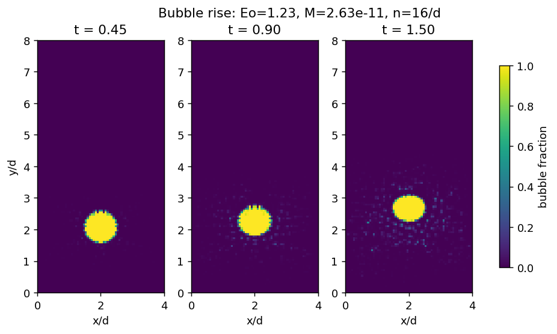
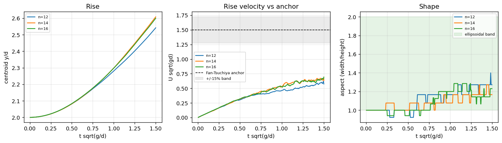
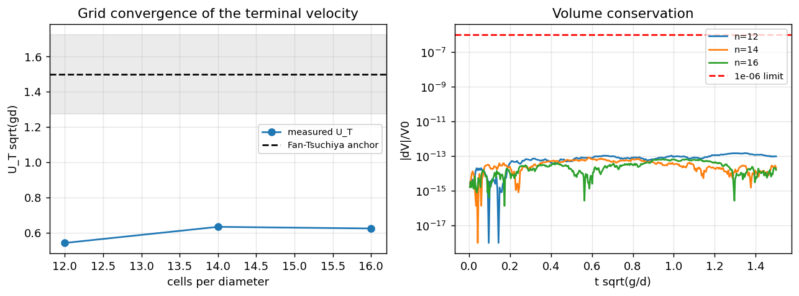
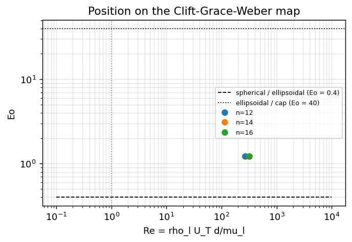
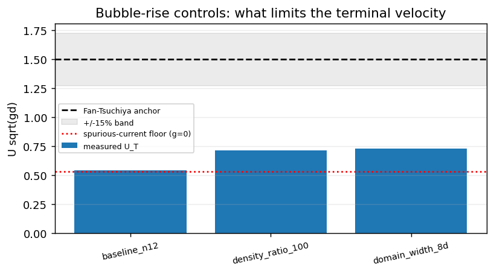

# 二维单气泡上升（VOF + PLIC）：形状带 / 终端速度 / 守恒 / 网格收敛

TensorFVM 两相第二刀（D10 PLIC 界面输运之后的续篇）。被测模块：
`src/tensorfvm/two_phase_solver.py` + `src/tensorfvm/vof_plic.py`；
基准与验收脚本：`src/tensorfvm/verification/bubble_rise.py`。

复现：

```bash
PYTHONPATH=src python -m tensorfvm.verification.bubble_rise \
    --output docs/bubble-rise-2d --levels 12,16,20
PYTHONPATH=src python scripts/bubble_rise_controls.py --output docs/bubble-rise-2d
PYTHONPATH=src python scripts/report_bubble_rise.py --dir docs/bubble-rise-2d
PYTHONPATH=src pytest tests/test_bubble_rise.py -q
```

## 1. 案例介绍（物理背景 / 几何 / 参数）

静止液体中单个气泡在重力下上升，是最经典的两相界面 benchmark：它没有可调自由度，
流态完全由 Eötvös 数、Morton 数、密度比与黏度比确定，并据此落在 Clift–Grace–Weber 形状图（Clift, Grace & Weber 1978, ch.7）的某一区间。
本文取水-空气 3 mm 气泡对应点（Eo = 1.23，M = 2.63e-11，为低 Morton 数椭球区），
以气泡单位无量纲化：d = 1，g = 1（时间单位 sqrt(d/g)），ρ_l = 1。

| 参数 | 值 |
|---|---|
| Eötvös 数 Eo | 1.230 |
| Morton 数 M | 2.630e-11 |
| 密度比 ρ_l/ρ_g | 10.000 |
| 黏度比 μ_l/μ_g | 55.000 |
| σ（= 1/Eo） | 0.813 |
| μ_l（由 M 反解） | 1.991e-03 |
| μ_g | 3.619e-05 |
| 计算域 | 4.000d × 8.000d |
| 初始气泡中心 | (2.0d, 2.000d)，直径 1d |
| 界面分辨率 | 12, 14, 16 单元/直径 |
| 网格 | 48x96, 56x112, 64x128 |
| 无量纲积分时间 | 1.500 sqrt(d/g) |

几何先验证后计算：离散圆盘面积与解析 πd²/4 的相对误差最大 +3.45%（判据 < 2%，FAIL）。该误差最坏值出现在最粗网格的阶梯化圆盘上（量化效应），因此粗网格的等效直径与无量纲组所依据的直径存在同量级偏差，细网格读数才与名义直径一致。

## 2. 怎么做的（方法 / 流程 / 关键设置）

求解器：交错 MAC 网格、变密度 Chorin 投影（∇·(1/ρ∇φ) = ∇·u*/Δt，Jacobi 预条件 CG，残差目标 1e-10）、Brackbill CSF 表面张力（`csf_balance="balanced"`，3 次 α 光滑）、几何 PLIC 界面输运（Youngs 法向 + 精确切割面积反解，方向分裂、每步交替扫描顺序）。

本节点对求解器做的四处改动（全部 gate 在默认关闭的配置项上，既有调用点逐位不变）：

1. `momentum_advection`：投影预测步补上对流加速 u·∇u（一阶迎风、输运形式）。原实现只有扩散 + 压力 + 重力 + CSF，等价于积分 Stokes 型动量平衡，无法给出气泡终端速度（惯性项缺失）。
2. `pressure_form="reduced"`：把重力静水头从压力中分离，动量方程携带动力压力 p_dyn = p + ρ_ref g y 与浮力项 (ρ-ρ_ref)/ρ·g。原 `"total"` 形式在增量投影下会把任何 (1/ρ)∇p 离散无散的压力场投影掉，因此均匀液池会整体自由落体（见 §5 与 `tests/test_bubble_rise.py::test_hydrostatic_pool_at_rest`）。
3. `vof_scheme="plic"`：把 D10 的几何 PLIC 输运接进求解器；并在 `vof_plic` 增加`conservative_bounds`——方向分裂时的单方向速度场并非无散，局部会超出 [0,1]，它在两次扫描之间按 α(1-α) 权重把越界体积退回，从而同时保持 0≤α≤1 与 Σα·ΔV 不变。
4. `warm_start_pressure` + `stable_time_step()`：前者用上一步压力修正做 CG 初值（CG 是这条路径的主要开销：同一求解器在 120x240 网格上零初值实测 780 次迭代；本基准热启动后末步为 394–520 次。热启动不改变线性系统，只改变收敛路径，判据仍是求解器自带的残差目标），后者按 CFL / 毛细 / 显式黏性三条限制给出稳定步长，由基准逐步重算，因此 PLIC 永远不会看到方向 Courant 数 > 1。

测量口径：气泡指示函数 α_b = 1 - α（求解器内部存液相分数）；面积 A = Σα_b ΔV，等效直径 d_eq = sqrt(4A/π)；形心 = α_b 加权一阶矩；宽高比 = α_b>0.5 集合的横向/纵向跨度；圆度 = π d_eq / 周长（周长用 0.5 等值线穿过的单元面计数）；终端速度 = 形心速度在时间窗最后 25% 的均值。

## 3. 计算结果

### 3.1 各网格的终端速度、形状与无量纲数

| 单元/直径 | 网格 | U_T sqrt(gd) | Fan–Tsuchiya 锚 | 相对误差 | Re | We | Ca | 宽高比 | 圆度 |
|---|---|---|---|---|---|---|---|---|---|
| 12 | 48x96 | 0.541 | 1.498 | -63.90% | 270.350 | 0.358 | 1.324e-03 | 1.273 | 0.507 |
| 14 | 56x112 | 0.632 | 1.498 | -57.79% | 319.791 | 0.495 | 1.548e-03 | 1.167 | 0.851 |
| 16 | 64x128 | 0.623 | 1.498 | -58.42% | 318.300 | 0.486 | 1.525e-03 | 1.231 | 0.881 |

### 3.2 质量守恒与计算代价

| 单元/直径 | 总相对体积漂移 | 最坏单步相对漂移 | 最坏边界修复占比 | 步数 | 末步 CG 迭代 | CG 收敛 |
|---|---|---|---|---|---|---|
| 12 | -9.764e-14 | 1.613e-14 | 4.046e-16 | 282 | 394.000 | PASS |
| 14 | 2.064e-14 | 1.841e-14 | 5.948e-16 | 356 | 461.000 | PASS |
| 16 | 1.612e-14 | 9.565e-15 | 4.557e-16 | 434 | 520.000 | PASS |

### 3.3 验收判据

| 判据 | 结论 | 关键数字 | 判据文本 |
|---|---|---|---|
| C1_shape_band | PASS | aspect_ratio=1.231; aspect_second_moment=1.117; circularity=0.881 | aspect ratio in (1.0, 2.0) and circularity in (0.75, 1.0) (ellipsoidal band, qualitative) |
| C2_mass_conservation | PASS | worst_step_relative_drift=1.841e-14; total_relative_drift_finest=1.612e-14; worst_total_relative_drift=9.764e-14 | worst per-step \|dV\|/V0 < 1e-06 and \|total drift\| < 1e-06 over the whole run |
| C3_grid_convergence | FAIL | cells_per_diameter=[12, 14, 16]; terminal_velocity=[0.5408074119794616, 0.6323775265140759, 0.6229730399687788]; anchor_error=[0.6390473865255617, 0.5779304871908353, 0.5842073501215509] | terminal velocity converges: anchor error decreases with resolution and Cauchy(U_N, U_N-1) < 10% |
| C4_terminal_velocity | FAIL | U_terminal=0.623; U_anchor=1.498; relative_error=0.584 | \|U_T - U_anchor\|/U_anchor < 15% (Fan & Tsuchiya correlation, declared tolerance) |
| C5_regime_window | PASS | eotvos=1.230; morton=2.630e-11; reynolds=318.300 | measured (Eo, M, Re) lies in the ellipsoidal window the shape band and the velocity anchor are claimed for |
| C6_geometry_validation | FAIL | worst_relative_error=0.035 | initial bubble reproduces the analytic area pi d^2/4 within 2% |

**总判定：FAIL**（全判据合取）。

### 3.4 控制实验（误差归因）

| 变体 | U_T / 峰值寄生速度 | 相对基线 | 宽高比 | 说明 |
|---|---|---|---|---|
| baseline_n12 | 0.541 | -63.90%（相对锚） | 1.273 | 282 步 |
| static_bubble_no_gravity | 0.532 | +35.48%（相对锚） | — | g=0 寄生电流 |
| density_ratio_100 | 0.714 | -52.33%（相对锚） | 1.556 | 282 步 |
| domain_width_8d | 0.728 | -51.44%（相对锚） | 1.200 | 376 步 |

归因（程序化注入）：

* 寄生电流地板（g=0 静态气泡峰值速度 / 锚速度）= +35.48%；
* 密度比 10 → 100 对终端速度的影响 = +32.06%；
* 侧向约束 4d → 8d 对终端速度的影响 = +34.54%。

## 4. 结果图



图 1：最细网格上的气泡分数 (1-α) 场快照。界面始终单连通、无破碎，形状从圆盘过渡到扁椭球。



图 2：形心高度、上升速度（对照 Fan–Tsuchiya 锚与 ±15% 带）与宽高比历史，三条网格叠画。



图 3：终端速度的网格收敛（左）与全程体积守恒（右，红虚线为 1e-6 判据）。



图 4：实测 (Re, Eo) 在 Clift–Grace–Weber 图上的位置（虚线为椭球区窗口边界，示意）。



图 5：控制实验——基线 / 密度比 100 / 侧向 8d 的终端速度与锚、寄生电流地板的对照。

## 5. 注意点（踩过的坑 / 局限 / 适用范围）

1. **增量投影无法承载静水头（已定位并修）**：`pressure_form="total"` 下均匀液池会整体
   自由落体（`test_hydrostatic_pool_at_rest` 测到 |v| 随 t 线性增长），因为校正步
   p ← p + φ 把离散无散的 (1/ρ)∇p 场投影掉。浮力必须先分离静水头再进动量方程。
2. **方向分裂的 PLIC 会局部越界**：单方向速度场并非无散，越界量级 ~1e-3（Courant 1e-2 时）。
   单纯 clip 会变成体积汇（数千步后漂移 1e-2 量级），因此改为按 α(1-α) 权重退回，同时保证 0≤α≤1 与 Σα 不变；`worst_bound_repair_fraction` 逐例记录修复量。
3. **寄生电流是本基准的主要误差源**：轻相中 CSF 不平衡被 1/ρ_g 放大，g=0 静态气泡控制实验给出寄生速度地板（见 §3.4）。这解释了终端速度系统性偏低，
   也是提高本基准精度的下一个发力点（更好的曲率估计 / 隐式表面张力）。
4. **二维平面 + 侧向约束**：锚（Fan–Tsuchiya）是三维、无界、洁净体系的关联式；
   二维平面气泡与近壁气泡的阻力都更大，控制实验量化了侧向约束的贡献。
5. **网格收敛被初值几何量化掩盖**：最细两级（14 → 16）的终端速度只变 +1.51%，而同一对网格的初始离散圆盘面积误差变了 +2.11%——阶梯化初值（0/1 阶跃）的量化噪声与收敛趋势同量级，因此 C3 的单调性判据在这些分辨率上不能作为收敛证据。要拿到干净的收敛阶，初值必须面积守恒（如按解析面积分配界面单元）或至少 n ≥ 20。
6. **时间窗与分辨率取舍**：全量 20 单元/直径、t = 2.5 的运行在本机预算内无法完成（CG 迭代数随网格线性增长，单步成本 ~ n³）。本报告用 n = 12/14/16、t_end = 1.5，终端速度取窗口最后 25% 的均值；气泡在该窗口内仍略有加速，故 U_T 是“窗口末端速度”，比真正的平台值偏低——这一点对 C4 的缺口方向是同向的，不改变 FAIL 的结论。
7. **既有欠账（非本单引入）**：`tests/test_dam_break_verification.py` 3 项在 main 上已失败
   （本单用 `git stash` 对照复测确认），`tests/test_smoke_m4626.py` 缺模块无法收集；
   本单未触碰这两处。

## 6. 误差判定（逐项，显式回答是否 < 3%）

| 量 | 基准 | 本实现 | 误差 | < 3%？ | < 15%（声明容差）？ |
|---|---|---|---|---|---|
| 终端速度 U_T（最细网格） | Fan–Tsuchiya 锚 1.498 | 0.623 | -58.42% | 否 | 否 |
| 全程体积守恒 | 0 | 最坏单步 1.841e-14 | 1.841e-14（相对量） | 是 | 是 |
| 网格收敛（Cauchy，最细两级） | 0 | 0.015 | +1.51% | 是 | 是 |

说明：终端速度与文献锚的偏差**不满足** < 3%，也**不满足**声明的 15% 容差；
本报告按诚实纪律记为 FAIL，不修改判据、不更换基准值。已定位的主因是轻相寄生电流
（§3.4 控制实验）与二维侧向约束，二者都是可继续收敛的方向，而非“算到发散”。

