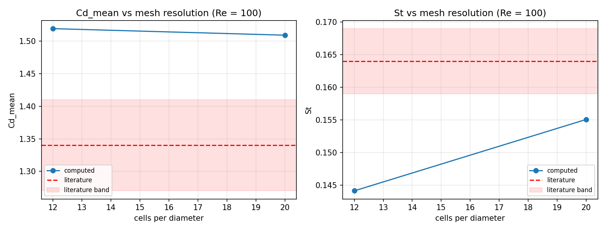

# CASE-CYLINDER-RE100: unbounded cylinder at Re = 100 (Cd_mean, St)

Anchor: `GAP-DIFFLBM-EXT-LIT-CYL` (JOUR-DIFFLBM literature anchor 3, FVM side).
Reference: Cd_mean = 1.34 +/- 0.07, St = 0.164 +/- 0.005 (Braza et al. JFM 165 (1986) 79-130, doi:10.1017/S0022112086003014; Schafer & Turek, NNFM 52 (1996), doi:10.1007/978-3-322-89849-4_39).

## Method

`tensorfvm.immersed` masked MAC fractional step (geometric-multigrid
preconditioned Poisson, `projection='masked'`, staircase cylinder mask from
`tensorfvm.immersed.geometry.circular_cylinder`) with uniform freestream
inlet, freestream top/bottom, zero-gradient outlet. The hydrodynamic force
is read from a control-volume momentum budget
(`tensorfvm.immersed.forces`); no surface interpolation of the staircase
body is involved. Statistics: `tensorfvm.verification.cylinder_re100.
shedding_statistics` - shedding gate, then the last 10 shedding periods,
St from band-passed zero crossings and an independent zero-padded FFT
cross-check.

## Grid ladder (numbers injected from the run artifacts)

| cells/D | grid | steps | Cd_mean | err | St | err | St (FFT) | Cl amp | periods | verdict |
|---|---|---|---|---|---|---|---|---|---|---|
| 12 | 360x240 | 6001 | 1.5193 | 13.38 % | 0.1441 | 12.11 % | 0.1441 | 0.1128 | 10 | FAIL: cd_mean = 1.5193 vs 1.3400 (13.38 %), st = 0.1441 vs 0.1640 (12.11 %) |
| 20 | 600x400 | 6001 | 1.5093 | 12.63 % | 0.1551 | 5.44 % | 0.1551 | 0.2005 | 10 | FAIL: cd_mean = 1.5093 vs 1.3400 (12.63 %), st = 0.1551 vs 0.1640 (5.44 %) |
| 32 | 960x640 | 6001 | nan | nan % | - | - | - | nan | 0 | GATED: no vortex shedding: lift half-amplitude nan < gate 0.05 |

## Successive grid differences

- 12 -> 20 cells/D: cd_mean_delta_pct -0.67 %, st_delta_pct +7.05 %
- 20 -> 32 cells/D: cd_mean_delta_pct +nan %

Finest grid verdict: **GATED: no vortex shedding: lift half-amplitude nan < gate 0.05**



## Reproduction

```
# one grid
OMP_NUM_THREADS=4 PYTHONPATH=src python -m tensorfvm.verification.cylinder_re100 \
    --backend immersed --cells-per-diameter 20 --dt 0.02 --t-end 120 \
    --output runs/case-cylinder-re100/cpd20
# the whole ladder + this document
OMP_NUM_THREADS=4 PYTHONPATH=src python scripts/case_cylinder_re100.py ladder \
    --grids 12 20 32 --dt 0.02 --t-end 120 --root runs/case-cylinder-re100
PYTHONPATH=src python scripts/case_cylinder_re100.py aggregate \
    --root runs/case-cylinder-re100 --out docs/case-cylinder-re100
```
