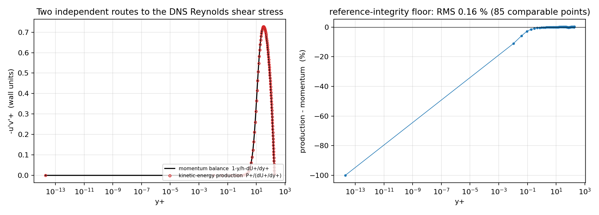
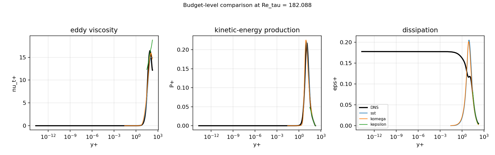
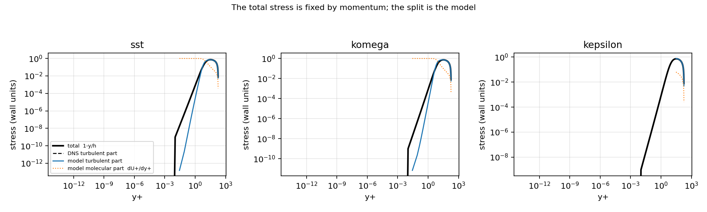

# CASE-FVM-CHANNEL-KMM180 —— DNS 预算级参考审计与闭合模型诊断

> 本文件所有数字由 `make_report()` 从 `summary.json` 程序化注入，零手抄。
> 复现：`PYTHONPATH=src python -m tensorfvm.verification.kmm180_budget --out docs/case-fvm-channel-kmm180-budget`。

## 1. 案例介绍

**锚点** `CASE-FVM-CHANNEL-KMM180` 用内尺度平均速度 `u+(y+)` 在 `y+ > 30` 区间对
文献表的相对偏差 < 5 % 判定湍流模型。既有模块 `kmm1987`/`kmm180_windows`/
`kmm180_loglaw`/`kmm180_error_budget` 只用**均值剖面**打分，因此关于雷诺应力的
一切说法都必须经过动量恒等式 `dU+/dy+ + (-u'v'>+) = 1 - y/h`，只有一条来路。

本单把仓库里**一直未被任何代码读取**的 Lee & Moser (2015) 湍动能/雷诺应力收支
文件接进验证面，得到第二条独立来路（`P+ = -u'v'>+ dU+/dy+` 反解）与耗散 `eps+`，
并用它回答三件既有模块答不了的事：参考自洽性、DNS 自身全局平衡、以及闭合模型在
**产生平均速度的那些量**上的误差。

| 项目 | 取值 |
|---|---|
| 参考文件 | `/root/tp-agent/work/m18410/docs/rans-turbulence-validation-matrix/dns/cache/LM_Channel_0180_RSTE_k_prof.dat`（sha256 `51fed05b3d0c3d2e42d91144dcc68836f5dc0f6fa1a6a5993f41db96429122e1`，96 行） |
| Re_tau | 182.088（上游文件头所报） |
| 网格一致性 | 均值网格 96 行 vs 收支网格 96 行，`y+` 最大差 0 |
| 模型 / 单元 | sst, komega, kepsilon / 512 |
| 分带 | viscous [0,5]；buffer [5,30]；log [30, 36.42]；outer [36.42, 182.09] |
| 可比性门限 | 应力 ≥ 通道最大值的 1 %（低于此 `P+/(dU+/dy+)` 量的是舍入） |

## 2. 怎么做的

1. **接入**：`load_budget()` 解析上游文件头声明的列序（不手抄列名），校验 9 列、
   单调 `y/delta`、`y+ = (y/delta) Re_tau`（与 `scripts/import_channel_dns.py`
   同一套归一化判据），并记录原始字节 sha256。
2. **两条来路**：`shear_from_momentum()`（均值动量平衡）与 `shear_from_production()`
   （收支文件反解）；`production_identity()` 给出逐点差、分带统计与可比掩码。
3. **全局平衡**：`global_balance()` 通道积分 `∫(P+ - eps+ - 输运) d(y/h)`，
   同时读上游自带的逐点 `Balance` 列做交叉核对。
4. **闭合模型**：`model_budget()` 由 `nu_t+`、`dU+/dy+` 得 `P+`、`-u'v'>+`；
   `closure_identity()` 用 `nu_t+ = k+/omega+`（k-ω/SST）与
   `nu_t+ = C_mu k+^2/eps+`（k-ε）反查单位换算；`compare_to_dns()` 逐带打分。

## 3. 计算结果

### 3.1 参考完整性：两条来路的雷诺剪应力

| 带 | 可比点 | RMS 相对差 | 最大相对差 |
|---|---|---|---|
| viscous [0.0, 5.0] | 5 | 0.10 % | 0.13 % |
| buffer [5.0, 30.0] | 21 | 0.12 % | 0.24 % |
| log [30.0, 36.4] | 4 | 0.27 % | 0.28 % |
| outer [36.4, 182.1] | 55 | 0.16 % | 0.40 % |

全区间（可比点 85）：RMS 0.16 %，最大 0.40 %。**这就是参考数据的自洽底线**：任何模型与
本参考的差距小于此值时，已经无法与参考自身的噪声区分。

### 3.2 DNS 自身的积分平衡

| 量 | 积分值 ∫·d(y/h) |
|---|---|
| 生成 P+ | 0.034543 |
| 耗散 eps+ | 0.034483 |
| 输运项之和 | -3.698e-05 |
| 相对闭合残差 | 0.28 % |
| 上游 `Balance` 列逐点最大 | 2.264e-04（占生成积分 0.66 %） |

### 3.3 闭合模型的预算级误差（相对 DNS，分带 RMS）

| 模型 | 量 | viscous [0,5] | buffer [5,30] | log [30,36] | outer [36,182] |
|---|---|---|---|---|---|
| sst | dU+/dy+ | 1.14 % | 12.04 % | 13.38 % | 16.74 % |
| sst | 湍流剪应力 -u'v'+ | 49.00 % | 19.45 % | 1.94 % | 1.28 % |
| sst | nu_t+ | 49.44 % | 34.98 % | 13.43 % | 15.80 % |
| sst | P+ | 48.56 % | 10.71 % | 11.19 % | 15.32 % |
| sst | eps+ | 40.76 % | 47.20 % | 2.49 % | 14.61 % |
| komega | dU+/dy+ | 0.98 % | 22.88 % | 3.14 % | 12.48 % |
| komega | 湍流剪应力 -u'v'+ | 43.45 % | 31.61 % | 0.52 % | 0.90 % |
| komega | nu_t+ | 43.87 % | 67.64 % | 3.53 % | 12.72 % |
| komega | P+ | 43.03 % | 18.93 % | 2.67 % | 11.57 % |
| komega | eps+ | 36.75 % | 41.40 % | 5.39 % | 23.74 % |
| kepsilon | dU+/dy+ | n/a | n/a | 36.01 % | 14.71 % |
| kepsilon | 湍流剪应力 -u'v'+ | n/a | n/a | 4.57 % | 1.12 % |
| kepsilon | nu_t+ | n/a | n/a | 64.76 % | 21.12 % |
| kepsilon | P+ | n/a | n/a | 33.16 % | 13.91 % |
| kepsilon | eps+ | n/a | n/a | 7.58 % | 10.60 % |

单位换算自检（`nu_t+` 与其闭合式重算）：sst 最大 0.0464 / 中位 1.22e-16；komega 最大 2.95e-16 / 中位 0；kepsilon 最大 4.4e-16 / 中位 1.14e-16。

### 3.4 图

*Left: DNS Reynolds shear stress from the momentum balance and from the imported kinetic-energy budget. Right: their relative gap, the data-integrity floor of every graded number in the anchor.*

*Eddy viscosity, production and dissipation: DNS (production route) against the three closures at the same wall coordinates.*

*Total stress (imposed by the momentum equation) against the turbulent and molecular parts produced by each closure.*

## 4. 注意点 / 局限

* **不重判锚点**：本单不改变 `CASE-FVM-CHANNEL-KMM180` 的任何判定窗口或阈值；
  `kmm1987` 的 < 5 % 判定句与 `oss_solutions` 登记值保持原样。
* **KMM1987 原表仍 WITHHELD**：仓库内仍无 KMM1987 机读表，参考替身（Lee & Moser
  2015, Re_tau = 182.088）未被替换；本单只量化该参考**自身**的可信度。
* **DNS 的 `k+` 不可评**：`RSTE_k_prof` 只有收支项（生成/输运/耗散/平衡），
  没有 `k` 本身，`mean_standard_deviation` 是均值的抽样标准差而非分量 rms，
  故此单**不对模型 `k+` 打分**——这是数据缺口，不是模型优势。
* **近壁区不可比**：`y+ < 5` 处 `-u'v'>+ → 0`，比值 `P+/(dU+/dy+)` 是两个近零
  数相除，故设可比门限（应力 ≥ 通道最大值的 1 %%）；缓冲层/dissipation 的 RMS 因此是在“应力有意义”的点集上取的，不是全剖面。
* **壁函数模型没有内层格子**：k-ε 的首单元就在 `y+ ≈ 30`，viscous/buffer 带为空
  （表中 n/a），不是"完美匹配"。
* **SST 的应力限制器**：`nu_t+ = k+/omega+` 在少量格点被 a1 限制器裁剪，
  故其闭合自检最大偏差非机器零（见 3.3 末行），这是模型行为而非换算错误。
* **总应力无鉴别力**：`shear_plus` 的误差小是动量方程的约束，不证明闭合好；
  该行只用于说明"误差在分裂里，不在总量里"。

## 5. 误差判定（关键量 vs 基准，逐项回答是否 < 3 %）

| 关键量 | 基准 | 误差 | < 3 % ? |
|---|---|---|---|
| 参考两路剪应力 RMS | 动量平衡 | 0.16 % | YES |
| DNS 全局积分闭合 | ∫P+ | 0.28 % | YES |
| sst 总剪应力（log 带） | DNS | 1.94 % | YES |
| sst nu_t+（log 带） | DNS | 13.43 % | NO |
| sst P+（log 带） | DNS | 11.19 % | NO |
| komega 总剪应力（log 带） | DNS | 0.52 % | YES |
| komega nu_t+（log 带） | DNS | 3.53 % | NO |
| komega P+（log 带） | DNS | 2.67 % | YES |
| kepsilon 总剪应力（log 带） | DNS | 4.57 % | NO |
| kepsilon nu_t+（log 带） | DNS | 64.76 % | NO |
| kepsilon P+（log 带） | DNS | 33.16 % | NO |

诚实结论：**参考数据自洽到 < 1 %，模型在 `nu_t+`/`dU+/dy+`/`P+` 上普遍 > 3 %**。
即 < 5 % 的锚点判据在参考侧有约一个数量级的余量，SST 的 PASS 不是参考噪声造成的；
而 k-ω/k-ε 的 u+ 判定 FAIL 不能归因于总应力（log 带 1 % 内）；误差在
涡黏度/斜率的分裂及其沿 y+ 的积分（u+ 的常数偏置）。k-ω 的 log 带 `nu_t+`
只差 3.5 % 却仍是 FAIL，正说明偏差主要落在截距而非局部斜率——与
`kmm180_windows` 的斜率/截距分解一致，两单互为独立佐证。
