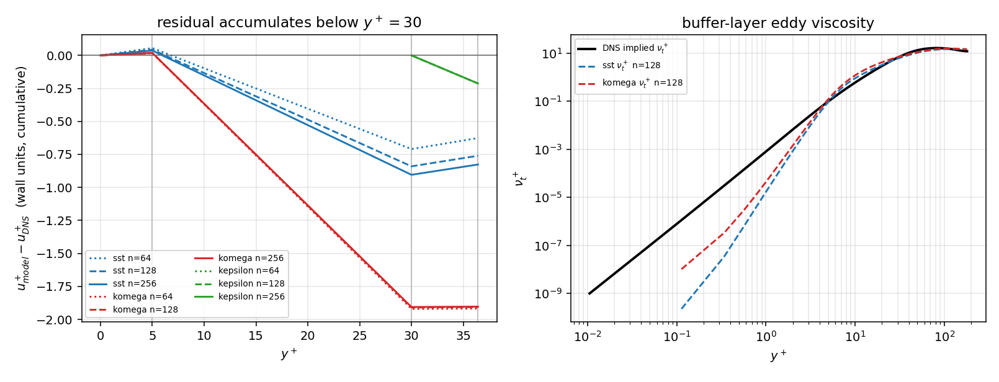

# CASE-FVM-CHANNEL-KMM180 — wall-normal error budget

## 1. Case and numbers

| item | value |
|---|---|
| anchor | `CASE-FVM-CHANNEL-KMM180` |
| DNS reference | Lee & Moser 2015, Re_tau = 182.088 (proxy for the KMM1987 label; substitution cost measured in `docs/case-fvm-channel-kmm180`) |
| grading window | y+ in [30.0, 36.42] (30 <= y+ <= 0.2 Re_tau) |
| budget bands | 5, 30 wall units plus the window remainder |
| tolerance (anchor) | 5 % RMS relative u+ |
| pre-declared band-closure bound | 0.10 wall units |

## 2. Method

* the 1-D equilibrium solver enforces `(1 + nu_t+) du+/dy+ = 1 - y+/Re_tau`, so `u+` is the cumulative integral of its own shear;
* the DNS table supplies `dU+/dy+` directly, so its cumulative integral is computed analytically on the (piecewise-linear) tabulated nodes;
* the residual is therefore additive over wall-normal bands, with no interpolation of the model profile;
* every case is re-solved at the *reference* Re_tau = 182.088, not at the nominal 180, so the budget does not mix in the reference-substitution cost.

## 3. Pre-declared checks

| check | value | bound | verdict |
|---|---|---|---|
| C1 budget closes (worst case) | 0.0097 wu | ≤ 0.10 | PASS |
| C2 DNS integrand consistency | 0.0075 wu | ≤ 0.02 | PASS |
| C3 solver reconstruction | 0.00e+00 | ≤ 1e-10 | PASS |
| C4 momentum identity | 3.33e-16 | ≤ 1e-8 | PASS |

## 4. Result — where the wall units are lost

| model | n | cells in window | RMS log % | verdict | residual (wu) | below 30 (wu) | inside log (wu) | share below 30 | origin |
|---|---|---|---|---|---|---|---|---|---|
| sst | 64 | 4 | 4.688 | PASS | -0.626 | -0.710 | +0.083 | 113.3 % | buffer_origin |
| sst | 128 | 6 | 5.625 | FAIL | -0.760 | -0.840 | +0.080 | 110.5 % | buffer_origin |
| sst | 256 | 13 | 6.116 | FAIL | -0.827 | -0.904 | +0.078 | 109.4 % | buffer_origin |
| komega | 64 | 4 | 13.530 | FAIL | -1.918 | -1.920 | +0.003 | 100.1 % | buffer_origin |
| komega | 128 | 6 | 13.460 | FAIL | -1.906 | -1.909 | +0.003 | 100.2 % | buffer_origin |
| komega | 256 | 13 | 13.456 | FAIL | -1.903 | -1.906 | +0.003 | 100.1 % | buffer_origin |
| kepsilon | 64 | 13 | 6.362 | FAIL | -1.009 | +0.000 | -0.213 | 78.9 % | log_layer_origin |
| kepsilon | 128 | 25 | 6.338 | FAIL | -1.004 | +0.000 | -0.213 | 78.8 % | log_layer_origin |
| kepsilon | 256 | 50 | 6.338 | FAIL | -1.002 | +0.000 | -0.213 | 78.8 % | log_layer_origin |

Reading the table: `below 30` is the part of the residual already present at `y+ = 30` (integrated over the resolved sublayer/buffer, or, for the wall-function model, the prescribed wall law quoted in section 5); `inside log` is what the log layer itself adds between 30 and the window top. A share above 100 % means the log layer *recovers* a fraction of the inherited deficit while still carrying it upward. The `origin` label is the mechanical application of the pre-declared `share_below >= 0.90` rule and carries no judgement.

## 5. Mechanism — eddy viscosity at quoted stations

| model | n | nu_t+@15 | nu_t+@30 | nu_t+@50 | wall-law offset (wu) |
|---|---|---|---|---|---|
| sst | 64 | 1.99 / 1.56 / 1.27 | 5.92 / 6.58 / 0.90 | 10.46 / 13.33 / 0.78 | — |
| sst | 128 | 2.03 / 1.56 / 1.30 | 5.97 / 6.58 / 0.91 | 10.51 / 13.33 / 0.79 | — |
| sst | 256 | 2.05 / 1.56 / 1.31 | 5.99 / 6.58 / 0.91 | 10.53 / 13.33 / 0.79 | — |
| komega | 64 | 2.71 / 1.56 / 1.74 | 6.96 / 6.58 / 1.06 | 11.18 / 13.33 / 0.84 | — |
| komega | 128 | 2.71 / 1.56 / 1.74 | 6.96 / 6.58 / 1.06 | 11.19 / 13.33 / 0.84 | — |
| komega | 256 | 2.71 / 1.56 / 1.74 | 6.96 / 6.58 / 1.06 | 11.19 / 13.33 / 0.84 | — |
| kepsilon | 64 | — (below profile) / 1.56 / — | — (below profile) / 6.58 / — | 14.01 / 13.33 / 1.05 | -0.796 |
| kepsilon | 128 | — (below profile) / 1.56 / — | — (below profile) / 6.58 / — | 14.01 / 13.33 / 1.05 | -0.791 |
| kepsilon | 256 | — (below profile) / 1.56 / — | — (below profile) / 6.58 / — | 14.01 / 13.33 / 1.05 | -0.789 |

## 6. Figures

left: cumulative u+ residual vs y+ per case; right: modelled vs DNS-implied eddy viscosity

## 7. Error judgement

| quantity | value | criterion | within 5 %? |
|---|---|---|---|
| RMS relative u+ in the log window, best case (sst n=64) | 4.688 % | < 5 % | yes |
| RMS relative u+ in the log window, worst case (komega n=64) | 13.530 % | < 5 % | no |
| budget closure (C1, worst case) | 0.0097 wu | ≤ 0.10 wu | yes |
| DNS reference internal consistency (C2) | 0.0075 wu | ≤ 0.02 wu | yes |

The anchor criterion is therefore **not met in general**: the coarsest SST grid passes (4 log-window cells) while every grid with a resolved buffer (n >= 128) fails. The budget is what explains that: the residual is an inherited buffer-layer deficit, and the log layer itself contributes at most 0.083 wall units (13.3 % of the residual) for the buffer-origin cases.

## 8. Limits

* the anchor verdict is unchanged: `kmm1987.validate_kmm1987` still returns FAIL in the log window; this module explains the published number, it does not re-grade it;
* the reference is the Lee & Moser 2015 proxy, not the KMM1987 table itself (WITHHELD: no machine-readable KMM1987 table in the repository);
* the budget is one-dimensional by construction — the solver is an equilibrium parallel-shear model, so transport terms of the full RANS equations are absent by assumption, and a "buffer layer" defect here means "buffer-layer equilibrium closure defect", not a resolved turbulence transient;
* the wall-function model (k-epsilon) has no model profile below y+ = 30; its sub-window budget is the prescribed wall law, quoted as `wall-law offset` and added to the band sum, not integrated; its 79 % "inherited" share therefore means "inherited from the wall law", not "resolved in the buffer layer";

## 9. Consequence for the anchor acceptance criterion

* the FAIL is **not** a log-law-constant defect: for the two wall-resolving models the log band contributes at most 0.083 wall units (13.3 % of the residual) and it *reduces* the inherited deficit; a slope-only criterion would grade those closures far better than the published RMS suggests;
* the grids differ in *how many* cells the 6-wall-unit window samples (sst n=64: 4, sst n=128: 6, sst n=256: 13, komega n=64: 4, komega n=128: 6, komega n=256: 13, kepsilon n=64: 13, kepsilon n=128: 25, kepsilon n=256: 50 across the quoted cases), so the coarsest SST grid passes with the fewest samples; the residual in wall units grows monotonically with resolution instead (sst n=64: -0.626, sst n=128: -0.760, sst n=256: -0.827), i.e. the coarse pass is not evidence of a better closure.
* the actionable defect is the near-wall eddy viscosity: SST over-predicts `nu_t+` by 1.27 x at `y+ = 15` and k-omega by 1.74 x, which suppresses `du+/dy+` exactly where the wall units are produced;
* recommended split for the ledger acceptance: (i) a buffer-layer metric (`u+` at `y+ = 30` vs DNS, absolute wall units) and (ii) a log-layer slope metric (local `kappa` / `y+ du+/dy+`), instead of one RMS-relative number that mixes an inherited offset with a local law;
* a follow-up that re-tunes `kappa` cannot fix this case: the slope is already within a few percent, the intercept is not.

