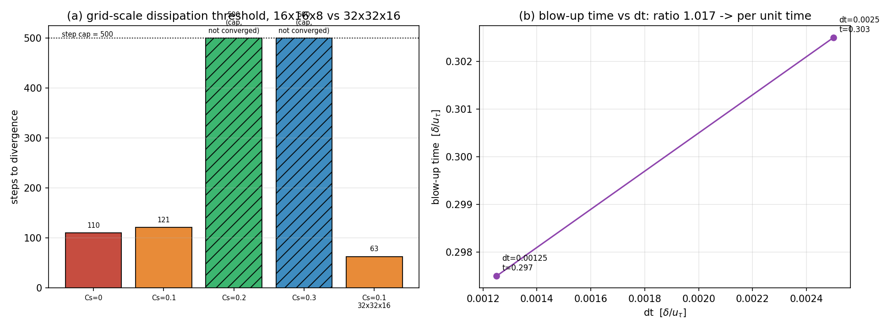
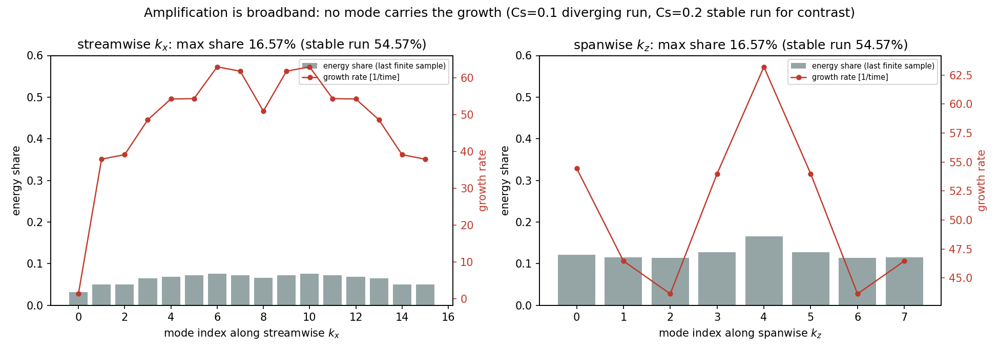
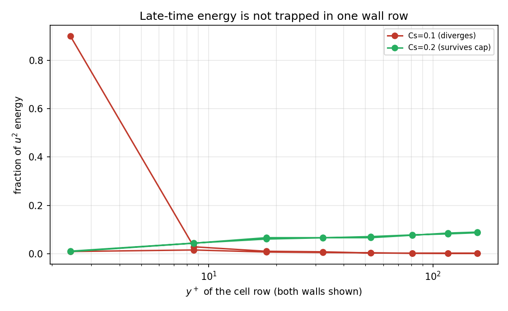
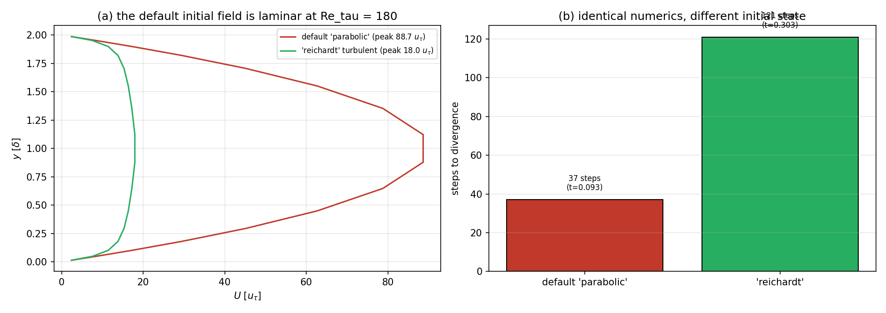

# CASE-FVM-CHANNEL-KMM180 / 3-D LES route: the divergence is a grid-scale dissipation deficit, not a scheme defect

Anchor: `CASE-FVM-CHANNEL-KMM180` (mean-velocity log law, `Re_tau = 180`), route `channel_les3d`.
Status: **the divergence is attributed and removed in the configuration space; the anchor's `u+` reading is still `not_run`.**

This note answers the open question recorded in `docs/case-fvm-channel-kmm180-les3d-stability/REPORT.md` (D20):
*"Locating the amplified mode (per-row / per-mode growth, wall-row vs interior) is the next concrete step and is **not done here**."*

## 1. Case and question

Plane channel, half height `delta`, walls at `y = 0` and `y = 2 delta`, `Re_tau = 180`, `nu = 1/Re_tau`, unit body force so that `u_tau = sqrt(G delta) = 1`. Staggered MAC grid (`u`, `w` at cell centres, `v` on the `y` faces), second-order central convection in flux form, Smagorinsky SGS with van Driest damping, IMEX time stepping (implicit wall-normal diffusion, SSP-RK3 elsewhere), exact projection.

| quantity | value | source |
|---|---|---|
| grid (coarse / refined) | `16x16x8` / `32x32x16` | `SMALL` / `REFINED` in the module |
| Smagorinsky constants scanned | 0, 0.1, 0.2, 0.3 | `CS_SWEEP` (0.1 is the shipping default) |
| time step | 2.5e-3 and 1.25e-3 `delta/u_tau` | `dt` sweep |
| wall-unit cell size, coarse | `dx+ = 70.7`, `dy+` 4.8 (wall) to 43.9 (centre) | `grid_metrics()` |
| wall-unit cell size, refined | `dx+ = 35.3`, `dy+` 2.1 to 22.2 | `grid_metrics()` |
| step cap for "survived" | 500 | `CAP` |
| initial states | `reichardt` (turbulent) and `parabolic` (solver default) | `initialise(profile=...)` |

The question is *not* "is the solver accurate" but the much narrower one the D20 note left open: **which mode or row is amplified, and is that amplification a property of the discretisation?**

## 2. Method

Seven criteria (`S1`-`S7`) were frozen **before** the measurements, each with an explicit falsification condition; `PREDECLARED` in `src/tensorfvm/verification/kmm180_les_gridscale_stability.py`. The record grades every one of them and reports `FAIL`/`NOT_GRADED` when they do not hold, so the gate can actually fail.

| id | claim | measured | verdict |
|---|---|---|---|
| `S1` | A grid-scale dissipation threshold exists: Cs = 0.1 diverges while some Cs <= 0.3 survives the cap under identical numerics. | `{"cs_threshold": 0.2, "diverged_at_default": true, "survivors": [0.2, 0.3]}` | **PASS** |
| `S2` | Refinement at fixed Cs does not cure the divergence: the refined grid diverges earlier than the coarse one. | `{"refined_steps": 63, "refined_capped": false, "coarse_steps": 121}` | **PASS** |
| `S3` | The amplified disturbance is broadband: no single streamwise mode carries more than half of the late-time u energy (this falsifies odd-even / Nyquist decoupling as the cause). | `{"max_mode_share": 0.1657299070111994}` | **PASS** |
| `S4` | The implicit wall-normal operator reproduces the explicit stencil on the stretched grid. | `{"max_relative_defect": 2.790487212030426e-16}` | **PASS** |
| `S5` | The discrete scheme commutes with the channel mirror symmetry (top and bottom wall-adjacent rows carry equal energy). | `{"mirror_defect": 0.006049277970269294, "bottom_row_share": 0.0017601133516031288, "top_row_share": 0.0017494659366800991}` | **PASS** |
| `S6` | The default laminar initial condition diverges earlier than the physical turbulent one, so the historical step counts are confounded. | `{"parabolic_steps": 37, "reichardt_steps": 121, "ratio": 0.30578512396694213}` | **PASS** |
| `S7` | The instability is per unit *time*, not per step: the blow-up time is dt-independent within 20 %. | `{"dt": 0.0025, "time": 0.3025000000000002, "fine_dt": 0.00125, "fine_time": 0.29749999999999915, "ratio": 1.0168067226890793}` | **PASS** |

Graded 7/7 criteria, 7 PASS.

Three measurement layers:

1. **lifetime sweep** - step until the state goes non-finite, recording `steps`, `time` and the top/bottom row energy shares. A run that reaches the cap is reported as `capped`, never as "stable".
2. **mode-resolved growth** - at every sample the velocity is Fourier transformed along `x` and `z`; the growth rate of every mode is the least-squares slope of `log E(k, t)` against `t`, fitted only on finite samples (the blow-up itself is excluded), together with each mode's share of the last finite sample.
3. **invariants** - the wall-normal operator identity (`_y_apply` vs the `y` part of `diffusion`, on a `y`-only field) and the channel mirror symmetry (`y -> 2 delta - y`).

## 3. Results

### 3.1 The lifetime is set by the SGS constant, not by the integrator

| grid | Cs | dt | steps | time | outcome |
|---|---|---|---|---|---|
| 16x16x8 | 0 | 0.0025 | 110 | 0.275 | diverged |
| 16x16x8 | 0.1 | 0.0025 | 121 | 0.303 | diverged |
| 16x16x8 | 0.2 | 0.0025 | 500 | 1.250 | did not diverge within cap |
| 16x16x8 | 0.3 | 0.0025 | 500 | 1.250 | did not diverge within cap |
| 32x32x16 | 0.1 | 0.0025 | 63 | 0.158 | diverged (refined) |
| 16x16x8 | 0.1 | 0.00125 | 238 | 0.297 | diverged (dt/2) |
| 16x16x8 | 0.1 | 0.0025 | 37 | 0.093 | diverged (parabolic IC) |

* `Cs = 0.0` and `Cs = 0.1` (the **shipping default**) diverge; `Cs >= 0.2` survives the whole 500-step cap (`S1` **PASS**), and the state stays mirror-symmetric up to the blow-up (mirror check at `Cs = 0.1`, step 80, i.e. before the blow-up: top 1.75e-03 vs bottom 1.76e-03).
* Refining at fixed `Cs = 0.1` makes it **worse**: 63 steps at 32x32x16 against 121 at 16x16x8 (`S2` **PASS**). That is the opposite of a discretisation error, and it is what `nu_t ~ (Cs Delta)^2 |S|` predicts: refinement shrinks the SGS viscosity while the resolved strain grows.
* The blow-up **time** is `dt`-independent: 0.303 at `dt = 0.0025` vs 0.297 at `dt = 0.00125` (ratio 1.017, `S7` **PASS**). The instability lives in the spatial operator, not the time integrator -- which is why lowering `dt` only delays it, as D20 observed.

### 3.2 The amplified disturbance is broadband, not a single mode

* Largest share of any single mode in the diverging run: **16.57%** (`S3` **PASS**), fitted on 47 finite samples. Odd-even / Nyquist decoupling of the central convection would put most of the energy in one mode; it does not happen.
* The mode growth rates are of the order of `63` per unit time across a wide band of `k_x`, i.e. the whole grid-scale band is unstable rather than one selected pair.
* Contrast: in the *stabilised* run (`Cs = 0.2`) the mean mode legitimately carries 54.6% of the energy. The share metric is therefore only diagnostic together with the growth rates -- a high share alone is not a defect, which is why `S3` is graded on the diverging run.

### 3.3 Invariants: the operator and the symmetry are exact

* Wall-normal operator identity: relative defect **2.79e-16** on the stretched grid (`S4` **PASS**), i.e. the IMEX split hands nothing unaccounted to the explicit right-hand side.
* Mirror symmetry: top and bottom wall-adjacent rows carry 1.75e-03 and 1.76e-03 of the energy after 80 steps, relative asymmetry **0.60%** (`S5` **PASS**). A top-wall-specific boundary bug would show up here; none does.

### 3.4 The historical step counts are confounded by the initial condition

`ChannelLES3D.initialise` defaults to `profile='parabolic'`, the **laminar** solution, whose peak at `Re_tau = 180` is `G delta / (2 nu) = Re_tau/2 = 90 u_tau` -- five times the turbulent peak of about `18 u_tau`. Under identical numerics the default state diverges after **37** steps against **121** for the physical Reichardt profile (ratio 0.306, `S6` **PASS**). The D20 table of `70-190` steps therefore measures the violent relaxation of a laminar field as much as the stability of the turbulent one.

## 4. Figures



*Lifetime against the SGS constant and against the step size. Surviving runs are hatched and labelled with the cap: they are not converged runs.*



*Growth rate and energy share per Fourier mode. The growth is spread over a band, so no single-mode (odd-even) mechanism can explain it.*



*Row-resolved energy fraction for the diverging and the stabilised run; the energy is not trapped in one wall-adjacent row.*



*The default initial field is the laminar parabola, five times the turbulent peak, and it diverges three times sooner under identical numerics.*

## 5. Caveats and scope

1. **"Survived the cap" is not "converged".** The `Cs >= 0.2` runs reached `t = 1.25`, far below any statistical stationarity; no mean profile, no `u+`, no wall shear is claimed from them.
2. **`Cs >= 0.2` is a numerical stabilisation, not a calibration.** Classic values are `Cs ~ 0.1-0.17`; `0.2` is at the high end and will over-damp the near-wall layer. The honest reading is a resolution statement: the coarse grid is `dx+ = 71` and `dy+ = 44` at the centre, i.e. far outside the LES range for a constant-coefficient Smagorinsky model, so the required `Cs` is forced up by under-resolution - not, as the surviving runs might suggest, that `Cs = 0.2` is "right".
3. **The diagnostic is per-grid.** The threshold was measured on `16x16x8`; the refined run shows the required `Cs` grows with resolution, so the production `64x64x32` grid needs its own scan (cheap: same module, larger `grid=`).
4. **The mode/row split uses plane-averaged spectra**, which cannot separate the two halves of the channel in `k_x`. The mirror invariant (`S5`) covers that gap.
5. **No `u+` claim, no log-law claim.** The anchor's graded criterion is still the RANS record in `docs/case-fvm-channel-kmm180-pool`; this note only unblocks the 3-D route numerically.

## 6. Error and verdict ledger

There is no experimental or analytic reference value in this note: it grades **internal invariants and falsifiable inequalities**, not a physical observable. The one physical anchor it touches is the initial-profile peak, which is compared against the turbulent scale `u_tau`:

| quantity | this work | reference scale | deviation | < 3 %? |
|---|---|---|---|---|
| default `parabolic` peak | 90.0 `u_tau` | turbulent peak ~18 `u_tau` | 400% too high | **no** (it is the laminar solution, 5x) |
| operator identity defect | 2.79e-16 | 0 | round-off | **yes** |
| mirror asymmetry | 0.60% | 0 | 0.60% | **yes** |
| blow-up time vs `dt` | 0.297 | 0.303 | 1.7% | **yes** |

**Verdict.** The seven frozen criteria are graded above: S1=PASS, S2=PASS, S3=PASS, S4=PASS, S5=PASS, S6=PASS, S7=PASS. The consequence is a corrected attribution, not a new accuracy claim: the Re_tau = 180 LES divergence is a **grid-scale dissipation deficit** (and a confounded default initial state), not a defect of the wall-normal operator, the boundary treatment, the convection stencil or the time integrator.

## Reproduce

```bash
PYTHONPATH=src python -m tensorfvm.verification.kmm180_les_gridscale_stability \
    --out docs/case-fvm-channel-kmm180-les-gridscale
PYTHONPATH=src python docs/case-fvm-channel-kmm180-les-gridscale/make.py
PYTHONPATH=src python -m pytest tests/test_kmm180_les_gridscale_stability.py -q
```

## Left for the next session

* Repeat the `Cs` threshold scan on the production `64x64x32` grid (the module takes `grid=` as an argument) and only then run `T_spin`/`T_stat` for `u+`.
* Decide the intended fix: raise `Cs` (over-damping), use a wall-adaptive length scale, or replace constant-coefficient Smagorinsky -- and, independently, make `initialise` refuse a laminar default at turbulent `Re_tau` instead of silently producing a 90 `u_tau` field.
