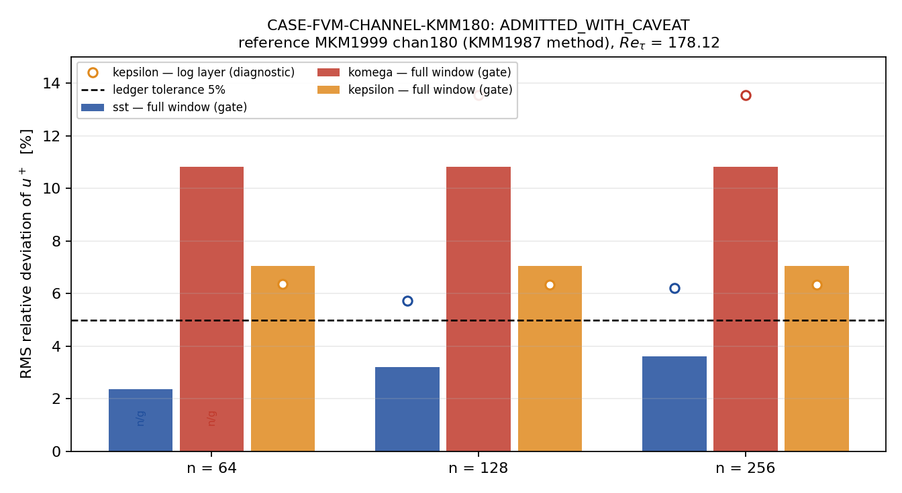
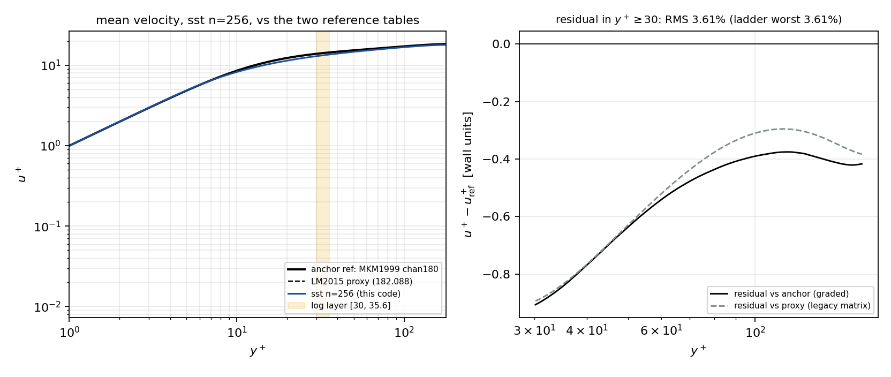

# CASE-FVM-CHANNEL-KMM180 — 算例池入池记录（机器可判）

**状态：`ADMITTED_WITH_CAVEAT`**　容差 `5.00%` （来自 `tensorfvm.verification.kmm1987.TOLERANCE_LOG_REGION`）

## 1. 契约

| 项 | 值 |
|---|---|
| 参考 | Kim, Moin & Moser 1987 J. Fluid Mech. 177:133 (DOI 10.1017/S0022112087000892) |
| 指标 | wall-unit mean velocity u+(y+) RMS relative deviation in y+ > 30 |
| 容差 | 5.0 % |
| 窗口下限 | y+ >= 30 |

## 2. 判据表（single source of truth = `CRITERIA`）

| 判据 | 量 | 值 | 比较 | 阈值 | 入池门 | 结果 |
|---|---|---|---|---|---|---|
| `u_plus_rms_full` | RMS relative deviation of u+ from the MKM1999 chan180 table, 30 <= y+ <= centreline, worst grid of the ladder (sst) | 3.61% | lt | 5.00% | 是 | **PASS** |
| `reference_is_kmm1987_lineage` | graded reference is the KMM1987-lineage dataset (MKM1999 chan180, digest verified), not the LM2015 proxy | yes | is_true | yes | 是 | **PASS** |
| `admitted_model_exists` | at least one closure of the matrix meets u_plus_rms_full | 1 | ge | 1 | 是 | **PASS** |
| `u_plus_rms_log_layer` | RMS relative deviation of u+ in the physical log layer 30 <= y+ <= 0.2 Re_tau, worst *gradable* grid (SST) | 6.21% | lt | 5.00% | 否 | **FAIL** |
| `cf` | relative error of skin-friction coefficient Cf vs the anchor reference profile, worst grid of the ladder (SST) | 6.09% | lt | 5.00% | 否 | **FAIL** |
| `bulk_velocity` | relative error of bulk velocity U_bulk+ vs the anchor reference, worst grid of the ladder (SST) | 2.91% | lt | 5.00% | 否 | **PASS** |
| `refinement_stability` | the full-window deviation used for admission is the worst over the ladder, and every grid of the ladder is separately published | yes | is_true | yes | 否 | **PASS** |
| `log_layer_gradability` | model cells inside the log-layer window at the coarsest grid of the ladder (SST, n=64) | 2 | ge | 3 | 否 | **FAIL** |

## 3. 网格/模型矩阵

| model | n | log 窗口格数 | full RMS | full | log RMS | log | Cf rel |
|---|---|---|---|---|---|---|---|
| sst | 64 | 2 | 2.37% | PASS | n/a | NOT_GRADED | 3.40% |
| sst | 128 | 6 | 3.21% | PASS | 5.72% | FAIL | 5.19% |
| sst | 256 | 11 | 3.61% | PASS | 6.21% | FAIL | 6.09% |
| komega | 64 | 2 | 10.83% | FAIL | n/a | NOT_GRADED | 23.70% |
| komega | 128 | 6 | 10.82% | FAIL | 13.54% | FAIL | 23.53% |
| komega | 256 | 11 | 10.81% | FAIL | 13.54% | FAIL | 23.47% |
| kepsilon | 64 | 12 | 7.06% | FAIL | 6.37% | FAIL | 14.82% |
| kepsilon | 128 | 23 | 7.05% | FAIL | 6.35% | FAIL | 14.81% |
| kepsilon | 256 | 46 | 7.06% | FAIL | 6.35% | FAIL | 14.81% |

## 4. 参考表身份

| 项 | 值 |
|---|---|
| 入池参考 | MKM1999 chan180 (KMM1987 method) |
| 出处 | Moser, Kim & Mansour 1999, Phys. Fluids 11:943 (chan180 statistics) |
| Re_tau | 178.120（名义 180） |
| Cf（由剖面重算） | 0.008135948 |
| U_bulk+ | 15.678731 |
| 采样点 | 65 |
| sha256 校验 | 通过 |
| 替身 LM2015 Re_tau | 182.088 |
| 替身 Cf 相对差 | 0.1560% |

## 5. 注意点（自动生成自记录本身）

- The admitted configuration fails the physically meaningful narrow log-layer window (30 <= y+ <= 0.2 Re_tau): n=128: 5.72% / n=256: 6.21%. The ledger window is the literal full window, so this does not block admission, but no claim of "u+ within 5 % in the log layer" may be made from this entry.
- Skin friction Cf errs by n=64: 3.40% / n=128: 5.19% / n=256: 6.09% against the anchor reference: the wall quantity a resistance consumer needs is worse than the graded profile metric suggests, and it crosses 5 % from n=128 upwards.
- The full-window deviation of the admitted configuration grows with refinement 2.37% -> 3.21% -> 3.61%; the coarsest grid is therefore the most favourable one. The criterion is graded on the worst grid for this reason -- a single-grid quote would be grid-lucky.
- The entry admits the case *with the designated closure only*; the other closures of the matrix are rejected controls (komega: 10.83%, kepsilon: 7.06% vs 5 %).
- The narrow log-layer window is under-resolved by the coarsest mesh: cell centres inside [30, 0.2 Re_tau] = n=64: 2 / n=128: 6 / n=256: 11 (a verdict needs 3). The log-layer diagnostic is therefore "NOT_GRADED" exactly where the full-window number looks best, which is the concrete reason the two windows must be quoted together.

## 6. 误差判定

- 主判据 `u_plus_rms_full` = 3.61% (worst grid n=256)，阈值 5 % → **< 5 %，通过**；余量 1.39%。
- 对数层窗口（诊断）= 6.21% → **>= 5 % 或不入判**。
- Cf（诊断）= 6.09% → **>= 5 %**。
- 复现命令：`python -m tensorfvm.verification.kmm180_case_pool --out docs/case-fvm-channel-kmm180-pool`

## 7. 图

*Pool verdict per closure and grid: bars are the graded full-window RMS deviation (the gate, threshold 5 % dashed), open circles the narrow log-layer diagnostic, "n/g" marks a window with fewer than three cells (missing data, not a zero).*

*Admitted profile at the finest grid against the KMM1999 chan180 anchor reference and the Lee & Moser (2015) proxy; the right panel is the wall-unit residual in the graded region, which is what the RMS number integrates.*
