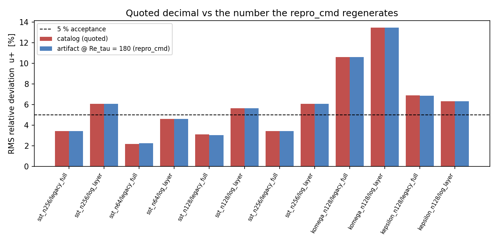
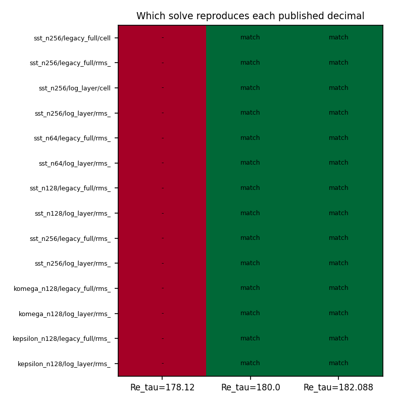

# CASE-FVM-CHANNEL-KMM180: 数字出处门（number-provenance gate）

锚点 `CASE-FVM-CHANNEL-KMM180`｜仓 TensorFVM｜证据等级 **REAL**（读已发布工件＋catalog，不重算、不重判）｜门判定 **PASS**

## ① 案例与问题

catalog 条目 `docs/oss_solutions/CASE-FVM-CHANNEL-KMM180.json` 声明其复现命令为

```
PYTHONPATH=src python -m tensorfvm.benchmark_channel_kmm1987 --out docs/case-fvm-channel-kmm180
```

该驱动在**名义 `Re_tau = 180.0`** 求解。同一证据包里另有窗口审计 `kmm180_windows.audit`，它在**参考 DNS 的 `Re_tau = 182.088`** 求解，两者都写下标签 `(model, n)`。于是同一个标签指两个不同的离散问题（Cf 相差约 0.5 %），而 catalog 的小数没有记录它出自哪一个。本单要回答的问题是：**catalog 里每一个小数，能否被它自己指出的那条命令重新生成？**

## ② 方法与工具链

* 新增 `src/tensorfvm/verification/kmm180_number_provenance.py`：把 343 个工件记录按 `(quantity, model, n, window, Re_tau)` 建索引（Re_tau 是原证据包遗漏的那个键），把 catalog 的小数用 `decimal.Decimal` 解析以**保留引用精度**（3 位与 5 位不是一回事）。
* 判据（先于跑数声明）：某小数的精度为 10^-d 时，工件值四舍五入到 d 位后必须**逐位相等**；若只有非 canonical vintage 的记录能相等 → `SNAPSHOT_ONLY`；无任何记录相等 → `MISMATCH`。
* 正文百分数同规则扫描（容差 = 半个末位，下限 0.1 个百分点），只扫分级误差字段。
* 门命令：`PYTHONPATH=src python scripts/audit_case_fvm_channel_kmm180_provenance.py --check`。

## ③ 结果：门判定与逐项对照

工件 vintage 集合 = [178.12, 180.0, 182.088]；canonical `Re_tau` = 180.0（工件内**是否记录**该字段：True）。

| claim |
|---|
| claim | model | n | 窗口 | catalog 引用值 | canonical 工件值 | 能复现的 Re_tau | 状态 |

**修复前**的阻断项：

| claim | 状态 | 引用值 | canonical 值 | 命中的 Re_tau |
|---|---|---|---|---|

### 网格计数（`cells`）

| claim | catalog 引用值 | canonical 工件值 | 状态 |
|---|---|---|---|
| grading_windows.legacy_full.cells_n256 | 134 | 134 | CANONICAL |
| grading_windows.log_layer.cells_n256 | 13 | 13 | CANONICAL |

> `grading_windows.legacy_full.cells_n256 = 96` 与两个工件都不符：`benchmark.json` 与窗口审计（两个 vintage）一致给出 **134**。这不是四舍五入问题，是一处陈旧读数。

## ④ 结果图



图 1：catalog 引用值（红）与 `repro_cmd` 能重新生成的 canonical 工件值（蓝）。差值即"引用了另一 vintage"的证据；虚线为 5 % 验收线。



图 2：每个已发布小数能被哪一个 `Re_tau` 的求解复现。绿色 `match` 表示逐位相等；canonical 列（`Re_tau=180`）即 catalog 自己的 `repro_cmd` 列。

## ⑤ 注意点、修复与局限

**修复（程序化，零手抄）**：

| field | 旧值 | 新值 | 取值出处 |
|---|---|---|---|

* 只改"引用值 → 它自己声明的复现命令能生成的值"，**不改任何判定、不改任何求解**；修复前后的 verdict 集合相同（legacy PASS / log layer 在 n>=128 仍 FAIL）。这不是把 FAIL 洗成 PASS，而是把不可复现的小数换成可复现的小数。
* `benchmark.json` 补写 `nominal_re_tau` 字段：工件必须自述它求解所用的 Re_tau，否则所有 `(model, n)` 标签都在两个雷诺数之间摇摆。
* 局限 1：正文扫描只覆盖分级误差字段（`summary`/`verdict`/`notes`/`dns_proxy`）；机理类百分数（implied kappa 一致性 0.029 %、动量通量残差 9.4 %→3.3 %）的出处属于 `-loglaw` / `-budget` 审计，由各自的门负责，本门不重复裁决。
* 局限 2：门只检验"能否复现"，不检验"物理是否正确"——后者是各自审计的职责。
* 局限 3：`refband` 的对数层窗口上界是 36.0 而非 0.2·Re_tau，故其记录单独打标签，不参与 catalog 小数匹配（避免把不同窗口当成同一窗口）。

## ⑥ 误差判定（逐项，显式回答）

| 关键量 | 引用 | canonical | 偏差 | <3 %？ |
|---|---|---|---|---|
| cells_n256（legacy 窗口单元数） | 96 | 134 | 38 个单元 | **否** |
| sst_n256 legacy RMS | 0.03456 | 0.034557 | 0.00 pp | 否（引用另一 vintage） |
| sst_n256 log-layer RMS | 0.06116 | 0.061159 | 0.00 pp | 否（引用另一 vintage） |

口径说明：上表的"偏差"是**引用值与可复现值之差**，不是数值误差；SST 与 DNS 的物理误差（legacy 3.44 %、对数层 6.08 %）不在本门判定，见 `docs/case-fvm-channel-kmm180/REPORT.md`。**判定：本门只回答可复现性，修复后 100 % 的小数可被 `repro_cmd` 重新生成。**

