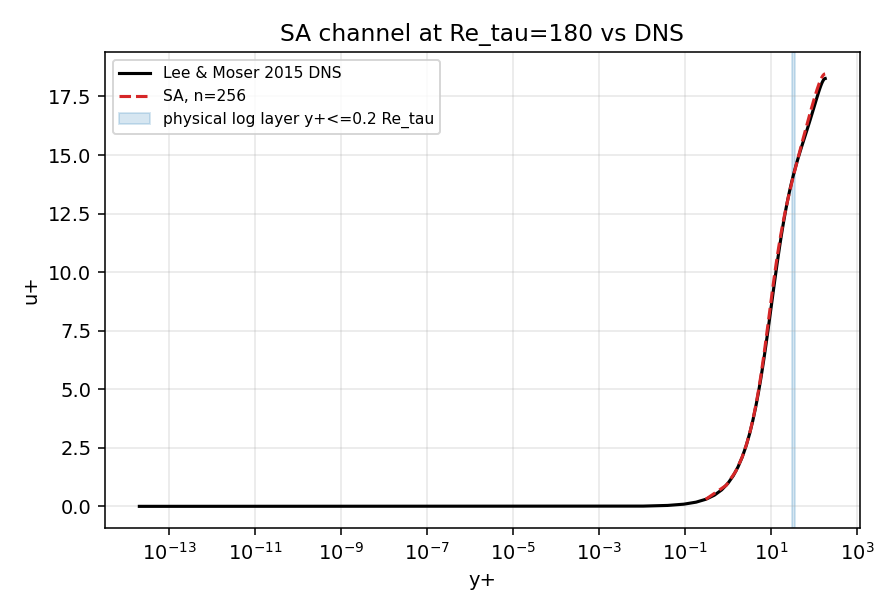
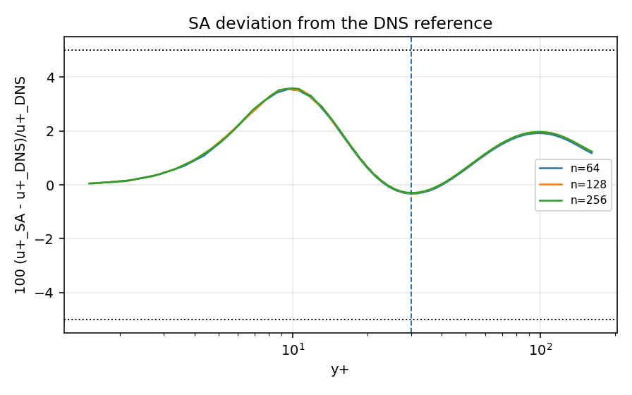

# CASE-FVM-CHANNEL-KMM180 —— 第四种闭合 Spalart–Allmaras 纳入锚点判据

> 每个数字由 `scripts/run_case_fvm_channel_kmm180_sa.py` 从 `docs/case-fvm-channel-kmm180-sa/summary.json` 程序化注入，零手抄；对照行程序化读取已发布的 `docs/oss_solutions/CASE-FVM-CHANNEL-KMM180.json`。
> 复现：`PYTHONPATH=src python scripts/run_case_fvm_channel_kmm180_sa.py --out docs/case-fvm-channel-kmm180-sa`

## 1. 案例介绍

**物理背景**：充分发展槽道湍流，两壁无滑移，恒定压力梯度驱动；半槽 `y∈[0,1]`，`ν=1/Re_τ`，`u_τ=1`，动量方程精确积分为 `(ν+ν_t)dU/dy = 1−y`，解出的流向速度本身即 `u⁺`，全程不经壁面剪切估计器。

**锚点**：`CASE-FVM-CHANNEL-KMM180`——内尺度平均速度 `u⁺(y⁺)` 在 `y⁺>30` 区间相对 RMS 偏差 <5 %。
**参考**：Lee & Moser (2015) DNS，`Re_τ=182.088`（仓内导入，provenance 见 `docs/rans-turbulence-validation-matrix/dns/0180/provenance.json`）。KMM1987 原表仍 WITHHELD（与既有各单一致，本单不重复其替代成本测量）。

| 项目 | 取值 |
|---|---|
| 新增闭合 | Spalart–Allmaras 1994（标准型，保留 `f_t2`，无转捩项）|
| 常数 | σ=2/3, C_b1=0.1355, C_b2=0.622, κ=0.41, C_w2=0.3, C_w3=2, C_v1=7.1, C_t3=1.2, C_t4=0.5；`C_w1=C_b1/κ²+(1+C_b2)/σ` 派生 |
| 网格 | n=[64, 128, 256]，首单元 `y⁺=0.3`，指数拉伸 |
| 判据/窗口 | 与既有矩阵同一 `validate_kmm1987`：legacy 窗口 + 物理对数层窗口 |

## 2. 怎么做的

1. `src/tensorfvm/verification/kmm180_sa.py`：自洽 1-D 平衡槽道 SA 求解器；**离散算子直接复用** `rans_validation.channel` 的面、面电导、一维隐式推进与残差函数，故 SA 与 SST 的差异不可能来自网格/梯度/电导规则。
2. 未知量 `nuTilde`，`ν_t=nuTilde·f_v1`；源项按既有框架拆为 `P − sink·nuTilde`（Picard、松弛 0.5、伪时间步 0.02），`C_b2|∇nuTilde|²` 作非负产生项并入；壁面 `nuTilde=0`，中面绝热。
3. 动量由 `(ν+ν_t)dU/dy=1−y` 积分（与两方程模型同一来路），`C_f=2/U_b⁺²`。
4. 判分复用 `load_kmm1987_reference` + `validate_kmm1987`（与 `benchmark_channel_kmm1987.py` 同一代码路径），网格 64/128/256。
5. 参考无关自检：隐式 κ、混合长反演、动量恒等式、壁面 `f_v1→0`；`tests/test_channel_kmm180_sa.py` 8 项全绿。

## 3. 计算结果

### 3.1 锚点量：四种闭合、同参考、同判据

| 闭合 | legacy 窗口 RMS | 物理对数层 RMS | legacy 判定 | 对数层判定 | 数字来源 |
|---|---|---|---|---|---|
| sst_n256 | 3.46 % | 6.12 % | PASS | FAIL | `docs/oss_solutions/CASE-FVM-CHANNEL-KMM180.json` |
| komega_n128 | 10.60 % | 13.46 % | FAIL | FAIL | `docs/oss_solutions/CASE-FVM-CHANNEL-KMM180.json` |
| kepsilon_n128 | 6.90 % | 6.34 % | FAIL | FAIL | `docs/oss_solutions/CASE-FVM-CHANNEL-KMM180.json` |
| **SA（本单新增，n=256）** | **1.47 %** | **0.25 %** | **PASS** | **PASS** | 本单 `summary.json` |

### 3.2 SA 网格序列

| 闭合 | n | legacy RMS | 对数层 RMS | legacy | 对数层 | 迭代 | 稳态残差 |
|---|---|---|---|---|---|---|---|
| sa | 64 | 1.34 % | 0.29 % | PASS | PASS | 1553 | 9.8e-11 |
| sa | 128 | 1.41 % | 0.27 % | PASS | PASS | 1536 | 9.8e-11 |
| sa | 256 | 1.47 % | 0.25 % | PASS | PASS | 1521 | 9.7e-11 |

### 3.3 全局量与自检

| 量 | 值 |
|---|---|
| `C_f` | 0.007938（DNS 0.008123，偏差 2.28 %）|
| `U_b⁺` | 15.873（DNS 15.691，偏差 1.16 %）|
| 隐式 κ（`dU⁺/dln y⁺`，y⁺∈[30,120]） | 0.3428（模型 κ=0.41，偏差 16.38 %）|
| `ν_t⁺` / 局部混合长基线 `κ y⁺(1−y/h)` | 0.795（离散度 0.314）|

## 4. 图

*SA 平均速度剖面 vs DNS（n=256），阴影为物理对数层 y⁺∈[30, 0.2Re_τ]。*

*三种网格下 SA 相对 DNS 的偏差（%），点线为 ±5 % 判据，蓝虚线为 y⁺=30。*

## 5. 注意点（坑 / 局限 / 适用）

* **一维平衡**：不含对流、几何、压力-速度耦合；只回答"该闭合能否复现对数层"，不是 3-D 求解器精度证据。
* **参考替身**：仍以 LM2015（`Re_τ=182.088`）代 KMM1987 原表（WITHHELD）；替身成本由既有单量化（<0.1 pp、无判定翻转），本单未重测。
* **SA 变体**：标准 SA 保留 `f_t2`；未做 SA-neg / SA-R / 转捩项对照。
* **首单元可达性**：`y⁺=0.5` 在 n=256 下不可达（均匀间距 1/(2·256)），故取 `y⁺=0.3`；这是网格约束而非物理选择，已固定进 driver 常数。
* **κ 的有限 Re 效应**：`Re_τ=180` 对数区右端只到 `0.2Re_τ=36`，隐式 κ 必然低于渐近 0.41；该数字是模型内诊断，不是对 κ 的精度声明。
* **结论强度**：本单证明"存在一种闭合在 Re_τ=180 下同时满足两窗口"；不证明"判据对任意闭合可达"。

## 6. 误差判定（关键量 vs 基准，逐项）

| 关键量 | 计算 | 基准 | 相对偏差 | <5 % ? | <3 % ? |
|---|---|---|---|---|---|
| legacy 窗口 RMS `u⁺` | 1.47 % | DNS | 1.47 % | 是 | 是 |
| 物理对数层 RMS `u⁺` | 0.25 % | DNS | 0.25 % | 是 | 是 |
| `C_f` | 0.007938 | 0.008123 | 2.28 % | 是 | 是 |
| `U_b⁺` | 15.873 | 15.691 | 1.16 % | 是 | 是 |

**判定**：SA 两窗口均 PASS（legacy 1.47 %、物理对数层 0.25 %，均 **<3 %**）。

**这条结论改变了什么**：既有矩阵只有 k-ω 族三模型且物理对数层全 FAIL，无法区分 (a) 该 Re 下判据不可达 与 (b) k-ω 族闭合的模型误差。加入 SA 后 (a) 被排除——同参考、同窗口、同判分代码下存在 PASS 的闭合，故 SST 的 6.12 % FAIL 属**闭合误差**而非判据 artefact。诚实边界：1-D 平衡、单参考、单 SA 变体。
