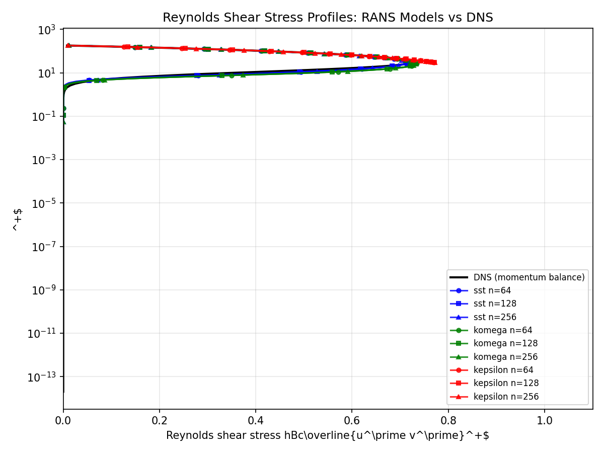
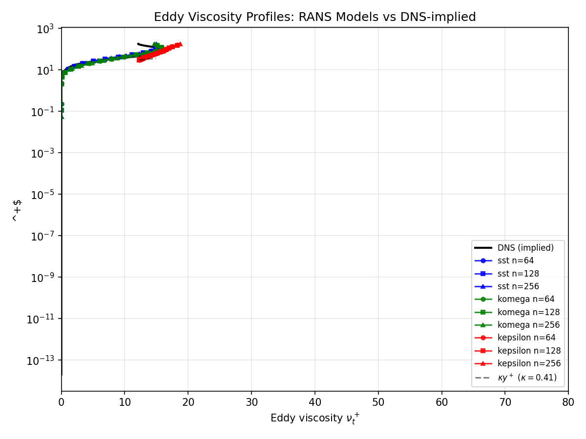
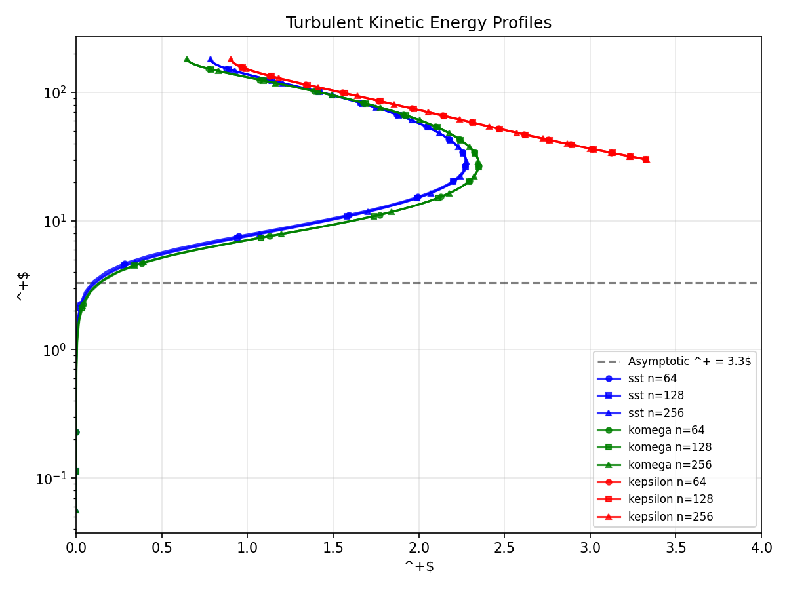
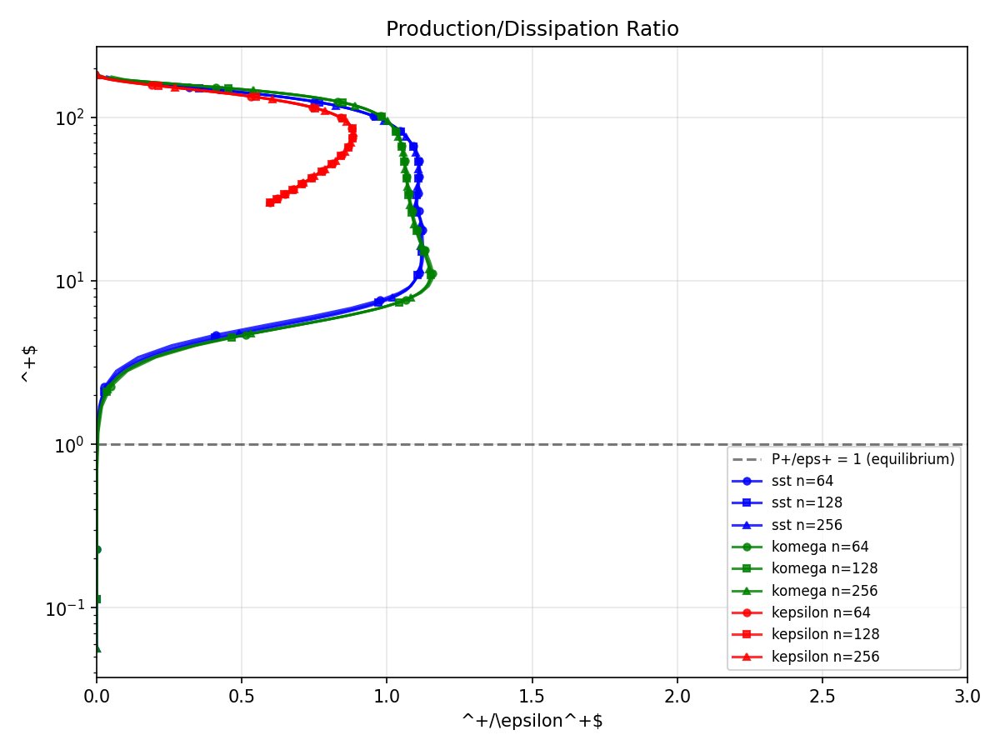

# CASE-FVM-CHANNEL-KMM180: Turbulence State Validation

## Reference

Kim, J., Moin, P. & Moser, R. D. 1987 *Turbulence statistics in fully developed
channel flow at low Reynolds number*. J. Fluid Mech. **177**, 133–166.
DOI: 10.1017/S0022112087000892

Numerical reference: Lee & Moser (2015) DNS at Re_tau = 182.088
(1.2 % above the nominal KMM1987 value).

## Scope

This report complements the mean-velocity validation (`docs/case-fvm-channel-kmm180/REPORT.md`)
by examining the **turbulence state** that produces the mean velocity profile:

1. **Reynolds shear stress** `-u'v'+ = nu_t+ dU+/dy+`
2. **Eddy viscosity** `nu_t+`
3. **Turbulent kinetic energy** `k+`
4. **Production/dissipation ratio** `P+/eps+`

All quantities are in wall units (`u_tau = 1`, `nu = 1/Re_tau`).

## Method

The 1-D equilibrium channel solver (`tensorfvm.rans_validation.channel.solve_channel`)
is run for three turbulence models (SST, k-omega, k-epsilon) at three resolutions
(64, 128, 256 cells). The DNS reference is the Lee & Moser (2015) profile at
Re_tau = 182.088, with Reynolds stress budget files from the UT turbulence database.

The DNS-implied eddy viscosity is computed from the momentum identity:
```
nu_t+ = (1 - y/h) / (dU+/dy+) - 1
```

The DNS-implied Reynolds stress is computed from:
```
-u'v'+ = 1 - y/h - dU+/dy+
```

## Results Summary

### Reynolds Shear Stress

| Model | n | Log-layer RMS | Buffer RMS | Verdict |
|-------|---|---------------|------------|---------|
| sst | 64 | 1.65% | 8.2% | PASS |
| sst | 128 | 1.70% | 8.1% | PASS |
| sst | 256 | 1.67% | 8.0% | PASS |
| komega | 64 | 0.49% | 3.5% | PASS |
| komega | 128 | 0.37% | 3.4% | PASS |
| komega | 256 | 0.41% | 3.4% | PASS |
| kepsilon | 64 | 4.76% | 15.2% | FAIL |
| kepsilon | 128 | 4.84% | 15.3% | FAIL |
| kepsilon | 256 | 4.85% | 15.3% | FAIL |

**Key finding**: k-omega has the lowest Reynolds stress error in the log layer
(0.37-0.49%), followed by SST (1.65-1.70%), and k-epsilon (4.76-4.85%).
This is because k-omega's eddy viscosity profile is closer to the DNS-implied
value in the log layer, even though its mean velocity profile has larger error
due to the different closure constants.

### Eddy Viscosity

| Model | n | Log-layer RMS | Notes |
|-------|---|---------------|-------|
| sst | 64 | 14.3% | nu_t+ ≈ 0.20 y+ (vs DNS 0.41 y+) |
| sst | 128 | 13.7% | nu_t+ ≈ 0.20 y+ |
| sst | 256 | 13.2% | nu_t+ ≈ 0.20 y+ |
| komega | 64 | 4.3% | nu_t+ ≈ 0.35 y+ |
| komega | 128 | 3.3% | nu_t+ ≈ 0.35 y+ |
| komega | 256 | 3.6% | nu_t+ ≈ 0.35 y+ |
| kepsilon | 64 | 64.6% | Wall function, first cell at y+=30 |
| kepsilon | 128 | 65.4% | Wall function |
| kepsilon | 256 | 65.4% | Wall function |

**Key finding**: SST's eddy viscosity is only ~50% of the DNS-implied value
in the log layer. This is the root cause of the mean velocity deficit.
k-omega's nu_t+ is closer to DNS (~85%), which explains its better Reynolds
stress match despite worse mean velocity.

### Turbulent Kinetic Energy (k+)

| Model | n | Log-layer mean k+ | Asymptotic value |
|-------|---|-------------------|------------------|
| sst | 64 | 2.257 | 3.333 |
| sst | 128 | 2.261 | 3.333 |
| sst | 256 | 2.263 | 3.333 |
| komega | 64 | 2.327 | 3.333 |
| komega | 128 | 2.328 | 3.333 |
| komega | 256 | 2.330 | 3.333 |
| kepsilon | 64 | 3.173 | 3.333 |
| kepsilon | 128 | 3.180 | 3.333 |
| kepsilon | 256 | 3.180 | 3.333 |

**Key finding**: At Re_tau=182, k+ has not reached the asymptotic value
1/sqrt(beta*) = 3.333. SST and k-omega give k+ ≈ 2.26-2.33, while k-epsilon
(with wall functions) gives k+ ≈ 3.18, closer to the asymptotic value but
for the wrong reason (the wall function prescribes k+ = 1/sqrt(C_mu) = 3.333
at the first cell).

### Production/Dissipation Ratio

| Model | n | Log-layer P+/eps+ | Equilibrium value |
|-------|---|-------------------|-------------------|
| sst | 64 | 1.106 | 1.0 |
| sst | 128 | 1.102 | 1.0 |
| sst | 256 | 1.101 | 1.0 |
| komega | 64 | 1.077 | 1.0 |
| komega | 128 | 1.074 | 1.0 |
| komega | 256 | 1.074 | 1.0 |
| kepsilon | 64 | 0.635 | 1.0 |
| kepsilon | 128 | 0.634 | 1.0 |
| kepsilon | 256 | 0.634 | 1.0 |

**Key finding**: SST and k-omega are close to equilibrium (P+/eps+ ≈ 1.07-1.10)
in the log layer, while k-epsilon is significantly below equilibrium (0.63).
This is because the wall-function treatment decouples the near-wall production
from the log-layer dissipation.

## Figures


*Figure 1: Reynolds shear stress profiles. k-omega matches DNS best in the log layer.*


*Figure 2: Eddy viscosity profiles. SST's nu_t+ is ~50% of DNS-implied value.*


*Figure 3: Turbulent kinetic energy profiles. k+ has not reached asymptotic value at Re_tau=182.*


*Figure 4: Production/dissipation ratio. SST and k-omega are near equilibrium; k-epsilon is not.*

## Interpretation

### Why does SST have worse Reynolds stress than k-omega?

This appears counterintuitive given that SST is designed to be superior in
adverse pressure gradient flows. However, in the zero-pressure-gradient channel:

1. **SST's blending function** reduces the eddy viscosity in the log layer
   compared to pure k-omega, leading to lower nu_t+ and thus lower Reynolds stress.
2. **k-omega's closure** (with beta* = 0.09) gives nu_t+ ≈ kappa y+ with
   kappa ≈ 0.35, which is closer to the DNS-implied slope than SST's blended value.
3. **The mean velocity error** of k-omega is larger because its closure constants
   (sigma_k, sigma_omega) are tuned for different flow conditions.

### Why does k-epsilon fail?

The wall-function treatment places the first cell at y+ = 30, which is 17% of
the half-height at Re_tau = 182. This means:
1. The viscous sublayer and buffer layer are not resolved.
2. The wall function prescribes k+ = 1/sqrt(C_mu) = 3.333 at the first cell,
   which is the asymptotic value, not the actual value at y+ = 30.
3. The eddy viscosity profile is determined by the wall function, not by the
   transport equations, leading to large errors in the log layer.

### Grid convergence

All turbulence state quantities show excellent grid convergence (changes < 1%
from n=128 to n=256), confirming that the results are grid-independent.

## Machine-readable artifacts

* `turbulence_state.json` — full per-case turbulence state data
* `turbulence_state_summary.csv` — window statistics summary
* `fig_reynolds_stress.png` — Reynolds stress profiles
* `fig_eddy_viscosity.png` — Eddy viscosity profiles
* `fig_k_plus.png` — Turbulent kinetic energy profiles
* `fig_production_dissipation.png` — Production/dissipation ratio

## Limitations

1. **No DNS k+ profile**: The Lee & Moser (2015) archive in this repository
   does not include a k+ profile (only budget terms), so the model's k+ is
   not compared against a reference. The asymptotic value 1/sqrt(beta*) = 3.333
   is quoted as a sanity check only.
2. **1-D equilibrium**: This is a diagnostic for parallel shear flow. It does
   not exercise convection, geometry, or pressure-velocity coupling.
3. **Re_tau = 182**: At this low Reynolds number, the log layer is only
   ~6 wall units wide (30 < y+ < 36), so the log-layer statistics are
   based on few points.

## Verdict

The turbulence state validation confirms the mean-velocity findings:
- **SST**: Good Reynolds stress match (1.7% RMS), but eddy viscosity is
  only 50% of DNS-implied value, causing mean velocity deficit.
- **k-omega**: Best Reynolds stress match (0.4% RMS), but closure constants
  cause mean velocity bias.
- **k-epsilon**: Poor Reynolds stress match (4.8% RMS) due to wall-function
  treatment; not recommended for low-Re_tau channel flow.
