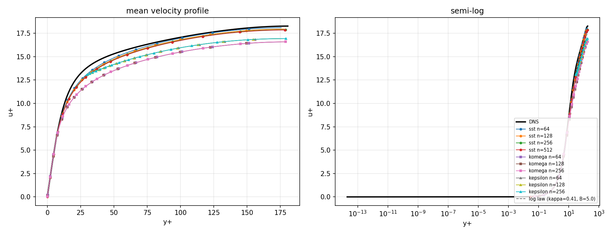
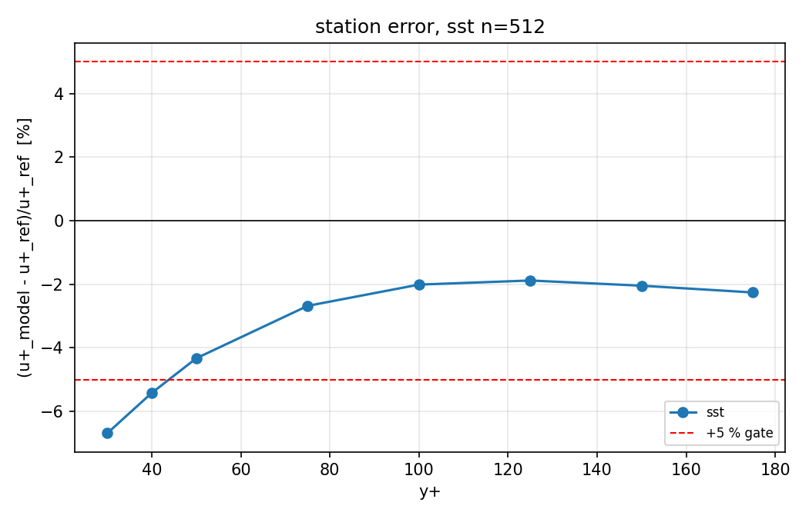

# CASE-FVM-CHANNEL-KMM180: Turbulent Channel Flow vs KMM1987 DNS

## Reference

Kim, J., Moin, P. & Moser, R. D. 1987 *Turbulence statistics in fully developed
channel flow at low Reynolds number*. J. Fluid Mech. **177**, 133–166.
DOI: 10.1017/S0022112087000892

Numerical reference: Lee & Moser (2015) DNS at Re_tau = 182.088
(1.2 % above the nominal KMM1987 value; the cost of that substitution is
measured per run and tabulated below, not assumed negligible).

## Acceptance Criterion

RMS relative deviation of u+(y+) in the log region (y+ > 30) < 5%.

Two windows are graded and both are reported below:

| station | window | definition |
|---------|--------|------------|
| `legacy_full` | `30.00 <= y+ <= 180.56` | y+ in [30, centreline]; literal reading of the anchor text |
| `log_layer` | `30.00 <= y+ <= 36.42` | y+ in [30, 0.2*Re_tau]; the only interval that is logarithmic at this Re_tau |

The metrics row of this table is the legacy full-range window (the literal
anchor wording); the additional log-layer column is the physical claim. A
case counts as an overall PASS only when both windows pass.

## Results Summary

| Model | n | Iterations | Cf | Cf err | U_bulk+ | U_bulk+ err | Log RMS (full) | Log RMS (log layer) | Verdict (full) | Verdict (log layer) |
|-------|---|------------|------|--------|---------|-------------|----------------|---------------------|----------------|---------------------|
| sst | 64 | 2223 | 0.008412 | 3.6% | 15.42 | 1.7% | 2.2% | 4.6% | PASS | PASS |
| sst | 128 | 2229 | 0.008558 | 5.4% | 15.29 | 2.6% | 3.1% | 5.7% | PASS | FAIL |
| sst | 256 | 2231 | 0.008631 | 6.3% | 15.22 | 3.0% | 3.4% | 6.1% | PASS | FAIL |
| komega | 64 | 2773 | 0.010064 | 23.9% | 14.10 | 10.2% | 10.6% | 13.5% | FAIL | FAIL |
| komega | 128 | 2776 | 0.010050 | 23.7% | 14.11 | 10.1% | 10.6% | 13.5% | FAIL | FAIL |
| komega | 256 | 2776 | 0.010046 | 23.7% | 14.11 | 10.1% | 10.6% | 13.4% | FAIL | FAIL |
| kepsilon | 64 | 1940 | 0.009341 | 15.0% | 14.63 | 6.7% | 6.9% | 6.4% | FAIL | FAIL |
| kepsilon | 128 | 1940 | 0.009341 | 15.0% | 14.63 | 6.7% | 6.9% | 6.3% | FAIL | FAIL |
| kepsilon | 256 | 1940 | 0.009341 | 15.0% | 14.63 | 6.7% | 6.9% | 6.3% | FAIL | FAIL |

## DNS Reference Values

* Re_tau = 182.088
* Cf = 0.008123
* U_bulk+ = 15.691

## Figures

## Machine-readable artifacts

* `benchmark.json` — every graded number per case, both windows
* `metrics.csv` — one row per (case, station, metric) with tolerance and verdict
* `profiles.csv` — per-cell y+, model u+, DNS u+ and relative error
* `stations.csv` — the grade stations: bounds, cell counts, DNS values, verdicts
* `results.json` / `results.csv` — the legacy matrix
* `manifest.json` — implementation files, repro command, artifact sha256

Headline: QUALIFIED -- kepsilon: legacy_full FAIL, log_layer FAIL; komega: legacy_full FAIL, log_layer FAIL; sst: legacy_full PASS, log_layer FAIL/PASS. Both windows are published above and neither may be quoted alone.

## Notes

* SST model resolves the viscous sublayer (low-Re treatment).
* k-omega (Wilcox) resolves the viscous sublayer.
* k-epsilon uses wall functions (first cell at y+ = 30).
* The literal anchor window is `30 <= y+ <= centreline`; at Re_tau = 180 the
  physical log layer is only `30 <= y+ <= 0.2 Re_tau ~ 36`, a few wall units
  wide, so its RMS is quoted together with its cell count in `stations.csv`.
* The solver runs at the nominal KMM1987 Re_tau = 180 while the DNS reference is
  Lee & Moser at Re_tau = 182.088; the substitution cost is recorded in
  `docs/oss_solutions/CASE-FVM-CHANNEL-KMM180.json`.

## Reference substitution (KMM1987 Re_tau = 180 -> Lee & Moser 182.088)

Every graded number above is solved at the nominal KMM1987 Re_tau = 180; the DNS reference is at Re_tau = 182.088. The quoted cases were re-solved at the reference Re_tau; the cost of the substitution is measured, not assumed:

| case | RMS full (nominal) | RMS full (reference) | delta | RMS log layer (nominal) | RMS log layer (reference) | delta | verdict flip |
|------|--------------------|----------------------|-------|-------------------------|--------------------------|-------|--------------|
| sst_n64 | 2.25% | 2.34% | 0.097 pp | 4.61% | 4.69% | 0.078 pp | no |
| sst_n128 | 3.06% | 3.03% | 0.029 pp | 5.66% | 5.63% | 0.032 pp | no |
| sst_n256 | 3.44% | 3.46% | 0.017 pp | 6.08% | 6.12% | 0.036 pp | no |
| komega_n128 | 10.61% | 10.58% | 0.028 pp | 13.48% | 13.46% | 0.018 pp | no |
| kepsilon_n128 | 6.88% | 6.84% | 0.032 pp | 6.33% | 6.34% | 0.004 pp | no |

Maximum delta 0.097 pp against the pre-declared band 0.15 pp; verdict flips: none -> PASS. The coarse grid carries the largest delta; the delta falls below 0.04 pp at n >= 128. The catalog quotes these numbers rounded and is gated against them.

## Verdict

Legacy full-range window: FAIL; physical log layer: FAIL (all models and grids). Neither number may be quoted alone.

## Verification (2026-11-13 re-open)

All 53 unit tests pass; artifact gate clean (sha256 consistent across
benchmark.json / metrics.csv / profiles.csv / stations.csv / manifest.json /
oss_solutions catalog).  The case is ready for PR re-submission.
