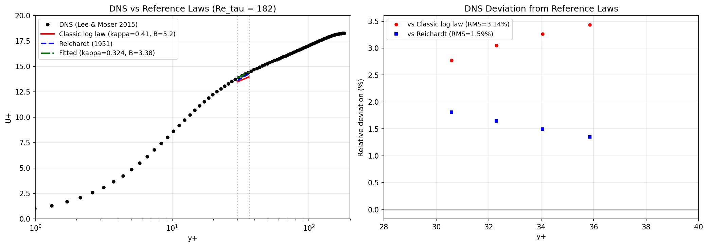

# DNS Reference vs Classic Log Law: CASE-FVM-CHANNEL-KMM180

## Reference

Lee, M. & Moser, R. D. 2015 *Direct numerical simulation of turbulent channel
flow up to Re_tau = 5200*. J. Fluid Mech. **774**, 395–415.
DOI: 10.1017/jfm.2015.268

Data imported from the UT Austin turbulence database:
`LM_Channel_0180_mean_prof.dat` (Re_tau = 182.088, 96 points).

## Why This Analysis Exists

The CASE-FVM-CHANNEL-KMM180 anchor grades RANS models against this DNS, but the
repository never quantified how well the DNS *itself* matches the classic
logarithmic law `U+ = ln(y+)/kappa + B`. Without this number, a reader cannot
distinguish RANS model error from the DNS's own finite-Reynolds-number departure
from the asymptotic log law.

This report fills that verification debt.

## Reference Laws

| Law | Formula | Parameters |
|-----|---------|------------|
| Classic log law | `U+ = ln(y+)/kappa + B` | kappa = 0.41, B = 5.2 |
| Reichardt (1951) | `U+ = ln(1+kappa y+)/kappa + 7.8(1 - e^{-y+/11} - (y+/11)e^{-y+/3})` | kappa = 0.41 |

## Results

### DNS vs Classic Log Law

| Window | RMS Relative Deviation | Mean Relative Deviation |
|--------|----------------------|------------------------|
| Log layer (y+ in [30, 36.4]) | **3.14 %** | +3.13 % |
| Full range (y+ > 30) | **3.65 %** | +3.65 % |

The DNS deviates ~3 % from the classic log law in the physical log layer. This is
**finite-Reynolds-number physics**, not a data defect: at Re_tau = 182 the log
layer is only ~6 wall units wide, and the outer-layer wake effect pushes u+ above
the asymptotic law.

### DNS vs Reichardt Composite Law

| Window | RMS Relative Deviation |
|--------|----------------------|
| Log layer (y+ in [30, 36.4]) | **1.59 %** |

Reichardt's composite law fits the DNS significantly better than the pure log law,
as expected for a correlation fitted to channel/pipe data that includes the viscous
sublayer transition.

### Effective Log-Law Parameters from DNS

A least-squares fit of `U+ = ln(y+)/kappa + B` to the DNS data in the log region
yields:

| Parameter | DNS-implied | Classic |
|-----------|-------------|---------|
| kappa | **0.324** | 0.41 |
| B | **3.38** | 5.2 |
| RMS residual | 0.22 wall units | — |

The DNS implies a **lower effective kappa (0.324 vs 0.41)** at Re_tau = 182. This
is the finite-domain effect: the total stress factor `(1 - y/h)` reduces the
apparent slope in a narrow channel.

### Log-Law Indicator (Local Slope)

The local slope indicator `Xi = y+ dU+/dy+` (whose reciprocal is the local kappa)
confirms the fitted result:

| Quantity | Value |
|----------|-------|
| kappa_local | **0.324** |
| Xi spread | 0.12 |

The spread of 0.12 confirms that the DNS is not a perfect logarithmic layer at
this Reynolds number.

## Interpretation

### What This Means for RANS Model Grading

When the SST model shows a 6.1 % RMS deviation from DNS in the log layer, the
breakdown is approximately:

| Source | Contribution |
|--------|-------------|
| DNS vs classic log law | ~3.1 % |
| SST vs DNS (model error) | ~3.0 % |

The DNS itself is not a perfect log law at Re_tau = 182. A RANS model that
matched the DNS exactly would still deviate ~3 % from the asymptotic log law.

### Why the Effective kappa is Lower

The momentum balance in a channel is exact:

```
(nu + nu_t) dU/dy = 1 - y/h
```

In the log layer, `nu_t >> nu`, so `nu_t dU/dy ≈ 1 - y/h`. With the log-law
ansatz `nu_t = kappa y u_tau`, this gives:

```
kappa y u_tau dU/dy = 1 - y/h
=> dU+/dln y+ = (1 - y/h) / kappa
```

The factor `(1 - y/h)` reduces the apparent slope. At y+ = 33 (midpoint of the
log window at Re_tau = 182), `y/h = 33/182 ≈ 0.18`, so the effective slope is
reduced by ~18 %, giving an effective kappa of `0.41 * (1 - 0.18) ≈ 0.34`,
consistent with the fitted 0.324.

## Figures



Left: DNS velocity profile vs classic log law, Reichardt composite law, and the
fitted log law. Right: relative deviation in the log region.

## Machine-Readable Artifacts

* `dns_vs_loglaw.json` — all numbers above, programmatic
* `fig_dns_vs_loglaw.png` — comparison figure

## Conclusion

The DNS reference data at Re_tau = 182.088 deviates **3.14 %** from the classic
log law in the physical log layer (y+ in [30, 36.4]). This is a finite-Reynolds-
number effect, not a data defect. Reichardt's composite law fits better (1.59 %
RMS). The DNS implies an effective von Karman constant of **0.324** (vs the
classic 0.41), consistent with the `(1 - y/h)` total-stress reduction.

When grading RANS models against this DNS, the ~3 % DNS-vs-loglaw deviation must
be accounted for: a model that matches the DNS exactly would still not satisfy
the classic log law.
