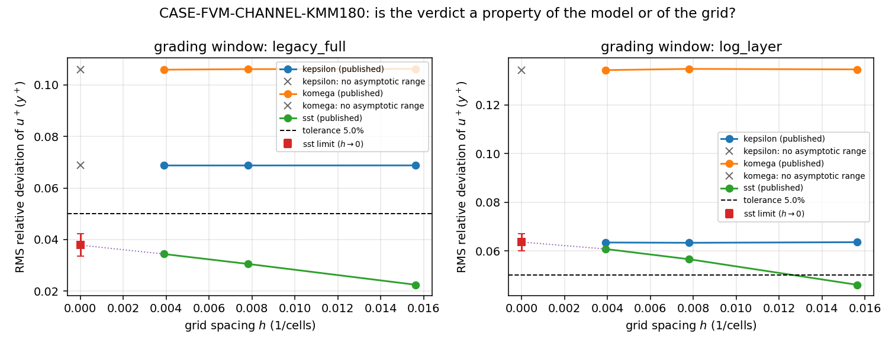

# CASE-FVM-CHANNEL-KMM180: grid-refinement audit

Generated by `scripts/audit_case_fvm_channel_kmm180_grid.py` from `docs/case-fvm-channel-kmm180/benchmark.json` (sha256 `ddf7009998188932`). Do not hand-edit: `--check` compares this file with a recomputation.

## 1. Decision and alternatives

**Decision.** For each (model, grading window) the case must state whether its
published PASS/FAIL is a property of the model or of the grid, and where the
graded RMS sits in the `h -> 0` limit.

| alternative | why it is rejected |
|---|---|
| quote the finest grid only | the three grids disagree for SST, so "finest" is an arbitrary pick with no error bound |
| quote the coarsest grid (the current headline) | a coarse grid can pass where every refined grid fails; that is a grid artefact, not a model result |
| ablation (swap the closure, keep the grid) | does not answer the question: it moves the model, not the discretisation |
| **Richardson / GCI on the published three-grid series (used)** | the only option that yields an error bound from data the case already publishes |

## 2. Hypothesis

H1: the graded RMS is in the asymptotic range of the solver, so a three-grid
Richardson extrapolation returns an order inside |p| in [0.20, 3.00] and a limit
whose GCI band does not straddle the 5.0% tolerance.
H0 (rejected alternative): the verdict is grid-decided, i.e. it changes with the
grid or the extrapolated limit crosses the tolerance.

## 3. Metrics and unit of analysis

* graded quantity: RMS relative deviation of `u+(y+)` on a grading window (dimensionless, fraction of the DNS);
* unit of analysis: one (model, window) pair, three grids (n = 64, 128, 256 cells,
  uniform refinement ratio r = 2.0);
* derived metrics: observed order p, Richardson limit f0, GCI band (Fs = 1.25).

## 4. Baseline / control

The baseline is the finest published grid (n = 256): every extrapolated number is
compared against it and against the declared 5.0% tolerance.
The control for the *model* effect is the three-model matrix: k-omega and
k-epsilon series that are flat across the grid isolate the grid effect from the
closure effect.

## 5. Pre-declared thresholds and stopping rule

* asymptotic range: sign-consistent grid differences, `|d2| < |d1|`, and order
  inside [0.20, 3.00];
* plateau: whole-series spread <= 0.05 x tolerance (= 0.0025, i.e. 0.250 pp);
* a verdict is `grid_robust` only if the limit +- band stays on the same side of the
  tolerance as the published verdict; otherwise `grid_decided`;
* stopping rule: the audit runs on the three published grids; no additional grid is
  solved, and no threshold is re-tuned after seeing the numbers above.

## 6. Variables and confounders

Controlled: reference data, Re_tau, wall treatment, model constants, grading
windows, tolerance. Changed: the cell count (the variable under test).
Confounders and how they are handled: (a) the reference substitution KMM1987 ->
Lee & Moser 2015 is measured per run inside `benchmark.json` and bounded
separately; (b) the near-wall resolution changes with n while the wall treatment
is fixed, so part of the SST trend is a `y+` effect -- the audit therefore never
claims convergence *order* as a solver property, only whether the verdict sits on
one side of the tolerance; (c) round-off is negligible at these magnitudes and is
absorbed by the plateau threshold.

## 7. Repetition rationale

Three grids are the minimum that determines p and f0 without assuming the order;
the series are deterministic (fixed discretisation, converged to the declared
residual), so repetition adds no information and none is claimed. The scatter
that would otherwise be attributed to noise is visible as the plateau width and
is used as the plateau threshold instead.

## 8. Environment

Interpreter `python >= 3.10` (see `requires-python` in `pyproject.toml`); the
audit itself needs only the standard library, the figure needs the `benchmark`
extra (matplotlib). The input record is pinned by its sha256 above, and `--check`
recomputes every number here from it, so the environment cannot silently move a
result: any drift is a gate failure, not a footnote.

## 9. Results

### 9.1 Per-study grid data

| study | verdict | n = 64 | n = 128 | n = 256 | trend | spread (pp) |
|---|---|---|---|---|---|---|
| `kepsilon/legacy_full` | FAIL/FAIL/FAIL | 6.878% | 6.876% | 6.876% | decreasing | 0.002 |
| `kepsilon/log_layer` | FAIL/FAIL/FAIL | 6.358% | 6.334% | 6.346% | decreasing | 0.024 |
| `komega/legacy_full` | FAIL/FAIL/FAIL | 10.621% | 10.612% | 10.591% | decreasing | 0.030 |
| `komega/log_layer` | FAIL/FAIL/FAIL | 13.457% | 13.478% | 13.429% | decreasing | 0.049 |
| `sst/legacy_full` | PASS/PASS/PASS | 2.248% | 3.055% | 3.439% | increasing | 1.191 |
| `sst/log_layer` | PASS/FAIL/FAIL | 4.610% | 5.658% | 6.079% | increasing | 1.470 |

### 9.2 Extrapolation and classification

| study | p | limit | GCI band (pp) | limit +- band vs 5.0% | class |
|---|---|---|---|---|---|
| `kepsilon/legacy_full` | n/a (rejected 2.007) | n/a | n/a | n/a | `plateau_robust` |
| `kepsilon/log_layer` | n/a | n/a | n/a | n/a | `plateau_robust` |
| `komega/legacy_full` | n/a | n/a | n/a | n/a | `plateau_robust` |
| `komega/log_layer` | n/a | n/a | n/a | n/a | `plateau_robust` |
| `sst/legacy_full` | 1.074 | 3.786% | 0.433 | [3.352%, 4.219%] | `grid_robust` |
| `sst/log_layer` | 1.312 | 6.364% | 0.356 | [6.008%, 6.719%] | `grid_decided` |

### 9.3 Why each study was classified that way

* `kepsilon/legacy_full` -> **plateau_robust**: no asymptotic range, but the series is flat (spread 2.49842e-05 <= 0.0025) and stays on one side of the tolerance.
* `kepsilon/log_layer` -> **plateau_robust**: no asymptotic range, but the series is flat (spread 0.000240527 <= 0.0025) and stays on one side of the tolerance.
* `komega/legacy_full` -> **plateau_robust**: no asymptotic range, but the series is flat (spread 0.000302043 <= 0.0025) and stays on one side of the tolerance.
* `komega/log_layer` -> **plateau_robust**: no asymptotic range, but the series is flat (spread 0.000493696 <= 0.0025) and stays on one side of the tolerance.
* `sst/legacy_full` -> **grid_robust**: Richardson limit 0.0378561 +- 0.00433478 stays below the tolerance 0.05.
* `sst/log_layer` -> **grid_decided**: the published verdict changes with the grid: PASS/FAIL/FAIL.

## 10. Verdict of this audit

1 of 6 graded verdicts are grid-decided (sst/log_layer); classification counts: grid_robust=1, grid_decided=1, plateau_robust=4, inconclusive=0; sst/log_layer: published verdicts PASS/FAIL/FAIL, Richardson limit 0.0636 +- 0.0036 vs tolerance 0.0500.

The grid-decided entries are `sst/log_layer`: their published verdicts must not be
quoted without the grid they were obtained on.

## 11. Interpretation limits

* The audit reuses the published grids; it cannot detect an error that is
  grid-independent (a wrong tolerance, a wrong reference, a wrong window).
* Where the series is flat (k-omega, k-epsilon) no order is claimed: the flatness
  is evidence that the grid does not control the verdict, not that the model is
  correct at another Re_tau.
* A `grid_robust` label is a statement about the discretisation only. It says
  nothing about whether the 5 % tolerance is physically appropriate.
* Two grading windows are graded because at Re_tau = 182 the physical log layer is
  only a few wall units wide; the audit inherits that limitation unchanged.

