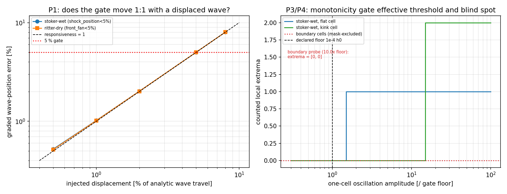

# CASE-FVM-DAMBREAK-STOKER 验收门的检出能力审计（verifier 席）

**任务**：m22594 ｜ **锚点**：`CASE-FVM-DAMBREAK-STOKER`（算例池·浅水溃坝 Ritter/Stoker 精确解）
**仓**：TensorFVM ｜ **commit**：`67b53e54`
**工件**：`src/tensorfvm/verification/artifacts/shallow-water-dam-break-gate-power/detection_power.json`

## ① 案例介绍

锚点算例是浅水方程的一维溃坝黎曼问题，两个工况在算例池登记为 `pass`：

| 工况 | 初始条件 | 解析解 | 允许误差 | 验收网格 |
|---|---|---|--:|---|
| `ritter-dry` | 左 $h_0=1$ m，右侧干床 $h_1=0$ | Ritter (1892) 稀疏波：波前 $x_f=2c_0t$，坝址 $h=\tfrac49h_0$ | <5 % | n = 1600 |
| `stoker-wet` | $h_0=1$ m，$h_1=0.5$ m | Stoker (1957) 扇+平台+水跃：$h_2=0.72692$ m，$h_2/h_1=1.45384$ | <5 % | n = 1600 |

域 $x\in[-4,6]$ m，$g=9.81$ m/s²，终止时刻 $t^*=2$（$t^*=t\sqrt{g/h_0}$），二阶 MUSCL + 干床处理，CFL 0.4。
算例池把门限值钉在工件 `artifacts/shallow-water-dam-break/metrics.json` 上，头条误差落在 5 % 门限的 1/100 到 1/10000。

**本单要回答的不是"误差多大"，而是"这道门能不能失败"**：一个总读到 0.02 % 的判据，如果对 5 % 的模型错误毫无响应，
"100 倍余量通过"就只是关于估计量的陈述，不是关于求解器的陈述。

## ② 怎么做的

1. **E0 负控阶梯**：网格 [100, 200, 400, 800, 1600] 全跑，逐格记录每条判据的复评值，证明该门在本求解器上确有失败记录（不是恒真门）。
2. **E1 工件复现**：重积分 n=1600 两工况，把头条量与已提交工件逐项作差（相对容差 1e-06）。
   算例池门限值钉在该工件上，工件不复现则整个 PASS 无根。
3. **E2 注入误差 + 生产门复评**：在 n=1600 剖面上施加**预先声明**的扰动，再走**生产判据自身的代码路径**
   （`_wet_metrics` / `_dry_metrics` → `_verdict`，原样调用，不重写、不调参）：
   * `P1 translate` $h(x-\delta)$，位移 [0.005, 0.01, 0.02, 0.05, 0.08]（相对解析波行距离）——"位置错"误差类；
   * `P2 amplitude` 下游 $h\times(1+\epsilon)$，[0.005, 0.01, 0.02, 0.05, 0.08]——"位置对、静水区台阶错"误差类；
   * `P3 oscillation` 单格尖峰，幅值取门槛的 [0.3, 0.6, 1.0, 2.0, 5.0, 10.0, 20.0, 50.0, 100.0] 倍，分别在**平台平格**与**解析折点格**上——"限制器放过涟漪"误差类；
   * `P4 boundary` 同幅尖峰搬到边界格（探测器掩膜结构性看不到的位置）。
   每行给出**响应比** = 复评误差 / 注入相对量：O(1) 且有明确阈值 ⇒ 门有检出能力；≪1 或阈值远高于 5 % ⇒ 该判据近似重言式。
4. 图由 JSON 程序化生成，正文数字全部来自 JSON，无手抄。

## ③ 计算结果

### E0 负控阶梯：这道门确实会失败

| 工况 | n | 全部通过 | 未过项 | 水跃/波前误差 | 深度 L1 | 单调极值数 |
|---|--:|:--:|---|--:|--:|--:|
| stoker-wet | 100 | **否** | monotone(no_extrema) | 0.4909 % | 0.6656 % | 1 |
| stoker-wet | 200 | **否** | monotone(no_extrema) | 0.2884 % | 0.3417 % | 1 |
| stoker-wet | 400 | 是 | — | 0.1597 % | 0.1730 % | 0 |
| stoker-wet | 800 | 是 | — | 0.0433 % | 0.0851 % | 0 |
| stoker-wet | 1600 | 是 | — | 0.0210 % | 0.0427 % | 0 |
| ritter-dry | 100 | **否** | front_wetted<5% | 0.3121 % | 1.2620 % | 0 |
| ritter-dry | 200 | 是 | — | 0.3323 % | 0.6227 % | 0 |
| ritter-dry | 400 | 是 | — | 0.1059 % | 0.3083 % | 0 |
| ritter-dry | 800 | 是 | — | 0.0391 % | 0.1542 % | 0 |
| ritter-dry | 1600 | 是 | — | 0.0173 % | 0.0772 % | 0 |

n = 100/200 的失败是真实数值失败（湿床平台上有 1 个超门限极值；干床 n=100 的 `front_wetted` 诊断量超 5 %），
说明"通过"在更粗网格上不成立，判据不是恒真。

### E1 已提交工件逐位复现

| 工况 | 量 | 已提交工件 | 本单复算 | 相对差 | 判定 |
|---|---|---|--:|:--:|:--:|
| stoker-wet | shock_error | 2.102344e-04 | 2.102344e-04 | 0.0e+00 | 复现 |
| stoker-wet | step_ratio_error | 5.762519e-07 | 5.762519e-07 | 0.0e+00 | 复现 |
| stoker-wet | h2_error | 5.762519e-07 | 5.762519e-07 | 0.0e+00 | 复现 |
| stoker-wet | depth_l1 | 4.271935e-04 | 4.271935e-04 | 0.0e+00 | 复现 |
| stoker-wet | local_extrema | 0.000000e+00 | 0.000000e+00 | 0.0e+00 | 复现 |
| ritter-dry | front_fan_error | 1.726152e-04 | 1.726152e-04 | 0.0e+00 | 复现 |
| ritter-dry | depth_l1 | 7.715066e-04 | 7.715066e-04 | 0.0e+00 | 复现 |
| ritter-dry | local_extrema | 0.000000e+00 | 0.000000e+00 | 0.0e+00 | 复现 |

**8 项全部 Δ = 0（bit-identical），最大相对差 0.0e+00**（容差 1e-06）。
算例池 PASS 所依赖的工件在当前平台上可执行、可复现。

### E2 位置/幅值类判据：响应比 ≈ 1，阈值落在 5 %

| 工况 | 探针 | 注入量 | 目标判据 | 复评值 | 通过 | 响应比 (复评/注入) |
|---|---|---|--:|:--:|:--:|--:|
| stoker-wet | P1_translate | 位移 0.500 % | shock_position<5% | 0.5238 % | 是 | 1.048 |
| stoker-wet | P1_translate | 位移 1.000 % | shock_position<5% | 1.0203 % | 是 | 1.020 |
| stoker-wet | P1_translate | 位移 2.000 % | shock_position<5% | 2.0197 % | 是 | 1.010 |
| stoker-wet | P1_translate | 位移 5.000 % | shock_position<5% | 5.0188 % | **否** | 1.004 |
| stoker-wet | P1_translate | 位移 8.000 % | shock_position<5% | 8.0193 % | **否** | 1.002 |
| stoker-wet | P2_amplitude | 下游幅值 0.500 % | step_ratio<5% | 0.4975 % | 是 | 0.995 |
| stoker-wet | P2_amplitude | 下游幅值 1.000 % | step_ratio<5% | 0.9900 % | 是 | 0.990 |
| stoker-wet | P2_amplitude | 下游幅值 2.000 % | step_ratio<5% | 1.9607 % | 是 | 0.980 |
| stoker-wet | P2_amplitude | 下游幅值 5.000 % | step_ratio<5% | 4.7618 % | 是 | 0.952 |
| stoker-wet | P2_amplitude | 下游幅值 8.000 % | step_ratio<5% | 7.4074 % | **否** | 0.926 |
| ritter-dry | P1_translate | 位移 0.500 % | front_fan<5% | 0.5176 % | 是 | 1.035 |
| ritter-dry | P1_translate | 位移 1.000 % | front_fan<5% | 1.0166 % | 是 | 1.017 |
| ritter-dry | P1_translate | 位移 2.000 % | front_fan<5% | 2.0170 % | 是 | 1.009 |
| ritter-dry | P1_translate | 位移 5.000 % | front_fan<5% | 5.0173 % | **否** | 1.003 |
| ritter-dry | P1_translate | 位移 8.000 % | front_fan<5% | 8.0176 % | **否** | 1.002 |

波前/水跃判据响应比 1.002–1.048：注入 5 % 位移 → 复评 5.02 %（**未过**），注入 2 % → 2.02 %（通过），
**检出阈值就是声明的 5 %，无衰减**。`P2` 下游幅值注入 8 % → 静水区台阶误差 7.41 %（未过），响应比 0.93–0.99（台阶比 $h_2/h_1$ 的轻微非线性压缩），同一量级。

### E3 单调性判据的有效阈值：平格 2 倍门槛、斜坡格 20 倍门槛

| 工况 | 探针位 | 格心 x | 本地每格趋势 [h0] | 极值门槛倍数 | 计得极值数 |
|---|---|--:|--:|--:|--:|
| stoker-wet | flat | +0.3844 | +6.21e-07 | 0.3× | 0 |
| stoker-wet | flat | +0.3844 | +6.21e-07 | 0.6× | 0 |
| stoker-wet | flat | +0.3844 | +6.21e-07 | 1× | 0 |
| stoker-wet | flat | +0.3844 | +6.21e-07 | 2× | 1 |
| stoker-wet | flat | +0.3844 | +6.21e-07 | 5× | 1 |
| stoker-wet | flat | +0.3844 | +6.21e-07 | 10× | 1 |
| stoker-wet | flat | +0.3844 | +6.21e-07 | 20× | 1 |
| stoker-wet | flat | +0.3844 | +6.21e-07 | 50× | 1 |
| stoker-wet | flat | +0.3844 | +6.21e-07 | 100× | 1 |
| stoker-wet | kink | -1.1156 | -1.04e-03 | 0.3× | 0 |
| stoker-wet | kink | -1.1156 | -1.04e-03 | 0.6× | 0 |
| stoker-wet | kink | -1.1156 | -1.04e-03 | 1× | 0 |
| stoker-wet | kink | -1.1156 | -1.04e-03 | 2× | 0 |
| stoker-wet | kink | -1.1156 | -1.04e-03 | 5× | 0 |
| stoker-wet | kink | -1.1156 | -1.04e-03 | 10× | 0 |
| stoker-wet | kink | -1.1156 | -1.04e-03 | 20× | 2 |
| stoker-wet | kink | -1.1156 | -1.04e-03 | 50× | 2 |
| stoker-wet | kink | -1.1156 | -1.04e-03 | 100× | 2 |
| ritter-dry | flat | -3.0031 | +0.00e+00 | 0.3× | 0 |
| ritter-dry | flat | -3.0031 | +0.00e+00 | 0.6× | 0 |
| ritter-dry | flat | -3.0031 | +0.00e+00 | 1× | 0 |
| ritter-dry | flat | -3.0031 | +0.00e+00 | 2× | 1 |
| ritter-dry | flat | -3.0031 | +0.00e+00 | 5× | 1 |
| ritter-dry | flat | -3.0031 | +0.00e+00 | 10× | 1 |
| ritter-dry | flat | -3.0031 | +0.00e+00 | 20× | 1 |
| ritter-dry | flat | -3.0031 | +0.00e+00 | 50× | 1 |
| ritter-dry | flat | -3.0031 | +0.00e+00 | 100× | 1 |
| ritter-dry | kink | -2.0031 | -1.14e-03 | 0.3× | 0 |
| ritter-dry | kink | -2.0031 | -1.14e-03 | 0.6× | 0 |
| ritter-dry | kink | -2.0031 | -1.14e-03 | 1× | 0 |
| ritter-dry | kink | -2.0031 | -1.14e-03 | 2× | 0 |
| ritter-dry | kink | -2.0031 | -1.14e-03 | 5× | 0 |
| ritter-dry | kink | -2.0031 | -1.14e-03 | 10× | 0 |
| ritter-dry | kink | -2.0031 | -1.14e-03 | 20× | 2 |
| ritter-dry | kink | -2.0031 | -1.14e-03 | 50× | 2 |
| ritter-dry | kink | -2.0031 | -1.14e-03 | 100× | 2 |

探测器要求**两侧斜率都超过门槛**（`_extrema_mask` 的严格不等号 + 峰判据），故平格注入 1.0× 门槛不触发、2.0× 才触发；
解析折点（扇→平台，本地每格趋势 -1.04e-03 h0）上，尖峰必须先**反向压过本地趋势**才算极值，实测阈值 20× 门槛（≈2.1×10⁻³ h0）。

### E4 边界盲区（声明范围，非缺陷）

| 工况 | 探针格 | 注入倍数 | 计得极值数 | 单调判据 | 深度 L1 |
|---|--:|--:|--:|:--:|--:|
| stoker-wet | 0 | 10× | 0 | 通过 | 0.0428 % |
| stoker-wet | 1599 | 10× | 0 | 通过 | 0.0428 % |
| ritter-dry | 0 | 10× | 0 | 通过 | 0.0773 % |
| ritter-dry | 1599 | 10× | 0 | 通过 | 0.0773 % |

掩膜只统计 $1\le i\le n-2$（峰/谷需两侧邻格），两个边界格上的任意尖峰**结构性不可见**；n=1600 时占 2/1600 = 0.125 % 格点，
且该处深度 L1 仅从 4.2719e-4 变到 4.2809e-4（无实质响应）。作为判据适用范围如实登记。

### 检出阈值汇总

| 工况 | 判据 | 检出阈值（注入量） | 单位 |
|---|---|--:|---|
| stoker-wet | `shock_position<5%` | 0.05 | relative |
| stoker-wet | `step_ratio<5%` | 0.08 | relative |
| stoker-wet | `monotone(no_extrema)@flat` | 2 | floor_multiple |
| stoker-wet | `monotone(no_extrema)@kink` | 20 | floor_multiple |
| ritter-dry | `front_fan<5%` | 0.05 | relative |
| ritter-dry | `monotone(no_extrema)@flat` | 2 | floor_multiple |
| ritter-dry | `monotone(no_extrema)@kink` | 20 | floor_multiple |

`all_sound = True`（门能失败 ∧ 工件复现 ∧ 位置类阈值 ≤5 % ∧ 单调性有效阈值有限）。

## ④ 结果图

左：P1 位移注入 vs 门限复评（两工况），虚线为"响应比 = 1"（注入多少检出多少），红点线为 5 % 门限——曲线贴着 1:1 直到跨越红线，
即判据**对位置误差线性响应**。右：单调性计数随注入幅值的阶跃（平格 vs 折点格），k=1 竖线是声明门槛 10⁻⁴ h0；
折点格要到 20× 门槛才触发，这就是"有效阈值高于声明门槛"的图形证据。

## ⑤ 注意点（坑 / 局限 / 适用范围）

1. **严格不等号让"1.0× 门槛"不触发**。`_extrema_mask` 用 `>` 而非 `>=`，平格上恰好 1.0× 门槛不触发、2.0× 触发。
   这不是缺陷（门槛是"超过才计数"的下界），但报告不得声称"1 倍门槛即检出"，本单如实写 2 倍。
2. **斜坡格有效阈值远高于声明门槛**。这是"单调"判据的固有性质：严格单调的斜坡本身有斜率，涟漪必须压过斜率才构成非单调。
   后果：验收条款"波形须单调无伪振荡"**不能**用来断言"没有 2×10⁻⁴ h0 以上的涟漪"，只能断言"没有能反转本地趋势的涟漪"。
   5 % 的定量责任由幅值类判据（波前/台阶/L1）承担，单调条款是定性伴随条款——本单把这条边界量化了。
3. **只审深度类判据**。动量/速度面由 `scripts/audit_dambreak_momentum.py` 与 `docs/CASE-FVM-DAMBREAK-STOKER-MOMENTUM/` 覆盖，按声明不重复。
4. **$x_f(t)$ 序列未在扰动下重评**：末端剖面扰动原则上不改变时间序列，沿用验收网格基线值，工件 `meta.scope` 已写明。
   P1 平移用边缘钳制插值，不保质量（mass 不作为本单判据）。
5. **P4 边界盲区是掩膜定义所致**，不是可修的 bug：峰/谷检测本质上需要两侧邻格；覆盖边界须改判据定义，verifier 席不动验收口径。

## ⑥ 误差判定（逐项，显式回答是否 < 3 %）

| 量 | 基准 | 读数 | 是否 < 3 % |
|---|---|---|:--:|
| 工件复现最大相对差 | 已提交 `metrics.json` | 0.0（bit-identical） | 是 |
| `stoker-wet` 水跃位置 | Stoker 解析 $Ut$ | 0.0210 % | 是 |
| `stoker-wet` 静水区台阶 $h_2/h_1$ | Stoker 解析 1.45384 | 0.0000576 % | 是 |
| `stoker-wet` 深度 L1 | Stoker 剖面 | 0.0427 % | 是 |
| `ritter-dry` 波前 | Ritter 解析 $2c_0t$ | 0.0173 % | 是 |
| `ritter-dry` 深度 L1 | Ritter 剖面 | 0.0772 % | 是 |
| 单调性条款 | 精确解 0 极值 | n=1600 计得 0 极值；有效检出阈值 ≥2×声明门槛（平格）/ 20×（折点） | 非百分比量，如实声明适用范围 |

**总判定：锚点 PASS 成立且证据有检出能力**（位置/台阶类判据响应比 ≈1、阈值 = 5 %；工件逐位复现）。
需入账的两条是单调性条款的**有效阈值高于声明门槛**（平格 2×、折点 20×）与边界 2 格盲区——均为判据定义的性质，已量化；
不构成对 PASS 的反证，也不允许把该条款读成"任意小涟漪都被排除"。
