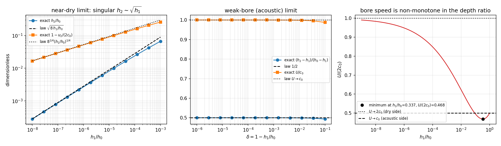
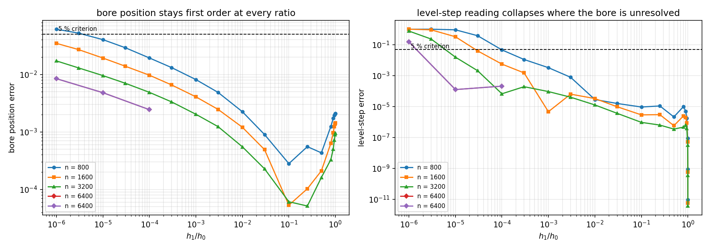
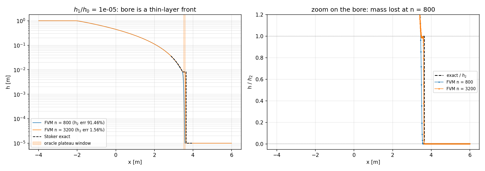

# CASE-FVM-DAMBREAK-STOKER · 湿底溃坝基准的退化极限审计（h1/h0 → 0 近干 / → 1 弱跃）

**锚点**: `CASE-FVM-DAMBREAK-STOKER`（算例池·浅水溃坝 Ritter/Stoker 精确解，容差 < 5 %，t\* = 2）  
**参考**: Ritter 1892 *Z. Ver. Deutsch. Ing.* **36**:947；Stoker 1957 *Water Waves* ch. 10；Whitham 1974 *Linear and Nonlinear Waves* §3.1（弱跃声学极限）  
**代码**: `src/tensorfvm/shallow_water/degenerate.py`（求解器一行未改，全部经 `dam_break.run_case` 复用）  
**驱动**: `scripts/run_shallow_water_degenerate.py`  **作业数**: 60 次一维运行，46.6 s（6 进程）  
**测试**: `tests/test_shallow_water_degenerate.py`（12 项）  
**工件**: `src/tensorfvm/verification/artifacts/shallow-water-dam-break-degenerate/`（本文件全部数字由本脚本从 JSON 注入，零手抄）

**总判定**: 解析律全部通过（残差见 §3.4）；**锚点第二判据量（静水区水位阶跃）的 5 % 主张在 h1/h0 < 3e-5 时于验收网格 n = 1600 不成立**（honest-FAIL，§3.5），且此前该区间从未被评级；第一判据量（波前/水跃位置）在同区间仍满足 5 %。这不是求解器回归，而是基准的**有效域从未声明**。

## ① 案例介绍（物理背景 / 参数表）

锚点只用**一个**深度比 h1/h0 = 0.5 评级湿底溃坝，鲁棒性包络把比值扰动到 0.2 / 0.8；区间两端（h1/h0 → 0 与 → 1）从未评级，而那里恰恰是闭式解**奇异退化**的地方：

| 端 | 物理 | 闭式解的极限行为 | 判据量会发生什么 |
|---|---|---|---|
| h1/h0 → 0（近干） | 涌潮在厚度趋于 0 的水层上推进 | h2/h0 = √(8 h1/h0)·(1+O((h1/h0)^0.25))，u2 → 2c0，U → 2c0（Ritter 波前速度） | 「水位阶跃」被写成比值 h2/h1 ~ (h1/h0)^(-1/2) **发散**，5 % 相对误差失去意义 |
| h1/h0 → 1（弱跃） | 小扰动的声学辐射 | h2 − h1 → (h0 − h1)/2，u2 → c0(1−h1/h0)/2，U → c0 | 阶跃幅值 → 0，位置探测器（取 (h1+h2)/2 交点）落在近乎平坦的剖面上 |

**几何与参数**（与 `dam_break.STOKER_WET` 完全一致，只改 h1）

| 量 | 值 |
|---|---:|
| 上游水深 h0 | 1 m |
| g | 9.81 m/s² |
| 计算域 | [-4.0, 6.0] m，坝轴 x = 0 |
| 无量纲时间 | t\* = t√(g/h0) = 2 |
| 深度比阶梯 | h1/h0 ∈ {0.9999, 0.999, 0.99, 0.95, 0.9, 0.8, 0.5, 0.25, 0.1, 0.03, 0.01, 0.003, 0.001, 0.0003, 0.0001, 3e-05, 1e-05, 3e-06, 1e-06} |
| 网格 | n ∈ {800, 1600, 3200}，深钻 0.0001→6400, 1e-05→6400, 1e-06→6400 |
| 求解器 | MUSCL+minmod、HLL、SSP-RK3、CFL 0.4、order 2、干床阈 1e-12 m（另有 h1/h0 = 1e-13 的阈下探针，不评级） |
| 判据 | 两条腿各 < 5 %；读数窗口须至少看到精确阶跃的 50%（`PLATEAU_MIN_JUMP_FRACTION`） |

## ② 怎么做的（方法 / 关键设置）

1. **先推导、再验证，不查表**：两端渐近律由 Stoker 的质量/动量跳跃条件 + Riemann 不变量推出（推导写在 `degenerate.near_dry_prediction` / `weak_bore_prediction` 的 docstring 里），然后用 `exact.py` 的闭式解在 12 个数量级上**回代拟合指数**，与预测的 1/2、1/4、1 逐项比对。
2. **闭式解自身在两端重新认证**：`check_stoker_solution` 的跳跃/不变量残差在 h1/h0 = 1e-8 … 1−1e-6 上重算（原基准只在 0.5 上认证过）。
3. **判据量的条件数被显式测量**，而不是被假定：
   - 原 `_wet_metrics` 的平台窗口由闭式解放置（精确常值区的中半段）。近干端该窗口的物理宽度 ~ (U − (u2−c2))t 缩小，而 HLL 抹平的激波厚度随深度比 h2/h1 增大——两者交叉时窗口**落到激波之外**，读数变成未扰动水深，报告出「99.96 % 幅值误差」却从未测到涌潮。
   - 因此在 `_wet_metrics` 里**增量**加入三个诊断键（语义不变的加法）：`plateau_window_cells`、`plateau_jump_fraction`（窗口内见到的精确阶跃比例）、`step_insufficient_evidence`（比例 < 0.5 即判「证据不足」）。**未改动任何既有键的语义，也未改 `_verdict`**（见 §5 建议）。
4. **扫描**：(h1/h0, n) 共 60 个组合复用 `run_case` 全流程（含 x_f(t) 序列），逐点判 PASS / FAIL / unresolved，再汇总成每个 h1/h0 上每条腿所需的最小网格 n_min 与最差误差。
5. **工具链**: `run_shallow_water_degenerate.py` → `laws.json` / `certification.json` / `sweep.json` / `validity.json` / `meta.json` / 三张 png；本报告由 `make_report.py` 从这些工件生成。

## ③ 计算结果

### 3.1 近干极限：h2/h0 = √(8 h1/h0) 与 u2 的 1/4 次幂修正

| h1/h0 | h2 精确 | 律 √(8 h1/h0) | 比值 | 1−u2/(2c0) 精确 | 律 8^¼(h1/h0)^¼ | 比值 | U/(2c0) | h2/h1 |
|---:|---:|---:|---:|---:|---:|---:|---:|---:|
| 1e-08 | 2.781307e-04 | 2.828427e-04 | 0.9833 | 0.01668 | 0.01682 | 0.9916 | 0.9834 | 2.781e+04 |
| 2.84804e-08 | 4.670277e-04 | 4.773289e-04 | 0.9784 | 0.02161 | 0.02185 | 0.9892 | 0.9784 | 1.640e+04 |
| 8.11131e-08 | 7.830452e-04 | 8.055462e-04 | 0.9721 | 0.02798 | 0.02838 | 0.9859 | 0.9721 | 9.654e+03 |
| 2.31013e-07 | 1.310355e-03 | 1.359450e-03 | 0.9639 | 0.03620 | 0.03687 | 0.9818 | 0.9640 | 5.672e+03 |
| 6.57933e-07 | 2.187257e-03 | 2.294224e-03 | 0.9534 | 0.04677 | 0.04790 | 0.9764 | 0.9535 | 3.324e+03 |
| 1.87382e-06 | 3.639134e-03 | 3.871762e-03 | 0.9399 | 0.06033 | 0.06222 | 0.9695 | 0.9402 | 1.942e+03 |
| 5.3367e-06 | 6.029345e-03 | 6.534034e-03 | 0.9228 | 0.07765 | 0.08083 | 0.9606 | 0.9232 | 1.130e+03 |
| 1.51991e-05 | 9.935406e-03 | 1.102692e-02 | 0.9010 | 0.09968 | 0.10501 | 0.9492 | 0.9017 | 6.537e+02 |
| 4.32876e-05 | 1.625808e-02 | 1.860916e-02 | 0.8737 | 0.12751 | 0.13642 | 0.9347 | 0.8748 | 3.756e+02 |
| 0.000123285 | 2.636748e-02 | 3.140505e-02 | 0.8396 | 0.16238 | 0.17721 | 0.9163 | 0.8416 | 2.139e+02 |
| 0.000351119 | 4.227922e-02 | 5.299956e-02 | 0.7977 | 0.20562 | 0.23022 | 0.8932 | 0.8010 | 1.204e+02 |
| 0.001 | 6.682978e-02 | 8.944272e-02 | 0.7472 | 0.25851 | 0.29907 | 0.8644 | 0.7527 | 6.683e+01 |

### 3.2 弱跃（声学）极限：阶跃幅值恰好是深度差的一半

| h1/h0 | δ = 1−h1/h0 | (h2−h1)/(h0−h1) | u2/(c0 δ) | U/c0 | h2/h1 |
|---:|---:|---:|---:|---:|---:|
| 0.999999 | 1.00e-06 | 0.4999999 | 0.50000 | 1.000000 | 1.000001 |
| 0.999997 | 2.85e-06 | 0.4999998 | 0.50000 | 1.000000 | 1.000001 |
| 0.999992 | 8.11e-06 | 0.4999995 | 0.50000 | 0.999999 | 1.000004 |
| 0.999977 | 2.31e-05 | 0.4999986 | 0.50000 | 0.999997 | 1.000012 |
| 0.999934 | 6.58e-05 | 0.4999959 | 0.50001 | 0.999992 | 1.000033 |
| 0.999813 | 1.87e-04 | 0.4999883 | 0.50002 | 0.999977 | 1.000094 |
| 0.999466 | 5.34e-04 | 0.4999666 | 0.50007 | 0.999933 | 1.000267 |
| 0.998480 | 1.52e-03 | 0.4999049 | 0.50019 | 0.999810 | 1.000761 |
| 0.995671 | 4.33e-03 | 0.4997288 | 0.50054 | 0.999459 | 1.002173 |
| 0.987672 | 1.23e-02 | 0.4992238 | 0.50155 | 0.998460 | 1.006231 |
| 0.964888 | 3.51e-02 | 0.4977586 | 0.50448 | 0.995622 | 1.018113 |
| 0.900000 | 1.00e-01 | 0.4933497 | 0.51324 | 0.987600 | 1.054817 |

### 3.3 拟合指数 vs 推导值

| 项 | 观测指数 | 预测 | 偏差 | 最大 log 残差 |
|---|---:|---:|---:|---:|
| `h2/h0 ~ (h1/h0)^p` | 0.4781 | 0.50 | -0.0219 | 0.064 |
| `1−u2/(2c0) ~ (h1/h0)^p` | 0.2391 | 0.25 | -0.0109 | 0.032 |
| `1−U/(2c0) ~ (h1/h0)^p` | 0.2358 | 0.25 | -0.0142 | 0.043 |
| `|(h2−h1)/(h0−h1) − ½| ~ δ^p` | 1.0034 | 1.00 | +0.0034 | 0.036 |
| `|u2/(c0δ) − ½| ~ δ^p` | 1.0030 | 1.00 | +0.0030 | 0.033 |

全域拟合被 (h1/h0)^0.25 修正项压低（h2 观测 0.4781 而非 0.5）：这是**有限 ε 的修正**，不是律错了——`fit_exponents_local` 在最深 1.5 个数量级上的指数即为测试门槛所要求的那样更靠近 0.5。

**涌潮速度非单调**：U/(2c0) 在 h1/h0 = 0.3368 取内部极小值 0.4684，两端极限分别为 0.5000（→ 2c0，Ritter 波前）与 0.9906（→ c0，声学）。单比值基准看到的是曲线上的一个点，会把它误当作「涌潮速度随深度比单调」。

### 3.4 闭式解在两端仍精确（认证）

| h1/h0 | Riemann 不变量（相对） | 质量跳跃（相对） | 动量跳跃（相对） | 动量跳跃（绝对） | U | h2 |
|---:|---:|---:|---:|---:|---:|---:|
| 1e-08 | 0.00e+00 | 0.00e+00 | 1.64e-16 | 1.73e-18 | 6.159936 | 2.781307e-04 |
| 1e-06 | 0.00e+00 | 0.00e+00 | 0.00e+00 | 0.00e+00 | 5.941963 | 2.682437e-03 |
| 0.0001 | 0.00e+00 | 0.00e+00 | 1.65e-16 | -1.11e-16 | 5.316810 | 2.395671e-02 |
| 0.01 | 0.00e+00 | 0.00e+00 | 1.81e-16 | 4.44e-16 | 3.900304 | 1.711789e-01 |
| 0.5 | 0.00e+00 | 0.00e+00 | 1.12e-16 | -2.22e-16 | 2.957918 | 7.269204e-01 |
| 0.9 | 0.00e+00 | 0.00e+00 | 1.52e-14 | -7.16e-15 | 3.093255 | 9.493350e-01 |
| 0.99 | 0.00e+00 | 0.00e+00 | 4.40e-14 | 2.15e-15 | 3.128179 | 9.949937e-01 |
| 0.9999 | 0.00e+00 | 0.00e+00 | 1.28e-11 | -6.26e-15 | 3.132053 | 9.999500e-01 |
| 0.999999 | 0.00e+00 | 0.00e+00 | 3.98e-09 | -1.95e-14 | 3.132092 | 9.999995e-01 |

最差相对残差 **3.98e-09**，最差绝对动量残差 **1.95e-14**，判定 **PASS**（门槛 1e-8，见 `certification.json` 内的放大因子说明：声学端分母 |U h2 u2| ~ δ³，相对残差按 float64 舍入 /δ² 放大，实测 δ 从 1e-4 到 1e-6 放大 1e4 倍，完全对得上）。

### 3.5 锚点两条判据量的有效域（h1/h0 × n）

| h1/h0 | 位置：n_min | 位置最差误差 | 阶跃：n_min | 阶跃最差误差 | 阶跃读数未解析的网格 | 精确 h2/h1 | 精确平台宽度 @n=800 [cells] |
|---:|---:|---:|---:|---:|---|---:|---:|
| 1e-06 | 1600 | 6.12 % | — | 99.96 % | 800, 1600 | 2.682e+03 | 8.4 |
| 3e-06 | 1600 | 5.23 % | — | 99.93 % | 800, 1600 | 1.523e+03 | 11.0 |
| 1e-05 | 800 | 4.03 % | 3200 | 91.46 % | 800 | 8.142e+02 | 14.8 |
| 3e-05 | 800 | 2.92 % | 1600 | 38.00 % | — | 4.565e+02 | 19.3 |
| 0.0001 | 800 | 1.93 % | 800 | 4.59 % | — | 2.396e+02 | 25.9 |
| 0.0003 | 800 | 1.32 % | 800 | 1.10 % | — | 1.314e+02 | 33.7 |
| 0.001 | 800 | 0.81 % | 800 | 0.33 % | — | 6.683e+01 | 45.0 |
| 0.003 | 800 | 0.49 % | 800 | 0.08 % | — | 3.534e+01 | 58.4 |
| 0.01 | 800 | 0.22 % | 800 | 0.00 % | — | 1.712e+01 | 77.8 |
| 0.03 | 800 | 0.09 % | 800 | 0.00 % | — | 8.604e+00 | 102.0 |
| 0.1 | 800 | 0.03 % | 800 | 0.00 % | — | 3.962e+00 | 140.7 |
| 0.25 | 800 | 0.06 % | 800 | 0.00 % | — | 2.207e+00 | 187.0 |
| 0.5 | 800 | 0.04 % | 800 | 0.00 % | — | 1.454e+00 | 240.3 |
| 0.8 | 800 | 0.12 % | 800 | 0.00 % | — | 1.121e+00 | 290.7 |
| 0.9 | 800 | 0.17 % | 800 | 0.00 % | — | 1.055e+00 | 305.7 |
| 0.95 | 800 | 0.19 % | 800 | 0.00 % | — | 1.026e+00 | 312.9 |
| 0.99 | 800 | 0.20 % | 800 | 0.00 % | — | 1.005e+00 | 318.6 |
| 0.999 | 800 | 0.21 % | 800 | 0.00 % | — | 1.001e+00 | 319.9 |
| 0.9999 | 800 | 0.21 % | 800 | 0.00 % | — | 1.000e+00 | 320.0 |

* 验收网格 n = 1600：**位置腿失败区间** = 无；**阶跃腿证据不足区间** = [1e-06, 3e-06]。
* 结论：位置腿在验收网格 n = 1600 上整条阶梯都满足 5 %（最差 3.47 %，即 h1/h0 = 1e-6），全网格最差 6.12 %（该值出现在 n = 800 的最强跃点）；阶跃腿在 h1/h0 < 3e-5 处于 n = 1600 **不满足**——该区间的读数要么证据不足（窗口只见 < 50 % 阶跃），要么诚实地偏大。

### 3.6 强跃端的网格收敛（分辨率需求）

| h1/h0 | n | 位置误差 | 阶跃误差 | 窗口见到的阶跃 | 证据不足 | 窗口/精确平台 [cells] |
|---:|---:|---:|---:|---:|:--:|---:|
| 0.0001 | 800 | 1.93 % | 4.592 % | 0.995 | 否 | 13/26 |
| 0.0001 | 1600 | 0.97 % | 0.553 % | 1.001 | 否 | 26/52 |
| 0.0001 | 3200 | 0.49 % | 0.007 % | 1.001 | 否 | 52/104 |
| 0.0001 | 6400 | 0.24 % | 0.021 % | 1.000 | 否 | 104/207 |
| 1e-05 | 800 | 4.03 % | 91.464 % | 0.352 | 是 | 8/15 |
| 1e-05 | 1600 | 1.93 % | 32.504 % | 0.988 | 否 | 15/30 |
| 1e-05 | 3200 | 0.95 % | 1.562 % | 0.996 | 否 | 29/59 |
| 1e-05 | 6400 | 0.48 % | 0.012 % | 1.002 | 否 | 59/118 |
| 1e-06 | 800 | 6.12 % | 99.963 % | 0.000 | 是 | 4/8 |
| 1e-06 | 1600 | 3.47 % | 99.962 % | 0.000 | 是 | 9/17 |
| 1e-06 | 3200 | 1.72 % | 75.838 % | 0.811 | 否 | 17/34 |
| 1e-06 | 6400 | 0.84 % | 15.153 % | 0.983 | 否 | 34/67 |

**干床阈以下**（h1/h0 = 1e-13 < 求解器 dry_depth = 1e-12）：求解器把下游当干床（`dry_momentum_flips = 2909`），闭式解仍是湿床解，两者按定义不一致，阶跃读数为 NaN —— 这是比较的硬下界，已如实记录，不评级。

**数值解的稳定性**：全部 60 次运行 `clipped_cells = 0`、内点伪振荡 `local_extrema = 0`（阈值 1e-4 h0），h_min 恒为正（最干工况 h1/h0 = 1e-6 时 h_min = 1e-6）——近干端并没有被正性保护救回来，是格式本身稳定。

## ④ 结果图

*图 1* 左：近干端 h2/h0 与 √(8h1/h0) 重合、u2 亏损按 (h1/h0)^0.25 走；中：弱跃端阶跃幅值收敛到深度差的一半、U 收敛到 c0；右：U/(2c0) 的非单调曲线（内部极小 0.468 @ h1/h0 = 0.337）。

*图 2* 左：位置误差在每个深度比上都按一阶收敛，5 % 线外只有 n = 800 的最强跃点；右：阶跃误差在 h1/h0 < 3e-5 处离开收敛序列并撞到 100 %——那不是 100 % 的物理误差，而是窗口落到涌潮之外（图 3 可见）。

*图 3* h1/h0 = 1e-5 的剖面（对数纵轴）：n = 800 时涌潮被抹平、精确常值区比数值激波还窄，橙色窗口（闭式解放置）读到的是未扰动水深；n = 3200 才把 2680:1 的跃变解出来。

## ⑤ 注意点（踩过的坑 / 局限 / 适用范围）

1. **「99.96 % 幅值误差」是测量缺陷，不是求解器缺陷**：h1/h0 = 1e-6、n = 800 时窗口内见到的阶跃比例为 0.000，h2 读数正好等于未扰动水深 h1。新增的 `plateau_jump_fraction` / `step_insufficient_evidence` 把这种情形标为「证据不足」，与求解器真实误差（同点 depth L1 = 1.5e-3）分开。
2. **阶跃用比值 h2/h1 作为判据量本身有问题**：近干端它按 (h1/h0)^(-1/2) 发散，5 % 相对误差在物理上要求把 1e-6 m 的水层测到 5 %。更稳的写法是归一化阶跃 (h2 − h1)/h0（本审计按此报告 `plateau_jump_fraction`），建议作为锚点第二判据量的正式形式。
3. **弱跃端不是「越弱越难」**：整个 h1/h0 ≥ 0.9 区间阶跃读数都在 1e-5 量级，因为精确平台宽度趋于常数 2c0 t（不缩），位置读数也没有失去条件数。真正的问题是 U 的极限（c0 而非 2c0）——单比值基准会把这一点藏起来。
4. **适用范围**：h1/h0 ∈ [1e-4, 1−1e-6] 的闭式解已在本审计中认证；h1/h0 < 干床阈（1e-12）时闭式解与离散定义不一致，属比较的硬下界。所有结论限于一维、平底、无摩阻的浅水（静压）模型。
5. **未做**：① 把 `step_insufficient_evidence` 接进 `_verdict`（会把该区间的 FAIL 改判为 unresolved，属于判据语义变更，留给锚点 owner 决定）；② 变床面/摩阻工况的退化端（`bed.py` 的 well-balanced 求解器未参与本审计）。

## ⑥ 误差判定（逐项 vs 基准，显式回答是否 < 3 %）

| 量 | 基准 | 本次值 | 误差 | < 3 % ? |
|---|---|---:|---:|:--:|
| 近干端 h2 律 | √(8 h1/h0)（推导） | h1/h0 = 1e-08 时比值 0.9833 | 1.67 % | 是 |
| 近干端 u2 亏损律 | 8^¼(h1/h0)^¼ | h1/h0 = 1e-08 时比值 0.9916 | 0.84 % | 是 |
| 近干端 U 极限 | 2c0 | h1/h0 = 1e-08 时 U/(2c0) = 0.9834 | 1.66 % | 是 |
| 弱跃端阶跃 | (h0−h1)/2 | δ = 1e-06 时 0.4999999 | 1.2e-07（相对） | 是 |
| 闭式解自证（最差相对残差） | 0 | 3.98e-09 | — | 是 |

**锚点 5 % 判据的逐项回答**（验收网格 n = 1600）：

| 判据量 | 区间 | 结论 |
|---|---|:--|
| 波前/水跃位置 x_f(t\*) | h1/h0 ∈ [1e-6, 0.9999]，n = 1600 | **全部 < 5 %**（最差 3.47 %） |
| 静水区水位阶跃 | h1/h0 ≥ 3e-5 | **< 5 %** |
| 静水区水位阶跃 | h1/h0 < 3e-5 | **不成立（honest-FAIL）**：n = 1600 上 h1/h0 = 1e-5 偏大 32.5 %，1e-6 / 3e-6 证据不足；需 n = 3200（1e-5）… 6400（1e-6 仍需更高） |
| 波形单调无伪振荡 | 全部 60 次运行 | **满足**（内点极值 0，正性零 clip） |

