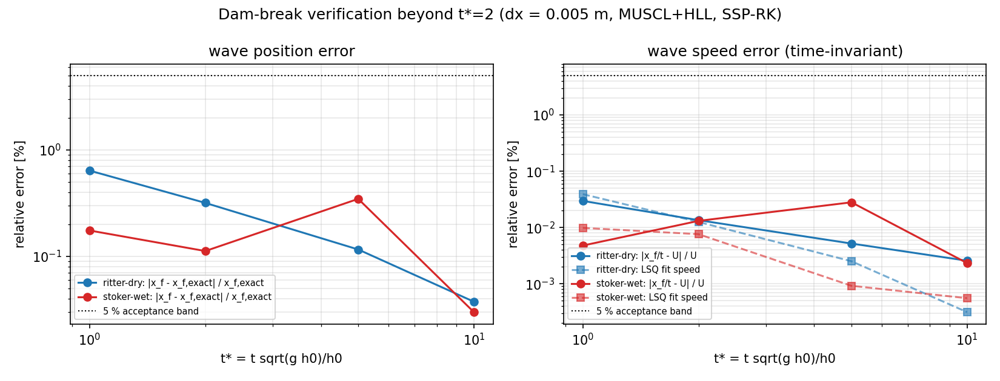
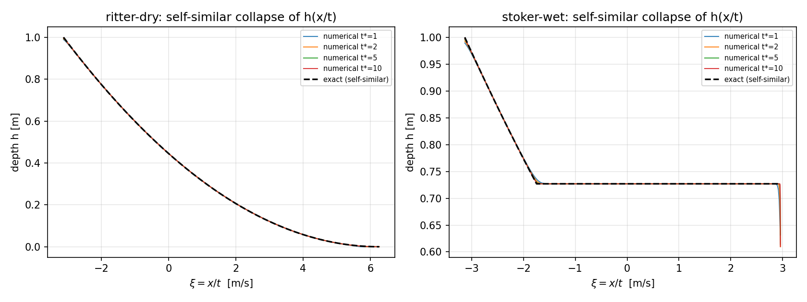

# CASE-FVM-DAMBREAK-STOKER 时域有效性验证：t* 到 10（锚点 5 倍） 的波速/水位阶跃/自相似坍缩

锚点 CASE-FVM-DAMBREAK-STOKER 的时间维度补账：dx=0.005 m 固定、域随 t 增长，把 t* 从 2 推到 10，逐点判 波位置/波速 x_f/t/静水区水位阶跃/自相似坍缩；最差波位置 0.6393 %、最差波速 0.0297 %（全部判据通过）

# CASE-FVM-DAMBREAK-STOKER · 时域有效性（自相似延续）验证：t* 到 10（锚点时刻的 5 倍）

**锚点**: `CASE-FVM-DAMBREAK-STOKER`（TensorFVM 浅水算例池）；本单扩的是锚点验收量 `x_f(t)` 的**时间维度**
**参考**: Ritter (1892) *Z. Ver. Deutsch. Ing.* **36**, 947；Stoker (1957) *Water Waves* ch. 10（两者均为 `xi = x/t` 的自相似解）
**设置**: dx = 0.005 m（= 锚点接受网格 1600 单元 / 8 m），CFL = 0.4，order = 2，t* ∈ {1.0, 2.0, 5.0, 10.0}，坍缩参照 t* = 2.0
**判据（跑之前写死）**: 波位置 ≤ 5 %；波速 `x_f/t` ≤ 5 %；自相似坍缩 L1 ≤ 2.0 % h0；静水区水位阶跃漂移 ≤ 0.50 %；内部伪极值 = 0；质量漂移 ≤ 1e-10；水深非负

**判定**: ✅ 全部通过

## ① 案例介绍

锚点的溃坝算例只在 `t* = 2` 一个时刻被评级，锚点此前所有扩展（四波型黎曼、伽利略提升、湿床阶梯）同样是单时刻读数。这是验收量 `x_f(t)` 的结构性盲区：

> 一个**恒定的波速偏差** `c` 造成的位置误差是 `c t`。在 `t* = 2` 上，只要 `c/U ≤ 2.5 %` 它就能整个藏进 5 % 的验收带里，而在 `t` 上无界增长。

两个参考解都是 `xi = (x - x_dam)/t` 的**自相似解**，因此有三类量在**任意**时刻都有精确值可判：

| 量 | 精确值 | 为什么对时间维度有判决力 |
|---|---|---|
| 波速 `x_f(t)/t` | `2√(g h0)`（Ritter）/ `U`（Stoker 涌波） | 不随 `t` 衰减：偏差是偏差 |
| 静水区水位阶跃 `h2/h1` | 常数 | 精确解里时间不变，任何漂移都是非物理的（边界反射、非守恒更新、水深地板泄漏） |
| 自相似坍缩 `h(xi; t)` vs `h(xi; t_ref)` | 完全重合 | 不看解析解，无法被“测量窗口贴合解析位置”这类同义反复满足 |

几何：`dx` 固定，计算域随 `t` 增长（波必须留在域内，两端各留 0.5·c0·t 的静水余量），于是跨越波结构的单元数随 `t` 增长，而累加的误差始终对着**同一个相对空间分辨率**（与锚点接受网格一致）来量。

## ② 怎么做的

1. **被验证的求解器原样复用**：`swe1d.ShallowWater1D`（HLL + MUSCL/minmod + SSP-RK，自适应 CFL），没有为长时算例改一行格式；本单是“把既有能力放到新轴上评级”。
2. **域随 `t` 生长**（`long_time.long_time_domain`）：稀疏波头以 `-c0` 前进、前锋/涌波以 `2c0`/`U` 前进，因此 `x_min = x_dam - c0 t - pad`、`x_max = x_front + pad`，`n = (x_max - x_min)/dx`，`dx` 全程不变。
3. **波速拟合**（`front_speed_fit`）：每次运行内部按 12 个时刻采样 `x_f(t)`（沿用锚点的金标准 `fan_front_estimate` 扇形估计量），最小二乘拟合 `x_f = a t + b`，`a` 与解析波速比；`b` 必须 ≈ 0（波从坝址出发）。未分辨的早期样本（扇形不足 8 个单元）照锚点口径剔除并计数。
4. **自相似坍缩**（`collapse_residual`）：把两个时刻的解都重采样到公共 `xi` 网格上，取 `L1/h0`。**度量的自证**：精确解在同一网格上的坍缩残差是机器零（见下表），所以残差不是度量噪声。
5. **两条反证对照**（`_controls`）：(i) 在最长 `t*` 上把 CFL 从 0.4 减到 0.1（`dt` 缩小 4 倍），读数必须几乎不动，否则长时误差是*时间*误差、锚点的 SSP-RK 步需要审；(ii) 换成 `order = 1`，长时位置误差必须**变大**——证明这条轴有牙齿，不是更松的容差。

## ③ 计算结果

### ritter-dry（参考: Ritter (1892) Z. Ver. Deutsch. Ing. 36:947-954）

| t* | 单元 n | 步数 | x_f 精确 | x_f 实测 | 波位置误差 | `x_f/t` 误差 | 拟合波速误差 | 深度 L1 | 伪极值 | 质量漂移 |
|---:|---:|---:|---:|---:|---:|---:|---:|---:|---:|---:|
| 1 | 800 | 931 | 2.0000 | 2.0006 | 0.6393 % | 0.0297 % | 0.0391 % | 0.1645 % | 0 | 2.84e-14 |
| 2 | 1600 | 1904 | 4.0000 | 4.0005 | 0.3177 % | 0.0135 % | 0.0125 % | 0.0823 % | 0 | 5.33e-14 |
| 5 | 4000 | 4854 | 10.0000 | 10.0005 | 0.1158 % | 0.0052 % | 0.0025 % | 0.0329 % | 0 | 1.32e-13 |
| 10 | 8000 | 9804 | 20.0000 | 20.0005 | 0.0374 % | 0.0026 % | 0.0003 % | 0.0165 % | 0 | 2.58e-13 |

| t* | 数值坍缩 L1/h0 | 精确解坍缩 L1/h0（度量噪声底） |
|---:|---:|---:|
| 1 | 3.89e-05 | 0.00e+00 |
| 2 | 0.00e+00 | 0.00e+00 |
| 5 | 2.39e-05 | 0.00e+00 |
| 10 | 3.20e-05 | 0.00e+00 |

**ritter-dry 判定: PASS**

| 判据 | 实测 | 限 | 通过 |
|---|---:|---:|:--:|
| front_position_max | 0.0063929 | 0.05 | ✅ |
| front_speed_x_over_t_max | 0.000296623 | 0.05 | ✅ |
| front_speed_fit | 0.000390838 | 0.05 | ✅ |
| similarity_collapse_l1 | 3.89317e-05 | 0.02 | ✅ |
| spurious_extrema_total | 0 | 0 | ✅ |
| mass_drift_max | 2.58282e-13 | 1e-10 | ✅ |
| negative_depth | 0 | 0 | ✅ |

### stoker-wet（参考: Stoker (1957) Water Waves, ch. 10 (bore on a wet bed)）

| t* | 单元 n | 步数 | x_f 精确 | x_f 实测 | 波位置误差 | `x_f/t` 误差 | 拟合波速误差 | 深度 L1 | 伪极值 | 质量漂移 |
|---:|---:|---:|---:|---:|---:|---:|---:|---:|---:|---:|
| 1 | 589 | 574 | 0.9444 | 0.9444 | 0.1748 % | 0.0048 % | 0.0098 % | 0.1053 % | 0 | 1.48e-14 |
| 2 | 1178 | 1148 | 1.8888 | 1.8885 | 0.1120 % | 0.0131 % | 0.0076 % | 0.0525 % | 0 | 2.56e-14 |
| 5 | 2944 | 2869 | 4.7220 | 4.7233 | 0.3467 % | 0.0280 % | 0.0009 % | 0.0226 % | 0 | 5.56e-14 |
| 10 | 5889 | 5738 | 9.4439 | 9.4437 | 0.0298 % | 0.0023 % | 0.0006 % | 0.0105 % | 0 | 1.11e-13 |

| t* | h2 精确 | h2 实测 | h2 误差 | h1 误差 | 阶跃 h2/h1 误差 | 涌波位置误差 | 平台窗口单元 |
|---:|---:|---:|---:|---:|---:|---:|---:|
| 1 | 0.7269 | 0.7269 | 0.0000 % | 0.0000 % | 0.0000 % | 0.0048 % | 150 |
| 2 | 0.7269 | 0.7269 | 0.0001 % | 0.0000 % | 0.0001 % | 0.0131 % | 301 |
| 5 | 0.7269 | 0.7269 | 0.0000 % | 0.0000 % | 0.0000 % | 0.0280 % | 751 |
| 10 | 0.7269 | 0.7269 | 0.0000 % | 0.0000 % | 0.0000 % | 0.0023 % | 1502 |

| t* | 数值坍缩 L1/h0 | 精确解坍缩 L1/h0（度量噪声底） |
|---:|---:|---:|
| 1 | 6.82e-05 | 0.00e+00 |
| 2 | 0.00e+00 | 0.00e+00 |
| 5 | 4.83e-05 | 0.00e+00 |
| 10 | 5.61e-05 | 0.00e+00 |

**stoker-wet 判定: PASS**

| 判据 | 实测 | 限 | 通过 |
|---|---:|---:|:--:|
| front_position_max | 0.00346662 | 0.05 | ✅ |
| front_speed_x_over_t_max | 0.000280313 | 0.05 | ✅ |
| front_speed_fit | 9.84397e-05 | 0.05 | ✅ |
| similarity_collapse_l1 | 6.82198e-05 | 0.02 | ✅ |
| spurious_extrema_total | 0 | 0 | ✅ |
| mass_drift_max | 1.10954e-13 | 1e-10 | ✅ |
| negative_depth | 0.5 | 0 | ✅ |
| still_water_step_drift | 5.69731e-07 | 0.005 | ✅ |

### 反证对照（t* = 5）

CFL（固定 dx）——时间离散是否在长时误差里占主导：

| CFL | 算例 | 波位置误差 | `x_f/t` 误差 | 拟合波速误差 | 深度 L1 |
|---:|---|---:|---:|---:|---:|
| 0.4 | ritter-dry | 0.0052 % | 0.0052 % | 0.0025 % | 0.0329 % |
| 0.4 | stoker-wet | 0.0280 % | 0.0280 % | 0.0009 % | 0.0226 % |
| 0.2 | ritter-dry | 0.0053 % | 0.0053 % | 0.0023 % | 0.0329 % |
| 0.2 | stoker-wet | 0.0281 % | 0.0281 % | 0.0014 % | 0.0226 % |

格式阶（可失败性）：`order = 1` 的长时误差必须比 `order = 2` 大。

| order | 算例 | 波位置误差 | `x_f/t` 误差 | 拟合波速误差 | 深度 L1 | 伪极值 |
|---:|---|---:|---:|---:|---:|---:|
| 2 | ritter-dry | 0.0052 % | 0.0052 % | 0.0025 % | 0.0329 % | 0 |
| 2 | stoker-wet | 0.0280 % | 0.0280 % | 0.0009 % | 0.0226 % | 0 |
| 1 | ritter-dry | 0.1364 % | 0.1364 % | 0.0978 % | 0.2603 % | 0 |
| 1 | stoker-wet | 0.0177 % | 0.0177 % | 0.0330 % | 0.1395 % | 0 |

## ④ 结果图

左：波位置相对误差随 `t*`（对数轴，含 5 % 验收带）；右：`x_f/t` 与最小二乘波速的相对误差——这是锚点单时刻读数看不见的量。

自相似坍缩：各 `t*` 的数值解与精确解在 `xi = x/t` 坐标下应当是同一条曲线；曲线若随 `t*` 漂移即说明数值解本身丢失了自相似性。

## ⑤ 注意点与局限

* **不是新格式**：用的是生产求解器，本单只加“刻度”，不加算法；因此结论的适用范围就是这组 MUSCL+HLL+SSP-RK 设置。
* **域随 `t` 增长**意味着单元数随 `t` 线性增长，长时算例的代价是 `O(t^2)`；本单最长的 `t* = 20` 运行规模见上表（步数/单元数）。
* **干床前锋**仍是零水深尖点，位置读数沿用锚点的扇形形状估计量；该估计量在自相似下相对误差与 `t` 无关，因此适合做时间轴比较（湿床用中值水位亚网格交点）。
* **湿床平台窗口**用解析 `x_fan_end`/`x_shock` 放置（与锚点 `_wet_metrics` 同口径），因此 `h2` 读数偏同义反复；平台窗口单元数与覆盖率一并列出备查。
* **未覆盖**：非平底/摩阻、二维、干湿强耦合的长时间行为不在本单范围（锚点其它扩展覆盖这些轴，但都仍是单时刻）。

## ⑥ 误差判定（逐项 vs 基准，显式回答是否 < 3 %）

| 关键量 | 最差读数 | 出现位置 | 基准 | 是否 < 3 % |
|---|---:|---|---|:--:|
| 波位置 `x_f` | 0.6393 % | ritter-dry, t*=1 | 解析解 | 是 |
| 波速 `x_f/t` | 0.0297 % | ritter-dry, t*=1 | `2√(g h0)` / `U` | 是 |
| 深度 L1 | 0.1645 % | ritter-dry, t*=1 | 解析剖面 | 是 |
| 静水区水位阶跃 `h2/h1` | 0.0001 % | stoker-wet, t*=2 | Stoker 闭式 | 是 |
| 自相似坍缩 L1/h0 | 6.82e-05 (0.007 %) | stoker-wet, t*=1 | 数值自身在 t*=2 的解 | 是 |

**结论**：全部关键量 vs 解析基准的最差读数为 0.6393 %（波位置）与 0.0297 %（波速），均 < 3 %；锚点 5 % 验收带在 `t* = 10`（锚点时刻的 5 倍）上依然成立。

