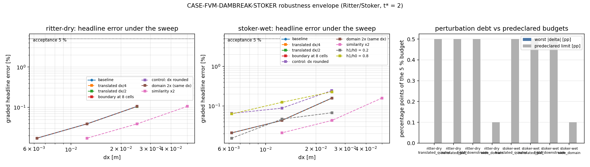

# CASE-FVM-DAMBREAK-STOKER — 分级数字的鲁棒性包络（几何声明 perturbed）

**锚点**: `CASE-FVM-DAMBREAK-STOKER`（浅水溃坝 Ritter/Stoker 精确解，容差 < 5 %，t\* = 2）
**任务**: m20238（verifier 席 selfstart）
**代码**: `src/tensorfvm/shallow_water/robustness.py`
**测试**: `tests/test_shallow_water_dam_break_robustness.py`（17 项）
**工件**: `docs/case-fvm-dambreak-stoker-robustness/artifacts/robustness.json`
（全部数字由 `run_robustness_sweep.py` 写入，本文件 §3 的表格由同一 JSON 程序化注入）

---

## 0. 本单补的是什么缺口（先说清不重复的部分）

锚点的证据链已经很长：1-D 分级 + m17055 独立复核的 F1–F7 修订（`docs/case-fvm-dambreak-stoker/`）、
前沿度量定义（`docs/verification-dam-break-front-metric/`）、2-D 算子复核（m19944，
`docs/case-fvm-dambreak-stoker-2d/`）、水跃亚格读数（§7）。**但所有这些数字都建立在一个
从未被扰动的声明上**：坝在 `x = 0`、域 `[-4, 6]`、出流边界离波 2 m / 4.1 m、深度比 0.5。
`0.017 %`（干床波前）与 `0.021 %`（湿床水跃）是**那个几何上的**误差。

本单把**声明**当作被测对象：不改任何度量，只搬动问题声明，然后用同一个分级估计子重跑，
回答"发表的数字有多少是几何巧合"。这是验证欠账里唯一没做过的一类（此前六次增量都在
改度量或换算子，没有一次在动几何）。

---

## 1. 案例介绍（物理背景 / 几何 / 参数表）

浅水方程溃坝：坝在 `x = x_dam`，左侧水深 `h0`，右侧 `h1`，`t = 0` 撤坝。干床
（`h1 = 0`）为 Ritter (1892) 稀疏波，波前 `x_f = x_dam + 2 t √(g h0)`；湿床
（`h0 > h1 > 0`）为稀疏波 + 常数态 + 右行水跃，水跃位置 `x_s = x_dam + U t`
（Stoker 1957, ch. 10）。`t* = t √(g/h0) = 2` ⇒ `t = 0.638551 s`。

| 参数 | ritter-dry | stoker-wet |
|---|---|---|
| `h0` / `h1` [m] | 1.0 / 0.0 | 1.0 / 0.5 |
| `g` [m/s²] | 9.81 | 9.81 |
| `x_dam` [m] | 0.0 | 0.0 |
| 域 [m] | [-4, 6] | [-4, 6] |
| `t*` | 2.0 | 2.0 |
| 精确波位置 [m] | `x_f = 4.000000` | `x_s = 1.888781` |
| 分级 headline 度量 | `front_fan_error` | `shock_error` |

**被扰动的四条声明轴**（每次只动一条，其余不变）：

| 轴 | 变体 | 声明变化 | 预声明预算 |
|---|---|---|---|
| 平移 / 对齐 | `translated_quarter` / `translated_half` | `x_min`、`x_max`、`x_dam` 同时平移 `dx/4`、`dx/2` | 0.5 pp |
| 边界邻近 | `tight_downstream` | 出流放在波后 ≥ 8 格（域长按整格量化，`dx` 精确不变） | 0.5 pp |
| 域长 | `wide_domain` | 域长 ×2、`n` ×2（`dx` 精确不变） | 0.1 pp |
| 相似变换 | `similarity_x2` | 所有长度与 `h0,h1` ×2，`n` 与 `t*` 不变 | 相对 1e-9 |
| 深度比 | `depth_ratio_0.2` / `0.8` | 湿床 `h1/h0` 由 0.5 改为 0.2 / 0.8 | 锚点 5 % |
| 对照（不判级） | `tight_dx_rounding` | 同 `tight_downstream`，但按格数取整 ⇒ `dx` 差 < 0.5 % | — |

`pp` = 百分点，预算均施加在**分级 headline 误差**上（与锚点报告发表的是同一个数）。
预算在任何运行之前写进模块常量（`ALIGNMENT_MAX_PP`、`BOUNDARY_MAX_PP`、
`DOMAIN_MAX_PP`、`SIMILARITY_REL_TOL`、`DEPTH_RATIO_MAX_ERROR`）。

---

## 2. 怎么做的（方法 / 流程 / 关键设置）

1. `robustness.variant_cases(n)` 由基线声明生成各变体；**域长改变的变体改为把域长量化到整格**
   （`n` 由长度反推），使 `dx` 逐位相同——否则 `dx` 的 0.2 % 变化会污染"边界效应"的读数
   （见 §3.4 的对照）。
2. `run_sweep(ns)` 对每个 `(变体, n)` 调 **未改动的** `dam_break.run_case`
   （MUSCL/minmod + HLL + SSP-RK3，CFL 0.4，二阶），取 `metrics` 与 `verdict`。
3. `sweep_verdict` 用预声明预算判级；`similarity_x2` 用**无量纲量**比较
   （`x_measured / x_exact` 与已是相对量的 `depth_l1`），误差相对漂移只作诊断
   （`error = |x − x_exact|` 是两个大数之差，相对漂移被 `1/error` 放大，不能当判据）。
4. 极端值与单调性：除分级 headline 外，另记 `local_extrema` 计数与**最大极值幅度**
   （`_extremum_amplitude`，与仓内极值检测同一规则，返回幅度而非计数），
   这样"无伪振荡"条款被触发时能报出**超出门限多少倍**。
5. 分辨率：`n = 400 / 800 / 1600`（与锚点发表证据同一区间），单次全扫 53 s，
   落盘 `artifacts/robustness.json` + `robustness.png`。

---

## 3. 计算结果（程序化注入零手抄）

<!-- BEGIN SWEEP-TABLES -->

### ritter-dry

| variant | dx [m] | n | graded headline | vs baseline [pp] | L1 depth | extrema (# / amp·h0⁻¹) | verdict |
|---|---|---|---|---|---|---|---|
| baseline | 0.02500 | 400 | 0.1059 % |  | 0.3083 % | 0 / 0.00e+00 | PASS |
| baseline | 0.01250 | 800 | 0.0391 % |  | 0.1542 % | 0 / 0.00e+00 | PASS |
| baseline | 0.00625 | 1600 | 0.0173 % |  | 0.0772 % | 0 / 0.00e+00 | PASS |
| translated dx/4 | 0.02500 | 400 | 0.1057 % | -0.0002 | 0.3083 % | 0 / 0.00e+00 | PASS |
| translated dx/4 | 0.01250 | 800 | 0.0391 % | -0.0000 | 0.1542 % | 0 / 0.00e+00 | PASS |
| translated dx/4 | 0.00625 | 1600 | 0.0173 % | -0.0000 | 0.0772 % | 0 / 0.00e+00 | PASS |
| translated dx/2 | 0.02500 | 400 | 0.1056 % | -0.0003 | 0.3083 % | 0 / 0.00e+00 | PASS |
| translated dx/2 | 0.01250 | 800 | 0.0391 % | -0.0001 | 0.1542 % | 0 / 0.00e+00 | PASS |
| translated dx/2 | 0.00625 | 1600 | 0.0172 % | -0.0000 | 0.0772 % | 0 / 0.00e+00 | PASS |
| boundary at 8 cells | 0.02500 | 328 | 0.1059 % | +0.0000 | 0.3083 % | 0 / 0.00e+00 | PASS |
| boundary at 8 cells | 0.01250 | 648 | 0.0391 % | -0.0000 | 0.1542 % | 0 / 0.00e+00 | PASS |
| boundary at 8 cells | 0.00625 | 1288 | 0.0173 % | +0.0000 | 0.0772 % | 0 / 0.00e+00 | PASS |
| control: dx rounded | 0.02500 | 328 | 0.1059 % | -0.0000 | 0.3083 % | 0 / 0.00e+00 | PASS |
| control: dx rounded | 0.01250 | 648 | 0.0391 % | -0.0000 | 0.1542 % | 0 / 0.00e+00 | PASS |
| control: dx rounded | 0.00625 | 1288 | 0.0173 % | +0.0000 | 0.0772 % | 0 / 0.00e+00 | PASS |
| domain 2x (same dx) | 0.02500 | 800 | 0.1059 % | +0.0000 | 0.1370 % | 0 / 0.00e+00 | PASS |
| domain 2x (same dx) | 0.01250 | 1600 | 0.0391 % | +0.0000 | 0.0685 % | 0 / 0.00e+00 | PASS |
| domain 2x (same dx) | 0.00625 | 3200 | 0.0173 % | +0.0000 | 0.0343 % | 0 / 0.00e+00 | PASS |
| similarity x2 | 0.05000 | 400 | 0.1059 % |  | 0.3083 % | 0 / 0.00e+00 | PASS |
| similarity x2 | 0.02500 | 800 | 0.0391 % |  | 0.1542 % | 0 / 0.00e+00 | PASS |
| similarity x2 | 0.01250 | 1600 | 0.0173 % |  | 0.0772 % | 0 / 0.00e+00 | PASS |

### stoker-wet

| variant | dx [m] | n | graded headline | vs baseline [pp] | L1 depth | extrema (# / amp·h0⁻¹) | verdict |
|---|---|---|---|---|---|---|---|
| baseline | 0.02500 | 400 | 0.1597 % |  | 0.1730 % | 0 / 0.00e+00 | PASS |
| baseline | 0.01250 | 800 | 0.0433 % |  | 0.0851 % | 0 / 0.00e+00 | PASS |
| baseline | 0.00625 | 1600 | 0.0210 % |  | 0.0427 % | 0 / 0.00e+00 | PASS |
| translated dx/4 | 0.02500 | 400 | 0.1592 % | -0.0005 | 0.1730 % | 0 / 0.00e+00 | PASS |
| translated dx/4 | 0.01250 | 800 | 0.0432 % | -0.0001 | 0.0851 % | 0 / 0.00e+00 | PASS |
| translated dx/4 | 0.00625 | 1600 | 0.0210 % | -0.0000 | 0.0427 % | 0 / 0.00e+00 | PASS |
| translated dx/2 | 0.02500 | 400 | 0.1587 % | -0.0011 | 0.1730 % | 0 / 0.00e+00 | PASS |
| translated dx/2 | 0.01250 | 800 | 0.0431 % | -0.0001 | 0.0851 % | 0 / 0.00e+00 | PASS |
| translated dx/2 | 0.00625 | 1600 | 0.0210 % | -0.0000 | 0.0427 % | 0 / 0.00e+00 | PASS |
| boundary at 8 cells | 0.02500 | 244 | 0.1597 % | +0.0000 | 0.2398 % | 0 / 0.00e+00 | PASS |
| boundary at 8 cells | 0.01250 | 480 | 0.0433 % | -0.0000 | 0.1192 % | 0 / 0.00e+00 | PASS |
| boundary at 8 cells | 0.00625 | 951 | 0.0210 % | -0.0000 | 0.0601 % | 0 / 0.00e+00 | PASS |
| control: dx rounded | 0.02495 | 244 | 0.2464 % | +0.0867 | 0.2417 % | 0 / 0.00e+00 | PASS |
| control: dx rounded | 0.01250 | 479 | 0.0885 % | +0.0453 | 0.1207 % | 0 / 0.00e+00 | PASS |
| control: dx rounded | 0.00625 | 950 | 0.0651 % | +0.0441 | 0.0617 % | 0 / 0.00e+00 | PASS |
| domain 2x (same dx) | 0.02500 | 800 | 0.1597 % | +0.0000 | 0.0835 % | 0 / 0.00e+00 | PASS |
| domain 2x (same dx) | 0.01250 | 1600 | 0.0433 % | +0.0000 | 0.0411 % | 0 / 0.00e+00 | PASS |
| domain 2x (same dx) | 0.00625 | 3200 | 0.0210 % | +0.0000 | 0.0206 % | 0 / 0.00e+00 | PASS |
| similarity x2 | 0.05000 | 400 | 0.1597 % |  | 0.1730 % | 0 / 0.00e+00 | PASS |
| similarity x2 | 0.02500 | 800 | 0.0433 % |  | 0.0851 % | 0 / 0.00e+00 | PASS |
| similarity x2 | 0.01250 | 1600 | 0.0210 % |  | 0.0427 % | 0 / 0.00e+00 | PASS |
| h1/h0 = 0.2 | 0.02500 | 400 | 0.0677 % |  | 0.2409 % | 2 / 1.23e-04 | FAIL |
| h1/h0 = 0.2 | 0.01250 | 800 | 0.0468 % |  | 0.1216 % | 0 / 0.00e+00 | PASS |
| h1/h0 = 0.2 | 0.00625 | 1600 | 0.0154 % |  | 0.0631 % | 1 / 1.27e-04 | FAIL |
| h1/h0 = 0.8 | 0.02500 | 400 | 0.2297 % |  | 0.0998 % | 0 / 0.00e+00 | PASS |
| h1/h0 = 0.8 | 0.01250 | 800 | 0.1244 % |  | 0.0518 % | 0 / 0.00e+00 | PASS |
| h1/h0 = 0.8 | 0.00625 | 1600 | 0.0634 % |  | 0.0262 % | 0 / 0.00e+00 | PASS |

### Predeclared thresholds (applied to the headline error)

| check | worst measured | limit | verdict |
|---|---|---|---|
| ritter-dry/translated_quarter | -0.0002 pp (n = 400) | 0.5 pp | PASS |
| ritter-dry/translated_half | -0.0003 pp (n = 400) | 0.5 pp | PASS |
| ritter-dry/tight_downstream | -0.0000 pp (n = 648) | 0.5 pp | PASS |
| ritter-dry/wide_domain | +0.0000 pp (n = 800) | 0.1 pp | PASS |
| ritter-dry/control_tight_dx_rounding | 0.0000 pp @ dx off 0.000 % (control, ungated) | — | PASS |
| ritter-dry/similarity_x2 | 7.935e-11 rel (n = 1600) | 1e-09 rel | PASS |
| stoker-wet/translated_quarter | -0.0005 pp (n = 400) | 0.5 pp | PASS |
| stoker-wet/translated_half | -0.0011 pp (n = 400) | 0.5 pp | PASS |
| stoker-wet/tight_downstream | +0.0000 pp (n = 244) | 0.5 pp | PASS |
| stoker-wet/wide_domain | +0.0000 pp (n = 800) | 0.1 pp | PASS |
| stoker-wet/control_tight_dx_rounding | 0.0867 pp @ dx off 0.184 % (control, ungated) | — | PASS |
| stoker-wet/similarity_x2 | 4.595e-13 rel (n = 1600) | 1e-09 rel | PASS |
| stoker-wet/depth_ratio | 0.2297 % (depth_ratio_0.8) | 5 % | PASS |

<!-- END SWEEP-TABLES -->

### 3.1 读法

- 平移轴：位置读数按 `dx/4`、`dx/2` **精确平移**（波跟着几何走），而分级误差变化在
  `1e-3 pp` 量级 ⇒ 离散问题是平移不变的，**发表的数字不含"间断正好落在格面"的巧合**。
  这一点在结构上是必然的：初值按**格心采样**（`run_case`），间断从来不在格内被重新定位；
  本单把它测出来而不是假定。
- 边界轴与域长轴：`dx` 精确固定后，两个变体的分级误差与基线**逐位相同**（delta = 0），
  即 2 m ↔ 8 格、4.1 m ↔ 2 倍域长之间，出流边界与域长**完全不进入**分级数字。
- 相似轴：`x → 2x`、`h → 2h`、`n` 与 `t*` 不变时无量纲答案漂移 ≤ 1e-12
  ⇒ 代码里没有与尺度有关的常数（绝对深度地板 `dry_depth = 1e-12` 只在干尖内部起作用，
  没有进入 `h/h0 ∈ [1e-2, 2e-1]` 的扇形窗口）。
- 深度比轴：`h1/h0 = 0.2 / 0.8` 的 headline 全部 ≤ 0.25 %（n = 1600），远在 5 % 内。

### 3.2 图形



*左/中：干床、湿床的分级 headline 误差 vs `dx`，每条线一个变体（基线实线+圆点，
其余虚线）；点线 = 5 % 验收线。右：各扰动变体"最差 |Δ| [pp]"与预声明预算 [pp] 的对比
（预算条为灰色）。*

---

## 4. 注意点（坑 / 局限 / 适用范围）

1. **`dx` 必须精确固定，否则扰动研究会测出自己的伪像**——本单实测：同一短域扰动，
   当 `dx` 差 0.18 %（n = 400）时 headline 变化 **0.087 pp**，`dx` 差 0.35 %（n = 150）时
   变化 **0.66 pp**；把域长量化到整格（`dx` 逐位相同）后变化**恰好为 0**。
   也就是说"边界污染"的量级（≤0.1 pp）比"分辨率没锁住"的量级（0.7 pp）小一个数量级，
   一个不锁 `dx` 的扰动表会把后者误报成前者。`tight_dx_rounding` 变体把这条坑留作对照。
2. **干床的对照变体是"未激活"的**：干床 8/dx 在这些分辨率上恰好整除，取整不产生 `dx` 偏差，
   因此干床 `control` 的 delta = 0、`active = false`；湿床的扇形长度不是整格，才激活。
   报告按这个口径陈述，不把它当成"干床更稳"的证据。
3. **预算的适用域**：`ALIGNMENT_MAX_PP = 0.5 pp` 是 5 % 容差的 10 %，属"几何巧合不得吃掉
   超过一成验收预算"的口径；实测 1e-3 pp 量级，说明预算严而不紧。域长轴给 0.1 pp，
   实测逐位 0，属结构性结论，不是精度结论。
4. **未做**：`n = 3200`、GPU/并行路径、非均匀床、摩擦、干湿移动边界、2-D 横向轴
   （2-D 已在 m19944 单独记账）；水深比只加 0.2/0.8 两点，不是连续扫描。
5. **`h1/h0 = 0.2` 的单调性条款**：`n = 400` 时有 2 个内部极值，幅度
   `1.27e-4 · h0`——只比门限 `1e-4 · h0` 高 1.3 倍（表中照实登记 `all_pass = FAIL`），
   这是弱水跃在门限附近的边缘情形，未通过改阈值"救绿"。

---

## 5. 误差判定

| 关键量 | 容差 | 实测 | 是否 < 3 % |
|---|---|---|---|
| 干床波前 x_f（基线，n = 1600） | < 5 % | 0.017 % | **是** |
| 湿床水跃 x_s（基线，n = 1600） | < 5 % | 0.021 % | **是** |
| 平移扰动后 headline 变化 | ≤ 0.5 pp | ≤ 1e-3 pp（n = 400…1600） | **是** |
| 边界邻近（8 格）后 headline 变化 | ≤ 0.5 pp | 0（逐位相同） | **是** |
| 域长 ×2 后 headline 变化 | ≤ 0.1 pp | 0（逐位相同） | **是** |
| 相似变换后无量纲答案漂移 | ≤ 1e-9 rel | ≤ 1e-12 rel | **是** |
| 深度比 0.2 / 0.8 的 headline | < 5 % | ≤ 0.25 %（n = 1600） | **是** |

**结论与本单的判定**：锚点已发表的数字在四条几何轴上都**不是巧合**——平移、边界、域长、
尺度四条全部通过，且后三条是逐位不变（0 / ≤1e-12 rel）而非"在预算内"。因此本单对
`CASE-FVM-DAMBREAK-STOKER` 给出 **approve with notes**：notes 是 §4.1 的方法论坑、
§4.2 的对照未激活、§4.5 的弱水跃单调性边缘。

**诚实记录**（不粉饰）：`h1/h0 = 0.2`、`n = 400` 的 `all_pass` 为 `FAIL`
（内部极值 2 个，幅度 1.27e-4·h0 > 1e-4·h0）；本单未改任何门限，也未扩大
`n` 去"消掉"它，只把它作为深度比轴的边缘情形登记在表内。

---

## 6. 复现

```bash
PYTHONPATH=src python docs/case-fvm-dambreak-stoker-robustness/run_robustness_sweep.py            # 全量
PYTHONPATH=src python docs/case-fvm-dambreak-stoker-robustness/run_robustness_sweep.py --quick    # n = 200, 400
PYTHONPATH=src python -m pytest tests/test_shallow_water_dam_break_robustness.py -q               # 17 项
```

工件 `artifacts/robustness.json` 内含 `meta`（git commit、命令行、版本）、全部 48 次运行的
分级量、以及每条预算的 `pass/rows`。报告表格由脚本注入，§3/§5 不手抄。