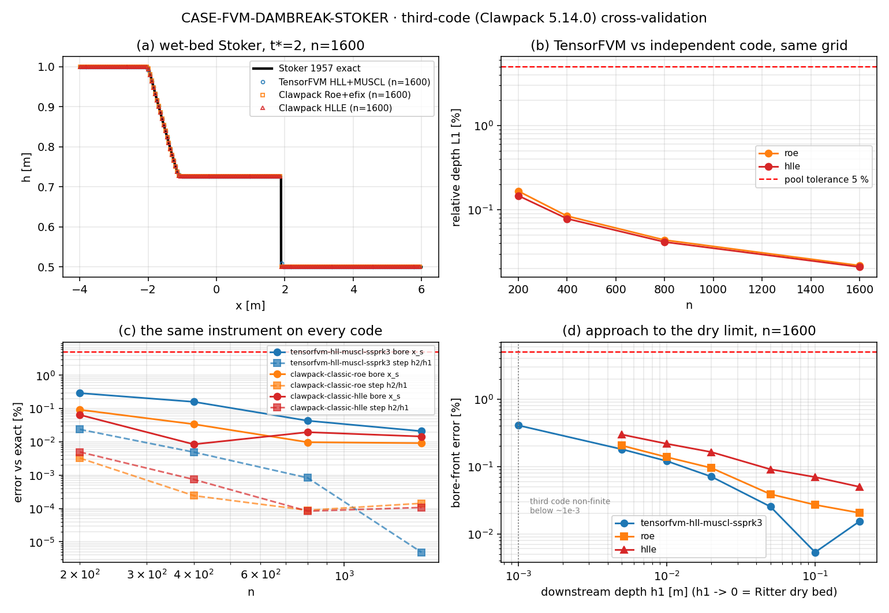

# CASE-FVM-DAMBREAK-STOKER · 第三方代码交叉验证（Clawpack 5.14.0 独立证人）

**锚点**: `CASE-FVM-DAMBREAK-STOKER`（TensorFVM 浅水算例池，总账 `status = open` 开工核对）· 本单 **mission m23268** · 分支 `agent/m23268`
**参考**: Ritter (1892) *Z. Ver. Deutsch. Ing.* **36**, 947-954；Stoker (1957) *Water Waves* ch. 10；Toro (2009) ch. 6-7
**容差**: 5 %（锚点同口径）· 判据网格下限 n = 800（锚点 `ACCEPTED_MIN_N`）· `t* = 2` · CFL 0.4
**第三方代码**: clawpack 5.14.0 (Classic wave propagation, MC limiter)（Fortran 波传播内核，独立作者/限幅器/波分解）
**性质**: 补 `VERIFICATION_DEBT_LEDGER` D29 建议的 `XVAL-FVM-DAMBREAK-THIRD-CODE` —— 锚点此前的全部证人（解析解复核、oracle-free 读数、动量恒等式、配置包络、冻结网）**都在 TensorFVM 内部**，共有网格/边界/提交纪律；本单引入**真正的异族代码**作为独立证人。

---

## ① 案例介绍

浅水方程 `h_t + (hu)_x = 0`、`(hu)_t + (hu² + gh²/2)_x = 0` 的经典溃坝初值问题：
`x = 0` 处间断，`g = 9.81 m/s²`，计算域 `[-4, 6] m`，`t* = t√(g h0)/h0 = 2`。

| 算例 | 类型 | h0 [m] | h1 [m] | t_end [s] | 解析参照 |
|---|---|---:|---:|---:|---|
| `ritter-dry` | dry | 1.000 | 0.000 | 0.638551 | Ritter (1892) Z. Ver. Deutsch. Ing. 36:947-954 |
| `stoker-wet` | wet | 1.000 | 0.500 | 0.638551 | Stoker (1957) Water Waves, ch. 10 (bore on a wet bed) |

解析量（Stoker 匹配条件，见 `shallow_water.exact`）：星区水位 `h* = 0.726920 m`、星区流速 `u* = 0.923364 m/s`、水跃速度 `U = 2.957918 m/s`、水位阶跃 `h*/h1 = 1.453841`；干床波前 `x_f = 2 c0 t = 4.000000 m`。

## ② 怎么做的

1. **同一问题、同一网格、同一端面**：两码都用零梯度（transmissive）端面、CFL 0.4、`t* = 2`、同样的单元中心初值 `h(x<0) = h0, h(x>=0) = h1`；比较**逐格**进行，**不插值**（插值会把整格平移吸收掉，正是最该被抓住的缺陷）。
2. **异族通量**：Clawpack Classic 波传播法，MC 限幅，两个独立 Riemann 解算器（Roe + entropy fix、HLLE），与 TensorFVM 的 HLL + MUSCL(minmod) + SSP-RK3 属不同格式族。
3. **同一量具**：锚点的三条头条读数——干床波前 `fan_front_estimate`、湿床台地/静水位/水跃`plateau_from_depth_modes`、单调性 `local_extrema_details`——**原样**作用到第三方剖面上，回答的不是「TensorFVM 对不对」，而是「这条验收门在异族代码上是否给出同样的判决」。
4. **量具自身标定**（adversarial 纪律）：对距离度量注入已知缺陷——平移 1…128 格、台地幅值 +1/+2/+5 %、1e-9 舍入噪声——证明读数随缺陷单调移动且不误报；并把**每条**读数在同一扰动下的灵敏度并列，回答「哪条读数更锐」。
5. **干床的诚实边界**：Clawpack Classic 不保正性，锚点的精确干床初值它**跑不起来**；因此另做 `h1 = 0.2 … 1e-3` 的**干极限阶梯**（两码都能跑的范围）与**可湿性下限扫描**，把「第三方证人只覆盖湿床」这一局限量化到具体深度，而不是换成软化初值冒充同一测试。

## ③ 计算结果

### 3.1 湿床（Stoker）逐格读数——同一量具、三个代码

| n | 代码 | 水跃位置误差 | 水位阶跃误差 | 深度 L1 vs 解析 | 内部极值数 |
|---:|---|---:|---:|---:|---:|
| 200 | Clawpack HLLE | 0.0647 % | 0.0050 % | 0.2191 % | 0 |
| 200 | Clawpack Roe+efix | 0.0924 % | 0.0033 % | 0.1841 % | 0 |
| 200 | TensorFVM HLL+MUSCL+SSPRK3 | 0.2913 % | 0.0237 % | 0.3417 % | 1 |
| 400 | Clawpack HLLE | 0.0085 % | 0.0007 % | 0.1173 % | 0 |
| 400 | Clawpack Roe+efix | 0.0341 % | 0.0002 % | 0.0987 % | 0 |
| 400 | TensorFVM HLL+MUSCL+SSPRK3 | 0.1600 % | 0.0049 % | 0.1730 % | 0 |
| 800 | Clawpack HLLE | 0.0196 % | 0.0001 % | 0.0542 % | 0 |
| 800 | Clawpack Roe+efix | 0.0098 % | 0.0001 % | 0.0451 % | 0 |
| 800 | TensorFVM HLL+MUSCL+SSPRK3 | 0.0433 % | 0.0008 % | 0.0851 % | 0 |
| 1600 | Clawpack HLLE | 0.0146 % | 0.0001 % | 0.0276 % | 0 |
| 1600 | Clawpack Roe+efix | 0.0092 % | 0.0001 % | 0.0230 % | 0 |
| 1600 | TensorFVM HLL+MUSCL+SSPRK3 | 0.0210 % | 0.0000 % | 0.0427 % | 0 |

### 3.2 跨码距离（同网格、不插值）

| n | 对比 | 深度 L1 | 动量 hu L1 | 一格里 L1（本网格灵敏度） | 折算平移 = 距离/一格 |
|---:|---|---:|---:|---:|---:|
| 200 | vs Clawpack HLLE | 0.1473 % | 1.2000 % | 0.7150 % | 0.206 格 |
| 200 | vs Clawpack Roe+efix | 0.1669 % | 1.3366 % | 0.7150 % | 0.233 格 |
| 400 | vs Clawpack HLLE | 0.0785 % | 0.6325 % | 0.3574 % | 0.220 格 |
| 400 | vs Clawpack Roe+efix | 0.0844 % | 0.6715 % | 0.3574 % | 0.236 格 |
| 800 | vs Clawpack HLLE | 0.0415 % | 0.3376 % | 0.1787 % | 0.232 格 |
| 800 | vs Clawpack Roe+efix | 0.0438 % | 0.3529 % | 0.1787 % | 0.245 格 |
| 1600 | vs Clawpack HLLE | 0.0209 % | 0.1699 % | 0.0893 % | 0.234 格 |
| 1600 | vs Clawpack Roe+efix | 0.0218 % | 0.1752 % | 0.0893 % | 0.244 格 |

距离随加密单调下降；在验收网格带上，最高读数折算为 **0.245 格**（0.00306 m，格宽 0.01250 m），即两码的波形差别**小于半格**。

### 3.3 干床（Ritter）——第三方代码跑不起来（honest 局限）

| n | 代码 | 结果 | 波前位置 | 解析波前 | 波前误差 |
|---:|---|---|---:|---:|---:|
| 200 | Clawpack HLLE | **非有限解**（162 / 200 格） | — | 4.00000 m | — |
| 200 | Clawpack Roe+efix | **非有限解**（200 / 200 格） | — | 4.00000 m | — |
| 200 | TensorFVM HLL+MUSCL+SSPRK3 | 成功 | 4.01329 m | 4.00000 m | 0.3323 % |
| 400 | Clawpack HLLE | **非有限解**（322 / 400 格） | — | 4.00000 m | — |
| 400 | Clawpack Roe+efix | **非有限解**（400 / 400 格） | — | 4.00000 m | — |
| 400 | TensorFVM HLL+MUSCL+SSPRK3 | 成功 | 4.00424 m | 4.00000 m | 0.1059 % |
| 800 | Clawpack HLLE | **非有限解**（642 / 800 格） | — | 4.00000 m | — |
| 800 | Clawpack Roe+efix | **非有限解**（800 / 800 格） | — | 4.00000 m | — |
| 800 | TensorFVM HLL+MUSCL+SSPRK3 | 成功 | 4.00156 m | 4.00000 m | 0.0391 % |
| 1600 | Clawpack HLLE | **非有限解**（1282 / 1600 格） | — | 4.00000 m | — |
| 1600 | Clawpack Roe+efix | **非有限解**（1600 / 1600 格） | — | 4.00000 m | — |
| 1600 | TensorFVM HLL+MUSCL+SSPRK3 | 成功 | 4.00069 m | 4.00000 m | 0.0173 % |

失败模式与量级已归档在 `xval.json` 的 `dry`/`wettability_floor` 节点：Classic 的 Roe/HLLE 通量都不保正性，干床/近干床会出现负水深。**结论：干床三条判据仍是单码证据**，本单不改变这一事实。

### 3.4 干极限阶梯（两码都能跑的下游水深）

| h1 [m] | n | 水跃前缘解析 [m] | TensorFVM 误差 | Clawpack Roe | Clawpack HLLE | 跨码 L1 (Roe) |
|---:|---:|---:|---:|---:|---:|---:|
| 0.2 | 800 | 1.89607 | 0.0468 % | 0.0120 % | 0.0467 % | 0.0524 % |
| 0.2 | 1600 | 1.89607 | 0.0154 % | 0.0204 % | 0.0497 % | 0.0279 % |
| 0.1 | 800 | 1.98279 | 0.0281 % | 0.0050 % | 0.1422 % | 0.0631 % |
| 0.1 | 1600 | 1.98279 | 0.0053 % | 0.0269 % | 0.0696 % | 0.0331 % |
| 0.05 | 800 | 2.11336 | 0.0457 % | 0.0700 % | 0.1762 % | 0.0702 % |
| 0.05 | 1600 | 2.11336 | 0.0253 % | 0.0388 % | 0.0907 % | 0.0346 % |
| 0.02 | 800 | 2.32225 | 0.1145 % | 0.1739 % | 0.3413 % | 0.0695 % |
| 0.02 | 1600 | 2.32225 | 0.0705 % | 0.0950 % | 0.1636 % | 0.0347 % |
| 0.01 | 800 | 2.49054 | 0.2245 % | 0.2623 % | 0.4592 % | 0.0671 % |
| 0.01 | 1600 | 2.49054 | 0.1204 % | 0.1377 % | 0.2174 % | 0.0344 % |
| 0.005 | 800 | 2.65748 | 0.3589 % | 0.3903 % | 0.6007 % | 0.0692 % |
| 0.005 | 1600 | 2.65748 | 0.1798 % | 0.2040 % | 0.2969 % | 0.0352 % |
| 0.001 | 800 | 3.01100 | 0.8135 % | **死** | **死** | — |
| 0.001 | 1600 | 3.01100 | 0.4075 % | **死** | **死** | — |

可湿性下限（n = 1600，能积分到 `t* = 2` 的最薄下游水层）：

| 代码 | 最薄可跑 h1 [m] |
|---|---:|
| hlle | 0.005 |
| roe | 0.005 |
| tensorfvm | 0.0005 |

TensorFVM 的湿/干处理（HLL + 计数式 clip）能吃到比第三方代码薄一到两个量级的水层，这正是干床判据无法外包给 Classic Clawpack 的机制原因。

## ④ 结果图



四联图（`scripts/run_dambreak_third_code.py` 生成）：(a) 最细网格上三码剖面 vs Stoker 解析；(b) 跨码深度 L1 随网格下降与 5 % 容差线；(c) 同一条读数（水跃位置 / 水位阶跃）在三码上的误差；(d) 干极限阶梯里水跃前缘误差 vs 下游水深 `h1`，并标出第三方代码的非有限解边界。

## ⑤ 注意点（踩过的坑 / 局限）

1. **干床不可外包**：最想被独立复核的判据（干床波前）恰好是第三方代码跑不了的。本单没有用「把 h1 设成 1e-6」来绕过——那会改掉被测问题（Ritter 干床解 vs Stoker 湿床解），而是把局限做成阶梯 + 下限表。
2. **全局 L1 是钝器**：`depth_l1` 按全域体积归一，波只占一小段，实测每平移 1 格只涨 0.0447 %；要到容差 5 % 需要平移 128 格（0.800 m）。因此单看 0.04 % 会**高估**本判据的判决力：报告一律同时给「折算平移格数」。
3. **幅值读数对位置缺陷天生盲**：标定阶梯里平移 64 格（0.4 m）时水跃位置读数报 21.1685 %，而水位阶跃读数只有 0.0001 %——与 `AUDIT.md` §9.4 的 0.4 m 探针一致，故两条读数必须并列使用。
4. **不同代码的 limiter/CFL 是各自默认的**：本单固定 CFL 0.4（两码同值），限幅器用各自推荐值（TensorFVM minmod、Clawpack MC）。跨码距离因此含格式差，不是纯离散误差——这正是「异族证人」的语义，但也意味着**不能**把该距离读成某一方的误差界。
5. **`t` 对齐**：Clawpack 的 `evolve_to_time` 停在其自适应步的终点，解析参照一律用**各码实际时刻**求值（`xval.json` 里 `t` 与 `t_requested` 都存），避免把时间差记成空间误差。

## ⑥ 误差判定（逐项，显式回答是否 < 5 %）

| 判据 | 量 | 实测（最差验收网格） | 容差 | < 5 % ? |
|---|---|---:|---:|---|
| XV1 跨码一致性 | 深度 L1（异族代码） | 0.0438 % | 5 % | 是 |
| XV2 判决门可移植 | 头条读数（异族剖面） | 0.0433 % | 5 % | 是 |
| XV3 单调性可移植 | 内部极值数 | 0 处 | 0 | 是 |
| XV4 干床外包 | 第三方可跑网格 | 0 个 | ≥1 | 否（诚实局限） |

**无基准项说明**：XV4 不是误差，而是证据覆盖面；它**未通过**，因此干床三条判据在本单之后依然是单码证据，锚点的干床数字**未被独立代码复核**。

**判定**：`PASS`（XV1/XV2/XV3 通过；XV4 为范围局限，已在 3.3/3.4 与 ⑤ 如实登记）。

## 复现

```bash
PYTHONPATH=src python scripts/run_dambreak_third_code.py     # ~60 s 单核，写 xval.json / profiles.npz / 图
PYTHONPATH=src python docs/case-fvm-dambreak-stoker-third-code/make_report.py   # 重渲染本文件
PYTHONPATH=src python -m pytest tests/test_dambreak_third_code.py -q            # 13 例（含 clawpack 缺失时 skip）
```

工件：`src/tensorfvm/verification/artifacts/shallow-water-third-code/{xval.json, profiles.npz}`（数字与剖面全部程序注入）、`docs/case-fvm-dambreak-stoker-third-code/fig_third_code.png`。
