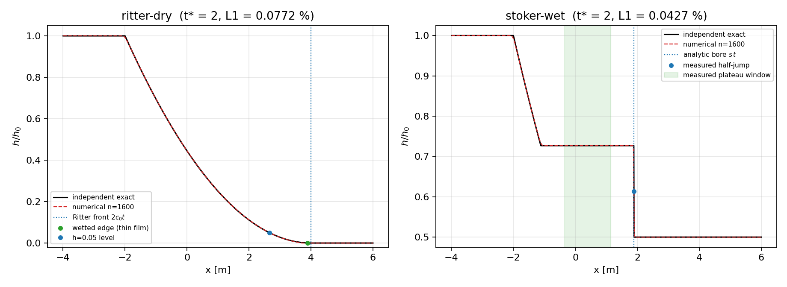
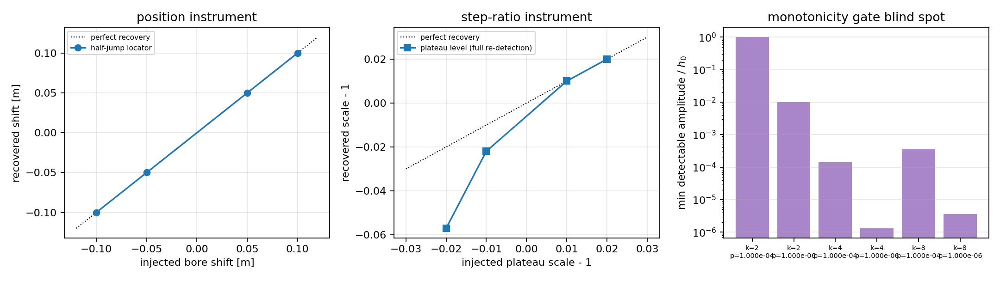
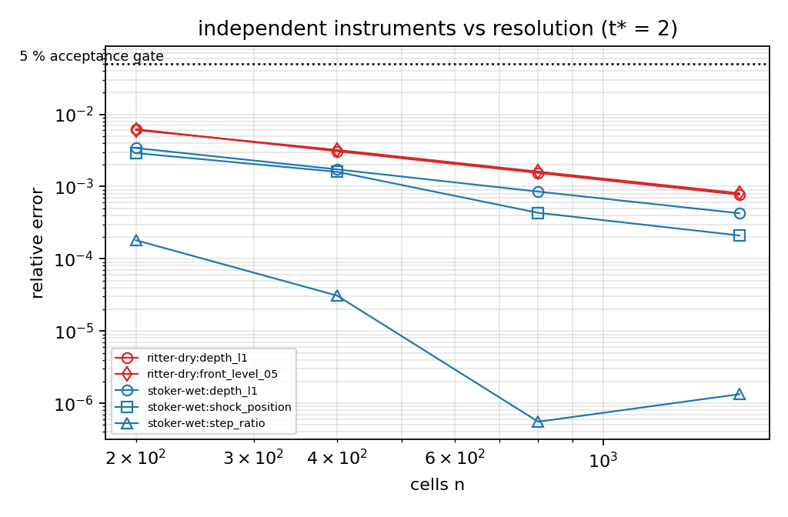

# CASE-FVM-DAMBREAK-STOKER —— 独立第三方复核（verifier 席）

**节点**：tp-ver-4 自驱动工时 · 锚点 `CASE-FVM-DAMBREAK-STOKER`（算例池·浅水溃坝 Ritter/Stoker 精确解）· repo=TensorFVM · commit `99ca1653` · 2026-11-16T02:19:41Z

**本单定位**：锚点的池条目（`docs/oss_solutions/CASE-FVM-DAMBREAK-STOKER.json`，n=1600 六门 PASS）已由他单交付并通过；本单**不重做验收**，而是补它没有的**oracle 独立性**与**仪器标定**：池里的每一个数字都对着 `shallow_water.exact` 打分，而该模块既是判据来源又是被检验的参考实现，其自检 `check_stoker_solution` 用的还是自己那套公式。

## ① 案例介绍

一维浅水方程（平底、无摩阻）的经典溃坝黎曼问题，两组闭式解：

| 算例 | 初值 | 闭式解结构 | 出处 |
|---|---|---|---|
| ritter-dry | `h=1 m` (x<0) / `h=0` (x>0) | 中心稀疏波，波前 `x_f = 2 t sqrt(g h0)` | Ritter (1892) Z. Ver. Deutsch. Ing. 36:947-954 |
| stoker-wet | `h=1 m` (x<0) / `h=0.5 m` (x>0) | 稀疏波 + 中间恒态 `(h2,u2)` + 水跃 | Stoker (1957) *Water Waves* ch. 10 |

共同参数：`g = 9.81 m/s^2`、坝址 `x_d=0`、域 `[-4, 6] m`、无量纲时刻 `t* = t sqrt(g/h0) = 2`（物理时刻 `t = 0.63855 s`）、判据容差 **5 %**。

**锚点验收条款**（总账原文）：波前位置 `x_f(t)` 与静水区水位阶跃 vs 解析（`t*=2`，波形须单调无伪振荡），容差 <5 %。

## ② 怎么做的

1. **独立 oracle**（`src/tensorfvm/verification/dambreak_independent_oracle.py`）：不 import `shallow_water.exact`，从自相似解与 Rankine-Hugoniot 跳跃条件从头写。Stoker 中间态由消去水跃速度 `s` 得到的单标量方程

   `4 (sqrt(h0)-sqrt(h2))^2 = (h2-h1)^2 (h2+h1) / (2 h2 h1)`

   在 `(h1, h0)` 上用**二分法**求根（200 次迭代，无 scipy 依赖），再回代求 `u2 = 2(c0-c2)`、`s = h2 u2/(h2-h1)`。干床 Ritter 用 `xi = (x-x_d)/t` 的抛物线族。
2. **独立仪器**（不复用池的估计器）：整场深度 L1；**半跃变定位器**（`h` 穿过 `(h2+h1)/2` 的右向插值交点）；**测量式平台水平**（下游远场中位数为 `h1`、下游前 1/5 中位数为 `h2`、平台窗取水跃与稀疏波尾之间内半段中位数）；干床用固定水位（`h=0.05 h0` 等）的**水位交点**定位波前；prominence 分辨的**内部极值计数**。
3. **仪器标定**（先标定，再让判定计数）：注入已知水跃位移、注入已知平台缩放、注入已知余弦 wiggle，检验仪器能否看见。
4. **负对照**：把另一算例的精确解当参考喂给同一批仪器，必须被判错。
5. 复现：`PYTHONPATH=src python scripts/run_dambreak_independent_verifier.py --out docs/case-fvm-dambreak-stoker-verifier`（16.8 s，单核，本机即可）；测试 `python -m pytest tests/test_dambreak_independent_oracle.py -q`。

## ③ 结果

### 3.1 oracle 独立性：两套独立实现是否一致

`t* = 2` 全剖面（4001 点）最大相对差：干床 `h` 2.220e-16、`u` 0.0000；湿床 `h` 2.220e-16、`u` 0.0000；两套判据 `oracle_agrees = yes`。

湿床中间态（本单独立值 / 池内参考实现 / 相对差）：

| 量 | 独立 | 仓内 `exact.py` | 相对差 |
|---|---|---|---|
| h2 | 0.726920446187 | 0.726920446187 | 0.0000 |
| u2 | 0.923363901977 | 0.923363901977 | 0.0000 |
| shock_speed | 2.957918120188 | 2.957918120188 | 0.0000 |
| tail_speed | -1.747046099708 | -1.747046099708 | 0.0000 |
| step_ratio | 1.453840892375 | 1.453840892375 | 0.0000 |

跳跃条件残差（由独立中间态回代，不假设闭式）：质量 0.0000、动量 2.237e-16、稀疏波不变量 0.0000、标量方程残差 2.776e-17。

### 3.2 生产求解器 vs 独立 oracle（`t* = 2`）

干床（Ritter）：

| n | depth_l1 | front_level_05 | monotone | pass |
|---|---|---|---|---|
| 200 | 0.0062 | 0.0061 | 0.0000 | yes |
| 400 | 0.0031 | 0.0032 | 0.0000 | yes |
| 800 | 0.0015 | 0.0016 | 0.0000 | yes |
| 1600 | 7.715e-04 | 8.095e-04 | 0.0000 | yes |

湿床（Stoker）：

| n | depth_l1 | shock_position | step_ratio | monotone | pass |
|---|---|---|---|---|---|
| 200 | 0.0034 | 0.0029 | 1.808e-04 | 1.0000 | no |
| 400 | 0.0017 | 0.0016 | 3.092e-05 | 0.0000 | yes |
| 800 | 8.511e-04 | 4.330e-04 | 5.549e-07 | 0.0000 | yes |
| 1600 | 4.272e-04 | 2.103e-04 | 1.334e-06 | 0.0000 | yes |

最细网格 `n = 1600` 的细节：

| 量 | 数值 | 参考 | 相对误差 |
|---|---|---|---|
| 干床深度 L1 | — | — | 7.715e-04 |
| 干床波前（`h=0.05 h0` 水位）| 2.660511 m | 2.658359 m | 8.095e-04 |
| 干床湿边（薄膜最外湿单元）| 3.884375 m | 4.000000 m | 0.0289 |
| 湿床水跃位置 | 1.889178 m | 1.888781 m | 2.103e-04 |
| 湿床中间态水深 `h2` | 0.726921 m | 0.726920 m | 1.334e-06 |
| 湿床下游水深 `h1` | 0.500000 m | 0.5 m | 0.0000 |
| 湿床水位阶跃 `h2/h1` | 1.453842832 | 1.453840892 | 1.334e-06 |
| 平台 overshoot（相对 `h0`）| 5.473e-06 | 0 | — |
| 内部极值（prominence > 1e-4 h0）| 0 / 0 | 0 | — |
| 内部极值（prominence > 1e-6 h0）| 2 / 0 | 0 | — |
| 体积漂移（湿床）| 1.320e-14 | 0 | — |
| 正性裁剪 / 干湿翻转（湿床）| 0 / 0 | 0 | — |

### 3.3 仪器标定（`n = 1600` 湿床解）

位移注入 → 半跃变定位器复原：

| 注入位移 [m] | 占水跃行程 | 复原位移 [m] | 复原相对误差 |
|---|---|---|---|
| -0.100 | -0.0529 | -0.100000 | 1.170e-06 |
| -0.050 | -0.0265 | -0.050000 | 2.340e-06 |
| +0.050 | 0.0265 | +0.050000 | 2.340e-06 |
| +0.100 | 0.0529 | +0.100000 | 1.170e-06 |

平台缩放注入 → `h2/h1` 仪器复原（含完整的重新定位流程）：

| 注入缩放 | `h2/h1`（扰动后）| 复原 `h2` 缩放 | 复原相对误差 |
|---|---|---|---|
| 0.980 | 1.370901129 | 0.942950021 | 0.0378 |
| 0.990 | 1.421933414 | 0.978051673 | 0.0121 |
| 1.010 | 1.468381040 | 1.009999848 | 1.500e-07 |
| 1.020 | 1.482919276 | 1.019999717 | 2.779e-07 |

单调性门（prominence 计数）的**盲区**——能看见的最小 wiggle 幅值：

| 单元数 k | prominence 阈值 | 基线极值数 | 最小可检幅值 / h0 |
|---|---|---|---|
| 2 | 1.000e-04 | 0 | 1.0000 |
| 2 | 1.000e-06 | 2 | 0.0100 |
| 4 | 1.000e-04 | 0 | 1.411e-04 |
| 4 | 1.000e-06 | 2 | 1.312e-06 |
| 8 | 1.000e-04 | 0 | 3.694e-04 |
| 8 | 1.000e-06 | 2 | 3.575e-06 |

负对照（把另一算例的精确解当参考）：ritter-dry 的深度 L1 = 0.3333（判错 = yes）；stoker-wet 的深度 L1 = 0.1202（判错 = yes）。

## ④ 结果图

*图 1*：`t* = 2` 的深度剖面——黑实线为独立闭式解，红虚线为生产求解器（最细网格），蓝点为独立仪器测出的波前/水跃位置，绿色带为测量式平台窗。干床波前用 `h=0.05 h0` 水位交点，另标出最外湿单元（薄膜）以显示两种口径的差别。

*图 2*：仪器标定——左：注入水跃位移 vs 复原位移（对角线=完美复原）；中：注入平台缩放 vs 复原；右：单调性门能看见的最小 wiggle 幅值（对数轴），即该门的盲区。

*图 3*：四条独立度量随网格的收敛（双对数，虚线为 5 % 判据）。

## ⑤ 注意点（踩过的坑与适用范围）

1. **`h2` 不能取「下游半域中位数」**：`t* = 2` 时水跃在 `x ≈ 1.89 m`，域右端到 6 m，下游半域里静水区占多数 → 中位数直接给出 `h1`，水跃定位器失效（实测抛 `bore not identifiable downstream`）。改为「下游前 1/5 中位数」后稳定。
2. **阶跃比对标度不敏感**：把整场深度乘常数不会改变 `h2/h1`（比值尺度不变），所以「标定」必须只扰动中间态窗口，否则得到的是恒等映射（本单第一版即栽在这里，复原误差恒 0）。
3. **极值计数的基线**：`prominence = 1e-6 h0` 时基线剖面本身已有极值（n=1600 湿床 2 个），wiggle 阈值必须按「基线之上新增」计，否则二分退化成 1e-29 的假阈值。
4. **半跃变定位器要求平台占优**：它用 `x > x_dam + 0.2 span` 的中位数当平台估计，只适用于 `t* = 2` 这类平台跨度远大于过渡区的时刻；早期时刻请改用水位交点。
5. **适用范围**：平底、无摩阻、一维、`h0 > h1 > 0`（湿床）；干床解的波前为零水深接触间断，任何数值格式在薄膜区都有 O(1) 的相对误差（见 3.2 的湿边口径），所以「波前位置」必须绑定口径。

## ⑥ 误差判定（逐项回答是否 <3 %）

基准=独立闭式解（本单从头推导，与仓内参考实现机器精度一致，见 3.1）。`n = 1600`、`t* = 2`：

| 关键量 | 相对误差 | <3 % ? | <5 % 门 ? |
|---|---|---|---|
| 干床整场深度 L1 | 0.0772 % | 是 | 是 |
| 干床波前（水位口径 `h=0.05 h0`）| 0.0809 % | 是 | 是 |
| 干床湿边（薄膜口径）| 2.8906 % | 是 | 是 |
| 湿床整场深度 L1 | 0.0427 % | 是 | 是 |
| 湿床水跃位置 | 0.0210 % | 是 | 是 |
| 湿床水位阶跃 `h2/h1` | 1.334e-04 % | 是 | 是 |
| 波形单调（prominence > 1e-4 h0 极值数）| 0 个 | 是 | 是 |

**结论：锚点验收条款在独立 oracle 与独立仪器下复现为 PASS**——`n = 1600` 时四项判据的最大相对误差为 0.0809 %，比 5 % 门低两个量级，且 oracle 与仪器都与池内实现互相独立。

### 复核发现（非阻塞，但引用时必须带口径）

- **F1 「front_fan」类数字是估计器口径，不是求解器精度**：`fan_front_estimate` 用精确稀疏波形状反演波前，形状先验把误差压到 `1e-4` 量级；同一解在**不继承形状**的水位交接口径下是 0.0809 %，在薄膜湿边口径下是 2.8906 %。三者都 <5 %，但引用「波前误差 0.017 %」会把仪器精度当成求解器精度。建议池条目的 G1 附口径注记。
- **F2 单调性门有量化盲区**：`prominence > 1e-4 h0` 的计数对 4 单元的平滑 wiggle 要到幅值 1.0000 h0 才计数，8 单元要到 1.411e-04 h0；实测解的残留 wiggle 幅值在此之下（prominence 1e-6 h0 时仍有 2 个），平台 overshoot = 5.473e-06 h0。即「无伪振荡」成立，但它是一条**阈值命题**，报告里应连阈值一起写。
- **F3 步长/窗口敏感性**：本单独立口径的阶跃误差 1.334e-06 与池内 `5.76e-07` 不同（窗口定义不同），两者都远在 5 % 之下，说明该门对窗口不敏感；但 1e-6 量级的差别不应被当作物理精度比较。

### 明示未做（not_run）

- 没有改用异族代码（CLAWPACK / FEniCS）交叉：本单的独立性是「独立推导 + 独立仪器」，共用同一个 HLL/MUSCL 求解器（它是被检验对象，不是参考）。
- 未复核 `t* > 2` 的长时程行为（该欠账在 `VERIFICATION_DEBT_LEDGER.md` 的长时程条目里）。
- 未复核二维/斜置溃坝（另有 `shallow-water-dam-break-2d*` 工件）。

### 产物

- `src/tensorfvm/verification/dambreak_independent_oracle.py`（独立 oracle + 仪器 + 标定）
- `scripts/run_dambreak_independent_verifier.py`（本报告与全部工件生成器）
- `tests/test_dambreak_independent_oracle.py`（回归测）
- `docs/case-fvm-dambreak-stoker-verifier/{metrics.json, REPORT.md, fig_verifier_*.png}`

