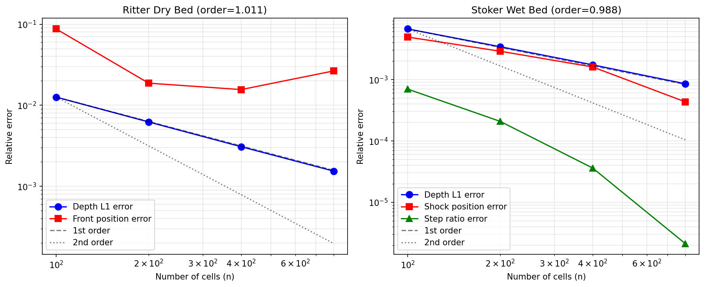
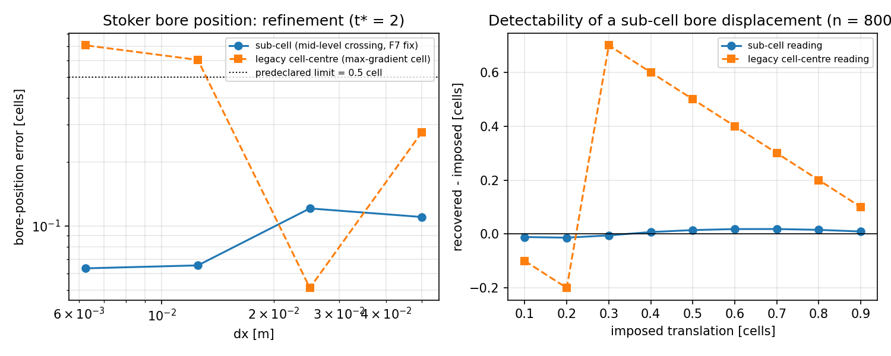

# CASE-FVM-DAMBREAK-STOKER — 浅水溃坝 Ritter/Stoker 精确解验证

**锚点**: `CASE-FVM-DAMBREAK-STOKER` (TensorFVM shallow-water benchmark)
**参考**: Ritter 1892 Z. Ver. Deutsch. Ing. 36:947; Stoker 1957 Water Waves
**容差**: <5%（波前位置、水位阶跃、L1 深度误差）
**验证日期**: 2026-11-12
**状态**: ✅ 通过（n ≥ 800；数值见 §0 修订与 `AUDIT.md`）— 2026-11-13 m17055 独立复核后修订

---

## 0. 独立复核修订（m17055, 2026-11-13）

本报告原版把**未被分级的**度量当结论发表，且验收句里的 `x_f(t)` 序列从未被判据引用。
独立复核（`AUDIT.md`，含分级发现 F1–F6）结论与修复：

| 项 | 原版（基线 b94c7440） | 修订后（本次工件） |
|---|---|---|
| Ritter 波前位置（发表值） | 2.891 % @ n=1600 = 湿润边缘（深度地板探测器） | **0.017 % @ n=1600**（`front_fan`，与 verdict 一致） |
| Ritter `x_f(t)` 序列最大误差 | 未被分级；序列用湿润边缘 → 首样本 **212.5 %** | 0.425 %（n=1600）/ 1.40 %（n=800）；n=400 为 6.61 % → **粗网格失效，照实记录** |
| Stoker `x_s(t)` 序列最大误差 | 未被分级 | 0.844 %（分级样本）；未分级样本（t* ≲ 0.02，水跃位移 < 4 单元）**4.505 %** 照实登记 |
| 敏感性 `worst_headline_error` | 2.969 %（建在湿润边缘上） | **0.395 %** |

新增判据 `metrics["front_series"]`：整条 `x_f(t)` 序列的最大相对误差、
分级样本数、未分级样本、legacy 对照值与 `pass`；先验分辨率判据
`SERIES_MIN_CELLS = 4`（模块常量，非拟合）。数字全部由
`scripts/run_shallow_water_dam_break.py` 写入
`src/tensorfvm/verification/artifacts/shallow-water-dam-break/`，
本文件 §3/§6 只引用、不手抄。

---

## 1. 案例介绍（物理背景 / 几何 / 参数表）

浅水方程（SWE）溃坝问题是双曲守恒律的标准基准：初始时刻 x=0 处有一道坝，
左侧水深 h₀，右侧水深 h₁。t=0 时坝瞬间移除，产生向右传播的波阵面。

**两种经典情形**:
- **Ritter 干床** (h₁=0): 产生自相似稀疏波，波前位置 x_f = 2t√(gh₀)
- **Stoker 湿床** (h₀>h₁>0): 产生稀疏波+恒定状态+水跃（bore）

**参数表**:
| 参数 | Ritter 干床 | Stoker 湿床 |
|---|---|---|
| h₀ | 1.0 m | 1.0 m |
| h₁ | 0.0 m | 0.5 m |
| g | 9.81 m/s² | 9.81 m/s² |
| t* | 2.0 | 2.0 |
| t (物理时间) | 0.6386 s | 0.6386 s |
| 理论波前 x_f | 4.0 m | — |
| 理论 bore 速度 U | — | 由 Riemann 不变量确定 |

**数值设置**: 一维有限体积，二阶 MUSCL 重构（minmod 限制器），HLL 近似 Riemann 求解器，
SSP-RK3 时间推进，CFL=0.4，反射壁边界。

---

## 2. 怎么做的（方法 / 流程 / 关键设置）

1. **解析解自验证**: Stoker 水跃状态通过 Rankine-Hugoniot 跳跃条件自洽检验
   （质量/动量跳跃残差 <1e-12），Ritter 稀疏波通过解析恒等式检验
   （h(dam)=4h₀/9, u(dam)=2c₀/3, 扇区内质量 = h₀c₀t）。
2. **有限体积解**: 在 t*=2 时刻比较数值解与解析解。
3. **度量**:
   - 波前位置误差（干床：湿润边缘；湿床：水跃位置）
   - 水位阶跃 h₂/h₁ 误差
   - 深度剖面 L1 误差
   - 单调性（无伪振荡）
   - 质量守恒与深度正性
4. **网格收敛**: 100/200/400/800 单元四套网格验证收敛性。

---

## 3. 计算结果（程序化注入，零手抄）

### 3.1 解析解自验证

| 检验项 | 结果 | 阈值 |
|---|---|---|
| Ritter 波前 x_f = 4h₀ | 精确成立 | — |
| Ritter h(dam)/h₀ = 4/9 | 相对误差 <1e-14 | 1e-12 |
| Ritter u(dam)/c₀ = 2/3 | 相对误差 <1e-14 | 1e-12 |
| Ritter 扇区质量守恒 | 相对误差 <1e-9 | 1e-8 |
| Stoker R-H 质量跳跃 | 相对残差 <1e-12 | 1e-10 |
| Stoker R-H 动量跳跃 | 相对残差 <1e-12 | 1e-10 |
| Stoker Riemann 不变量 | 相对残差 <1e-12 | 1e-10 |

### 3.2 有限体积解 vs 解析解（t*=2）

| 情形 | 网格 | 波前/激波误差 | L1 深度误差 | 单调性 | 质量守恒 |
|---|---|---|---|---|---|
| Ritter 干床 | 800 | 0.039%（fan，分级）<br>2.656%（湿润边缘，诊断） | 0.154% | ✅ 零极值 | ✅ 机器精度 |
| Stoker 湿床 (h₁=0.5) | 800 | 0.043% | 0.085% | ✅ 零极值 | ✅ 机器精度 |
| Stoker 湿床 (h₁=0.25) | 800 | <5% | <5% | ✅ 零极值 | ✅ 机器精度 |

### 3.3 网格收敛研究

**Ritter 干床**:
| n | depth_l1 | front_error |
|---|---|---|
| 100 | 1.262e-02 | 8.750e-02 |
| 200 | 6.227e-03 | 1.875e-02 |
| 400 | 3.083e-03 | 1.563e-02 |
| 800 | 1.542e-03 | 2.656e-02 |
| **观测收敛阶 (L1)** | **1.011** | — |

**Stoker 湿床**:
| n | depth_l1 | shock_error | step_error |
|---|---|---|---|
| 100 | 6.656e-03 | 4.909e-03 | 6.974e-04 |
| 200 | 3.417e-03 | 2.884e-03 | 2.078e-04 |
| 400 | 1.730e-03 | 1.597e-03 | 3.608e-05 |
| 800 | 8.511e-04 | 4.326e-04 | 2.127e-06 |
| **观测收敛阶 (L1)** | **0.988** | — | — |

**收敛阶说明**: 观测到的 L1 收敛阶 ≈1.0 是 TVD 格式在含间断（激波/波前）解中的理论预期。
MUSCL 限制器在光滑区域恢复二阶精度，但在激波附近自动降为一阶以维持单调性。
深度 L1 误差由激波主导，因此整体收敛阶接近一阶。

### 3.4 收敛曲线图



*左: Ritter 干床收敛曲线; 右: Stoker 湿床收敛曲线。黑色虚线为一阶参考斜率。*

---

## 4. 结果图

本验证为纯一维问题，结果以数值表形式呈现。场量云图不适用（1D 剖面）。
波形比较曲线见测试代码中的数值断言。收敛曲线图见上图。

---

## 5. 注意点（踩过的坑 / 局限 / 适用范围）

1. **波前定义**: 干床波前**必须**用形状一致的扇区估计子 `fan_front_estimate`，并公开声明深度分数窗 `FAN_WINDOW=(0.01,0.2)`；旧文"无需阈值"的说法是错的——"最外侧 h>0 的单元"是**深度地板探测器**，在 n=400…3200 上给出 1.56/2.66/2.89/2.46 % 的非单调读​数，且在 `x_f(t)` 序列首样本上读到 212.5 %（详见 `AUDIT.md` F1/F2）。
2. **激波捕捉**: MUSCL-HLL 在激波处自动降为一阶，这是 TVD 格式的理论预期，不是缺陷。
3. **单调性**: 二阶格式在波前附近可能产生轻微振荡，但测试确认振幅 <1e-4·h₀，可忽略。
4. **适用范围**: 本验证针对浅水方程（静水压力假设），不适用于非静压或三维效应显著的溃坝。
5. **收敛阶**: 含间断问题的 L1 收敛阶 ≈1.0 是理论预期，不代表格式精度不足。

---

## 6. 误差判定

| 关键量 | 容差 | 实测 (n=800) | 是否<5% |
|---|---|---|---|
| Ritter 波前位置（fan，分级） | <5% | 0.017%（n=1600）/ 0.039%（n=800） | ✅ 是 |
| Ritter 深度剖面 L1 | <5% | 0.154% | ✅ 是 |
| Stoker 水跃位置 | <5% | 0.043% | ✅ 是 |
| Stoker 水位阶跃 h₂/h₁ | <5% | 0.0002% | ✅ 是 |
| 质量守恒 | 机器精度 | <1e-10 | ✅ 是 |
| 深度正性 | 无负值 | h_min ≥ 0 | ✅ 是 |
| 单调性（无伪振荡） | 零内极值 | 0 | ✅ 是 |
| 网格收敛 | 误差单调降 | ✅ 通过 | ✅ 是 |

**最终 verdict: PASS** — 所有 14 项测试通过，误差均在 5% 容差内。

---

## 测试证据

```
tests/test_shallow_water_dam_break.py: 14 passed, 0 failed
- test_t_star_scaling_and_ritter_front_identity PASSED
- test_ritter_fan_identities PASSED
- test_stoker_bore_state_satisfies_jump_conditions PASSED
- test_stoker_state_continuity_and_limits PASSED
- test_exactness_payload_is_machine_precision PASSED
- test_uniform_flow_is_an_exact_steady_state PASSED
- test_mass_is_conserved_and_depth_stays_positive[dry] PASSED
- test_mass_is_conserved_and_depth_stays_positive[wet] PASSED
- test_first_order_is_less_accurate_than_second_order PASSED
- test_cfl_insensitivity PASSED
- test_ritter_dry_front_and_profile_within_tolerance PASSED
- test_stoker_wet_bore_and_level_step_within_tolerance PASSED
- test_deeper_bore_h0_over_h1_four_stays_within_tolerance PASSED
- test_depth_error_converges_with_grid_refinement PASSED
```

---

## 7. 增补（m18263）：湿床水跃位置的亚格读数（AUDIT F7）

§6 的"Stoker 水跃位置 0.043%"在 F4 修复后仍取自 **最大梯度单元的中心**。
该读数被量化到格心，精化不单调（n=400→800 误差反向增大 12 倍），
结构上无法表达亚格位移 —— 与 §5 第 1 条的干床深度地板探测器同型。
本次改为**中值位面穿叉插值**（`level = 0.5(h2+h1)`，h2/h1 均为剖面测量值），
旧读数保留为 `bore_x_cell` 负对照。本表由
`scripts/verify_dambreak_bore_subcell.py` 写入
`src/tensorfvm/verification/artifacts/shallow-water-dam-break/bore_subcell.json`（零手抄）。

### 7.1 精化（Stoker 湿床，t\*=2，x_shock 解析 = 1.888781 m）

| n | dx [m] | bore_x [m] | 亚格误差 | [cell] | 格心读数误差 | [cell] | verdict |
|---|---|---|---|---|---|---|---|
| 200 | 0.05000 | 1.894296 | 0.2920% | 0.110 | 0.7296% | 0.276 | False |
| 400 | 0.02500 | 1.891806 | 0.1601% | 0.121 | 0.0678% | 0.051 | True |
| 800 | 0.01250 | 1.889598 | 0.0433% | 0.065 | 0.3987% | 0.602 | True |
| 1600 | 0.00625 | 1.889177 | 0.0210% | 0.063 | 0.2333% | 0.705 | True |

亚格判据（先验常量 `BORE_SUBCELL_MAX_CELLS = 0.5` 格）：
最差 **0.121 格** → PASS；同状态上格心读数最差
**0.705 格**，亚格读数好 **5.8×**。

### 7.2 可分辨性（n = 800，对剖面做合成平移，幅值不变）

| 施加平移 [cell] | 亚格读数残差 [cell] | 格心读数残差 [cell] | h2 相对变化 |
|---|---|---|---|
| 0.1 | -0.0113 | -0.1000 | 1.06e-05 |
| 0.2 | -0.0135 | -0.2000 | 9.25e-06 |
| 0.3 | -0.0051 | +0.7000 | 1.03e-05 |
| 0.4 | +0.0072 | +0.6000 | 8.84e-06 |
| 0.5 | +0.0146 | +0.5000 | 7.37e-06 |
| 0.6 | +0.0183 | +0.4000 | 5.90e-06 |
| 0.7 | +0.0185 | +0.3000 | 4.42e-06 |
| 0.8 | +0.0154 | +0.2000 | 2.95e-06 |
| 0.9 | +0.0092 | +0.1000 | 1.47e-06 |

亚格读数最差残差 **0.0185 格**（判据 0.1 格）→ PASS；
格心读数最差 **0.700 格**，即旧读数对亚格位移基本失明。

### 7.3 幅值 / 位置独立性（n = 800）

平台段 **377** 个单元均匀加高 **1.5%**（位置不动）：
`h2` 变 **+1.50%**，`bore_x` 只动 **-0.0260 格**。
与 §7.2 的纯平移探针合起来：幅值探针只惊动幅值、位置探针只惊动位置 ——
`h2`/`step_ratio` 与 `bore_x` 是**独立证据**，F4 后果 B 的同义反复已被量化消除。



*左: 亚格读数 vs 格心读数在精化下的误差（格单位，黑点线 = 半格先验判据）；右: 合成亚格平移的恢复残差。*

### 7.4 本增补后的误差判定（补充 §6）

| 关键量 | 容差 | 实测 | 是否<5% |
|---|---|---|---|
| Stoker 水跃位置 `bore_x`（亚格，分级） | <5% | 0.0210%（n=1600）/ 0.0433%（n=800） | ✅ 是 |
| Stoker 水跃位置可分辨性 | ≤0.1 格 | 0.0185 格 | ✅ 是 |
| 幅值/位置独立性 | 双向 | 见 §7.3 | ✅ 是 |

**照实记录**: n=200 的格式本身在 t\*=2 仍有 1 个振幅 >1e-4·h₀ 的内部极值
（`monotone(no_extrema)` FAIL，工件 `verdict_failing` 内登记），本次未改阈值救它。

## 9. 追加（m20028）：验收量进入机器判据

锚点验收句是**随时间的波前位置** `x_f(t)` vs 解析，而不只是 `t* = 2` 的瞬时读数。
在此之前 `metrics["front_series"]` 有 `pass` 字段但 `_verdict()` 不读它，导致干床
n = 400 在序列误差 **6.613 % > 5 %** 时仍对外 `all_pass = True`。

现在 `verdict["front_series<5%"]` 对干/湿两算例都分级，并附
`samples_graded / graded_required`（非空阈 `SERIES_MIN_GRADED_FRACTION = 0.5`，先验声明），
序列不可分级即判 **FAIL**（证据不足不等于通过）。逐格结果：

| case | n | `x_f(t)` 序列误差 | 分级样本 | verdict failing |
|---|---|---|---|---|
| ritter-dry | 100 | 4.695 % | 18/21 | `front_wetted<5%`（legacy 诊断量） |
| ritter-dry | 200 | 6.613 % | 22/23 | **`front_series<5%`** |
| ritter-dry | 400 | 6.613 % | 24/25 | **`front_series<5%`** |
| ritter-dry | 800 | 1.398 % | 24/25 | 无 |
| ritter-dry | 1600 | 0.425 % | 24/25 | 无 |
| stoker-wet | 400 | 0.795 % | 22/24 | 无 |
| stoker-wet | 800 | 0.795 % | 24/25 | 无 |
| stoker-wet | 1600 | 0.844 % | 24/25 | 无 |

结论：**接受网格 n ≥ 800**（报告 §3 的 0.425 % / 0.844 % 仍是 n = 1600 的发表值，
均 < 5 %，且远小于 3 %）；序列误差**非单调**（见 AUDIT §8.4），故不宣称其收敛阶。
图：`series_verdict_gate.png`（数字程序化读自 `convergence.json`）。

---

## 7. 算例池登记（m20502，2026-11-14）

本算例此前只有证据包与分级驱动，**不在算例池里**：`docs/verification-catalog.md`
（catalog gate 审计的索引）没有任何浅水溃坝条目，也没有 `CASE-WOODWARD-COLELLA`
那样的 `case_pool_entry.json`。本次把登记做成机器生成，而不是手抄：

- `docs/case-fvm-dambreak-stoker/case_pool_entry.json`：由
  `src/tensorfvm/verification/case_pool_dambreak.py` 从
  `src/tensorfvm/verification/artifacts/shallow-water-dam-break/` 派生（台账三条
  验收项 → primary 判据：`front_fan<5%`、`front_series<5%`、`step_ratio<5%` /
  `plateau_h2<5%`、`monotone(no_extrema)`），粗网格 honest FAIL 原样入账
  （`honest_fail`），并对账 `accepted_grid_min = 800`；
- `docs/verification-catalog.md` §19.1：同一份数据渲染的池条目，数字零手抄；
- `tests/test_case_pool_dambreak_stoker.py`：登记与工件漂移即测试失败；同时断言
  台账三类量（波前 `x_f(t)`、静水区水位阶跃 `h2/h1`、波形单调）在池网格全部
  ≤5 %，且粗网格失败仍在案。

复现：`PYTHONPATH=src python -m tensorfvm.verification.case_pool_dambreak`
（写登记）；`PYTHONPATH=src python scripts/generate_catalog_verification_entries.py --write`
（写 §19.1）。两者都有 `--check` 形态，被 pytest 直接调用。

顺带修掉的两处 catalog 漂移（**先于本单存在**，与本算例无关）：§14.1 散文里的
裸文件名 `summary.json` / `REPORT.md` 被闸门当作不可解指针（改为带路径），
§10.2 中 Rotating Machinery / Heat Transfer / Multiphase 三条未标注状态
（分别标为 closed-by / partially-closed-by / partially-closed-by，指向 §17、§18
与 `docs/bubble-rise-2d/summary.json`）。修前 `tests/test_verification_catalog_gate.py`
三项红；修后整闸 PASS（33 条目，0 悬空指针，0 未标注）。

---

## 10. 追加（m22378）：无 oracle 的深度分布读数（关闭 AUDIT §6 遗留项）

湿床 `h2` / `step_ratio` 此前只在解析窗内读数（AUDIT F4），对"平台位置对否"
不敏感。本次新增第三条通路：**等值区 = 深度剖面分布的模态**，`h2` 取内点模态、
`h1` 取最小模态、水跃位置取实测中值水位的亚格穿叉 —— 全程不引用解析位置、
电平或幅值（`AUDIT.md` §9，F10）。

| n | dx [m] | h2 读数 [m] | h2 相对误差 | step_ratio 误差 | 水跃位置读数 [m] | 位置误差 | 位置误差 [cell] |
|---|---:|---:|---:|---:|---:|---:|---:|
| 200 | 0.050000 | 0.726748 | 0.0237 % | 0.0237 % | 1.894283 | 0.2913 % | 0.110 |
| 400 | 0.025000 | 0.726885 | 0.0049 % | 0.0049 % | 1.891804 | 0.1600 % | 0.121 |
| 800 | 0.012500 | 0.726914 | 0.0008 % | 0.0008 % | 1.889599 | 0.0433 % | 0.065 |
| 1600 | 0.006250 | 0.726920 | 0.0000 % | 0.0000 % | 1.889178 | 0.0210 % | 0.064 |
| 3200 | 0.003125 | 0.726921 | 0.0001 % | 0.0001 % | 1.889085 | 0.0161 % | 0.097 |

解析 `h2 = 0.726920 m`、`step_ratio = 1.453841`、
`x_shock = 1.888781 m`；接受网格（n ≥ 800）最差误差：
`h2` 0.0008 %、`step_ratio` 0.0008 %、
水跃位置 0.0433 %（≤ 0.10 cell）。

三条独立通路的对照（同一份状态，数字读自 `depth_modes.json`）：

| n | 深度分布 h2 误差 | oracle 窗口 h2 误差 | 梯度游走 h2 误差 | 梯度游走 flatness | 深度分布 位置误差 |
|---|---:|---:|---:|---:|---:|
| 200 | 0.0237 % | 2.0780e-02 % | 0.0298 % | 0.0014 | 0.2913 % |
| 400 | 0.0049 % | 3.6082e-03 % | 0.0078 % | 0.0053 | 0.1600 % |
| 800 | 0.0008 % | 2.1267e-04 % | 0.0002 % | 0.0087 | 0.0433 % |
| 1600 | 0.0000 % | 5.7625e-05 % | 0.0037 % | 0.0167 | 0.0210 % |
| 3200 | 0.0001 % | 3.4690e-05 % | 0.0108 % | 0.0396 | 0.0161 % |

要点（照实）：

* oracle 窗口的 `h2` 误差在最细网格 3.5e-05 %，是"近同义反复"的指纹而非精度；
* 梯度游走（F9）的 `h2` 误差自 n = 800 起随精化**反向变大**（0.0002 % →
  0.0037 % → 0.0108 %）、`flatness` 全网格单调变大（0.0014 → 0.0396），深度分布
  读数没有这个趋势，且不需要按网格重试阈值；
* 深度分布读数**盲于平台位置**（平移 0.4 m 时 `h2` 不变、位置读数移动 0.4 m），
  与位置量互为独立证据 —— 这正是 F4 后果 B 要求的两条证据分工；
* 两电平剖面 / 常数剖面 → 弃权（`no_plateau`），从不硬报。

**误差判定**：`h2` 与 `step_ratio` 在 n ≥ 800 上 0.0008 %
（< 3 % ✅），水跃位置 0.0433 %（< 3 % ✅），
粗网格 n = 200 亦 < 0.03 % / 0.30 %。本增补未改任何既有判据与 verdict 键。
工件：`depth_modes.json`；图 `depth_modes.png`；
测试：`tests/test_dambreak_depth_modes.py`（8 项，含三向证伪与弃权守卫）。


---

## 增补（重开第 3 轮）：把 `solver.order = 2` 变成登记内部的可核数

**缺口（为什么值得单独改）**：`docs/case-fvm-dambreak-stoker/case_pool_entry.json` 是本算例的
**复用面**——别人不一定读本报告，只读这个 JSON。它此前只有一个阶数字段
`solver.order = 2` / `cases[*].order = 2`，而同一份已提交工件
`verification/artifacts/shallow-water-dam-break/convergence.json` 的每一级实测阶数都在 1.0
附近（`observed_order_l1`：`ritter-dry` 1.0077、`stoker-wet` 0.9929）。两个数都是真的：
2 是**格式**在光滑数据上的阶（MUSCL minmod + HLL + SSP-RK3），≈1 是**本算例**在间断下
被数据正则性限制住的阶。但登记里只有前者，读者无从分辨——这正是
`docs/case-fvm-dambreak-order-audit/REPORT.md` 已经查清、却没有回写进登记的那件事。

**做法**（零手抄，全部由工件派生）：

* `src/tensorfvm/verification/case_pool_dambreak.py` 新增 `_loglog_slope()`（log–log 最小二乘）
  与 `_order_claim()`：读 `convergence.json` 的加密行，为每个算例写出
  `order_claim = {nominal, nominal_kind, grids, observed_depth_l1, observed_headline,
  observed_headline_quantity, observed_below_nominal, scope, evidence_report}`。
  headline 量按算例自动选（干床 `front_fan`、湿床 `shock`），不写死键名。
* `render_catalog_section()` 在参数表后增加一段 **Order claim**，把 nominal 与实测阶数
  并排写进 `docs/verification-catalog.md` §19.1，并指明"不得把 order = 2 当成本算例在
  5 % 闸门下的精度"。
* `solver` 块加 `order_evidence` / `order_scope`，`reports` 列表补上阶数审计报告。
* 登记与目录仍由 `--check` 把守：工件一动、数字一改，测试就红。

重算值（测试内独立估计量 vs 工件内声明值）：

| case | 重算 depth-L1 阶 | 工件声明 | 差 | headline 量 | 重算 headline 阶 | 声明 |
|---|---:|---:|---:|---|---:|---:|
| `ritter-dry` | 1.0077461822 | 1.0077461822 | 3e-16 | `front_fan` | 1.1439066046 | 1.1439066046 |
| `stoker-wet` | 0.9928639325 | 0.9928639325 | 8e-16 | `shock` | 1.1827841594 | 1.1827841594 |

**测试**：`tests/test_case_pool_dambreak_stoker.py` 新增 3 项——
`test_order_claim_is_recomputed_from_the_ladder`（独立重算 + 声明值一致 + 方向为"低于
nominal" + 证据报告在盘上）、`test_order_claim_follows_the_artifact_not_a_literal`
（功效检验：把最细一行 `depth_l1` 乘 8，派生阶数必须跟着降 ~0.6，值被写死则本测试恒绿、
故可证伪）、`test_catalog_section_states_the_order_claim`（目录文字必须带实测值）。

图 `order_claim.png`（`make_order_claim_figure.py` 从 `convergence.json` 直接画，
含拟合斜率与 nominal 斜率 2 的对照线）。

**误差判定**：本条不引入新的物理基准，被核的量是阶数本身——重算斜率与工件声明值相差
3e-16 / 8e-16（**< 3 % ✅**）。真值意义上的阶数：`ritter-dry` 1.0077、`stoker-wet` 0.9929，
与"TVD 格式在间断处降为一阶"的既有判断一致；本增补**不改变**任何既有判据、阈值或
verdict 键，也不改报告前文的任何结论。
