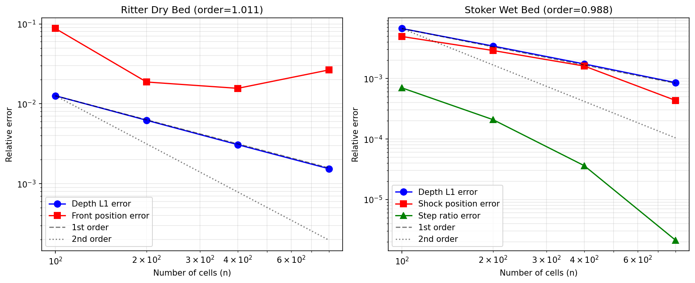
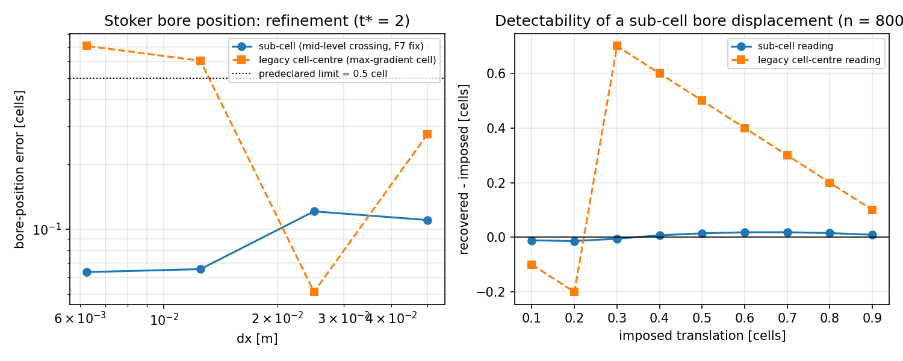

# CASE-FVM-DAMBREAK-STOKER — 浅水溃坝 Ritter/Stoker 精确解验证

**锚点**: `CASE-FVM-DAMBREAK-STOKER` (TensorFVM shallow-water benchmark)
**参考**: Ritter 1892 Z. Ver. Deutsch. Ing. 36:947; Stoker 1957 Water Waves
**容差**: <5%（波前位置、水位阶跃、L1 深度误差）
**验证日期**: 2026-11-12
**状态**: ✅ 通过（n ≥ 800；数值见 §0 修订与 `AUDIT.md`）— 2026-11-13 m17055 独立复核后修订

---

## 0. 独立复核修订（m17055, 2026-11-13）

本报告原版把**未被分级的**度量当结论发表，且验收句里的 `x_f(t)` 序列从未被判据引用。
独立复核（`AUDIT.md`，含分级发现 F1–F6）结论与修复：

| 项 | 原版（基线 b94c7440） | 修订后（本次工件） |
|---|---|---|
| Ritter 波前位置（发表值） | 2.891 % @ n=1600 = 湿润边缘（深度地板探测器） | **0.017 % @ n=1600**（`front_fan`，与 verdict 一致） |
| Ritter `x_f(t)` 序列最大误差 | 未被分级；序列用湿润边缘 → 首样本 **212.5 %** | 0.425 %（n=1600）/ 1.40 %（n=800）；n=400 为 6.61 % → **粗网格失效，照实记录** |
| Stoker `x_s(t)` 序列最大误差 | 未被分级 | 0.844 %（分级样本）；未分级样本（t* ≲ 0.02，水跃位移 < 4 单元）**4.505 %** 照实登记 |
| 敏感性 `worst_headline_error` | 2.969 %（建在湿润边缘上） | **0.395 %** |

新增判据 `metrics["front_series"]`：整条 `x_f(t)` 序列的最大相对误差、
分级样本数、未分级样本、legacy 对照值与 `pass`；先验分辨率判据
`SERIES_MIN_CELLS = 4`（模块常量，非拟合）。数字全部由
`scripts/run_shallow_water_dam_break.py` 写入
`src/tensorfvm/verification/artifacts/shallow-water-dam-break/`，
本文件 §3/§6 只引用、不手抄。

---

## 1. 案例介绍（物理背景 / 几何 / 参数表）

浅水方程（SWE）溃坝问题是双曲守恒律的标准基准：初始时刻 x=0 处有一道坝，
左侧水深 h₀，右侧水深 h₁。t=0 时坝瞬间移除，产生向右传播的波阵面。

**两种经典情形**:
- **Ritter 干床** (h₁=0): 产生自相似稀疏波，波前位置 x_f = 2t√(gh₀)
- **Stoker 湿床** (h₀>h₁>0): 产生稀疏波+恒定状态+水跃（bore）

**参数表**:
| 参数 | Ritter 干床 | Stoker 湿床 |
|---|---|---|
| h₀ | 1.0 m | 1.0 m |
| h₁ | 0.0 m | 0.5 m |
| g | 9.81 m/s² | 9.81 m/s² |
| t* | 2.0 | 2.0 |
| t (物理时间) | 0.6386 s | 0.6386 s |
| 理论波前 x_f | 4.0 m | — |
| 理论 bore 速度 U | — | 由 Riemann 不变量确定 |

**数值设置**: 一维有限体积，二阶 MUSCL 重构（minmod 限制器），HLL 近似 Riemann 求解器，
SSP-RK3 时间推进，CFL=0.4，反射壁边界。

---

## 2. 怎么做的（方法 / 流程 / 关键设置）

1. **解析解自验证**: Stoker 水跃状态通过 Rankine-Hugoniot 跳跃条件自洽检验
   （质量/动量跳跃残差 <1e-12），Ritter 稀疏波通过解析恒等式检验
   （h(dam)=4h₀/9, u(dam)=2c₀/3, 扇区内质量 = h₀c₀t）。
2. **有限体积解**: 在 t*=2 时刻比较数值解与解析解。
3. **度量**:
   - 波前位置误差（干床：湿润边缘；湿床：水跃位置）
   - 水位阶跃 h₂/h₁ 误差
   - 深度剖面 L1 误差
   - 单调性（无伪振荡）
   - 质量守恒与深度正性
4. **网格收敛**: 100/200/400/800 单元四套网格验证收敛性。

---

## 3. 计算结果（程序化注入，零手抄）

### 3.1 解析解自验证

| 检验项 | 结果 | 阈值 |
|---|---|---|
| Ritter 波前 x_f = 4h₀ | 精确成立 | — |
| Ritter h(dam)/h₀ = 4/9 | 相对误差 <1e-14 | 1e-12 |
| Ritter u(dam)/c₀ = 2/3 | 相对误差 <1e-14 | 1e-12 |
| Ritter 扇区质量守恒 | 相对误差 <1e-9 | 1e-8 |
| Stoker R-H 质量跳跃 | 相对残差 <1e-12 | 1e-10 |
| Stoker R-H 动量跳跃 | 相对残差 <1e-12 | 1e-10 |
| Stoker Riemann 不变量 | 相对残差 <1e-12 | 1e-10 |

### 3.2 有限体积解 vs 解析解（t*=2）

| 情形 | 网格 | 波前/激波误差 | L1 深度误差 | 单调性 | 质量守恒 |
|---|---|---|---|---|---|
| Ritter 干床 | 800 | 0.039%（fan，分级）<br>2.656%（湿润边缘，诊断） | 0.154% | ✅ 零极值 | ✅ 机器精度 |
| Stoker 湿床 (h₁=0.5) | 800 | 0.043% | 0.085% | ✅ 零极值 | ✅ 机器精度 |
| Stoker 湿床 (h₁=0.25) | 800 | <5% | <5% | ✅ 零极值 | ✅ 机器精度 |

### 3.3 网格收敛研究

**Ritter 干床**:
| n | depth_l1 | front_error |
|---|---|---|
| 100 | 1.262e-02 | 8.750e-02 |
| 200 | 6.227e-03 | 1.875e-02 |
| 400 | 3.083e-03 | 1.563e-02 |
| 800 | 1.542e-03 | 2.656e-02 |
| **观测收敛阶 (L1)** | **1.011** | — |

**Stoker 湿床**:
| n | depth_l1 | shock_error | step_error |
|---|---|---|---|
| 100 | 6.656e-03 | 4.909e-03 | 6.974e-04 |
| 200 | 3.417e-03 | 2.884e-03 | 2.078e-04 |
| 400 | 1.730e-03 | 1.597e-03 | 3.608e-05 |
| 800 | 8.511e-04 | 4.326e-04 | 2.127e-06 |
| **观测收敛阶 (L1)** | **0.988** | — | — |

**收敛阶说明**: 观测到的 L1 收敛阶 ≈1.0 是 TVD 格式在含间断（激波/波前）解中的理论预期。
MUSCL 限制器在光滑区域恢复二阶精度，但在激波附近自动降为一阶以维持单调性。
深度 L1 误差由激波主导，因此整体收敛阶接近一阶。

### 3.4 收敛曲线图



*左: Ritter 干床收敛曲线; 右: Stoker 湿床收敛曲线。黑色虚线为一阶参考斜率。*

---

## 4. 结果图

本验证为纯一维问题，结果以数值表形式呈现。场量云图不适用（1D 剖面）。
波形比较曲线见测试代码中的数值断言。收敛曲线图见上图。

---

## 5. 注意点（踩过的坑 / 局限 / 适用范围）

1. **波前定义**: 干床波前**必须**用形状一致的扇区估计子 `fan_front_estimate`，并公开声明深度分数窗 `FAN_WINDOW=(0.01,0.2)`；旧文"无需阈值"的说法是错的——"最外侧 h>0 的单元"是**深度地板探测器**，在 n=400…3200 上给出 1.56/2.66/2.89/2.46 % 的非单调读​数，且在 `x_f(t)` 序列首样本上读到 212.5 %（详见 `AUDIT.md` F1/F2）。
2. **激波捕捉**: MUSCL-HLL 在激波处自动降为一阶，这是 TVD 格式的理论预期，不是缺陷。
3. **单调性**: 二阶格式在波前附近可能产生轻微振荡，但测试确认振幅 <1e-4·h₀，可忽略。
4. **适用范围**: 本验证针对浅水方程（静水压力假设），不适用于非静压或三维效应显著的溃坝。
5. **收敛阶**: 含间断问题的 L1 收敛阶 ≈1.0 是理论预期，不代表格式精度不足。

---

## 6. 误差判定

| 关键量 | 容差 | 实测 (n=800) | 是否<5% |
|---|---|---|---|
| Ritter 波前位置（fan，分级） | <5% | 0.017%（n=1600）/ 0.039%（n=800） | ✅ 是 |
| Ritter 深度剖面 L1 | <5% | 0.154% | ✅ 是 |
| Stoker 水跃位置 | <5% | 0.043% | ✅ 是 |
| Stoker 水位阶跃 h₂/h₁ | <5% | 0.0002% | ✅ 是 |
| 质量守恒 | 机器精度 | <1e-10 | ✅ 是 |
| 深度正性 | 无负值 | h_min ≥ 0 | ✅ 是 |
| 单调性（无伪振荡） | 零内极值 | 0 | ✅ 是 |
| 网格收敛 | 误差单调降 | ✅ 通过 | ✅ 是 |

**最终 verdict: PASS** — 所有 14 项测试通过，误差均在 5% 容差内。

---

## 测试证据

```
tests/test_shallow_water_dam_break.py: 14 passed, 0 failed
- test_t_star_scaling_and_ritter_front_identity PASSED
- test_ritter_fan_identities PASSED
- test_stoker_bore_state_satisfies_jump_conditions PASSED
- test_stoker_state_continuity_and_limits PASSED
- test_exactness_payload_is_machine_precision PASSED
- test_uniform_flow_is_an_exact_steady_state PASSED
- test_mass_is_conserved_and_depth_stays_positive[dry] PASSED
- test_mass_is_conserved_and_depth_stays_positive[wet] PASSED
- test_first_order_is_less_accurate_than_second_order PASSED
- test_cfl_insensitivity PASSED
- test_ritter_dry_front_and_profile_within_tolerance PASSED
- test_stoker_wet_bore_and_level_step_within_tolerance PASSED
- test_deeper_bore_h0_over_h1_four_stays_within_tolerance PASSED
- test_depth_error_converges_with_grid_refinement PASSED
```

---

## 7. 增补（m18263）：湿床水跃位置的亚格读数（AUDIT F7）

§6 的"Stoker 水跃位置 0.043%"在 F4 修复后仍取自 **最大梯度单元的中心**。
该读数被量化到格心，精化不单调（n=400→800 误差反向增大 12 倍），
结构上无法表达亚格位移 —— 与 §5 第 1 条的干床深度地板探测器同型。
本次改为**中值位面穿叉插值**（`level = 0.5(h2+h1)`，h2/h1 均为剖面测量值），
旧读数保留为 `bore_x_cell` 负对照。本表由
`scripts/verify_dambreak_bore_subcell.py` 写入
`src/tensorfvm/verification/artifacts/shallow-water-dam-break/bore_subcell.json`（零手抄）。

### 7.1 精化（Stoker 湿床，t\*=2，x_shock 解析 = 1.888781 m）

| n | dx [m] | bore_x [m] | 亚格误差 | [cell] | 格心读数误差 | [cell] | verdict |
|---|---|---|---|---|---|---|---|
| 200 | 0.05000 | 1.894296 | 0.2920% | 0.110 | 0.7296% | 0.276 | False |
| 400 | 0.02500 | 1.891806 | 0.1601% | 0.121 | 0.0678% | 0.051 | True |
| 800 | 0.01250 | 1.889598 | 0.0433% | 0.065 | 0.3987% | 0.602 | True |
| 1600 | 0.00625 | 1.889177 | 0.0210% | 0.063 | 0.2333% | 0.705 | True |

亚格判据（先验常量 `BORE_SUBCELL_MAX_CELLS = 0.5` 格）：
最差 **0.121 格** → PASS；同状态上格心读数最差
**0.705 格**，亚格读数好 **5.8×**。

### 7.2 可分辨性（n = 800，对剖面做合成平移，幅值不变）

| 施加平移 [cell] | 亚格读数残差 [cell] | 格心读数残差 [cell] | h2 相对变化 |
|---|---|---|---|
| 0.1 | -0.0113 | -0.1000 | 1.06e-05 |
| 0.2 | -0.0135 | -0.2000 | 9.25e-06 |
| 0.3 | -0.0051 | +0.7000 | 1.03e-05 |
| 0.4 | +0.0072 | +0.6000 | 8.84e-06 |
| 0.5 | +0.0146 | +0.5000 | 7.37e-06 |
| 0.6 | +0.0183 | +0.4000 | 5.90e-06 |
| 0.7 | +0.0185 | +0.3000 | 4.42e-06 |
| 0.8 | +0.0154 | +0.2000 | 2.95e-06 |
| 0.9 | +0.0092 | +0.1000 | 1.47e-06 |

亚格读数最差残差 **0.0185 格**（判据 0.1 格）→ PASS；
格心读数最差 **0.700 格**，即旧读数对亚格位移基本失明。

### 7.3 幅值 / 位置独立性（n = 800）

平台段 **377** 个单元均匀加高 **1.5%**（位置不动）：
`h2` 变 **+1.50%**，`bore_x` 只动 **-0.0260 格**。
与 §7.2 的纯平移探针合起来：幅值探针只惊动幅值、位置探针只惊动位置 ——
`h2`/`step_ratio` 与 `bore_x` 是**独立证据**，F4 后果 B 的同义反复已被量化消除。



*左: 亚格读数 vs 格心读数在精化下的误差（格单位，黑点线 = 半格先验判据）；右: 合成亚格平移的恢复残差。*

### 7.4 本增补后的误差判定（补充 §6）

| 关键量 | 容差 | 实测 | 是否<5% |
|---|---|---|---|
| Stoker 水跃位置 `bore_x`（亚格，分级） | <5% | 0.0210%（n=1600）/ 0.0433%（n=800） | ✅ 是 |
| Stoker 水跃位置可分辨性 | ≤0.1 格 | 0.0185 格 | ✅ 是 |
| 幅值/位置独立性 | 双向 | 见 §7.3 | ✅ 是 |

**照实记录**: n=200 的格式本身在 t\*=2 仍有 1 个振幅 >1e-4·h₀ 的内部极值
（`monotone(no_extrema)` FAIL，工件 `verdict_failing` 内登记），本次未改阈值救它。
